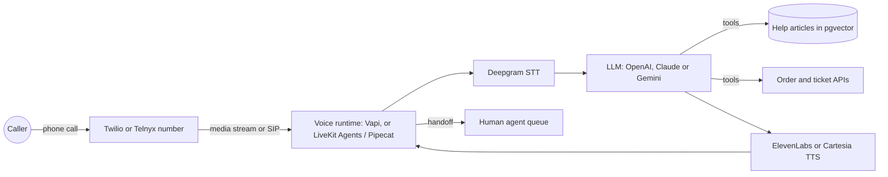
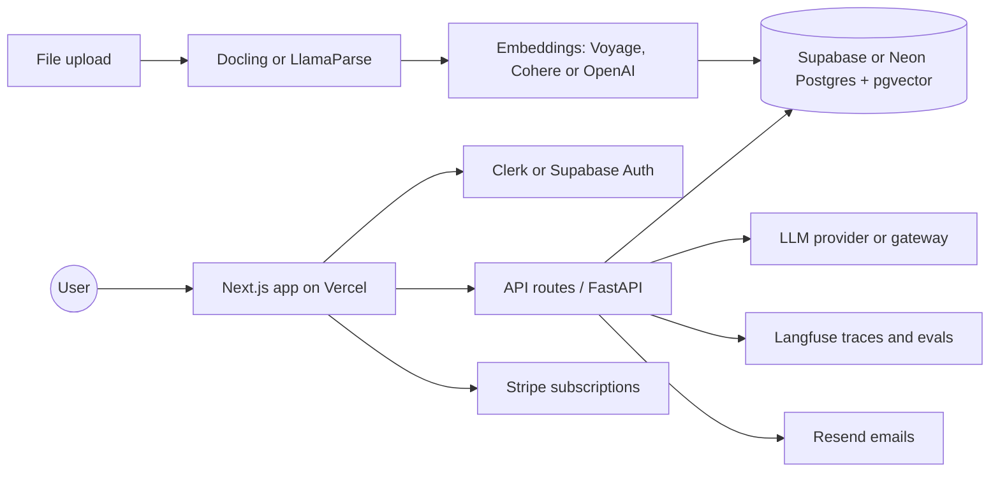
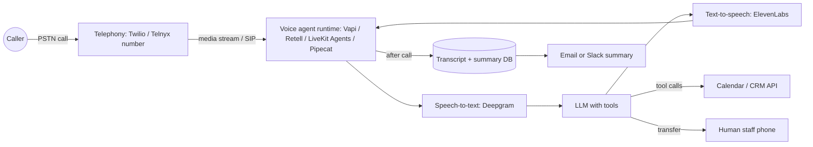
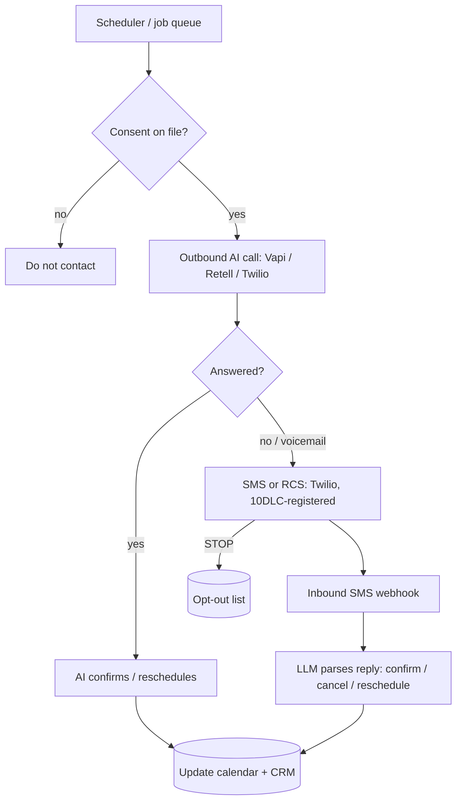
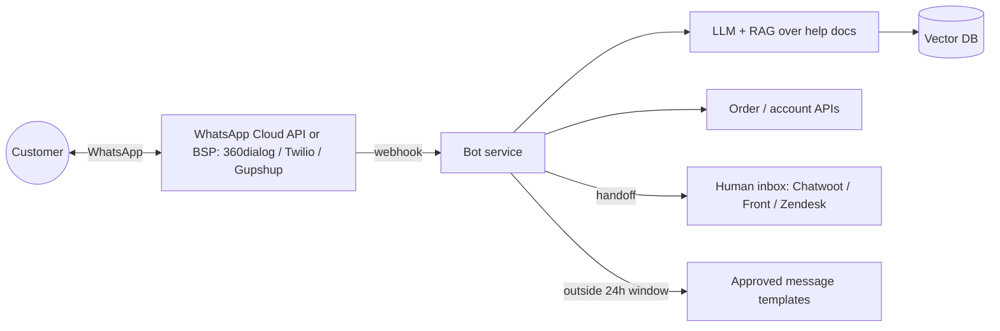
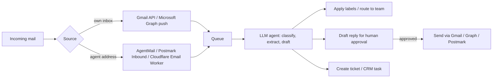
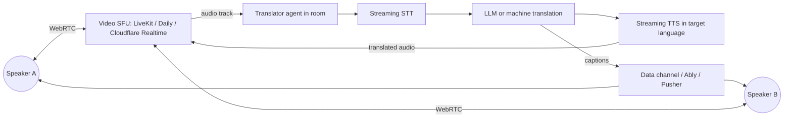
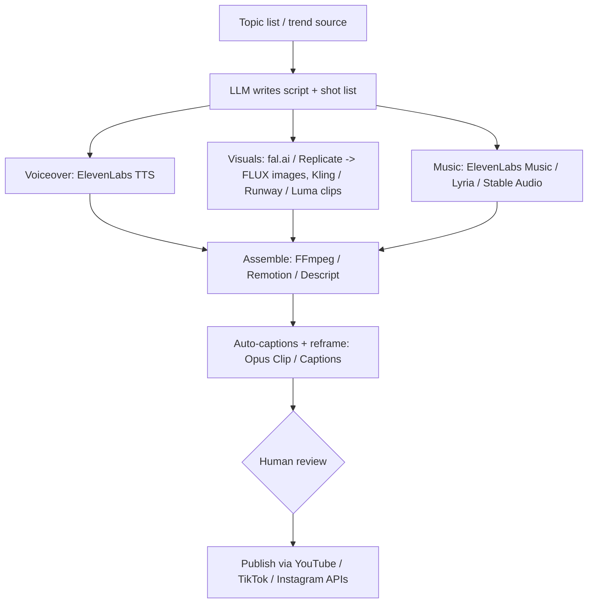

# AI Platforms and Tools Beyond the Big Clouds, Explained Simply

**Last checked: 13 November 2026.** Every "Site" and "Docs" link below was opened on that date to confirm it still loads. Status changes (acquisitions, shutdowns, renames) were confirmed from the company's own website, docs or official announcement. See [Sources](#sources) at the end.

> **Who is this for:** Beginners who keep hearing names like Twilio, Vapi, ElevenLabs, Deepgram, Pinecone or Langfuse and want to know what each one does.
>
> **What you get:** A short entry for each product: what it is, when you would use it, a few alternatives, and two links (the product site and the developer documentation). Each category starts with an "In plain words" paragraph and a "How to choose" table.
>
> **How to read it:** You do not need to read it top to bottom. Read the "In plain words" part and the table for the area you care about, then look up single names when you need them. Section 28 shows how the pieces fit together in real products.
>
> **Related guides in this folder:** [Cloud computing for AI](18_Cloud.md) and [Every Google Cloud service explained simply](gcp_services_explained_simply.md). The big clouds (AWS, Azure, Google Cloud) also offer many of the same things; this guide points to them only briefly.

**How every entry is written:**

- **Name**: what it is, in one or two lines. **When and why:** typical good fits. **Alternatives:** similar products. Some entries also have **Status:** or **Providers:**.
- `Site:` the official product page. `Docs:` the official developer documentation. "Docs: not public" means the company does not publish developer docs.
- Labels in bold capitals show status changes: **ACQUIRED**, **SHUT DOWN**, **SUNSETTING**, **RENAMED**, **MAINTENANCE MODE**, **STATUS UNCLEAR**.

**Important notes before you start:**

- This area changes every month. Companies get bought, rename products or close. Always check the official site before you build on something.
- Prices are not listed on purpose, because they change often. "Free tier" is mentioned only where the official pricing page showed one on the check date. Many other products also have free trials.
- Most products here are paid cloud services. Some are open source, which means you can download the code and run it yourself for free (you still pay for your own servers).
- Nothing here is a paid recommendation. The alternatives are listed in no special order.

---

## Contents

0. [Status changes at a glance](#0-status-changes-at-a-glance)
1. [Calling and telephony](#1-calling-and-telephony)
2. [Messaging and chat channels](#2-messaging-and-chat-channels)
3. [Email](#3-email)
4. [Notifications and in-app real-time](#4-notifications-and-in-app-real-time)
5. [Video calling, live streaming and meeting bots](#5-video-calling-live-streaming-and-meeting-bots)
6. [Real-time voice AI and voice agents](#6-real-time-voice-ai-and-voice-agents)
7. [Text-to-speech, voice cloning, dubbing and audio clean-up](#7-text-to-speech-voice-cloning-dubbing-and-audio-clean-up)
8. [Speech-to-text and audio understanding](#8-speech-to-text-and-audio-understanding)
9. [LLM model providers](#9-llm-model-providers)
10. [Inference platforms and self-hosted model serving](#10-inference-platforms-and-self-hosted-model-serving)
11. [LLM gateways and routers](#11-llm-gateways-and-routers)
12. [GPU clouds](#12-gpu-clouds)
13. [Image, video, avatar, music and 3D generation](#13-image-video-avatar-music-and-3d-generation)
14. [Vector databases and search engines](#14-vector-databases-and-search-engines)
15. [Embeddings and rerankers](#15-embeddings-and-rerankers)
16. [Document parsing, web scraping and data ingestion](#16-document-parsing-web-scraping-and-data-ingestion)
17. [Web search APIs for agents](#17-web-search-apis-for-agents)
18. [Agent frameworks and no-code builders](#18-agent-frameworks-and-no-code-builders)
19. [Agent infrastructure](#19-agent-infrastructure)
20. [Observability, evals and prompt management](#20-observability-evals-and-prompt-management)
21. [Guardrails and AI security](#21-guardrails-and-ai-security)
22. [Fine-tuning and training platforms](#22-fine-tuning-and-training-platforms)
23. [Data labeling and human feedback](#23-data-labeling-and-human-feedback)
24. [App building blocks for AI SaaS](#24-app-building-blocks-for-ai-saas)
25. [Coding agents and AI developer tools](#25-coding-agents-and-ai-developer-tools)
26. [Robotics, sensors and edge AI](#26-robotics-sensors-and-edge-ai)
27. [Compliance notes for voice, messaging and media](#27-compliance-notes-for-voice-messaging-and-media)
28. [Typical AI product stacks](#28-typical-ai-product-stacks)
29. [Where to go next in this course](#29-where-to-go-next-in-this-course)
30. [Sources](#sources)

---

## 0. Status changes at a glance

These are the changes most likely to confuse you when you read older tutorials. Details are in each entry.

**Shut down, sunsetting or unclear:**

| Product | What happened | What to do |
|---|---|---|
| PlayHT / PlayAI | Team joined Meta (July 2025). API turned off in 2025, platform **SHUT DOWN** at the end of 2025. | Use ElevenLabs, Cartesia, Rime, Inworld or another TTS. |
| Humanloop | Team joined Anthropic (August 2025). Platform **SHUT DOWN** on 8 September 2025. | Use Langfuse, LangSmith, Braintrust or similar. |
| Flowise | **SUNSETTING**: code freeze July 2026, GitHub repo archived August 2026, end of life 31 August 2026. Code stays open source. | Use Langflow, Dify, n8n or a code framework. |
| OpenAI Sora API | Sora 2 models and the Videos API **SHUT DOWN** on 24 September 2026. | Use Google, Runway, Luma, Kling or similar. |
| Google Imagen and Veo previews (Gemini API) | Imagen is listed as **SHUT DOWN** in the Gemini API; the Veo 3.1 preview models there were shut down in October 2026. | Use the Nano Banana image models and the current Gemini video model, or Veo on Google Cloud. |
| Chroma Cloud | Chroma is joining Replit (October 2026). Open-source Chroma continues; **Chroma Cloud is winding down**. | Self-host Chroma, or use another managed vector database. |
| Smithery (hosted parts) | Now part of Arcade. Its MCP proxy, API, CLI and SDKs **SHUT DOWN** on 31 October 2026. The registry stays. | Connect to each MCP server's own URL, or use Arcade. |
| Hume EVI | Google DeepMind licensed Hume's technology and hired its CEO (January 2026). Hume's site and docs no longer list EVI. | Use OpenAI Realtime, Gemini Live or a voice platform. |
| Udio | After deals with Universal and Warner, song downloads are turned off while it builds a licensed platform. | Use a music API with clear export rights. |
| Bing Search APIs | **SHUT DOWN** on 11 August 2025. | Use Brave, Tavily, Exa, Serper or Grounding with Bing in Azure. |
| Google Business Messages | **SHUT DOWN** (July 2024); its old address now points to RCS Business Messaging. | Use RCS Business Messaging or WhatsApp. |
| Dolby.io | Site now redirects to Dolby OptiView (streaming); old communications and media APIs are gone. | Use LiveKit, Daily or Agora for calls; Auphonic for audio clean-up. |
| Coqui | Company closed; its site returns "not found". The XTTS code lives on in a community fork. | Use Piper, Kokoro or a hosted TTS. |
| Luma Genie (3D) | The Genie page now redirects to Luma's home page. | Use Meshy or Tripo for 3D. |
| Lamini | CEO and staff moved to AMD (2025); site did not load on the check date. **STATUS UNCLEAR**. | Use another fine-tuning platform. |
| Air.ai | Its domain now shows a different enterprise product. **STATUS UNCLEAR**. | Use Vapi, Retell, Bland or Synthflow. |
| LOVO / Genny | Site returned "deployment disabled" errors on the check date. Appears offline. | Use Murf, ElevenLabs or WellSaid. |
| Vocode | Open-source code still on GitHub but development has slowed. | Use Pipecat or LiveKit Agents. |
| Mistral OCR (first model) | Marked deprecated and replaced by newer Mistral OCR models. | Use the current OCR model name from Mistral's docs. |

**Renamed:**

| Product | New name or home |
|---|---|
| Windsurf | **Devin Desktop**, made by Cognition (windsurf.com redirects there). |
| MessageBird | **Bird** (messagebird.com redirects to bird.com). |
| ElevenLabs Conversational AI | **ElevenLabs Agents** (ElevenAgents). |
| Amazon Nova Sonic | **Amazon Nova 2 Sonic**. |
| Galileo | Now **Splunk Agent Observability** (galileo.ai redirects there). |
| Dyte | **Cloudflare RealtimeKit**, part of Cloudflare Realtime. |
| Vertex AI (Google Cloud) | Docs now live under **Gemini Enterprise Agent Platform**. |
| Azure AI Foundry | **Microsoft Foundry**. |

**Acquired (product still offered, at least for now):**

| Product | New owner and date | Notes |
|---|---|---|
| OpenRouter | Stripe | Stripe's homepage says "OpenRouter is now part of Stripe". API still runs. |
| Daily and the Pipecat team | Deepgram (announced late 2026) | Pipecat stays open source, with an independent foundation planned. |
| Ultravox | Inworld | Site says "Ultravox has been acquired by Inworld". |
| Langfuse | ClickHouse (January 2026) | Still MIT open source; Langfuse Cloud still runs. |
| Helicone | Mintlify (March 2026), now listed as "part of Experiential Labs" | In maintenance mode. |
| Promptfoo | OpenAI (announced March 2026) | Stays open source. |
| Galileo | Cisco (closed May 2026) | Part of Splunk. |
| Guardrails AI | Harvey (September 2026) | Team moved to Harvey; open-source repo still on GitHub. |
| Jina AI | Elastic (October 2025) | Jina models and API still offered. |
| Voyage AI | MongoDB (2025) | API still offered. |
| Replicate | Cloudflare (announced November 2025) | Existing APIs keep working. |
| Tavily | Nebius | Now "Tavily by Nebius". |
| Groq | Non-exclusive licensing deal with NVIDIA (December 2025) | GroqCloud keeps running. Not an acquisition. |
| Weights & Biases | CoreWeave | Now part of CoreWeave Forge. |
| Neon | Databricks | "A complete backend from Databricks". |
| Predibase | Rubrik | Old site redirects to Rubrik Agent Cloud. |
| Protect AI | Palo Alto Networks | Now part of Prisma AIRS. |
| Lakera | Check Point | Still offered under Check Point. |
| Prompt Security | SentinelOne | "Prompt Security from SentinelOne". |
| Pillar Security | Vanta (announced) | Site banner: "Vanta to acquire Pillar Security". |
| Cognigy | NICE | Now "NiCE Cognigy". |
| Paperspace | DigitalOcean | GPU products move under DigitalOcean. |
| Edge Impulse | Qualcomm | Still offered. |
| Argilla | Hugging Face (2024) | Still open source. |
| Lemon Squeezy | Stripe (2024) | Being linked with Stripe Managed Payments. |
| Dialpad | "Dialpad and Ada are joining forces" | Check the announcement for details. |

---

## 1. Calling and telephony

**In plain words:** These services connect your software to the normal phone network. You rent a phone number from them, and when someone calls it they hand the call to your code. That can be a webhook that says what to do, a SIP connection, or a live audio stream. "CPaaS" (Communications Platform as a Service) means a developer API for calls and SMS. "CCaaS" (Contact Center as a Service) means a full call-center product with queues, human agents and dashboards.

**Words you will see:**

- **PSTN:** the normal worldwide phone network.
- **SIP:** the standard internet protocol for starting and ending voice calls. A **SIP trunk** is a "virtual phone line" between your system and a carrier.
- **IVR:** an automated phone menu ("press 1 for sales"). AI voice agents are replacing many of these.
- **Media stream:** live call audio sent to your server, usually over a WebSocket, so an AI can listen and talk.
- **CPaaS / CCaaS:** a developer API for calls and SMS / a full cloud call-center product.

**How to choose:**

| Your situation | Good first pick |
|---|---|
| Learning, prototyping, most tutorials | Twilio Voice + Media Streams |
| AI calling at volume, want low latency SIP | Telnyx, Plivo, SignalWire |
| You run LiveKit/Jambonz and only need numbers | Twilio/Telnyx SIP trunk, Bandwidth (US) |
| India numbers and local compliance | Exotel, Plivo |
| WhatsApp + SMS + voice across regions | Infobip, Sinch, Vonage |
| Full call center with human handoff | Amazon Connect, Twilio Flex, Genesys, Five9 |
| Already on AWS / Azure | Amazon Connect or Chime SDK / Azure Communication Services |
| Plug into an existing office phone system | RingCentral, Dialpad, Aircall APIs |

**How a phone call reaches your AI agent:**

```
Caller's phone
   -> phone number (rented from Twilio / Telnyx / Plivo / ...)
   -> carrier network (PSTN) -> your provider
   -> provider hands the call to you in one of two ways:
        a) SIP trunk -> your SIP server or a voice platform (LiveKit, Jambonz, Vapi ...)
        b) Media stream over WebSocket (for example Twilio Media Streams): raw audio frames to your server
   -> VAD (detects when the caller has stopped talking)
   -> STT (speech to text)  -> LLM (decides what to say, may call tools)
   -> TTS (text to speech)  -> audio goes back up the same WebSocket or SIP leg
   -> caller hears the reply
```

Speech-to-speech models (OpenAI Realtime, Gemini Live, Nova 2 Sonic) merge the STT, LLM and TTS steps into one model. Platforms like Vapi or Retell run the whole middle part for you.

The full guide to building voice agents is in [section 6](#6-real-time-voice-ai-and-voice-agents), and compliance rules are in [section 27](#27-compliance-notes-for-voice-messaging-and-media).

**Entries:**

- **Twilio Voice**: The best-known API for phone numbers, making and receiving calls, and call control using TwiML or webhooks. **When and why:** The default starting point. It has the largest set of docs and tutorials. Use Media Streams or ConversationRelay to send call audio to an AI agent. **Alternatives:** Telnyx, Plivo, Vonage, SignalWire.
  Site: https://www.twilio.com | Docs: https://www.twilio.com/docs/voice

- **Twilio Elastic SIP Trunking**: Connects your own SIP system (a PBX, LiveKit SIP, Jambonz) to the phone network through Twilio. **When and why:** Use it when you run your own voice stack and only need phone numbers plus PSTN access. **Alternatives:** Telnyx SIP, Bandwidth, Plivo Zentrunk.
  Site: https://www.twilio.com | Docs: https://www.twilio.com/docs/sip-trunking

- **Twilio Studio**: A drag-and-drop builder for call and messaging flows. **When and why:** Good for IVR menus and prototypes when you want little code. It can hand off to your AI webhook. **Alternatives:** Vonage AI Studio, Amazon Connect flows.
  Site: https://www.twilio.com | Docs: https://www.twilio.com/docs/studio

- **Twilio Flex**: Twilio's programmable contact-center app (agent desktop, queues, routing). **When and why:** Use it when an AI agent needs to hand calls over to human agents inside a call center you can customize. **Alternatives:** Amazon Connect, Genesys Cloud, Five9.
  Site: https://www.twilio.com | Docs: https://www.twilio.com/docs/flex

- **Vonage (Voice API)**: A CPaaS for voice, SMS and video, owned by Ericsson. Calls are controlled with NCCO JSON and WebSocket audio streaming. **When and why:** A strong Twilio alternative with global coverage. It is easy to stream call audio to a WebSocket. **Alternatives:** Twilio, Sinch, Infobip.
  Site: https://www.vonage.com | Docs: https://developer.vonage.com/en/voice/voice-api/overview

- **Telnyx**: A CPaaS that runs its own private IP network. It offers voice, SIP, numbers, SMS and built-in AI voice-assistant features. **When and why:** Popular for AI calling because of low latency, direct SIP and media streaming, and an AI layer you can use if you want it. **Alternatives:** Twilio, Plivo, Bandwidth.
  Site: https://telnyx.com | Docs: https://developers.telnyx.com/

- **Plivo**: A voice and SMS API that is simpler and often cheaper than Twilio, with audio streaming support. **When and why:** Use it for high-volume calling, or when you want a simpler Twilio-like API. **Alternatives:** Twilio, Telnyx, Exotel (for India).
  Site: https://www.plivo.com | Docs: https://www.plivo.com/docs/

- **Sinch**: A large global CPaaS (voice, SMS, verification, RCS, email) with many direct carrier connections. **When and why:** Use it for enterprise-scale messaging and voice across many countries. **Alternatives:** Infobip, Vonage, Twilio.
  Site: https://sinch.com | Docs: https://developers.sinch.com/

- **Bandwidth**: A US-based carrier with its own network that also gives you voice, messaging and 911 APIs. **When and why:** Use it when you want carrier-grade US numbers and emergency calling directly from the carrier. **Alternatives:** Telnyx, Twilio.
  Site: https://www.bandwidth.com | Docs: https://dev.bandwidth.com/

- **SignalWire**: A CPaaS built by the creators of FreeSWITCH. It includes an AI agent layer (SWML and AI Agent). **When and why:** Use it for low-level telephony control combined with built-in AI agent features. **Alternatives:** Telnyx, Twilio, Jambonz (self-hosted).
  Site: https://signalwire.com | Docs: https://signalwire.com/docs

- **Infobip**: A global omnichannel platform (SMS, WhatsApp, voice, chat apps) with conversational AI tools. **When and why:** Use it when your users are on WhatsApp and SMS across Europe, Africa and Asia, not only on phone calls. **Alternatives:** Sinch, Twilio, Vonage.
  Site: https://www.infobip.com | Docs: https://www.infobip.com/docs

- **Exotel**: A cloud telephony and contact-center platform focused on India, Southeast Asia and the Middle East. **When and why:** Use it for Indian virtual numbers and calling that follows local rules, which global providers may not offer easily. **Alternatives:** Plivo, Knowlarity, Twilio.
  Site: https://exotel.com | Docs: https://developer.exotel.com/

- **Amazon Connect**: AWS's pay-as-you-go cloud contact center, with flows, Lex bots and AI agent assist. **When and why:** The natural choice if you already build on AWS and want a full call center with AI features. **Alternatives:** Twilio Flex, Genesys Cloud, Azure Communication Services.
  Site: https://aws.amazon.com/connect/ | Docs: https://docs.aws.amazon.com/connect/

- **Amazon Chime SDK (PSTN audio, Voice Connector)**: AWS building blocks for meetings, SIP trunking (Voice Connector) and programmable phone calls (PSTN Audio). **Status:** AWS announced the end of the Amazon Chime meetings app (end of support February 2026). The Chime SDK developer service is separate and still offered. **When and why:** Use it to add phone calls or SIP to an AWS app without a full contact center. **Alternatives:** Amazon Connect, Twilio.
  Site: https://aws.amazon.com/chime/chime-sdk/ | Docs: https://docs.aws.amazon.com/chime-sdk/latest/dg/what-is-chime-sdk.html

- **Azure Communication Services (calling)**: Microsoft's API for voice, video, SMS, phone numbers and Teams interop. The Call Automation API can stream audio to AI. **When and why:** The natural choice in Azure shops, and when you need to work with Microsoft Teams. **Alternatives:** Twilio, Amazon Chime SDK.
  Site: https://azure.microsoft.com/en-us/products/communication-services | Docs: https://learn.microsoft.com/en-us/azure/communication-services/

**Genesys Cloud** (brief)
- What it is: A large enterprise contact-center suite with APIs and AI features.
- When and why: You will usually connect your AI agent to it when a big company already runs Genesys, rather than choose it yourself.
- Alternatives: Five9, NICE CXone, Amazon Connect.
- Site: https://www.genesys.com | Docs: https://developer.genesys.cloud/

**Five9** (brief)
- What it is: An enterprise cloud contact center with APIs and AI agents.
- When and why: Like Genesys, it is usually something you integrate with because it is already in place.
- Alternatives: Genesys Cloud, NICE CXone, Talkdesk.
- Site: https://www.five9.com | Docs: https://documentation.five9.com/

- **Aircall**: A cloud phone system for sales and support teams, with a REST API and webhooks. **When and why:** Use it to pull call data and recordings into your AI tools (summaries, CRM updates) for small and mid-size teams. **Alternatives:** Dialpad, RingCentral, JustCall.
  Site: https://aircall.io | Docs: https://developer.aircall.io/

- **RingCentral**: A business phone, video and messaging platform (UCaaS) with a large developer API. **When and why:** Use it to build on the company phone system people already use: call logs, recordings, SMS, and bots. **Alternatives:** Dialpad, Zoom Phone, Microsoft Teams Phone.
  Site: https://www.ringcentral.com | Docs: https://developers.ringcentral.com/

- **Dialpad (APIs)**: A business phone and contact-center system with built-in AI transcription. It has APIs and webhooks. **Status:** In November 2026 its homepage says "Dialpad and Ada are joining forces" (Ada is an AI customer-service company); check the announcement for product plans. **When and why:** Use it to get live transcripts and call events from a phone system that is already AI-first. **Alternatives:** Aircall, RingCentral.
  Site: https://www.dialpad.com | Docs: https://developers.dialpad.com/
- **Bird (formerly MessageBird)**: **RENAMED** omnichannel platform for SMS, WhatsApp, email and voice; messagebird.com now redirects to bird.com. **When and why:** Use it when you want low-cost messaging and email in one place. **Alternatives:** Infobip, Twilio.
  Site: https://bird.com | Docs: https://docs.bird.com
- **Knowlarity**: Indian cloud telephony (virtual numbers, IVR, call tracking). **When and why:** Use it when you need Indian business numbers with IVR. **Alternatives:** Exotel.
  Site: https://www.knowlarity.com | Docs: not public (API guides are shared with customers)
- **Vonage Contact Center**: cloud contact-center product from Vonage. **When and why:** Use it when a business wants a ready call center with AI add-ons. **Alternatives:** Five9, Genesys.
  Site: https://www.vonage.com/contact-center/ | Docs: not public
- **NICE CXone**: large enterprise contact-center platform; NICE also owns Cognigy. **When and why:** Use it when the customer already runs NICE. **Alternatives:** Genesys, Five9.
  Site: https://www.nice.com | Docs: https://developer.niceincontact.com
- **Asterisk / FreeSWITCH**: classic open-source phone-system software. **When and why:** Use it when you need full control of telephony and have experience with it. **Alternatives:** Jambonz, SignalWire.
  Site: https://www.asterisk.org | Docs: https://docs.asterisk.org (FreeSWITCH: https://developer.signalwire.com/freeswitch/)

---

## 2. Messaging and chat channels

**In plain words:** An AI agent is only useful if people can reach it. A "channel" is the place the conversation happens: a text message, a WhatsApp chat, a Slack workspace, a Telegram group. Each channel has its own rules, its own API, and often its own approval process. Most teams do not connect to the phone networks themselves. They use a provider (such as Twilio) that sells phone numbers and passes messages to and from their code through webhooks.

**How to choose:**

| Your situation | Good first pick | Why |
|---|---|---|
| Personal or hobby AI bot | Telegram Bot API | Free, no approval, quick to start |
| Customers outside the US who chat on WhatsApp | WhatsApp Cloud API (direct or a BSP) | That is where your users are |
| US customers, reminders, codes | SMS via Twilio, Vonage, Plivo or Telnyx (with 10DLC) | Reaches every phone |
| Rich branded texts on Android and iPhone | RCS Business Messaging with SMS fallback | Buttons, images and branding inside the default app |
| Internal company assistant | Slack (Bolt) or Teams (Teams SDK or Agents SDK) | Lives where employees already work |
| Community bot | Discord | Built for servers and communities |
| Japan or Thailand, China | LINE, WeChat | The local default apps |
| Ready-made AI support, no code | Intercom Fin, Zendesk AI | Bundled with a helpdesk |
| Open-source multi-channel inbox for your own bot | Chatwoot | Self-hostable, many channels |

**SMS and MMS:**

- **SMS / MMS (via a CPaaS provider)**: plain text messages (SMS) and picture messages (MMS) sent to any mobile number. **When and why:** Use it for one-time codes, reminders, and as a fallback when a user has no chat app. It reaches almost everyone, but it costs money per message and needs carrier registration (see [section 27](#27-compliance-notes-for-voice-messaging-and-media) on 10DLC). **Providers:** Twilio, Vonage, Plivo, Telnyx, Infobip, Bird (formerly MessageBird), Sinch.
  Site: https://www.twilio.com/messaging | Docs: https://www.twilio.com/docs/messaging
  Other docs: Vonage https://developer.vonage.com/en/messages/overview | Plivo https://www.plivo.com/docs | Telnyx https://developers.telnyx.com | Infobip https://www.infobip.com/docs | Bird https://bird.com/docs

**Chat apps:**

- **WhatsApp Business Platform (Cloud API)**: Meta's official API for businesses to send and receive WhatsApp messages. The Cloud API is hosted by Meta (the old self-hosted "On-Premises API" is retired). **When and why:** The default support and sales channel in much of Latin America, Europe, India, Africa and Southeast Asia. Users must opt in, and messages you start (outside a 24-hour reply window) must use pre-approved templates. **Alternatives:** Go direct to Meta, or use a Business Solution Provider (BSP) that adds onboarding, inbox and billing help.
  Site: https://whatsappbusiness.com/products/business-platform/ | Docs: https://developers.facebook.com/documentation/business-messaging/whatsapp/about-the-platform

- **WhatsApp providers (BSPs)**: companies approved by Meta to connect businesses to the WhatsApp API. **When and why:** Pick a BSP when you also need SMS, a shared inbox, or help with number verification. Pick Meta direct when you only need WhatsApp and want the lowest number of middlemen.
  - Twilio: one API for SMS, WhatsApp and voice. Docs: https://www.twilio.com/docs/whatsapp
  - 360dialog: thin, developer-focused WhatsApp access, popular with SaaS builders. Site: https://www.360dialog.com | Docs: https://docs.360dialog.com/docs
  - Gupshup: strong in India, with bot tooling. Site: https://www.gupshup.io | Docs: https://docs.gupshup.io
  - Meta direct: Cloud API with no BSP. Docs: link above.

- **RCS Business Messaging (RBM / "RCS for Business")**: the upgrade to SMS inside the phone's default messaging app. It adds branding, a verified sender, images, buttons and read receipts. It works on Android, and on iPhones from iOS 18 onward where the carrier supports it. **When and why:** Use it for rich messages to people who do not use WhatsApp, with automatic SMS fallback. Each agent needs brand verification and carrier approval. **Providers:** Google RBM directly, or Twilio, Sinch, Infobip, Vonage.
  Site: https://developers.google.com/business-communications/rcs-business-messaging | Docs: https://developers.google.com/business-communications/rcs-business-messaging

- **Messenger Platform and Instagram Messaging API (Meta)**: APIs for replying to Facebook Page messages and Instagram direct messages. **When and why:** For brands whose customers message them on Facebook or Instagram. The same 24-hour reply-window idea applies. **Alternatives:** WhatsApp for one-to-one support; a unified inbox (Front, Chatwoot) to handle all three.
  - Instagram docs: https://developers.facebook.com/documentation/instagram-platform
  Site: https://www.messenger.com | Docs: https://developers.facebook.com/documentation/business-messaging/messenger-platform

- **Telegram Bot API**: a free HTTP API for building Telegram bots. You get a token from @BotFather and receive updates by webhook or long polling. **When and why:** The easiest chat channel to start with: no approval, no message fees, and support for groups, buttons, files and mini apps. A good first channel for a personal AI assistant. **Alternatives:** Discord bots for communities; WhatsApp for customers.
  - (Note: the Telegram site did not answer automated checks from this network. It is a well-known live service. Verify it in a browser.)
  Site: https://telegram.org | Docs: https://core.telegram.org/bots/api

- **Discord bots**: bot accounts that join Discord servers and use slash commands, messages and voice channels. **When and why:** For community, gaming and developer-community assistants. Libraries: discord.py, discord.js. **Alternatives:** Telegram, Slack.
  Site: https://discord.com | Docs: https://docs.discord.com/developers/intro

- **Slack apps (Bolt framework)**: apps that live in a Slack workspace. Bolt is Slack's official framework (Python, JavaScript, Java). Slack's developer docs moved to docs.slack.dev. **When and why:** Internal AI assistants for teams, such as answering questions from company docs, running workflows, or posting alerts. Slack also offers an "AI app" surface for assistant-style apps. **Alternatives:** Microsoft Teams bots for Microsoft-based companies.
  Site: https://slack.com | Docs: https://docs.slack.dev/tools/bolt-python/

- **Microsoft Teams bots (Teams SDK, Microsoft 365 Agents SDK)**: bots and AI agents inside Microsoft Teams. The current options are the Teams SDK (formerly the "Teams AI Library"), for Teams-only apps, and the Microsoft 365 Agents SDK, for agents that run in Teams, Copilot and other channels. **Status:** The classic Bot Framework SDK is no longer the recommended path. The Azure Bot Service docs hub now points to the Agents SDK and Copilot Studio. Azure Bot Service itself still provides channel hosting. **When and why:** Internal assistants for companies that use Microsoft 365. **Alternatives:** Copilot Studio (low-code), Slack.
  - Agents SDK docs: https://learn.microsoft.com/en-us/microsoft-365/agents-sdk/ | Azure Bot Service: https://learn.microsoft.com/en-us/azure/bot-service/
  Site: https://learn.microsoft.com/en-us/microsoftteams/platform/ | Docs: https://microsoft.github.io/teams-sdk/

- **LINE Messaging API**: the bot API for LINE Official Accounts. **When and why:** Needed for consumers in Japan, Taiwan and Thailand, where LINE is the main chat app.
  Site: https://www.lycorp.co.jp/en/ | Docs: https://developers.line.biz/en/docs/messaging-api/

- **Viber REST Bot API**: chatbot API for Viber. **When and why:** Viber is popular in parts of Eastern Europe, the Balkans, the Middle East and the Philippines. Business messaging at scale usually goes through Viber partners (for example Infobip).
  Site: https://www.viber.com | Docs: https://developers.viber.com/docs/api/rest-bot-api/

- **WeChat (Official Accounts and Mini Programs)**: Tencent's platform for business accounts and mini apps inside WeChat. **When and why:** Needed for users in mainland China. Setup usually needs a Chinese business entity, and docs are mostly in Chinese.
  Site: https://www.wechat.com | Docs: https://developers.weixin.qq.com/doc/

- **Apple Messages for Business**: lets customers message a business from the iPhone Messages app, through Maps, Safari or Search. Businesses connect through an approved Messaging Service Provider (for example Zendesk, LivePerson, Salesforce). There is no direct public API for small developers. **When and why:** Premium support for iPhone-heavy markets. It requires Apple approval.
  Site: https://register.apple.com/resources/messages/messaging-documentation/ | Docs: https://register.apple.com/resources/messages/messaging-documentation/

- **Google Business Messages: SHUT DOWN**: chat from Google Search and Maps business listings. **Status:** Google shut it down in July 2024. The old docs URL now redirects to RCS Business Messaging, which Google names as the replacement. Do not build on it.
  - Docs (redirects): https://developers.google.com/business-communications/business-messages

**AI support inboxes:**

- **Intercom Fin**: an AI support agent that answers customer chats and emails using your help center. It works inside Intercom and can also plug into other helpdesks. **When and why:** You want a ready-made AI agent for customer support without building your own RAG bot. **Alternatives:** Zendesk AI, Decagon, Sierra, Ada.
  Site: https://fin.ai | Docs: https://developers.intercom.com

- **Zendesk AI (AI agents)**: AI agents and agent-assist features built into the Zendesk helpdesk. **When and why:** Your support team already uses Zendesk and you want automation without leaving it. **Alternatives:** Intercom Fin, Freshdesk Freddy AI.
  Site: https://www.zendesk.com/service/ai/ | Docs: https://developer.zendesk.com/documentation/

- **Front**: a shared inbox for email, SMS, WhatsApp and chat, with AI drafting, tagging and routing. **When and why:** Teams that work mostly in email and want a custom AI agent to sit inside a shared inbox through its API. **Alternatives:** Help Scout, Missive.
  Site: https://front.com | Docs: https://dev.frontapp.com/docs/welcome

- **Chatwoot**: an open-source omnichannel support inbox (website chat, email, WhatsApp, Telegram, and more) with an AI assistant ("Captain"). You can self-host it. **When and why:** You want one inbox for many channels, data on your own servers, and an easy place to plug in your own bot via webhooks. **Alternatives:** Intercom, Zendesk, Front.
  Site: https://www.chatwoot.com | Docs: https://developers.chatwoot.com/introduction

---

## 3. Email

**In plain words:** Email for apps comes in three kinds. Transactional email is the one-to-one message your app triggers, such as a password reset or a receipt. Marketing or lifecycle email is a campaign or automated journey sent to many people. Inbound email is mail that arrives at an address you control and gets turned into data your code (or an AI agent) can read. Providers often do more than one, but they are tuned for one. Whatever you pick, getting into the inbox instead of spam depends on proving you own your domain (see the deliverability note).

**How to choose:**

| Need | Good pick | Why |
|---|---|---|
| Cheapest large volume on AWS | Amazon SES | Low cost, you manage the details |
| Critical receipts and resets | Postmark | Fast, transactional-first |
| Quick start in JavaScript or TypeScript | Resend | Clean API, React Email |
| Already on Twilio | SendGrid | One vendor |
| Startup with transactional and product emails | Loops | One simple tool |
| Open source or self-hosted | Plunk | Runs on your own servers |
| E-commerce marketing | Klaviyo | Shopify data built in |
| Event-driven SaaS journeys | Customer.io | Triggers from product events |
| Enterprise multi-channel | Braze, Iterable | Scale and many channels |
| An agent with its own inbox | AgentMail, Postmark Inbound, Cloudflare Email Workers | Email arrives as JSON or an event |
| Agent working in a user's existing mailbox | Gmail API, Microsoft Graph | OAuth access to real mailboxes |

**Transactional email:**

- **Amazon SES (Simple Email Service)**: AWS's bulk and transactional email API and SMTP service. **When and why:** You are on AWS and want large volume at low cost. It is more do-it-yourself: you manage templates, bounces and reputation. **Alternatives:** SendGrid, Postmark, Resend.
  Site: https://aws.amazon.com/ses/ | Docs: https://docs.aws.amazon.com/ses/

- **SendGrid (Twilio SendGrid)**: a long-running email API with transactional and marketing features, owned by Twilio. **When and why:** You are already using Twilio, or you want one vendor for both transactional and marketing email. **Alternatives:** Mailgun, SES, Brevo.
  Site: https://sendgrid.com | Docs: https://www.twilio.com/docs/sendgrid

- **Mailgun (Sinch)**: a developer email API with strong inbound routing and validation. **When and why:** You need sending plus inbound parsing and email validation in one place. **Alternatives:** SendGrid, Postmark.
  Site: https://www.mailgun.com | Docs: https://documentation.mailgun.com

- **Postmark (ActiveCampaign)**: a transactional-first email service known for fast, reliable delivery. It keeps transactional and bulk traffic on separate "streams". **When and why:** Password resets and receipts must arrive in seconds. **Alternatives:** Resend, SES.
  Site: https://postmarkapp.com | Docs: https://postmarkapp.com/developer

- **Resend**: a modern email API built for developers, with React Email templates. **When and why:** Quick setup in JavaScript or TypeScript and Next.js projects, with clean docs. **Alternatives:** Postmark, Loops, Plunk.
  Site: https://resend.com | Docs: https://resend.com/docs/introduction

- **SparkPost (now part of Bird)**: a high-volume email API. MessageBird bought it in 2021, and MessageBird renamed itself Bird. The SparkPost API still runs. **When and why:** Very high-volume senders, and existing SparkPost users. **Alternatives:** SES, SendGrid.
  Site: https://www.sparkpost.com | Docs: https://developers.sparkpost.com/api/

- **Mailchimp Transactional (formerly Mandrill)**: Mailchimp's transactional email API, an add-on to paid Mailchimp plans. **When and why:** Your marketing team already uses Mailchimp and you want one vendor. **Alternatives:** Postmark, SendGrid.
  Site: https://mandrillapp.com | Docs: https://mailchimp.com/developer/transactional/

- **Brevo (formerly Sendinblue)**: an all-in-one platform for email, SMS, WhatsApp and a CRM, with a transactional API. **When and why:** Small teams that want marketing and transactional email together, with a European data focus. **Alternatives:** MailerSend, SendGrid.
  Site: https://www.brevo.com | Docs: https://developers.brevo.com/docs/getting-started

- **MailerSend**: a transactional email (and SMS) API from the makers of MailerLite. **When and why:** A simple, budget-friendly transactional API with a template builder. **Alternatives:** Brevo, Resend.
  Site: https://www.mailersend.com | Docs: https://developers.mailersend.com

- **Loops**: email for SaaS companies that combines transactional sends with simple lifecycle and marketing emails. **When and why:** Startups that want one tool for "welcome", "reset password" and "product update" emails. **Alternatives:** Resend, Customer.io.
  Site: https://loops.so | Docs: https://loops.so/docs

- **Plunk**: an open-source email platform (transactional, automations, broadcasts) that you can self-host. **When and why:** You want open source or self-hosting on top of SES. **Alternatives:** Loops, Resend.
  Site: https://www.useplunk.com | Docs: https://docs.useplunk.com

**Marketing and lifecycle email:**

- **Mailchimp (Intuit)**: the best-known email marketing tool for newsletters, campaigns and simple automations. **When and why:** Small businesses and newsletters. **Alternatives:** Brevo, Kit, Klaviyo.
  Site: https://mailchimp.com | Docs: https://mailchimp.com/developer/

- **Customer.io**: behavior-driven messaging (email, push, SMS, in-app) triggered by events from your product. **When and why:** SaaS onboarding and re-engagement journeys based on what users do. **Alternatives:** Braze, Iterable, Loops.
  Site: https://customer.io | Docs: https://docs.customer.io

- **Klaviyo**: email and SMS marketing built around e-commerce data, with deep Shopify integration. **When and why:** Online stores. **Alternatives:** Mailchimp, Omnisend.
  Site: https://www.klaviyo.com | Docs: https://developers.klaviyo.com/en

- **Braze**: an enterprise customer-engagement platform covering email, push, SMS, in-app and WhatsApp. **When and why:** Large consumer apps with many channels and big marketing teams. **Alternatives:** Iterable, Customer.io.
  Site: https://www.braze.com | Docs: https://www.braze.com/docs

- **Iterable**: an enterprise cross-channel marketing platform. **When and why:** Similar to Braze, for large brands running journeys across many channels. **Alternatives:** Braze, Customer.io.
  Site: https://iterable.com | Docs: https://api.iterable.com/api/docs

**Inbound email for AI agents:**

These let an agent "have an inbox": mail arrives, gets parsed into JSON, and your code or agent acts on it.

- **Amazon SES email receiving**: SES receipt rules that store incoming mail in S3, or trigger Lambda or SNS. **When and why:** You are on AWS and want serverless inbound processing.
  Site: https://aws.amazon.com/ses/ | Docs: https://docs.aws.amazon.com/ses/latest/dg/receiving-email.html

- **Postmark Inbound**: Postmark parses incoming mail and POSTs clean JSON (body, attachments, headers) to your webhook. **When and why:** The simplest "email to webhook" setup.
  Site: https://postmarkapp.com | Docs: https://postmarkapp.com/developer/user-guide/inbound

- **Mailgun Routes (Receive, Forward, Store)**: rules that match incoming mail and forward it to a URL, store it, or forward it to another address. **When and why:** You need filtering rules before mail reaches your code.
  Site: https://www.mailgun.com | Docs: https://documentation.mailgun.com/docs/mailgun/user-manual/receive-forward-store/view-stored-messages

- **Cloudflare Email Routing with Email Workers**: run a Cloudflare Worker on each incoming email to read it, reject it, forward it, or call an AI model. The docs have moved under Cloudflare's "Email Service" section. **When and why:** Your domain is on Cloudflare and you want inbound handling at the edge with no servers.
  Site: https://www.cloudflare.com/developer-platform/products/email-routing/ | Docs: https://developers.cloudflare.com/email-service/api/route-emails/email-handler/

- **AgentMail**: an email API built for AI agents. You create inboxes through the API, then send, receive and reply in threads with webhooks. **When and why:** Each agent needs its own real inbox, without setting up Gmail accounts. **Alternatives:** Postmark Inbound, SES receiving.
  Site: https://www.agentmail.to | Docs: https://docs.agentmail.to/welcome

- **Gmail API (Google Workspace)**: read, label, draft and send mail in a user's Gmail with OAuth permission. It can push changes through Pub/Sub watch. **When and why:** An AI assistant that triages your own or a user's Gmail. Sensitive or restricted scopes need Google verification and may need a security assessment.
  Site: https://workspace.google.com/products/gmail/ | Docs: https://developers.google.com/workspace/gmail/api/guides

- **Microsoft Graph mail API**: access to Outlook and Exchange Online mailboxes through Microsoft Graph, with change notifications (webhooks). **When and why:** The same as the Gmail API, for Microsoft 365 users and companies.
  Site: https://www.microsoft.com/microsoft-365/outlook | Docs: https://learn.microsoft.com/en-us/graph/api/resources/mail-api-overview?view=graph-rest-1.0

**Deliverability note (SPF, DKIM, DMARC, BIMI):**

- **SPF**: a DNS record that lists which servers may send mail for your domain.
- **DKIM**: a digital signature on each message, checked against a public key in your DNS.
- **DMARC**: a DNS policy that tells inboxes what to do when SPF or DKIM fail (none, quarantine or reject), and where to send reports. Its SPF or DKIM domain must "align" with the visible From address.
- **BIMI**: shows your logo in the inbox. It needs DMARC at enforcement, and usually a verified mark certificate (VMC or CMC).
- Since 2024, Gmail and Yahoo require bulk senders to have SPF, DKIM and DMARC, offer one-click unsubscribe, and keep spam complaints low. Use a separate subdomain for marketing mail (for example `news.example.com`) so it does not hurt your transactional reputation.
Links: DMARC https://dmarc.org | BIMI https://bimigroup.org | Gmail sender guidelines https://support.google.com/a/answer/81126 | Yahoo https://senders.yahooinc.com/best-practices/

---

## 4. Notifications and in-app real-time

**In plain words:** There are three related jobs. Push notifications wake up a phone or browser when your app is closed. Notification infrastructure decides who gets told what, on which channel (push, email, SMS, in-app inbox, Slack), and respects user preferences. Real-time pub/sub keeps an open connection so that screens update instantly, for example streaming an AI agent's progress, a live chat, or cursors in a shared doc. Chat SDKs are ready-made chat features (threads, typing indicators, moderation) that you drop into your own app.

**How to choose:**

| Need | Good pick | Why |
|---|---|---|
| Push to Android, iOS and web, free | FCM (plus APNs for iOS) | The standard path |
| React Native with Expo | Expo Push | One API |
| Marketers send pushes themselves | OneSignal | Dashboard and segments |
| One "notify user" API across many channels | Novu (open source), Knock, Courier, SuprSend | Workflows and user preferences |
| Just an in-app bell and inbox | MagicBell, or Novu's or Knock's inbox component | Fast to add |
| Stream AI agent output or live updates (hosted) | Ably, Pusher Channels, AppSync Events | No servers to run |
| Self-hosted live updates | Socket.IO | Free, full control |
| Live Postgres changes | Supabase Realtime | Built into Supabase |
| Multiplayer editing and comments | Liveblocks | Collaboration primitives |
| Full in-app chat product | Stream, Sendbird, CometChat, TalkJS | UI, moderation and storage included |

**Mobile and web push:**

- **Firebase Cloud Messaging (FCM)**: Google's free push service for Android, iOS (it relays through APNs) and web. **When and why:** The default for Android, and a common single API for every platform.
  Site: https://firebase.google.com/products/cloud-messaging | Docs: https://firebase.google.com/docs/cloud-messaging

- **Apple Push Notification service (APNs)**: Apple's push service for iOS, iPadOS, macOS, watchOS and Safari web push. Every iPhone push ends up going through APNs. **When and why:** Native iOS apps. You can call it directly or through FCM or OneSignal.
  Site: https://developer.apple.com/notifications/ | Docs: https://developer.apple.com/documentation/usernotifications

- **OneSignal**: a hosted push, in-app, email and SMS service with segmentation and a dashboard. **When and why:** Marketing teams want to send pushes without engineers. **Alternatives:** Braze, Pusher Beams.
  Site: https://onesignal.com | Docs: https://documentation.onesignal.com/docs/en/home

- **Expo Push Notifications**: one push API for React Native apps built with Expo. It wraps FCM and APNs. **When and why:** You build with Expo or React Native.
  Site: https://expo.dev | Docs: https://docs.expo.dev/push-notifications/overview/

- **Pusher Beams**: a push API for iOS, Android and web from Pusher. **When and why:** Simple developer-focused push, often alongside Pusher Channels.
  Site: https://pusher.com/beams | Docs: https://pusher.com/docs/beams/

- **Amazon SNS mobile push**: SNS sends to APNs, FCM and others from AWS. **When and why:** AWS-native backends that fan out events to devices.
  Site: https://aws.amazon.com/sns/ | Docs: https://docs.aws.amazon.com/sns/latest/dg/sns-mobile-application-as-subscriber.html

- **Azure Notification Hubs**: Azure's push fan-out service across APNs, FCM and Windows. **When and why:** Azure-based backends.
  Site: https://azure.microsoft.com/products/notification-hubs | Docs: https://learn.microsoft.com/en-us/azure/notification-hubs/

**Notification infrastructure:**

- **Novu**: open-source notification infrastructure: workflows, an in-app inbox component, user preferences, and many channel providers. **When and why:** You want one API for "notify user X" across channels, and you may want to self-host.
  Site: https://novu.co | Docs: https://docs.novu.co

- **Knock**: hosted notification infrastructure with workflows, batching, preferences and an in-app feed. **When and why:** Product teams that want a polished hosted service.
  Site: https://knock.app | Docs: https://docs.knock.app

- **Courier**: a hosted notification platform with a template designer, routing and an inbox. **When and why:** Non-engineers edit notification content, and routing has many rules.
  Site: https://www.courier.com | Docs: https://www.courier.com/docs/overview

- **SuprSend**: hosted notification infrastructure with workflows, preferences and an inbox. **When and why:** Similar to Knock or Courier.
  Site: https://www.suprsend.com | Docs: https://docs.suprsend.com/docs/what-is-suprsend

- **MagicBell**: an embeddable in-app notification inbox, plus push and other channels. **When and why:** You mainly need a notification bell and inbox in your web app quickly.
  Site: https://www.magicbell.com | Docs: https://www.magicbell.com/docs

**Real-time pub/sub:**

- **Pusher Channels**: hosted WebSocket channels (public, private and presence) with a simple API. **When and why:** You want to add live updates quickly without running WebSocket servers.
  Site: https://pusher.com/channels | Docs: https://pusher.com/docs/channels/

- **Ably**: hosted real-time messaging with guaranteed ordering, history and presence. It also offers chat and AI-response streaming products. **When and why:** You need strong reliability guarantees at scale.
  Site: https://ably.com | Docs: https://ably.com/docs

- **PubNub**: a hosted real-time network for pub/sub, presence and storage, with serverless functions. **When and why:** IoT and large real-time apps.
  Site: https://www.pubnub.com | Docs: https://www.pubnub.com/docs

- **Socket.IO**: an open-source library for real-time two-way events (WebSocket with fallbacks) that you host yourself. **When and why:** Free, full control, Node.js-friendly. You handle scaling (for example with a Redis adapter).
  Site: https://socket.io | Docs: https://socket.io/docs/v4/

- **Supabase Realtime**: listen to Postgres changes, broadcast messages and track presence through Supabase. **When and why:** Your app already uses Supabase and you want live database updates.
  Site: https://supabase.com/realtime | Docs: https://supabase.com/docs/guides/realtime

- **Liveblocks**: building blocks for collaboration (live cursors, comments, multiplayer documents, AI copilots in a document). **When and why:** Figma- or Notion-style multiplayer features.
  Site: https://liveblocks.io | Docs: https://liveblocks.io/docs

- **Azure Web PubSub**: managed WebSocket pub/sub on Azure. Azure SignalR Service is the related option for ASP.NET apps. **When and why:** Azure-based apps.
  Site: https://azure.microsoft.com/products/web-pubsub | Docs: https://learn.microsoft.com/en-us/azure/azure-web-pubsub/

- **AWS AppSync Events**: serverless WebSocket pub/sub channels on AWS, separate from AppSync GraphQL. **When and why:** AWS-native real-time features, such as streaming agent status to a browser.
  Site: https://aws.amazon.com/appsync/ | Docs: https://docs.aws.amazon.com/appsync/latest/eventapi/event-api-welcome.html

**Chat SDKs (drop-in chat features):**

- **Stream (GetStream)**: chat, activity feeds, and video and audio SDKs with ready-made UI kits and moderation. **When and why:** Adding in-app chat (including AI chatbot UIs) to a product.
  Site: https://getstream.io | Docs: https://getstream.io/chat/docs/

- **Sendbird**: chat, calls and AI chatbot SDKs for apps. **When and why:** Marketplaces, fintech and health apps that need in-app messaging.
  Site: https://sendbird.com | Docs: https://sendbird.com/docs

- **CometChat**: chat, voice and video SDKs with UI kits and moderation. **When and why:** Similar to Stream or Sendbird.
  Site: https://www.cometchat.com | Docs: https://www.cometchat.com/docs

- **TalkJS**: a prebuilt chat UI with an API, quick to embed. **When and why:** Buyer-seller or user-to-user chat in a few hours.
  Site: https://talkjs.com | Docs: https://talkjs.com/docs/

---

## 5. Video calling, live streaming and meeting bots

**In plain words:** Video calling APIs (WebRTC) let you build Zoom-like rooms inside your own app. They are also how AI agents join calls in real time. Live-streaming and video APIs work differently: they deliver video to many viewers with a few seconds of delay (HLS), or let you upload and play recorded video. Meeting-bot APIs send a bot into Zoom, Meet or Teams to record and transcribe, which is the basis for AI note-takers.

**How to choose:**

| Your situation | Good first pick |
|---|---|
| Video or voice app with AI agents in the room | LiveKit, Daily |
| Very large scale / Asia focus | Agora |
| Quick embed with little code | Whereby Embedded, 100ms, Cloudflare RealtimeKit |
| Telehealth/enterprise, migrating from Twilio Video | Vonage Video, Daily, Zoom Video SDK |
| Zoom quality in your own UI | Zoom Video SDK |
| Host and stream video to many viewers | Mux, Cloudflare Stream, Amazon IVS, api.video |
| Edge-native WebRTC | Cloudflare Realtime |
| Bot that joins Zoom/Meet/Teams | Recall.ai, Meeting BaaS |
| Pull notes from an existing note-taker | Fireflies API, Fathom API (Otter: enterprise only) |

**Entries:**

- **LiveKit**: An open-source WebRTC media server (SFU) and LiveKit Cloud, with SDKs for every platform. It also offers SIP and the Agents framework (see section 6). **When and why:** The top pick for AI-plus-video and voice apps. You can self-host or use the cloud. **Alternatives:** Daily, Agora, Cloudflare Realtime.
  Site: https://livekit.com | Docs: https://docs.livekit.io/

- **Daily**: A hosted WebRTC video and audio API. It is the company behind Pipecat. **Status:** **ACQUIRED.** In November 2026 Daily's site says "Daily is joining Deepgram", and the announcement plans an independent Pipecat foundation. Check the post before starting new long-term work: https://www.daily.co/blog/deepgram-is-acquiring-daily-and-establishing-an-independent-pipecat-foundation/ **When and why:** Use it for reliable embeddable video calls and Pipecat-based voice and video agents. **Alternatives:** LiveKit, 100ms.
  Site: https://www.daily.co | Docs: https://docs.daily.co/

- **Agora**: A large global real-time engagement platform (video, voice, interactive live streaming, conversational AI engine). **When and why:** Use it for large-scale apps, especially in Asia, and for social or live-interactive use cases. **Alternatives:** LiveKit, Tencent RTC, ZEGOCLOUD.
  Site: https://www.agora.io | Docs: https://docs.agora.io/en/

- **100ms**: Live video SDKs (conferencing, live streaming with HLS, recording) with prebuilt UI. **When and why:** Use it to ship video features quickly with ready-made UI, popular in India. **Alternatives:** Daily, Agora, Cloudflare RealtimeKit.
  Site: https://www.100ms.live | Docs: https://www.100ms.live/docs

- **Vonage Video API (formerly TokBox/OpenTok)**: A long-running WebRTC video API for embedded video sessions. **When and why:** Use it for telehealth and enterprise video, and the migration target for some Twilio Video users. **Alternatives:** Daily, LiveKit, Zoom Video SDK.
  Site: https://www.vonage.com | Docs: https://developer.vonage.com/en/video/overview

- **Twilio Video**: Twilio's WebRTC video rooms API. **Status:** Twilio announced end of life in 2023, then reversed the decision in 2024 and kept the product. It is still active, with docs and new features (checked November 2026), but many teams moved away during the EOL period. **Alternatives:** Vonage Video, Daily, LiveKit.
  Site: https://www.twilio.com | Docs: https://www.twilio.com/docs/video

- **Zoom Video SDK**: Zoom's video technology in your own app, with your own UI and no Zoom branding. **When and why:** Use it when you want Zoom's proven quality and scale inside a custom app. To build on Zoom meetings themselves, use the separate Meeting SDK. **Alternatives:** Daily, Agora.
  Site: https://developers.zoom.us | Docs: https://developers.zoom.us/docs/video-sdk/

- **Whereby Embedded**: Video rooms you embed with an iframe or a few lines of code. Rooms are browser-based with no download. **When and why:** The simplest way to add video calls, such as telehealth or tutoring, with little code. **Alternatives:** Daily Prebuilt, 100ms.
  Site: https://whereby.com/information/embedded | Docs: https://docs.whereby.com/

- **Dyte (now Cloudflare RealtimeKit)**: Was a video and voice SDK with prebuilt UI. **Status:** Acquired by Cloudflare in 2025. dyte.io now redirects to Cloudflare Realtime, and the SDK continues as Cloudflare RealtimeKit. The old Dyte docs are still online for existing users. **Alternatives:** Cloudflare RealtimeKit, 100ms, Daily.
  Site: https://dyte.io (redirects to Cloudflare) | Docs: https://developers.cloudflare.com/realtime/realtimekit/ (legacy: https://docs.dyte.io/)

- **Mux**: A video API for uploading, encoding, streaming (live and on-demand) and playback analytics. **When and why:** The developer favorite for adding video hosting and live streams to an app. **Alternatives:** Cloudflare Stream, api.video, Amazon IVS.
  Site: https://www.mux.com | Docs: https://www.mux.com/docs

- **Cloudflare Stream**: Video upload, encoding, storage and delivery (on-demand and live) on Cloudflare's network. **When and why:** Use it for simple, low-ops video hosting, especially if you already use Cloudflare. **Alternatives:** Mux, api.video.
  Site: https://www.cloudflare.com | Docs: https://developers.cloudflare.com/stream/

- **Cloudflare Realtime (Calls / SFU, RealtimeKit)**: Cloudflare's WebRTC platform. It includes the SFU (formerly "Calls"), TURN, and RealtimeKit (the former Dyte SDK). **When and why:** Use it for global, serverless-style WebRTC at the edge, with a low-level SFU or prebuilt UI. **Alternatives:** LiveKit, Daily.
  Site: https://www.cloudflare.com/products/realtime/ | Docs: https://developers.cloudflare.com/realtime/

- **Amazon IVS (Interactive Video Service)**: AWS's managed live streaming (low-latency HLS) and Real-Time Stages for multi-host video. **When and why:** Use it for Twitch-style live streaming on AWS. It uses the same technology as Twitch. **Alternatives:** Mux, Agora.
  Site: https://aws.amazon.com/ivs/ | Docs: https://docs.aws.amazon.com/ivs/

- **api.video**: A video hosting and live-streaming API with a player and analytics, based in France. **When and why:** Use it as a simple Mux alternative with EU hosting. **Alternatives:** Mux, Cloudflare Stream.
  Site: https://api.video | Docs: https://docs.api.video/

- **Livepeer**: An open, decentralized video transcoding network that also runs real-time AI video processing. **When and why:** Use it for low-cost transcoding or AI video pipelines on a decentralized GPU network. **Alternatives:** Mux, Cloudflare Stream.
  Site: https://livepeer.org | Docs: https://docs.livepeer.org/

- **Recall.ai**: One API that sends bots into Zoom, Google Meet, Microsoft Teams and others to record and transcribe, and to stream audio and video out in real time. **When and why:** The standard way to build an AI note-taker or meeting agent without writing a separate bot for each platform. **Alternatives:** Meeting BaaS, platform-native APIs (Zoom RTMS, Teams).
  Site: https://www.recall.ai | Docs: https://docs.recall.ai/

- **Meeting BaaS**: A meeting-bot API (Meet, Teams, Zoom) for recordings and transcripts, with some open-source parts. **When and why:** An alternative to Recall.ai, especially if you want open-source or self-hosted options. **Alternatives:** Recall.ai.
  Site: https://www.meetingbaas.com | Docs: https://docs.meetingbaas.com/

- **Fireflies.ai**: An AI meeting note-taker app with a GraphQL API for transcripts and summaries. **When and why:** Use it to pull meeting transcripts into your own tools when your team already uses Fireflies. **Alternatives:** Otter, Fathom.
  Site: https://fireflies.ai | Docs: https://docs.fireflies.ai/

- **Otter.ai**: An AI meeting note-taker and transcription app with an AI meeting agent. **When and why:** An end-user product for teams. API access is limited to business and enterprise plans, and there is no open public developer docs site (help.otter.ai blocks automated checks). **Alternatives:** Fireflies, Fathom.
  Site: https://otter.ai | Docs: https://help.otter.ai/ (help center; API details for enterprise)

- **Fathom**: An AI meeting recorder and note-taker (formerly at fathom.video, now fathom.ai) with a public API and webhooks. **When and why:** Use it to get meeting notes and recordings into a CRM or your own app. **Alternatives:** Fireflies, Otter.
  Site: https://www.fathom.ai | Docs: https://developers.fathom.ai/

---

## 6. Real-time voice AI and voice agents

**In plain words:** A voice agent is an LLM you can talk to out loud, on a phone call or in a browser. You can buy a hosted platform that handles everything (Vapi, Retell, Bland), use a speech-to-speech model API directly (OpenAI Realtime, Gemini Live), or build your own pipeline with an open-source framework (LiveKit Agents, Pipecat). What matters most is latency, meaning how fast it replies, and turn-taking, meaning knowing when the user has finished and handling interruptions.

**How to choose:**

| Your situation | Good first pick |
|---|---|
| Want a phone agent working today, developer-friendly | Vapi or Retell AI |
| Non-developers building agents | Synthflow |
| Big enterprise contact center, managed project | PolyAI, Parloa, NICE Cognigy |
| Best voice quality / brand voice | ElevenLabs Agents |
| Single model, lowest effort, natural speech | OpenAI Realtime, Gemini Live, Nova 2 Sonic (AWS) |
| Own the pipeline, swap vendors, self-host | LiveKit Agents or Pipecat |
| Self-hosted telephony gateway | Jambonz |
| Fully open-source models | Kyutai Moshi/Unmute, Ultravox weights, Pipecat + local models |

**Entries:**

- **Vapi**: A developer platform for building phone and web voice agents. You choose the STT, LLM and TTS, and Vapi runs the orchestration. **When and why:** The fastest way for developers to get a configurable AI phone agent with tools and webhooks. **Alternatives:** Retell AI, Bland AI, Synthflow.
  Site: https://vapi.ai | Docs: https://docs.vapi.ai/

- **Retell AI**: A hosted voice-agent platform focused on natural turn-taking for call-center use. **When and why:** Use it for production phone agents (appointment booking, support) where you want good interruption handling without much tuning. **Alternatives:** Vapi, Bland AI.
  Site: https://www.retellai.com | Docs: https://docs.retellai.com/

- **Bland AI**: An enterprise phone-agent platform with its own hosted models and "pathways" (conversation flows). **When and why:** Use it for high-volume outbound or inbound calls where you want one vendor to run the whole stack. **Alternatives:** Retell AI, Vapi.
  Site: https://www.bland.ai | Docs: https://docs.bland.ai/

- **Synthflow**: A no-code builder for voice agents, aimed at businesses and agencies. **When and why:** Use it when non-developers need to build and deploy phone agents. **Alternatives:** Vapi, Retell AI.
  Site: https://synthflow.ai | Docs: https://docs.synthflow.ai/

- **PolyAI**: Enterprise customer-service voice assistants, typically built together with the customer. **When and why:** Use it for large contact centers (hotels, banks, retail) that want a managed, branded voice assistant. **Alternatives:** Parloa, NICE Cognigy, Google Customer Engagement Suite.
  Site: https://poly.ai | Docs: https://docs.poly.ai/

- **Parloa**: A European enterprise platform for AI voice agents in contact centers. **When and why:** Use it for large EU call centers that need enterprise integrations and compliance. **Alternatives:** PolyAI, NICE Cognigy.
  Site: https://www.parloa.com | Docs: https://docs.parloa.com/

- **Cognigy (now NICE Cognigy)**: An enterprise conversational-AI platform for voice and chat agents. **Status:** Acquired by NICE in 2025. It is now branded "NiCE Cognigy" and is being built into NICE CXone, but it is still sold. **When and why:** Use it in enterprises already using NICE CXone, or for large low-code agent projects. **Alternatives:** PolyAI, Parloa, Kore.ai.
  Site: https://www.cognigy.com | Docs: https://docs.cognigy.com/

- **ElevenLabs Agents (ElevenAgents)**: ElevenLabs' platform for voice agents, with STT, LLM routing, turn-taking, its own TTS, and phone/SIP integration. **Status:** Formerly "Conversational AI", now branded ElevenAgents (the docs path changed to /eleven-agents/). **When and why:** Use it when voice quality and cloned brand voices matter most. **Alternatives:** Vapi, Retell AI, OpenAI Realtime.
  Site: https://elevenlabs.io | Docs: https://elevenlabs.io/docs/eleven-agents/overview

- **OpenAI Realtime API**: A speech-to-speech model API that connects over WebRTC, WebSocket or SIP. Audio goes in and audio comes out, with tool calls. **When and why:** The lowest-effort way to get natural, fast voice from a top model. You can use it on its own or inside LiveKit or Pipecat. **Alternatives:** Gemini Live API, Amazon Nova 2 Sonic, Ultravox.
  Site: https://openai.com | Docs: https://developers.openai.com/api/docs/guides/realtime

- **Gemini Live API**: Google's low-latency, two-way streaming API for voice (and video) conversations with Gemini. **When and why:** Use it for multimodal live agents (voice plus camera or screen) or if you are already on Google. **Alternatives:** OpenAI Realtime, Nova 2 Sonic.
  Site: https://ai.google.dev | Docs: https://ai.google.dev/gemini-api/docs/live

- **Amazon Nova 2 Sonic (formerly Nova Sonic)**: AWS Bedrock's speech-to-speech model with streaming, turn-taking and tool use. **Status:** The current docs describe "Amazon Nova 2 Sonic", which replaces the first Nova Sonic. **When and why:** Use it for voice agents that must stay inside AWS, for example with Amazon Connect. **Alternatives:** OpenAI Realtime, Gemini Live.
  Site: https://aws.amazon.com/nova/ | Docs: https://docs.aws.amazon.com/nova/latest/nova2-userguide/using-conversational-speech.html

- **Hume EVI (Empathic Voice Interface)**: Hume's emotion-aware speech-to-speech voice interface. **Status:** As of November 2026, Hume's website and docs no longer list EVI. Old EVI docs links now redirect to Hume's "Audio Decisions" API, and Hume now focuses on audio analysis and voice-model evaluation. Treat EVI as discontinued for new projects. **Alternatives:** OpenAI Realtime, ElevenLabs Agents.
  Site: https://www.hume.ai | Docs: https://dev.hume.ai/audio-decisions/docs/overview

- **Ultravox**: An open-weight speech-understanding model (audio goes straight into the LLM) plus a hosted voice-agent API, originally from Fixie. **Status:** **ACQUIRED** by Inworld (its site says "Ultravox has been acquired by Inworld"). **When and why:** Use it when you want speech-native understanding with open weights or a simple hosted API. **Alternatives:** OpenAI Realtime, Vapi.
  Site: https://www.ultravox.ai | Docs: https://docs.ultravox.ai/

- **Kyutai (Moshi, Unmute)**: A French non-profit AI lab. Moshi is an open full-duplex speech model (it listens and talks at the same time). Unmute wraps any text LLM with Kyutai's fast streaming STT and TTS. **When and why:** Use it for research and self-hosted, open-source low-latency voice. **Alternatives:** Pipecat with open models, Ultravox.
  Site: https://kyutai.org | Docs: https://github.com/kyutai-labs/moshi (also https://github.com/kyutai-labs/unmute)

- **LiveKit Agents**: An open-source framework (Python and Node) for real-time voice and video agents on LiveKit's WebRTC media server, with SIP telephony. **When and why:** Use it when you want to own the pipeline: swap any STT, LLM or TTS, get good turn detection, and self-host or use LiveKit Cloud. **Alternatives:** Pipecat, Vocode.
  Site: https://livekit.com | Docs: https://docs.livekit.io/agents/

- **Pipecat (and Daily)**: Pipecat is an open-source Python framework for voice and multimodal agent pipelines, created by Daily. **Status:** The Pipecat team is joining Deepgram (with Daily), and the site says Pipecat stays "open source and vendor neutral". Daily provides the WebRTC transport and hosting (Pipecat Cloud, which replaced "Daily Bots"). **When and why:** Use it for flexible, vendor-neutral pipelines with many plug-ins, especially if you like Python. **Alternatives:** LiveKit Agents, Vocode.
  Site: https://www.pipecat.ai | Docs: https://docs.pipecat.ai/ (Daily: https://docs.daily.co/)

- **Vocode**: An early open-source library for voice agents over phone and web. **Status:** Still on GitHub, but the README asks for community maintainers and activity is low. Prefer LiveKit Agents or Pipecat for new work. **Alternatives:** Pipecat, LiveKit Agents.
  Site: https://github.com/vocodedev | Docs: https://docs.vocode.dev/

- **Jambonz**: An open-source, self-hostable "voice gateway" CPaaS. It connects SIP carriers to any STT, TTS or LLM. **When and why:** Use it when you want your own Twilio-like layer, for example for data residency or cost, and want to bring your own carrier. **Alternatives:** SignalWire, Asterisk/FreeSWITCH, LiveKit SIP.
  Site: https://jambonz.org | Docs: https://docs.jambonz.org/

- **Silero VAD**: A small, fast open-source voice-activity-detection model that detects when someone is speaking. **When and why:** Used in almost every DIY voice agent to decide when the user starts and stops talking. It is built into LiveKit and Pipecat. **Alternatives:** WebRTC VAD, LiveKit turn-detector model, Pipecat Smart Turn.
  Site: https://github.com/snakers4/silero-vad | Docs: https://github.com/snakers4/silero-vad

- **Krisp (SDKs)**: AI noise, voice and background-speaker removal, plus turn-taking models, offered as SDKs for apps and voice agents. **When and why:** Use it to clean caller audio before STT, so the agent hears less noise and fewer false interruptions. **Alternatives:** RNNoise, NVIDIA Maxine, the provider's own noise cancellation.
  Site: https://krisp.ai | Docs: https://developers-docs.krisp.ai/docs/getting-started
- **Air.ai**: was known for long AI sales and service phone calls. **Status:** **STATUS UNCLEAR.** On the check date the air.ai domain showed a different enterprise "readiness" product, and the old voice-agent product was not visible. **When and why:** Do not start new projects on it. **Alternatives:** Vapi, Retell AI, Bland AI.
  Site: https://www.air.ai | Docs: not public
- **Sierra**: customer-service AI agents for chat and voice, built together with each company. **When and why:** Use it when a large brand wants a fully managed agent. **Alternatives:** Decagon, Intercom Fin, PolyAI.
  Site: https://sierra.ai | Docs: not public

**Latency tips:**

- Aim for under about 800 ms from the moment the user stops talking to the first audio of the reply. People start to notice gaps above roughly 1 second.
- Stream everything: streaming STT, LLM token streaming, and TTS that starts on the first sentence. Never wait for the full reply.
- Run services in the same region, close to your telephony provider, to avoid extra network hops.
- Use a good VAD or turn-detection model, and tune the end-of-speech silence (about 300 to 600 ms is a common range). Too short cuts users off; too long feels slow.
- Support barge-in: stop TTS at once when the user starts talking.
- Use a fast LLM for the spoken reply. Keep prompts short and reuse cached prompt prefixes. Run slow tools in the background, or say a filler such as "Let me check that".
- Prefer WebRTC over WebSocket for browser clients, and avoid re-encoding audio. Phone audio is usually 8 kHz mu-law, so match it.
- Measure each stage (STT, LLM time to first token, TTS time to first byte) separately before you optimize.

---

## 7. Text-to-speech, voice cloning, dubbing and audio clean-up

**In plain words:** Text-to-speech (TTS) turns text into a spoken voice. Voice cloning copies a voice from a sample (always get consent). Dubbing translates a video and re-voices it in another language. Some tools also generate sound effects or music. For live agents, look at "time to first byte". For audiobooks and video, look at quality and control.

**How to choose:**

| Your situation | Good first pick |
|---|---|
| Best overall quality, cloning, dubbing, SFX, music | ElevenLabs |
| Real-time agent, lowest latency | Cartesia, Rime, ElevenLabs Flash, Inworld |
| Corporate narration with safe licensed voices | WellSaid, Murf |
| Cloning plus deepfake detection/watermarks | Resemble AI |
| Already using OpenAI / a cloud provider | OpenAI TTS / Google, Azure, Polly |
| Free, local, offline | Kokoro, Piper; Coqui XTTS or Fish-Speech for cloning |
| Clean up live call audio | Krisp |
| Clean up recorded audio | Adobe Podcast (manual), Auphonic (API) |

**Entries:**

- **ElevenLabs (TTS, cloning, dubbing, sound effects, music)**: A leading AI voice company: expressive multilingual TTS, instant and professional voice cloning, video dubbing, sound-effect and music generation, and STT (Scribe). **When and why:** The usual default when voice quality and range of features matter, from narration to agents. It has low-latency "Flash" models for real-time use. **Alternatives:** Cartesia, OpenAI TTS, Resemble AI.
  Site: https://elevenlabs.io | Docs: https://elevenlabs.io/docs (TTS: https://elevenlabs.io/docs/overview/capabilities/text-to-speech, Dubbing: https://elevenlabs.io/docs/overview/capabilities/dubbing, Sound effects: https://elevenlabs.io/docs/overview/capabilities/sound-effects, Music: https://elevenlabs.io/docs/overview/capabilities/music)

- **Cartesia (Sonic)**: A very low-latency streaming TTS (Sonic models) with voice cloning, plus STT. **When and why:** A top pick for real-time voice agents where speed is the main concern. **Alternatives:** ElevenLabs Flash, Rime, Deepgram Aura.
  Site: https://cartesia.ai | Docs: https://docs.cartesia.ai/

- **PlayHT / PlayAI**: Was a TTS and voice-agent platform. **Status:** Acquired by Meta in 2025. The play.ht and play.ai websites no longer load (checked November 2026). Old docs pages remain online, but treat the service as shut down. Do not start new projects on it. **Alternatives:** ElevenLabs, Cartesia.
  Site: https://play.ht (offline) | Docs: https://docs.play.ht/ (archived pages)

- **Resemble AI**: Voice cloning and TTS for enterprises, with deepfake detection and audio watermarking. **When and why:** Use it when you need custom cloned voices together with safety tools (detection and watermarks), or on-premise deployment. **Alternatives:** ElevenLabs, WellSaid.
  Site: https://www.resemble.ai | Docs: https://docs.resemble.ai/

- **WellSaid**: A studio-quality TTS service for corporate training, e-learning and marketing, using licensed voice actors. **When and why:** Use it for safe, consistent narration voices in enterprise content. **Alternatives:** Murf, ElevenLabs.
  Site: https://www.wellsaid.io | Docs: https://docs.wellsaidlabs.com/

- **Murf**: A voiceover studio and TTS API (Falcon/Gen2 models) for videos, presentations and real-time use. **When and why:** Use it for easy voiceovers with an editor, and the API for apps. **Alternatives:** WellSaid, ElevenLabs.
  Site: https://murf.ai | Docs: https://murf.ai/api/docs/introduction/overview

- **LOVO / Genny**: Was an AI voiceover and video tool. **Status:** In November 2026 lovo.ai, genny.lovo.ai and its docs return "deployment disabled" or "inactive" errors. It appears to be offline. Do not use it for new work. **Alternatives:** Murf, ElevenLabs.
  Site: https://lovo.ai (offline) | Docs: none available

- **Speechify API**: The developer API behind the Speechify reading app: TTS with voice cloning. **When and why:** Use it for reading-style TTS (articles, documents) in apps. **Alternatives:** ElevenLabs, OpenAI TTS.
  Site: https://speechify.ai | Docs: https://docs.speechify.ai/

- **Rime**: TTS built for real-time conversation, with voices that sound like natural, everyday speakers. **When and why:** Use it for phone agents where natural-sounding, fast voices matter, for example in high-volume call centers. **Alternatives:** Cartesia, ElevenLabs Flash.
  Site: https://rime.ai | Docs: https://docs.rime.ai/

- **Inworld TTS**: Inworld's low-latency, expressive TTS models with cloning, first built for games and characters. **When and why:** Use it for expressive real-time voices for characters and agents at scale. **Alternatives:** Cartesia, ElevenLabs.
  Site: https://inworld.ai/tts | Docs: https://docs.inworld.ai/tts/tts

- **Fish Audio**: A TTS and voice-cloning platform with open models (OpenAudio, Fish-Speech) and a hosted API. **When and why:** Use it for good multilingual cloning, with the option to self-host open weights. **Alternatives:** ElevenLabs, Coqui XTTS.
  Site: https://fish.audio | Docs: https://docs.fish.audio/

- **Kokoro**: A tiny (82M-parameter) open-weight TTS model with good quality for its size, released under the Apache license. **When and why:** Use it for free, local or on-device TTS that runs well even on a CPU. **Alternatives:** Piper, Coqui XTTS.
  Site: https://huggingface.co/hexgrad/Kokoro-82M | Docs: https://github.com/hexgrad/kokoro

- **Piper**: A fast, local neural TTS for small devices (Raspberry Pi) and home assistants. **Status:** The original rhasspy/piper repo is archived. Development continues at OHF-Voice/piper1-gpl (Open Home Foundation). **When and why:** Use it for offline, low-resource TTS. **Alternatives:** Kokoro, eSpeak NG.
  Site: https://github.com/OHF-Voice/piper1-gpl | Docs: https://github.com/OHF-Voice/piper1-gpl

- **Coqui XTTS (Coqui TTS)**: An open-source TTS toolkit. XTTS-v2 can clone voices in many languages from a short clip. **Status:** Coqui the company shut down in early 2024. The original repo is not maintained. The Idiap fork (`coqui-tts` package) keeps the library going. Check the XTTS model license before commercial use. **Alternatives:** Fish Audio, Kokoro, F5-TTS.
  Site: https://github.com/idiap/coqui-ai-TTS | Docs: https://coqui-tts.readthedocs.io/

- **OpenAI TTS**: OpenAI's speech API (gpt-4o-mini-tts and tts-1 models). You can steer the voice style with instructions. **When and why:** Use it for simple, good-quality TTS if you already use OpenAI. **Alternatives:** ElevenLabs, Google, Azure.
  Site: https://openai.com | Docs: https://developers.openai.com/api/docs/guides/text-to-speech

- **Big cloud TTS (pointers)**:
  - Google Cloud Text-to-Speech (Chirp 3 HD, WaveNet voices): https://docs.cloud.google.com/text-to-speech/docs
  - Azure AI Speech (neural voices, custom neural voice, SSML): https://learn.microsoft.com/en-us/azure/ai-services/speech-service/
  - Amazon Polly (neural and generative voices): https://docs.aws.amazon.com/polly/
  - When and why: Use these for wide language coverage, enterprise compliance, and an easy fit inside a cloud you already use.
- **Deepgram Aura**: fast text-to-speech from Deepgram, built for voice agents. **When and why:** Use it when you already use Deepgram speech-to-text and want one vendor. **Alternatives:** Cartesia, Rime.
  Site: https://deepgram.com/product/text-to-speech | Docs: https://developers.deepgram.com/docs/text-to-speech
- **ElevenLabs Voice Isolator**: removes background noise from recorded speech. **When and why:** Use it when you already use ElevenLabs and need quick clean-up. **Alternatives:** Adobe Podcast Enhance, Auphonic.
  Site: https://elevenlabs.io/voice-isolator | Docs: https://elevenlabs.io/docs/capabilities/voice-isolator

**Audio clean-up and enhancement:**

- **Krisp**: AI noise and echo cancellation as a desktop app and as SDKs (see section 6). **When and why:** Use it to clean live audio for calls and agents.
  Site: https://krisp.ai | Docs: https://developers-docs.krisp.ai/docs/getting-started

- **Adobe Podcast Enhance Speech**: A free and paid web tool that makes rough recordings sound like they were recorded in a studio. **When and why:** Quick clean-up of recorded voice. It is a web app, not a public developer API. **Alternatives:** Auphonic, Descript Studio Sound.
  Site: https://podcast.adobe.com/enhance | Docs: no public developer API

- **Auphonic**: Automatic audio post-production (leveling, loudness, noise reduction, filler-word cutting) with a REST API. **When and why:** Use it to batch-process podcasts or recorded audio in a pipeline. **Alternatives:** Adobe Podcast, Dolby (historically).
  Site: https://auphonic.com | Docs: https://auphonic.com/help/

- **Dolby.io**: Was Dolby's developer platform for communications APIs and media enhancement. **Status:** Dolby.io now redirects to Dolby OptiView, a live-streaming and video-player product. The old communications and media-enhancement developer APIs are no longer offered as Dolby.io. Treat it as rebranded, with those APIs discontinued. **Alternatives:** Auphonic, Krisp.
  Site: https://optiview.dolby.com | Docs: https://optiview.dolby.com/docs/

---

## 8. Speech-to-text and audio understanding

**In plain words:** Speech-to-text (STT, also called ASR) turns audio into text. Streaming STT gives words while someone is still talking, which voice agents need. Batch STT processes whole files, for meetings, podcasts and subtitles. Diarization means labeling who spoke when. Compare providers on word error rate in your own language and domain, on latency, and on extras such as diarization and timestamps.

**How to choose:**

| Your situation | Good first pick |
|---|---|
| Real-time voice agent | Deepgram, AssemblyAI streaming, Soniox, Speechmatics |
| Meeting/call analytics with summaries and PII redaction | AssemblyAI, Amazon Transcribe Call Analytics |
| Many languages, accents, code-switching | Speechmatics, Gladia, Soniox, Google Chirp |
| May need human-verified transcripts | Rev AI |
| Self-hosted, free | faster-whisper, NVIDIA Parakeet/Canary |
| Subtitles with word timestamps + speakers | WhisperX (open) or AssemblyAI (hosted) |
| Speaker labels only | pyannote |
| Inside one cloud already | Google Chirp / Azure Speech / Amazon Transcribe / OpenAI |

**Entries:**

- **Deepgram**: A fast STT API (Nova models, Flux for conversational turn detection) that also offers TTS (Aura) and a voice-agent API. **When and why:** A very common choice for real-time voice agents because of low latency and strong streaming. **Alternatives:** AssemblyAI, Speechmatics, Soniox.
  Site: https://deepgram.com | Docs: https://developers.deepgram.com/

- **AssemblyAI**: An STT API with streaming and batch modes, plus "speech understanding" features (summaries, PII redaction, speaker labels). **When and why:** Use it for accurate transcription with built-in extras for meeting and call analytics, with good developer docs. **Alternatives:** Deepgram, Rev AI, Gladia.
  Site: https://www.assemblyai.com | Docs: https://www.assemblyai.com/docs

- **Speechmatics**: A UK-based STT with strong accent and language coverage, offered in the cloud or on-premise. **When and why:** Use it for many languages and accents, or when you need on-premise or private deployment. **Alternatives:** Deepgram, Azure Speech.
  Site: https://www.speechmatics.com | Docs: https://docs.speechmatics.com/

- **Rev AI**: The STT API from Rev, the human transcription company, with an option to use human transcribers. **When and why:** Use it when you may need to upgrade to human-checked transcripts, for example for legal or media work. **Alternatives:** AssemblyAI, Speechmatics.
  Site: https://www.rev.ai | Docs: https://docs.rev.ai/

- **Gladia**: A European STT API with real-time and batch modes, code-switching (mixed languages) and add-ons. **When and why:** Use it for multilingual real-time transcription with EU hosting. **Alternatives:** Speechmatics, Deepgram.
  Site: https://www.gladia.io | Docs: https://docs.gladia.io/

- **Soniox**: A single multilingual STT model with very low-latency streaming, translation and speaker labels. **When and why:** Use it for real-time multilingual agents and live translation. **Alternatives:** Gladia, Deepgram.
  Site: https://soniox.com | Docs: https://soniox.com/docs/

- **OpenAI transcription API**: Hosted transcription (gpt-4o-transcribe, gpt-4o-mini-transcribe, whisper-1), with streaming and Realtime transcription modes. **When and why:** Simple, accurate transcription if you already use OpenAI. **Alternatives:** Deepgram, AssemblyAI.
  Site: https://openai.com | Docs: https://developers.openai.com/api/docs/guides/speech-to-text

- **Whisper (open source)**: OpenAI's open-weight multilingual STT model (MIT license). **When and why:** Free, self-hosted, works in many languages. It is the baseline for most open STT work. The original is slow, so use the faster variants below. **Alternatives:** NVIDIA Parakeet and Canary, faster-whisper.
  Site: https://github.com/openai/whisper | Docs: https://github.com/openai/whisper

- **faster-whisper**: Whisper rebuilt on CTranslate2. It is several times faster and uses less memory. **When and why:** The practical way to run Whisper on your own server or GPU. **Alternatives:** Whisper.cpp, WhisperX.
  Site: https://github.com/SYSTRAN/faster-whisper | Docs: https://github.com/SYSTRAN/faster-whisper

- **WhisperX**: Builds on faster-whisper and adds word-level timestamps and speaker diarization (using pyannote). **When and why:** Use it for subtitles and meeting transcripts with "who said what" from open-source tools. **Alternatives:** AssemblyAI (hosted), pyannote plus faster-whisper yourself.
  Site: https://github.com/m-bain/whisperX | Docs: https://github.com/m-bain/whisperX

- **NVIDIA Parakeet, Canary and Riva**: Parakeet and Canary are open NVIDIA STT models (NeMo). They rank near the top of open ASR leaderboards, and Canary adds translation. Riva is NVIDIA's GPU-optimized speech serving stack (part of NVIDIA AI Enterprise / NIM). **When and why:** Use them for very fast, accurate self-hosted STT on NVIDIA GPUs, and Riva for production serving on-premise. **Alternatives:** Whisper variants, cloud STT.
  Site: https://huggingface.co/nvidia/parakeet-tdt-0.6b-v2 (also https://huggingface.co/nvidia/canary-1b-flash) | Docs: https://docs.nvidia.com/nemo-framework/user-guide/latest/nemotoolkit/asr/intro.html (Riva: https://docs.nvidia.com/deeplearning/riva/user-guide/docs/index.html)

- **Google Cloud Speech-to-Text (Chirp)**: Google's STT. Chirp 3 is its large multilingual model. **When and why:** Use it for wide language coverage on Google Cloud. **Alternatives:** Azure Speech, Amazon Transcribe.
  Site: https://cloud.google.com/speech-to-text | Docs: https://docs.cloud.google.com/speech-to-text/docs/models/chirp-3

- **Azure AI Speech (STT)**: Microsoft's speech service (STT, TTS, translation, custom speech models). **When and why:** Use it in Azure or enterprise settings, when you need custom vocabulary or models, or with Teams and Azure Communication Services. **Alternatives:** Google, Amazon Transcribe.
  Site: https://azure.microsoft.com/en-us/products/ai-services/ai-speech | Docs: https://learn.microsoft.com/en-us/azure/ai-services/speech-service/

- **Amazon Transcribe**: AWS's STT, including Call Analytics and a medical version. **When and why:** Use it with Amazon Connect or call-center analytics on AWS. **Alternatives:** Deepgram, Google, Azure.
  Site: https://aws.amazon.com/transcribe/ | Docs: https://docs.aws.amazon.com/transcribe/

- **pyannote (diarization)**: An open-source speaker-diarization toolkit (pyannote.audio), plus a paid hosted API and premium models from pyannoteAI. **When and why:** The standard way to answer "who spoke when". Combine it with any STT. **Alternatives:** NVIDIA NeMo diarization, the diarization built into AssemblyAI or Deepgram.
  Site: https://www.pyannote.ai | Docs: https://github.com/pyannote/pyannote-audio (hosted API: https://docs.pyannote.ai/)

---

## 9. LLM model providers

**In plain words:** These companies train their own large language models (LLMs) and let you use them through an API: you send text (and often images, audio or files) and get an answer back. They differ in quality, speed, price, context length (how much text the model can read at once), and whether the model weights are open (you can download and run them) or closed (API only). The details of how to pick models and control cost are in notebooks 08_LLM/24 and 08_LLM/27.

**How to choose:**

| You want to... | Good starting point |
|---|---|
| Strong general models with big ecosystems | OpenAI, Anthropic, Google Gemini |
| Open-weight models you can also self-host | Mistral, DeepSeek, Qwen, Meta Llama, Moonshot Kimi, Z.ai GLM |
| Enterprise RAG, embeddings and rerankers from one vendor | Cohere |
| Use the same models inside your cloud account (billing, data rules) | Amazon Bedrock, Microsoft Foundry, Google Cloud Gemini Enterprise Agent Platform (see the cloud notebooks in this folder) |
| Try many models with one API key | A gateway such as OpenRouter (section 11) |

**Entries:**

- **OpenAI API**: GPT models for text, images, audio, real-time voice and agents (Responses API, Agents SDK). **When and why:** Use it when you want broad features and lots of examples. **Alternatives:** Anthropic, Gemini.
  Site: https://openai.com/api/ | Docs: https://developers.openai.com/api/docs
- **Anthropic (Claude API)**: Claude models, strong at coding, long documents, tool use and agents. **When and why:** Use it when you build agents, coding tools or careful writing assistants. **Alternatives:** OpenAI, Gemini.
  Site: https://claude.com/platform/api | Docs: https://platform.claude.com/docs
- **Google Gemini API**: Gemini models with long context, image, video and audio input, Live API and image generation. **When and why:** Use it when you need image, video or audio input. A free tier is available. **Alternatives:** OpenAI.
  Site: https://ai.google.dev | Docs: https://ai.google.dev/gemini-api/docs
- **Mistral AI**: French lab with open-weight and commercial models, plus OCR and agents APIs. **When and why:** Use it when you want strong open models or EU-based hosting. **Alternatives:** DeepSeek, Qwen.
  Site: https://mistral.ai | Docs: https://docs.mistral.ai
- **Cohere**: enterprise LLMs (Command), embeddings and rerankers, with private deployment options. **When and why:** Use it when you build enterprise search and RAG. **Alternatives:** Mistral.
  Site: https://cohere.com | Docs: https://docs.cohere.com
- **xAI (Grok API)**: Grok models via an API that is compatible with OpenAI's format. **When and why:** Use it when you want to compare Grok models or need its real-time search features. **Alternatives:** OpenAI.
  Site: https://x.ai/api | Docs: https://docs.x.ai
- **DeepSeek API**: low-cost API for DeepSeek's open-weight chat and reasoning models. **When and why:** Use it when cost matters and you are allowed to use a China-based provider (check your data rules). **Alternatives:** the same models on Together or Fireworks.
  Site: https://www.deepseek.com | Docs: https://api-docs.deepseek.com
- **Qwen (Alibaba Cloud Model Studio)**: Alibaba's Qwen models, many open-weight. **When and why:** Use it when you want strong open models, also for Chinese and Asian languages. **Alternatives:** DeepSeek.
  Site: https://qwen.ai | Docs: https://www.alibabacloud.com/help/en/model-studio/
- **Meta Llama**: Meta's open-weight Llama models, plus the Llama API. **When and why:** Use it when you want widely supported open models. **Alternatives:** Qwen, Mistral.
  Site: https://www.llama.com | Docs: https://dev.meta.ai (Llama docs moved here)
- **Moonshot AI (Kimi)**: Kimi models, open-weight and strong at agentic coding. **When and why:** Use it when you compare open models for agents. **Alternatives:** Qwen, GLM.
  Site: https://www.moonshot.ai | Docs: https://platform.kimi.ai/docs
- **Z.ai (GLM)**: GLM models from Zhipu AI, many open-weight. **When and why:** Use it when you want another strong open model family. **Alternatives:** Kimi.
  Site: https://z.ai | Docs: https://docs.z.ai
- **AI21 Labs**: Jamba models and enterprise AI systems. **When and why:** Use it when you want long-context models with private deployment. **Alternatives:** Cohere.
  Site: https://www.ai21.com | Docs: https://docs.ai21.com
- **Perplexity Sonar API**: LLM answers grounded in live web search with citations (see section 17).
- **Big cloud model catalogs (pointers):** Amazon Bedrock https://docs.aws.amazon.com/bedrock/ , Microsoft Foundry (formerly Azure AI Foundry) https://learn.microsoft.com/en-us/azure/foundry/ , Google Cloud Gemini Enterprise Agent Platform (formerly Vertex AI) https://docs.cloud.google.com/gemini-enterprise-agent-platform . The cloud notebooks in this folder (07, 09, 11) cover them.

---

## 10. Inference platforms and self-hosted model serving

**In plain words:** **Inference** means running a trained model to get answers. Inference platforms run open-weight models (and sometimes your own fine-tuned ones) on their GPUs or special chips and give you an API. Some focus on raw speed (Groq, Cerebras, SambaNova use custom chips), some on choice and price (Together, Fireworks, DeepInfra), and some let you deploy any custom model or code (Modal, Baseten, Replicate). You can also serve models yourself with open-source servers such as vLLM.

**How to choose:**

| You want to... | Good starting point |
|---|---|
| The fastest tokens per second | Groq, Cerebras, SambaNova |
| Many open models at low cost with an OpenAI-style API | Together AI, Fireworks AI, DeepInfra, Hugging Face Inference Providers |
| Deploy your own model or Python code on GPUs | Modal, Baseten, Replicate, Hugging Face Inference Endpoints |
| Run models on your laptop | Ollama, LM Studio, llama.cpp |
| Serve models on your own GPU servers | vLLM, SGLang, NVIDIA NIM, TGI-style servers |
| Large-scale distributed Python and batch inference | Anyscale (Ray) |

**Hosted inference:**

- **Groq**: very fast inference on Groq's own LPU chips (GroqCloud). In December 2025 Groq signed a non-exclusive technology licensing deal with NVIDIA; GroqCloud keeps running. **When and why:** Use it when speed matters most (voice agents, live apps). **Alternatives:** Cerebras.
  Site: https://groq.com | Docs: https://console.groq.com/docs/overview
- **Cerebras Inference**: very fast inference on Cerebras wafer-scale chips. **When and why:** Use it when you need very high tokens per second for open models. **Alternatives:** Groq, SambaNova.
  Site: https://www.cerebras.ai | Docs: https://inference-docs.cerebras.ai
- **SambaNova (SambaCloud)**: fast inference on SambaNova's RDU chips with an OpenAI-compatible API. **When and why:** Use it when you want fast open models or on-premises AI racks. **Alternatives:** Groq.
  Site: https://sambanova.ai | Docs: https://docs.sambanova.ai
- **Together AI**: API for many open models, plus fine-tuning and GPU clusters. **When and why:** Use it when you want one place to run, compare and fine-tune open models. **Alternatives:** Fireworks.
  Site: https://www.together.ai | Docs: https://docs.together.ai
- **Fireworks AI**: fast, production-focused inference and fine-tuning for open models. **When and why:** Use it when you run open models at scale with low latency. **Alternatives:** Together.
  Site: https://fireworks.ai | Docs: https://docs.fireworks.ai
- **DeepInfra**: low-cost API for many open models. **When and why:** Use it when price per token is your main concern. **Alternatives:** Together.
  Site: https://deepinfra.com | Docs: https://docs.deepinfra.com
- **Replicate**: run thousands of community models (images, video, audio, LLMs) with one API, or push your own with Cog. **ACQUIRED:** Replicate announced it is joining Cloudflare (November 2025). **When and why:** Use it when you want to try many generative models quickly. **Alternatives:** fal.ai.
  Site: https://replicate.com | Docs: https://replicate.com/docs
- **Baseten**: deploy and scale custom and open models with high performance. **When and why:** Use it when you serve your own model in production. **Alternatives:** Modal.
  Site: https://www.baseten.co | Docs: https://docs.baseten.co
- **Modal**: serverless cloud where you write Python and it runs on GPUs on demand (also Sandboxes, section 19). **When and why:** Use it when you want GPU jobs, APIs or batch work without managing servers. **Alternatives:** Baseten, RunPod Serverless.
  Site: https://modal.com | Docs: https://modal.com/docs
- **Anyscale**: managed platform for Ray, the open-source framework for distributed Python, training and batch inference. **When and why:** Use it when you scale big data or model jobs across many machines. **Alternatives:** Modal.
  Site: https://www.anyscale.com | Docs: https://docs.anyscale.com
- **Hugging Face Inference Providers**: one Hugging Face API and token that routes to many partner inference providers. **When and why:** Use it when you want to call Hub models without signing up to each provider. **Alternatives:** OpenRouter.
  Site: https://huggingface.co/inference/models | Docs: https://huggingface.co/docs/inference-providers/index
- **Hugging Face Inference Endpoints**: deploy any Hub model on a dedicated, managed server. **When and why:** Use it when you need your own private endpoint for a model. **Alternatives:** Baseten.
  Site: https://endpoints.huggingface.co | Docs: https://huggingface.co/docs/inference-endpoints/index
- **NVIDIA NIM**: ready containers that run popular models fast on NVIDIA GPUs, plus a hosted API catalog. **When and why:** Use it when you deploy models on your own NVIDIA hardware. **Alternatives:** vLLM.
  Site: https://build.nvidia.com | Docs: https://docs.nvidia.com/nim/

**Local and self-hosted serving:**

- **Ollama**: run open models on your own computer with one command and a local API. **When and why:** Use it when you learn, prototype offline or keep data local. **Alternatives:** LM Studio.
  Site: https://ollama.com | Docs: https://docs.ollama.com
- **LM Studio**: desktop app to download and chat with local models, with a local server. **When and why:** Use it when you prefer a graphical app. **Alternatives:** Ollama.
  Site: https://lmstudio.ai | Docs: https://lmstudio.ai/docs/app
- **llama.cpp**: fast C/C++ engine for running models on CPUs, Macs and small GPUs (used under many local tools). **When and why:** Use it when you need the most control on small hardware. **Alternatives:** Ollama.
  Site: https://github.com/ggml-org/llama.cpp | Docs: https://github.com/ggml-org/llama.cpp/tree/master/docs
- **vLLM**: popular open-source high-throughput inference server for GPUs. **When and why:** Use it when you serve open models to many users on your own GPUs. **Alternatives:** SGLang.
  Site: https://vllm.ai | Docs: https://docs.vllm.ai
- **SGLang**: fast open-source serving framework, strong for structured output and agents. **When and why:** Use it when you want an alternative to vLLM. **Alternatives:** vLLM.
  Site: https://github.com/sgl-project/sglang | Docs: https://docs.sglang.io

---

## 11. LLM gateways and routers

**In plain words:** A **gateway** sits between your app and the model providers. Your app calls one API, and the gateway forwards the request to OpenAI, Anthropic, Google or others. Gateways add features such as one bill, fallback when a provider is down, caching, rate limits, cost tracking and logs. A **router** also picks the model for you.

**How to choose:**

| Situation | Choice |
|---|---|
| One app, one provider, small project | Use the provider's own SDK directly. Simpler. |
| Try many models with one key and one bill | OpenRouter, Vercel AI Gateway |
| A company with many teams: budgets, keys, logs, self-hosted | LiteLLM Proxy, Portkey, Kong AI Gateway |
| Your app already runs on Cloudflare or Vercel | Cloudflare AI Gateway, Vercel AI Gateway |
| You need strict data control | Self-host LiteLLM, or use your cloud's own gateway |

**Entries:**

- **OpenRouter**: one API and one bill for hundreds of models from many providers, with automatic fallbacks. **ACQUIRED:** Stripe's homepage says "OpenRouter is now part of Stripe"; the OpenRouter API keeps running. **When and why:** Use it when you want to try and switch models easily. **Alternatives:** Vercel AI Gateway.
  Site: https://openrouter.ai | Docs: https://openrouter.ai/docs
- **LiteLLM**: open-source Python SDK and proxy server that calls 100+ LLM APIs in the OpenAI format, with budgets and keys. **When and why:** Use it when you want a self-hosted gateway for your team. **Alternatives:** Portkey.
  Site: https://www.litellm.ai | Docs: https://docs.litellm.ai
- **Portkey**: AI gateway with routing, guardrails, caching and observability; open-source gateway core. **When and why:** Use it when you run LLM apps in production and want control and logs. **Alternatives:** LiteLLM.
  Site: https://portkey.ai | Docs: https://portkey.ai/docs
- **Helicone**: open-source LLM observability and gateway. **ACQUIRED:** Mintlify bought it in March 2026 and put it in **MAINTENANCE MODE** (fixes and new model support, no new features); in November 2026 its site says it "is now part of Experiential Labs", with details to come. **When and why:** Use it when you already use it. **Alternatives:** Portkey, Langfuse.
  Site: https://www.helicone.ai | Docs: https://docs.helicone.ai
- **Cloudflare AI Gateway**: gateway on Cloudflare with caching, rate limits, logs and analytics. **When and why:** Use it when your app runs on Cloudflare Workers. **Alternatives:** Vercel AI Gateway.
  Site: https://www.cloudflare.com/developer-platform/products/ai-gateway/ | Docs: https://developers.cloudflare.com/ai-gateway/
- **Vercel AI Gateway**: one endpoint for many models, built into the Vercel platform and AI SDK. **When and why:** Use it when you build on Vercel and Next.js. **Alternatives:** OpenRouter.
  Site: https://vercel.com/ai-gateway | Docs: https://vercel.com/docs/ai-gateway
- **Kong AI Gateway**: AI features on top of the Kong API gateway (enterprise API management). **When and why:** Use it when your company already uses Kong. **Alternatives:** Portkey.
  Site: https://konghq.com/products/kong-ai-gateway | Docs: https://developer.konghq.com/ai-gateway/
- **Not Diamond / Martian (routers)**: services that pick the best model for each prompt to save cost. **When and why:** Use it when you have many requests of mixed difficulty. **Alternatives:** your own simple rules.
  Site: https://www.notdiamond.ai | Docs: https://docs.notdiamond.ai

---

## 12. GPU clouds

**In plain words:** **GPU clouds** rent you graphics cards (GPUs) by the hour for training or running models. They are often cheaper and easier to get than GPUs from AWS, Azure or Google Cloud, but offer fewer extra services. Some sell single GPUs for hobby projects; others sell huge clusters to AI labs.

**How to choose:**

| You want to... | Good starting point |
|---|---|
| A cheap GPU for a few hours, for learning | RunPod, Vast.ai, Lambda, Lightning AI |
| Serverless GPU endpoints that scale to zero | RunPod Serverless, Modal |
| Big training clusters for a company | CoreWeave, Lambda, Crusoe, Nebius, Together GPU Clusters |
| A notebook-style workspace with GPUs | Lightning AI Studios, Google Colab, Paperspace (DigitalOcean) |
| Already on a big cloud | AWS, Azure or Google Cloud GPUs (see notebook 18_Cloud/04 on cost) |

**Entries:**

- **CoreWeave**: large AI cloud for training and inference clusters; it also owns Weights & Biases. **When and why:** Use it when a company needs many top-end NVIDIA GPUs. **Alternatives:** Lambda, Nebius.
  Site: https://www.coreweave.com | Docs: https://docs.coreweave.com
- **Lambda**: GPU cloud with on-demand instances and clusters, popular with researchers. **When and why:** Use it when you want simple GPU machines with ML software installed. **Alternatives:** RunPod.
  Site: https://lambda.com | Docs: https://docs.lambda.com
- **RunPod**: low-cost GPU pods and serverless GPU endpoints. **When and why:** Use it when you want cheap GPUs fast for experiments or small APIs. **Alternatives:** Vast.ai.
  Site: https://www.runpod.io | Docs: https://docs.runpod.io
- **Vast.ai**: marketplace where many hosts rent out GPUs, often the lowest prices. **When and why:** Use it when price matters more than reliability. Do not use it for sensitive data. **Alternatives:** RunPod.
  Site: https://vast.ai | Docs: https://docs.vast.ai
- **Crusoe**: AI cloud powered by cleaner and stranded energy. **When and why:** Use it when you need large clusters with an energy focus. **Alternatives:** CoreWeave.
  Site: https://www.crusoe.ai | Docs: https://docs.crusoe.ai
- **Nebius**: AI cloud with GPU clusters and Nebius AI Studio inference; it now also owns Tavily. **When and why:** Use it when you want clusters or inference, with strong Europe presence. **Alternatives:** CoreWeave.
  Site: https://nebius.com | Docs: https://docs.nebius.com
- **Paperspace (DigitalOcean)**: **ACQUIRED** by DigitalOcean. GPU machines and notebooks; DigitalOcean now offers its main GPU products under its own brand. **When and why:** Use it when you already use DigitalOcean. **Alternatives:** Lambda.
  Site: https://www.paperspace.com | Docs: https://docs.digitalocean.com/products/paperspace/
- **Lightning AI**: cloud workspaces ("Studios") with GPUs, from the makers of PyTorch Lightning. **When and why:** Use it when you want a ready coding environment with GPUs for training and demos. **Alternatives:** Google Colab, Modal.
  Site: https://lightning.ai | Docs: https://lightning.ai/docs/overview/
- **Google Colab**: free and paid notebooks with GPUs in the browser. **When and why:** Use it when you are learning or running course notebooks. **Alternatives:** Kaggle Notebooks.
  Site: https://colab.research.google.com | Docs: https://research.google.com/colaboratory/faq.html
- **Hyperbolic / Nscale / Voltage Park (others):** more GPU clouds you may see. Compare price, region and support before choosing.
  Site: https://www.hyperbolic.ai | Docs: https://docs.hyperbolic.ai

---

## 13. Image, video, avatar, music and 3D generation

**In plain words:** Generative media models turn text (and sometimes images or audio) into new images, video clips, talking avatars, songs or 3D objects. You can use them in two ways: through the company's own app (good for people making things by hand) or through an API (good for building products and pipelines). Some well-known tools have no public API. Model names change every few months, so check the docs before you build. Many services from late 2025 have already been renamed, replaced or shut down (see the status notes below).

**How to choose:**

| Need | Good pick | Why |
|---|---|---|
| Image editing and text in images through an API | OpenAI GPT Image, Google Nano Banana | Strong prompt-following and editing |
| Open weights or self-hosting | FLUX (BFL), Stability AI | Run and fine-tune yourself |
| Typography, posters, logos | Ideogram, Recraft (vector) | Accurate text, SVG output |
| Commercially safe brand content | Adobe Firefly | Trained on licensed data |
| Video through an API | Google Gemini Omni or Veo on Google Cloud, Runway, Luma, Kling, MiniMax Hailuo | Mature video APIs (Sora API is shut down) |
| Try many models with one key | fal.ai, Replicate | Marketplace |
| Avatar training videos | Synthesia, HeyGen | Enterprise avatar video |
| Real-time face for a voice agent | Tavus, D-ID, HeyGen streaming | Conversational video |
| Dubbing and lip-sync | HeyGen translation, Sync Labs | Lip-sync to new audio |
| Music through an API | ElevenLabs Music, Google Lyria, Stable Audio | Official APIs, licensed or owned training data |
| Long video to shorts | Opus Clip, Descript | Automatic clipping and editing |
| 3D assets | Meshy, Tripo | Text or image to 3D |

**Image and video models (first-party labs):**

- **OpenAI image generation (GPT Image models)**: OpenAI's image generation and editing models, available through the Images API and as a tool in the Responses API. At the time of writing the docs list the `gpt-image-2.x` family (for example `gpt-image-2.6-flare` for speed and `gpt-image-2.6-sunburst` for detailed work). OpenAI's docs moved to developers.openai.com. **When and why:** Strong at following prompts, editing images, and rendering text inside images. **Alternatives:** Google Nano Banana, FLUX, Ideogram.
  Site: https://openai.com | Docs: https://developers.openai.com/api/docs/guides/image-generation

- **OpenAI Sora: API SHUT DOWN**: OpenAI's text-to-video models (`sora-2`, `sora-2-pro`) and the Videos API. **Status:** OpenAI's docs say the Sora 2 models and the Videos API were shut down on 2026-09-24, with no one-to-one replacement API. The guide is kept for historical reference only.
  Docs: https://developers.openai.com/api/docs/guides/video-generation

- **Google image and video models (Nano Banana, Gemini Omni, Veo)**: Google's media models in the Gemini API (docs now served from aistudio.google.com) and in Google Cloud (Vertex AI docs now live under "Gemini Enterprise Agent Platform"). **When and why:** Very good image editing and character consistency, and video with native audio. Fits well if you already use Gemini.
  - Images: the "Nano Banana" family of Gemini image models, for example Nano Banana 2.1 (`gemini-nano-banana-2.1`), Nano Banana Pro (`gemini-3-pro-image`), Nano Banana 2 (`gemini-3.1-flash-image`) and the original Nano Banana (`gemini-2.5-flash-image`). The Imagen models are shut down in the Gemini API.
  - Video: Gemini Omni Flash (`gemini-omni-1.2-flash`) is the current video model in the Gemini API. The Veo 3.1 Preview models in the Gemini API were shut down on 2026-10-22. The docs say GA Veo models are still offered on Google Cloud.
  Site: https://deepmind.google/models/ | Docs: https://aistudio.google.com/docs/image-generation
  Video docs: https://aistudio.google.com/docs/video | Google Cloud video docs: https://docs.cloud.google.com/gemini-enterprise-agent-platform/models/video/overview

**Video generation (specialist companies):**

- **Runway**: AI video generation and editing (the Gen and Aleph models), with an API. **When and why:** Creative and film work, video-to-video edits.
  Site: https://runwayml.com | Docs: https://docs.dev.runwayml.com

- **Luma AI (Dream Machine, Ray models)**: video generation (the current flagship is Ray 3.2, plus a "Uni-1" brand model) with an API. **When and why:** Cinematic clips with an API.
  Site: https://lumalabs.ai | Docs: https://docs.lumalabs.ai/docs/welcome

- **Pika**: a consumer-friendly video generator with effects. It now has a developer portal (dev.pika.art), and its models are also on fal.ai. **When and why:** Short social clips and effects.
  Site: https://pika.art | Docs: https://dev.pika.art/

- **Kling (Kuaishou)**: high-quality text-to-video and image-to-video models with an API. **When and why:** Realistic motion. Popular on aggregators.
  Site: https://kling.ai | Docs: https://kling.ai/document-api

- **MiniMax Hailuo**: MiniMax's video models (Hailuo), plus speech and music models, on the MiniMax platform. **When and why:** Good value video, and one vendor for video, voice and music.
  Site: https://hailuoai.video | Docs: https://platform.minimax.io/docs/guides/models-intro

- **Higgsfield**: a creator platform with camera-motion presets that brings many video and image models together in one place. It now has an API. **When and why:** Social and marketing content with cinematic camera moves.
  Site: https://higgsfield.ai | Docs: https://docs.higgsfield.ai/docs

**Image generation (specialist companies):**

- **Midjourney**: a famous artistic image (and short video) generator, used through its website and Discord. **When and why:** Concept art and aesthetic imagery by hand, not in automated pipelines.
  - Status note: there is no official public API. Third-party "Midjourney APIs" are unofficial and break the terms of service.
  Site: https://www.midjourney.com | Docs: https://docs.midjourney.com (user docs; may block automated checks)

- **Black Forest Labs FLUX**: the FLUX image models (open-weight and pro versions) from former Stable Diffusion researchers, with an official API. **When and why:** Top-quality images, open weights for self-hosting, and editing (FLUX Kontext).
  Site: https://bfl.ai | Docs: https://docs.bfl.ai/quick_start/introduction

- **Stability AI**: maker of Stable Diffusion (image), Stable Audio, and 3D and video models. It offers an API and open weights. **When and why:** Open models you can fine-tune and run yourself.
  Site: https://stability.ai | Docs: https://docs.stability.ai/

- **Ideogram**: an image model known for accurate text and typography inside images. **When and why:** Posters, logos, social graphics with words.
  Site: https://ideogram.ai | Docs: https://developer.ideogram.ai/ideogram-api/api-overview

- **Recraft**: image generation focused on design, including vector (SVG) output and brand styles. **When and why:** Icons, illustrations, vector assets.
  Site: https://www.recraft.ai | Docs: https://www.recraft.ai/docs

- **Leonardo.ai (owned by Canva)**: an image and video generation platform for creators and game assets. Canva acquired it in 2024. **When and why:** An all-in-one creator suite with an API.
  Site: https://leonardo.ai | Docs: https://docs.leonardo.ai/docs/getting-started

- **Adobe Firefly (and Firefly Services)**: Adobe's image, video and audio generation, trained on licensed content, with enterprise APIs. **When and why:** Brands that care about commercial safety and use Adobe tools.
  Site: https://firefly.adobe.com | Docs: https://developer.adobe.com/firefly-services/docs/guides/

- **Krea**: a creative suite with real-time image generation, upscaling, and access to many video models. **When and why:** Fast visual exploration and upscaling.
  Site: https://www.krea.ai | Docs: https://www.krea.ai/docs

**Model marketplaces (one API, many models):**

- **fal.ai**: a fast serverless inference platform hosting hundreds of image, video, audio and 3D models (FLUX, Kling, Pika, and more). **When and why:** Try and switch between many media models with one API key.
  Site: https://fal.ai | Docs: https://fal.ai/docs/documentation

- **Replicate (joining Cloudflare)**: run open-source and commercial models through an API, or deploy your own with Cog. **Status:** Cloudflare announced in November 2025 that Replicate is joining Cloudflare. Cloudflare says existing Replicate APIs keep working. **When and why:** A large catalog of community models and easy custom deployments.
  Site: https://replicate.com | Docs: https://replicate.com/docs

**Avatars, talking heads and lip-sync:**

- **HeyGen**: AI avatar videos, video translation with lip-sync, and interactive streaming avatars, with an API. **When and why:** Marketing and training videos, and translating videos into many languages.
  Site: https://www.heygen.com | Docs: https://developers.heygen.com/

- **Synthesia**: enterprise AI avatar video for training and communications, with an API. **When and why:** Corporate learning content and strict enterprise needs.
  Site: https://www.synthesia.io | Docs: https://docs.synthesia.io/

- **D-ID**: talking-head video from a photo, plus real-time conversational agents. **When and why:** Animate a still portrait, or build a face for a chat agent.
  Site: https://www.d-id.com | Docs: https://docs.d-id.com/docs/quickstart

- **Tavus**: real-time conversational video AI (a face for your agent) and personalized video replicas. **When and why:** Video calls with an AI agent, and personalized outreach videos.
  Site: https://www.tavus.io | Docs: https://docs.tavus.io/sections/introduction

- **Hedra**: expressive talking-character video from an image plus audio. **When and why:** Animated characters and talking-photo content.
  Site: https://www.hedra.com | Docs: https://www.hedra.com/docs/

- **Captions (company now "Mirage")**: an AI video editing app for creators (auto captions, AI avatars, dubbing). Its maker now operates as Mirage (NOCAP, Inc. d/b/a Mirage) and offers video-generation and captioning APIs. **When and why:** Short-form talking videos on a phone.
  Site: https://captions.ai | Docs: https://mirage.app/ (company site with API information; there is no separate docs URL to confirm)

- **Sync Labs (sync.)**: a lip-sync API that matches any video to new audio. **When and why:** Dubbing and fixing dialogue.
  Site: https://sync.so | Docs: https://sync.so/docs/introduction

**Music and audio:**

- **Suno**: generates full songs (vocals and instruments) from text. It settled with Warner Music Group in late 2025 and is moving to licensed models.
  - Status note: there is no official public developer API. Use the app.
  Site: https://suno.com | Docs: https://help.suno.com (help center; no developer docs)

- **Udio: CHANGED**: an AI song generator. **Status:** After settling with Universal Music Group (October 2025) and Warner Music Group, Udio turned off song downloads and is building a licensed platform for 2026 (reported name "Starstruck"). It is not suitable for pipelines that need exports. No public API.
  Site: https://www.udio.com | Docs: none public

- **ElevenLabs Music (Eleven Music)**: ElevenLabs' music generation API, trained on licensed data, next to its voice and sound-effects APIs. **When and why:** An API for music cleared for commercial use, from the same vendor as your TTS.
  - Status note: the docs mark the `music_v1` model as deprecated with a removal date, so use the newer model ID listed there.
  Site: https://elevenlabs.io/music | Docs: https://elevenlabs.io/docs/overview/capabilities/music

- **Stable Audio (Stability AI)**: music and sound generation (there is also an open-weight Stable Audio Open). **When and why:** Sound effects, loops, background tracks.
  Site: https://stableaudio.com | Docs: https://docs.stability.ai/

- **Google Lyria**: Google DeepMind's music models. The Gemini API lists Lyria 3 Clip (`lyria-3-clip-preview`, 30-second clips) and Lyria 3.5 (`lyria-3.5`, full songs). **When and why:** Music inside a Google or Gemini stack.
  Site: https://deepmind.google/models/lyria/ | Docs: https://aistudio.google.com/docs/music-generation

**Video editing AI:**

- **Descript**: edit video and podcasts by editing the transcript, with AI voice, filler-word removal and an AI co-editor. **When and why:** Podcasts, talking-head videos, tutorials.
  Site: https://www.descript.com | Docs: https://help.descript.com/developers

- **Opus Clip**: turns long videos into short viral clips automatically, with captions and reframing. It has an API. **When and why:** Repurposing podcasts and webinars into shorts.
  Site: https://www.opus.pro | Docs: https://help.opus.pro/api-reference/overview

**3D generation:**

- **Meshy**: text-to-3D and image-to-3D models with textures, and an API. **When and why:** Game assets, prototypes, 3D printing.
  Site: https://www.meshy.ai | Docs: https://docs.meshy.ai/en

- **Tripo (Tripo3D)**: fast image- and text-to-3D generation with an API. **When and why:** Quick 3D assets with clean geometry.
  Site: https://www.tripo3d.ai | Docs: https://developers.tripo3d.ai/en

- **Luma Genie: LIKELY RETIRED**: Luma's text-to-3D tool. **Status:** Lumalabs.ai/genie now redirects to Luma's homepage, which covers only the video and image models (Ray 3.2, Uni-1). Treat Genie as no longer offered. Use Meshy or Tripo for 3D.
  Site: https://lumalabs.ai | Docs: https://docs.lumalabs.ai/docs/welcome

---

## 14. Vector databases and search engines

**In plain words:** A **vector database** stores **embeddings** (lists of numbers that capture meaning) and finds the ones closest to a question. This is the "retrieval" in **RAG** (Retrieval-Augmented Generation): find the right pieces of your documents, then give them to the LLM. Many normal databases (Postgres, MongoDB, Redis, Elasticsearch) can now store vectors too, so you often do not need a separate product. The course covers this in 13_Databases/03_vector_db and 13_Databases/09.

**How to choose:**

| Situation | Choice |
|---|---|
| You already use Postgres and have under a few million chunks | pgvector (in Supabase, Neon or any Postgres). Simplest. |
| You already use MongoDB, Elasticsearch or Redis | Use their built-in vector search |
| Large scale, no servers to manage | Pinecone, turbopuffer, Zilliz Cloud, Weaviate Cloud, Qdrant Cloud (Chroma Cloud is winding down) |
| Open source you can self-host | Qdrant, Weaviate, Milvus, Chroma, LanceDB |
| Local prototype in a notebook | Chroma (open source) or LanceDB |
| Keyword plus vector search ("hybrid") with ranking control | Elasticsearch, OpenSearch, Vespa, Weaviate |

**Entries:**

- **Pinecone**: fully managed serverless vector database. **When and why:** Use it when you want vector search at scale with no servers to run. **Alternatives:** turbopuffer, Zilliz.
  Site: https://www.pinecone.io | Docs: https://docs.pinecone.io
- **Weaviate**: open-source vector database with hybrid search and built-in model integrations; also a cloud service. **When and why:** Use it when you want hybrid search and the option to self-host. **Alternatives:** Qdrant.
  Site: https://weaviate.io | Docs: https://docs.weaviate.io
- **Qdrant**: fast open-source vector database written in Rust, with strong filtering; also a cloud. **When and why:** Use it when you need speed and metadata filters. **Alternatives:** Weaviate, Milvus.
  Site: https://qdrant.tech | Docs: https://qdrant.tech/documentation/
- **Chroma**: simple open-source embedding database. **ACQUIRED:** Chroma announced it is joining Replit (23 October 2026). The open-source project continues (Apache 2.0), but **Chroma Cloud is winding down** over 60 days, so do not start new projects on Chroma Cloud. **When and why:** Use it when you prototype RAG locally in Python. **Alternatives:** LanceDB, Qdrant.
  Site: https://www.trychroma.com | Docs: https://docs.trychroma.com
- **Milvus / Zilliz Cloud**: open-source vector database for very large scale; Zilliz runs the managed version. **When and why:** Use it when you have billions of vectors. **Alternatives:** Pinecone.
  Site: https://milvus.io | Docs: https://milvus.io/docs
- **LanceDB**: open-source embedded vector database built on the Lance file format, good for multimodal data. **When and why:** Use it when you want a file-based database with no server, or large image and video datasets. **Alternatives:** Chroma.
  Site: https://lancedb.com | Docs: https://docs.lancedb.com
- **turbopuffer**: serverless vector and full-text search built on object storage, low cost at huge scale. **When and why:** Use it when you store very many vectors (for example one index per customer). **Alternatives:** Pinecone.
  Site: https://turbopuffer.com | Docs: https://turbopuffer.com/docs
- **Vespa**: open-source engine for search, recommendation and ranking at large scale, with a cloud service. **When and why:** Use it when you need advanced ranking and hybrid search. **Alternatives:** Elasticsearch.
  Site: https://vespa.ai | Docs: https://docs.vespa.ai
- **Elasticsearch (Elastic)**: popular search engine with keyword and vector search; Elastic also owns Jina AI. **When and why:** Use it when you already run Elastic or need strong keyword search plus vectors. **Alternatives:** OpenSearch.
  Site: https://www.elastic.co/elasticsearch | Docs: https://www.elastic.co/docs
- **OpenSearch**: open-source fork of Elasticsearch, run by the Linux Foundation; Amazon OpenSearch Service is the AWS version. **When and why:** Use it when you want open-source search with vectors, or you are on AWS. **Alternatives:** Elasticsearch.
  Site: https://opensearch.org | Docs: https://docs.opensearch.org
- **pgvector (pointer)**: Postgres extension for vector search. Works in **Supabase**, **Neon** and most hosted Postgres (see section 24). **When and why:** Use it when you want your app data and vectors in one database.
  Site: https://github.com/pgvector/pgvector | Docs: https://github.com/pgvector/pgvector#readme
- **MongoDB Atlas Vector Search**: vector search inside MongoDB Atlas; MongoDB also owns Voyage AI embeddings. **When and why:** Use it when your app data is in MongoDB. **Alternatives:** pgvector.
  Site: https://www.mongodb.com/products/platform/atlas-vector-search | Docs: https://www.mongodb.com/docs/vector-search/
- **Redis (pointer)**: in-memory database with vector search, often used for caching and semantic caching. See notebook 13_Databases/10.
  Site: https://redis.io | Docs: https://redis.io/docs/latest/develop/ai/
- **Marqo**: started as an open-source vector search engine and now focuses on AI product search for online shops. **When and why:** Use it when you run e-commerce search. **Alternatives:** Algolia, Vespa.
  Site: https://www.marqo.ai | Docs: https://docs.marqo.ai

---

## 15. Embeddings and rerankers

**In plain words:** An **embedding model** turns text (or images) into a vector so similar meanings land close together. A **reranker** takes the top results from a search and sorts them again more carefully, which often improves RAG answers a lot. Most LLM providers also sell embeddings; the companies below specialize in them.

**How to choose:**

| You want to... | Good starting point |
|---|---|
| High-quality embeddings, many domains (code, law, finance) | Voyage AI, Cohere Embed, OpenAI, Gemini embeddings |
| A reranker to improve RAG | Cohere Rerank, Voyage rerank, Jina reranker, Mixedbread |
| Free, open models you run yourself | Sentence Transformers models, Nomic Embed, Jina, Mixedbread, BGE, Qwen3 Embedding |
| Images and text in the same space | Jina CLIP, Nomic Embed Vision, Voyage multimodal, Cohere Embed |

**Entries:**

- **Voyage AI**: top-quality embedding and reranking models, including domain-specific ones. **ACQUIRED** by MongoDB (2025); the API is still offered. **When and why:** Use it when retrieval quality matters most. **Alternatives:** Cohere.
  Site: https://www.voyageai.com | Docs: https://docs.voyageai.com
- **Cohere Embed and Rerank**: multilingual and multimodal embeddings plus a widely used reranker. **When and why:** Use it when you want strong rerank results in many languages. **Alternatives:** Voyage.
  Site: https://cohere.com/embed | Docs: https://docs.cohere.com/docs/rerank-overview
- **Jina AI**: embeddings, rerankers, small models and the Reader tool. **ACQUIRED** by Elastic (October 2025); models remain on Hugging Face and the Jina API still works. **When and why:** Use it when you want strong open multilingual models. **Alternatives:** Nomic, Mixedbread.
  Site: https://jina.ai | Docs: https://jina.ai/embeddings/
- **Mixedbread**: open embedding and reranker models plus a managed search API. **When and why:** Use it when you want open models with a hosted option. **Alternatives:** Jina.
  Site: https://www.mixedbread.com | Docs: https://www.mixedbread.com/docs
- **Nomic**: open embedding models (Nomic Embed) and the Atlas data map tool. **When and why:** Use it when you want fully open, reproducible embeddings. **Alternatives:** Jina.
  Site: https://www.nomic.ai | Docs: https://docs.nomic.ai
- **Sentence Transformers**: open-source Python library for embedding and reranker models. **When and why:** Use it when you run embeddings locally or fine-tune them. **Alternatives:** Hugging Face Text Embeddings Inference.
  Site: https://sbert.net | Docs: https://sbert.net/docs/quickstart.html
- **OpenAI and Gemini embeddings (pointers):** OpenAI https://developers.openai.com/api/docs/guides/embeddings , Gemini https://ai.google.dev/gemini-api/docs/embeddings . **Use them when:** you already use that provider.

---

## 16. Document parsing, web scraping and data ingestion

**In plain words:** Before an AI can use your data, you have to get it out of PDFs, slides, scanned images, spreadsheets and websites and turn it into clean text. **Document parsers** read files (including tables and images) and output text or Markdown. **OCR** (Optical Character Recognition) reads text from images. **Scrapers and crawlers** fetch web pages and turn them into clean text for LLMs.

**How to choose:**

| You want to... | Good starting point |
|---|---|
| Free, local PDF and Office parsing | Docling, Unstructured (open source), PyMuPDF |
| Hard PDFs with tables, forms and charts, hosted | LlamaParse, Reducto, Unstructured platform, Mistral OCR |
| Already on a big cloud | Azure Document Intelligence, Amazon Textract, Google Document AI |
| Turn one web page into Markdown | Jina Reader, Firecrawl |
| Crawl whole websites | Firecrawl, Crawl4AI (open source), Apify |
| Scrape sites that block bots, at scale | Bright Data, ScrapingBee, Apify |

Always respect website terms, robots.txt and copyright when you scrape.

**Document parsing:**

- **Unstructured**: open-source library and hosted platform that turns many file types into clean chunks for RAG. **When and why:** Use it when you ingest many file types into a pipeline. **Alternatives:** Docling.
  Site: https://unstructured.io | Docs: https://docs.unstructured.io
- **LlamaParse / LlamaCloud**: hosted parsing, extraction and indexing from the LlamaIndex team. **When and why:** Use it when you need good parsing of complex PDFs, especially with LlamaIndex. **Alternatives:** Reducto.
  Site: https://www.llamaindex.ai/llamaparse | Docs: https://developers.llamaindex.ai
- **Reducto**: API for accurate parsing and extraction from complex documents (tables, forms). **When and why:** Use it when accuracy on business documents is critical. **Alternatives:** LlamaParse.
  Site: https://reducto.ai | Docs: https://docs.reducto.ai
- **Docling**: open-source document converter started at IBM Research, now hosted by the LF AI & Data Foundation. **When and why:** Use it when you want free, local, good-quality PDF to Markdown. **Alternatives:** Unstructured, Marker.
  Site: https://www.docling.ai | Docs: https://docling-project.github.io/docling/
- **Mistral OCR (Document AI)**: Mistral's OCR and document understanding API. The first Mistral OCR model is marked deprecated and has been replaced by newer OCR models, so use the current model name from the docs. **When and why:** Use it when you need fast OCR that keeps layout, tables and images. **Alternatives:** Azure Document Intelligence.
  Site: https://mistral.ai/news/ocr-4/ | Docs: https://docs.mistral.ai/studio/document-processing/basic_ocr
- **Cloud document AI (pointers):** Azure Document Intelligence https://learn.microsoft.com/en-us/azure/ai-services/document-intelligence/ , Amazon Textract https://docs.aws.amazon.com/textract/ , Google Document AI https://cloud.google.com/document-ai/docs . **Use them when:** you already use that cloud or need ready invoice and ID models.

**Web scraping and crawling:**

- **Firecrawl**: API that scrapes and crawls websites and returns LLM-ready Markdown; open-source core. **When and why:** Use it when you feed websites into RAG or agents. **Alternatives:** Crawl4AI, Jina Reader.
  Site: https://www.firecrawl.dev | Docs: https://docs.firecrawl.dev
- **Jina Reader**: put `r.jina.ai/` in front of a URL to get clean Markdown of that page. **When and why:** Use it when you need a quick single-page reader. **Alternatives:** Firecrawl.
  Site: https://jina.ai/reader/ | Docs: https://jina.ai/reader/
- **Crawl4AI**: open-source Python crawler built for LLM use. **When and why:** Use it when you want a free, self-hosted crawler. **Alternatives:** Firecrawl.
  Site: https://github.com/unclecode/crawl4ai | Docs: https://docs.crawl4ai.com
- **Apify**: platform of ready scrapers ("Actors") and tools to build your own. **When and why:** Use it when you need a ready scraper for a popular site. **Alternatives:** Bright Data.
  Site: https://apify.com | Docs: https://docs.apify.com
- **ScrapingBee**: web scraping API that handles headless browsers and proxies. **When and why:** Use it when you need simple scraping of sites with JavaScript. **Alternatives:** ScraperAPI.
  Site: https://www.scrapingbee.com | Docs: https://www.scrapingbee.com/documentation/
- **Bright Data**: large proxy network and web data platform, with tools for AI agents. **When and why:** Use it when you need large-scale data collection. **Alternatives:** Oxylabs, Apify.
  Site: https://brightdata.com | Docs: https://docs.brightdata.com

---

## 17. Web search APIs for agents

**In plain words:** LLMs do not know today's news. A **search API** lets your agent search the web and read the results, then answer with sources. Some APIs return a list of links (like a search engine page); others return cleaned page content or a ready answer with citations. Notebook 08_LLM/28 explains how AI search works.

**How to choose:**

| You want to... | Good starting point |
|---|---|
| Simple search tool for an agent, easy LangChain support | Tavily |
| Search by meaning, find similar pages, research | Exa, Parallel |
| Your own independent web index, privacy-friendly | Brave Search API |
| Raw Google results (links, maps, shopping) | Serper, SerpApi |
| A ready answer with citations | Perplexity Sonar API, You.com |
| Built into the model provider | OpenAI, Anthropic and Gemini web search tools |

Note: the old **Bing Search APIs** were **SHUT DOWN** on 11 August 2025. Microsoft points users to "Grounding with Bing Search" inside Azure AI agents.

**Entries:**

- **Tavily**: search, extract, crawl and research API built for AI agents. **ACQUIRED** by Nebius (now "Tavily by Nebius"). **When and why:** Use it when you want the most common search tool in agent tutorials. **Alternatives:** Exa.
  Site: https://www.tavily.com | Docs: https://docs.tavily.com
- **Exa**: AI-native search engine that finds pages by meaning, with content and research endpoints. **When and why:** Use it when you need high-quality results for research agents. **Alternatives:** Parallel.
  Site: https://exa.ai | Docs: https://exa.ai/docs
- **Brave Search API**: search results from Brave's own independent index, with AI grounding features. **When and why:** Use it when you want an independent index that is not Google or Bing. **Alternatives:** Tavily.
  Site: https://brave.com/search/api/ | Docs: https://api-dashboard.search.brave.com/app/documentation
- **Serper**: fast, low-cost Google search results API. **When and why:** Use it when you need Google results as JSON. **Alternatives:** SerpApi.
  Site: https://serper.dev | Docs: https://serper.dev/playground (API playground; no separate docs site)
- **SerpApi**: scraped search results from Google, Bing, Amazon, YouTube and more. **When and why:** Use it when you need many search engines and result types. **Alternatives:** Serper.
  Site: https://serpapi.com | Docs: https://serpapi.com/search-api
- **Perplexity Sonar API**: LLM answers grounded in live web search, with citations, plus a raw Search API. **When and why:** Use it when you want a ready answer with sources in one call. **Alternatives:** You.com.
  Site: https://www.perplexity.ai/api-platform | Docs: https://docs.perplexity.ai
- **You.com APIs**: web search, news and research APIs for AI. **When and why:** Use it when you want another search-plus-answer option. **Alternatives:** Perplexity.
  Site: https://you.com/apis | Docs: https://you.com/docs/welcome
- **Parallel**: web search and deep research APIs built for AI agents. **When and why:** Use it when agents need many detailed web lookups. **Alternatives:** Exa.
  Site: https://parallel.ai | Docs: https://docs.parallel.ai

---

## 18. Agent frameworks and no-code builders

**In plain words:** An **agent** is an LLM that can call tools (search, code, APIs) in a loop until a task is done. **Frameworks** are code libraries that handle that loop, memory, tool calling and multi-step plans. **No-code builders** let you connect apps and AI with drag-and-drop. This course already has hands-on notebooks: 10_Agents/03 and 12 (LangGraph), 13 (CrewAI and multi-agent), 14 (n8n, Make, Zapier) and 15 (framework landscape).

**How to choose:**

| Situation | Good starting point |
|---|---|
| Learning how agents work | The provider SDK (OpenAI Agents SDK, Claude Agent SDK) or PydanticAI, then LangGraph |
| Complex, long-running, stateful workflows in Python | LangGraph |
| RAG over your documents | LlamaIndex, LangChain |
| Role-based teams of agents | CrewAI |
| TypeScript and web apps | Vercel AI SDK, Mastra |
| Google Cloud or Microsoft stack | Google ADK, Microsoft Agent Framework |
| Business automations without code | n8n, Zapier, Make |
| Visual LLM app builders | Langflow, Dify |

**Code frameworks:**

- **LangChain and LangGraph**: LangChain gives building blocks for LLM apps; LangGraph builds agents as graphs with state, loops and human approval steps. **When and why:** Use it when you need controllable, production agents. **Alternatives:** LlamaIndex, PydanticAI.
  Site: https://www.langchain.com | Docs: https://docs.langchain.com
- **LlamaIndex**: framework for RAG and document agents. **When and why:** Use it when your agent mainly works with your own documents. **Alternatives:** LangChain.
  Site: https://www.llamaindex.ai | Docs: https://developers.llamaindex.ai
- **CrewAI**: framework for teams of role-based agents ("researcher", "writer") working together. **When and why:** Use it when your task splits naturally into roles. **Alternatives:** LangGraph.
  Site: https://www.crewai.com | Docs: https://docs.crewai.com
- **OpenAI Agents SDK**: lightweight Python and TypeScript SDK for agents, handoffs, guardrails and tracing. **When and why:** Use it when you build on OpenAI models and want a small framework. **Alternatives:** PydanticAI.
  Site: https://openai.github.io/openai-agents-python/ | Docs: https://openai.github.io/openai-agents-python/
- **Claude Agent SDK**: Anthropic's SDK that gives you the same agent loop and tools that power Claude Code. **When and why:** Use it when you build agents on Claude that work with files, code and tools. **Alternatives:** OpenAI Agents SDK.
  Site: https://www.anthropic.com | Docs: https://code.claude.com/docs/en/agent-sdk/overview
- **Google Agent Development Kit (ADK)**: Google's open-source framework for agents, with easy deployment to Google Cloud. **When and why:** Use it when you build with Gemini or on Google Cloud. **Alternatives:** LangGraph.
  Site: https://adk.dev | Docs: https://adk.dev
- **Microsoft Agent Framework**: Microsoft's open-source framework that combines ideas from Semantic Kernel and AutoGen (Python and .NET). **When and why:** Use it when you build agents on Azure or in .NET. **Alternatives:** LangGraph.
  Site: https://github.com/microsoft/agent-framework | Docs: https://learn.microsoft.com/en-us/agent-framework/
- **PydanticAI**: type-safe Python agent framework from the Pydantic team. **When and why:** Use it when you want clean, well-typed Python agents. **Alternatives:** OpenAI Agents SDK.
  Site: https://ai.pydantic.dev | Docs: https://pydantic.dev/docs/ai/overview/
- **Mastra**: TypeScript framework for agents, workflows, RAG and evals. **When and why:** Use it when your team works in TypeScript. **Alternatives:** Vercel AI SDK.
  Site: https://mastra.ai | Docs: https://mastra.ai/docs
- **Vercel AI SDK**: TypeScript library for streaming chat, tool calls and agents in web apps, with any provider. **When and why:** Use it when you build AI features in Next.js or React. **Alternatives:** Mastra.
  Site: https://ai-sdk.dev | Docs: https://ai-sdk.dev/docs/introduction
- **Agno, smolagents, Haystack, DSPy (others):** Agno (fast multi-agent Python framework, https://docs.agno.com ), Hugging Face smolagents (tiny code-writing agents, https://huggingface.co/docs/smolagents ), Haystack (RAG pipelines, https://docs.haystack.deepset.ai ), DSPy (programs that optimize their own prompts, https://dspy.ai ).

**No-code and low-code builders:**

- **n8n**: open-source workflow automation with strong AI agent nodes; self-host or cloud. **When and why:** Use it when you want automations you can self-host and extend with code. **Alternatives:** Make, Zapier.
  Site: https://n8n.io | Docs: https://docs.n8n.io
- **Zapier**: the biggest no-code automation tool, with thousands of app connections, AI agents and an MCP server. **When and why:** Use it when non-developers need to connect business apps fast. **Alternatives:** Make.
  Site: https://zapier.com | Docs: https://docs.zapier.com
- **Make**: visual automation builder with detailed control over each step. **When and why:** Use it when you want complex visual flows at lower cost. **Alternatives:** n8n.
  Site: https://www.make.com | Docs: https://help.make.com
- **Flowise**: open-source drag-and-drop LLM app builder. **SUNSETTING:** active development stopped in July 2026, the GitHub repo was archived in August 2026 and official support ended on 31 August 2026. The code stays open source (Apache 2.0) and can be forked. **Use instead:** Langflow, Dify or n8n.
  Site: https://flowiseai.com | Docs: https://docs.flowiseai.com
- **Langflow**: open-source visual builder for agents and RAG flows, built on Python. **When and why:** Use it when you want to design flows visually and export them as APIs. **Alternatives:** Dify.
  Site: https://www.langflow.org | Docs: https://docs.langflow.org
- **Dify**: open-source platform for LLM apps, agents, RAG and workflows, with a cloud version. **When and why:** Use it when a team wants a full app platform with a UI. **Alternatives:** Langflow.
  Site: https://dify.ai | Docs: https://docs.dify.ai
- **Relevance AI**: no-code platform to build AI agent "workforces" for sales and operations. **When and why:** Use it when business teams build agents without code. **Alternatives:** Lindy.
  Site: https://relevanceai.com | Docs: https://relevanceai.com/docs
- **Lindy**: no-code AI assistants for email, meetings, calls and workflows. **When and why:** Use it when you want a personal or team AI assistant fast. **Alternatives:** Relevance AI, Zapier Agents.
  Site: https://www.lindy.ai | Docs: https://docs.lindy.ai

---

## 19. Agent infrastructure

**In plain words:** Agents need more than a model. They need a safe place to **run code** (a sandbox), a way to **use a web browser**, **connections to apps** like Gmail or Salesforce (with login handled safely), **memory** that lasts between sessions, and a way to **keep long tasks running** even if a server restarts. The tools below provide those pieces. Notebook 10_Agents/05 covers MCP and tools, and 10_Agents/11 covers memory and agent protocols.

**How to choose:**

| Need | Good starting point |
|---|---|
| Run AI-written code safely | E2B, Daytona, Modal Sandboxes, Cloudflare Sandbox |
| Agent uses a real web browser | Browserbase, Browser Use, Steel, Anchor |
| Agent connects to many SaaS apps with user logins | Composio, Arcade, Pipedream Connect |
| Find MCP servers | Official MCP Registry, Smithery (now a registry only, run by Arcade) |
| Long-term memory for users | Mem0, Zep, Letta |
| Long tasks that survive crashes and retries | Temporal, Inngest, Trigger.dev |

**Code sandboxes:**

- **E2B**: secure cloud sandboxes (small virtual machines) where agents run code. **When and why:** Use it when your agent writes and runs code, like a data analyst agent. **Alternatives:** Daytona.
  Site: https://e2b.dev | Docs: https://docs.e2b.dev
- **Daytona**: fast, secure sandboxes for AI-generated code. **When and why:** Use it when you need quick-starting dev environments for agents. **Alternatives:** E2B.
  Site: https://www.daytona.io | Docs: https://www.daytona.io/docs/
- **Modal Sandboxes**: sandboxes on Modal's serverless platform, with GPUs if needed. **When and why:** Use it when you already use Modal. **Alternatives:** E2B.
  Site: https://modal.com/products/sandboxes | Docs: https://modal.com/docs/guide/sandboxes

**Browser automation for agents:**

- **Browserbase**: cloud headless browsers for agents, plus the open-source Stagehand framework. **When and why:** Use it when agents must browse and act on real websites at scale. **Alternatives:** Steel.
  Site: https://www.browserbase.com | Docs: https://docs.browserbase.com
- **Browser Use**: open-source library that lets an LLM control a browser, plus a cloud service. **When and why:** Use it when you want a quick open-source browsing agent. **Alternatives:** Stagehand.
  Site: https://browser-use.com | Docs: https://docs.browser-use.com
- **Steel**: open-source browser API for agents, self-host or cloud. **When and why:** Use it when you want to host your own browser fleet. **Alternatives:** Browserbase.
  Site: https://steel.dev | Docs: https://docs.steel.dev
- **Anchor Browser**: cloud browsers for agents with login and anti-bot handling. **When and why:** Use it when agents need to work on sites behind logins. **Alternatives:** Browserbase.
  Site: https://anchorbrowser.io | Docs: https://docs.anchorbrowser.io

**Tool and integration layers:**

- **Composio**: hundreds of ready tool integrations (Gmail, GitHub, Slack and more) with managed user logins, usable as MCP. **When and why:** Use it when your agent acts in users' own apps. **Alternatives:** Arcade.
  Site: https://composio.dev | Docs: https://docs.composio.dev
- **Arcade**: tool platform that handles user authorization so agents can safely act for users. **When and why:** Use it when security of user logins is a top concern. **Alternatives:** Composio.
  Site: https://www.arcade.dev | Docs: https://docs.arcade.dev
- **Pipedream Connect**: managed logins, prebuilt tools and triggers for thousands of APIs, for agents and apps. **When and why:** Use it when you want Pipedream's large integration library inside your product. **Alternatives:** Composio.
  Site: https://pipedream.com/connect | Docs: https://pipedream.com/docs/connect
- **Official MCP Registry**: the public list of MCP (Model Context Protocol) servers run by the MCP project. **When and why:** Use it when you look for trusted MCP servers. **Alternatives:** Smithery.
  Site: https://registry.modelcontextprotocol.io | Docs: https://modelcontextprotocol.io/docs/getting-started/intro
- **Smithery**: MCP server registry. **ACQUIRED:** now part of Arcade. Its hosted MCP proxy, API, Connect, CLI and SDKs **SHUT DOWN** on 31 October 2026; smithery.ai continues only as a public registry that lists each server's direct URL. **When and why:** Use it when you browse for MCP servers. **Alternatives:** the official MCP Registry, Arcade.
  Site: https://smithery.ai | Docs: https://docs.arcade.dev/en/home (Smithery changes: https://smithery.ai/future)

**Memory:**

- **Mem0**: memory layer that stores and recalls facts about users across sessions; open source plus cloud. **When and why:** Use it when your assistant should remember user preferences. **Alternatives:** Zep.
  Site: https://mem0.ai | Docs: https://docs.mem0.ai
- **Zep**: memory and context engineering platform using a knowledge graph (open-source Graphiti). **When and why:** Use it when you need memory that tracks how facts change over time. **Alternatives:** Mem0.
  Site: https://www.getzep.com | Docs: https://help.getzep.com
- **Letta (formerly MemGPT)**: platform for stateful agents with long-term memory. **When and why:** Use it when you build agents that keep learning over many sessions. **Alternatives:** Mem0.
  Site: https://www.letta.com | Docs: https://docs.letta.com

**Durable workflows:**

- **Temporal**: open-source durable execution platform; your code keeps running through crashes and retries. **When and why:** Use it when agent tasks take minutes or days and must not be lost. **Alternatives:** Inngest.
  Site: https://temporal.io | Docs: https://docs.temporal.io
- **Inngest**: event-driven durable functions and AI workflows, easy with serverless apps. **When and why:** Use it when you build on Vercel or serverless and need background jobs. **Alternatives:** Trigger.dev.
  Site: https://www.inngest.com | Docs: https://www.inngest.com/docs
- **Trigger.dev**: open-source background jobs and AI tasks for TypeScript. **When and why:** Use it when you need long-running tasks in a TypeScript app. **Alternatives:** Inngest.
  Site: https://trigger.dev | Docs: https://trigger.dev/docs

---

## 20. Observability, evals and prompt management

**In plain words:** **Observability** means recording what your AI app did on each request: the prompt, the answer, tool calls, time and cost (this record is called a **trace**). **Evals** (evaluations) test your app on many examples to check quality before and after changes. **Prompt management** stores prompt versions so you can change them safely. Notebook 10_Agents/06 covers agent observability.

**How to choose:**

| Situation | Good starting point |
|---|---|
| Open source, self-hostable tracing and prompts | Langfuse, Arize Phoenix |
| Using LangChain or LangGraph | LangSmith |
| Strong evals and experiments workflow | Braintrust, LangSmith, Weave |
| Test prompts and red-team in CI | Promptfoo, DeepEval |
| RAG-specific metrics | Ragas, DeepEval |
| Your company already uses an observability tool | Datadog LLM Observability, Splunk (Galileo) |

**Entries:**

- **LangSmith**: tracing, evals, prompt hub and deployment from the LangChain team; works with any framework. **When and why:** Use it when you use LangChain or LangGraph. **Alternatives:** Langfuse.
  Site: https://www.langchain.com/langsmith | Docs: https://docs.langchain.com/langsmith/home
- **Langfuse**: open-source LLM engineering platform (tracing, prompts, evals, cost). **ACQUIRED** by ClickHouse (January 2026); still MIT-licensed and Langfuse Cloud still runs. **When and why:** Use it when you want open source and self-hosting. **Alternatives:** Phoenix.
  Site: https://langfuse.com | Docs: https://langfuse.com/docs
- **Arize Phoenix / Arize AX**: Phoenix is open-source tracing and evals built on OpenTelemetry; AX is Arize's enterprise platform. **When and why:** Use it when you want open standards and notebook-friendly tools. **Alternatives:** Langfuse.
  Site: https://arize.com/phoenix/ | Docs: https://arize.com/docs/phoenix
- **Weights & Biases Weave**: tracing and evals for LLM apps from W&B (now part of CoreWeave). **When and why:** Use it when your team already uses W&B for training. **Alternatives:** Braintrust.
  Site: https://wandb.ai/site/weave/ | Docs: https://docs.coreweave.com/products/wandb/weave
- **Braintrust**: evals, experiments, logging and prompt playground. **When and why:** Use it when you run many evaluation experiments as a team. **Alternatives:** LangSmith.
  Site: https://www.braintrust.dev | Docs: https://docs.braintrust.dev
- **Helicone**: proxy-based logging and gateway. **ACQUIRED** and in **MAINTENANCE MODE** (see section 11).
  Site: https://www.helicone.ai | Docs: https://docs.helicone.ai
- **HoneyHive**: observability and evals for AI agents in production. **When and why:** Use it when you monitor complex agents in a company. **Alternatives:** Arize.
  Site: https://www.honeyhive.ai | Docs: https://docs.honeyhive.ai
- **Galileo**: evaluation, guardrails and observability for AI agents. **ACQUIRED** by Cisco (closed May 2026); galileo.ai now redirects to **Splunk Agent Observability**. **When and why:** Use it when your company uses Splunk. **Alternatives:** Arize.
  Site: https://www.splunk.com/en_us/products/agent-observability.html | Docs: https://docs.galileo.ai
- **Humanloop**: **SHUT DOWN** on 8 September 2025 after its team joined Anthropic. Old guides will not work. **Use instead:** Langfuse, LangSmith or Braintrust.
  Site: https://humanloop.com | Docs: not available (platform closed)
- **Promptfoo**: open-source CLI for testing prompts, comparing models and red-teaming. OpenAI announced it is acquiring Promptfoo (March 2026); it stays open source. **When and why:** Use it when you want prompt tests in CI. **Alternatives:** DeepEval.
  Site: https://www.promptfoo.dev | Docs: https://www.promptfoo.dev/docs/intro/
- **DeepEval / Confident AI**: DeepEval is an open-source "pytest for LLMs"; Confident AI is the hosted platform. **When and why:** Use it when you write LLM tests in Python. **Alternatives:** Promptfoo.
  Site: https://www.confident-ai.com | Docs: https://deepeval.com/docs/getting-started
- **Ragas**: open-source metrics for RAG and agents (faithfulness, relevance and more). **When and why:** Use it when you measure RAG quality. **Alternatives:** DeepEval.
  Site: https://www.ragas.io | Docs: https://docs.ragas.io (code now at https://github.com/vibrantlabsai/ragas)
- **Patronus AI**: automated evaluation and research tools for detecting AI mistakes. **When and why:** Use it when you need strong automated judges and test sets. **Alternatives:** Galileo.
  Site: https://www.patronus.ai | Docs: https://docs.patronus.ai
- **Datadog LLM Observability**: LLM tracing inside Datadog. **When and why:** Use it when your company already monitors apps with Datadog. **Alternatives:** Langfuse.
  Site: https://www.datadoghq.com/product/llm-observability/ | Docs: https://docs.datadoghq.com/llm_observability/

---

## 21. Guardrails and AI security

**In plain words:** **Guardrails** check what goes into and out of your AI app: they block prompt injection (hidden instructions in user input or documents), stop leaks of private data, and filter harmful content. **AI security** products also scan models and agents for weaknesses and test them with attacks ("red teaming"). This area saw many acquisitions by big security companies in 2025 and 2026. The course covers this in 10_Agents/08 and the 27_AI_and_Cybersecurity notebooks.

**How to choose:**

| Need | Good starting point |
|---|---|
| Free, code-level checks you control | NVIDIA NeMo Guardrails, Llama Guard and Prompt Guard, Guardrails AI (now owned by Harvey) |
| Managed prompt-injection and data-leak protection | Lakera (Check Point), Prisma AIRS (Palo Alto), Prompt Security (SentinelOne), Pillar (Vanta) |
| Model and supply-chain scanning | HiddenLayer, Prisma AIRS |
| Content moderation on a big cloud | Azure AI Content Safety, Amazon Bedrock Guardrails, OpenAI Moderation |

**Entries:**

- **Lakera**: runtime protection against prompt injection and data leaks, plus red teaming. **ACQUIRED** by Check Point. **When and why:** Use it when you need a managed guard in front of your LLM. **Alternatives:** Prompt Security.
  Site: https://www.lakera.ai | Docs: https://docs.lakera.ai
- **Protect AI**: **ACQUIRED** by Palo Alto Networks; its site now redirects to **Prisma AIRS**, Palo Alto's AI security platform (model scanning, runtime security, red teaming). **When and why:** Use it when your company uses Palo Alto. **Alternatives:** HiddenLayer.
  Site: https://www.paloaltonetworks.com/ai-security/prisma-airs | Docs: https://docs.paloaltonetworks.com/prisma-airs
- **HiddenLayer**: security platform for AI models and agents (model scanning, runtime defense). **When and why:** Use it when you need to secure models you download or deploy. **Alternatives:** Prisma AIRS.
  Site: https://www.hiddenlayer.com | Docs: not public
- **Guardrails AI**: open-source Python framework with a hub of validators for LLM inputs and outputs. **ACQUIRED:** "Guardrails AI joins Harvey" (September 2026); the team moved to Harvey, the open-source repo is still on GitHub, and the docs link on its site returned "not found" on the check date. **When and why:** Use it when you want code-level checks (format, PII, toxicity) and accept slower updates. **Alternatives:** NeMo Guardrails.
  Site: https://www.guardrailsai.com | Docs: https://github.com/guardrails-ai/guardrails (README; hub at https://hub.guardrailsai.com)
- **NVIDIA NeMo Guardrails**: open-source toolkit to add programmable rules ("rails") to LLM apps. **When and why:** Use it when you need conversation rules and topic limits. **Alternatives:** Guardrails AI.
  Site: https://developer.nvidia.com/nemo-guardrails | Docs: https://docs.nvidia.com/nemo/guardrails/about-nemo-guardrails-library/overview
- **Llama Guard and Prompt Guard (Meta)**: open safety classifier models: Llama Guard checks content safety, Prompt Guard detects prompt injection and jailbreaks. **When and why:** Use it when you want free models you run yourself. **Alternatives:** cloud content safety APIs.
  Site: https://github.com/meta-llama/PurpleLlama | Docs: https://huggingface.co/meta-llama/Llama-Guard-4-12B (model card)
- **Azure AI Content Safety (pointer)**: Microsoft API for harmful content and prompt attack detection ("Prompt Shields").
  Site: https://azure.microsoft.com/en-us/products/ai-services/ai-content-safety | Docs: https://learn.microsoft.com/en-us/azure/ai-services/content-safety/
- **Prompt Security**: security for employee AI use, AI apps and agents. **ACQUIRED** by SentinelOne ("Prompt Security from SentinelOne"). **When and why:** Use it when a company wants to control and protect AI use. **Alternatives:** Lakera.
  Site: https://prompt.security | Docs: not public
- **Pillar Security**: platform to secure AI apps and agents across their life cycle (discovery, red teaming, runtime). Its site announces that **Vanta is acquiring Pillar Security**. **When and why:** Use it when you need full-lifecycle AI security. **Alternatives:** Lakera.
  Site: https://www.pillar.security | Docs: not public

---

## 22. Fine-tuning and training platforms

**In plain words:** **Fine-tuning** means training an existing model a little more on your own examples so it follows your style or task better. It is useful when good prompts and RAG are not enough. You can use a hosted service (send data, get a tuned model) or open-source tools on your own GPUs. Popular methods such as **LoRA** train only a small add-on, which is cheap.

**How to choose:**

| Situation | Good starting point |
|---|---|
| Tune a closed model you already use | OpenAI fine-tuning, Gemini or cloud tuning |
| Tune open models without managing GPUs | Together fine-tuning, Fireworks, Hugging Face AutoTrain |
| Tune open models on one GPU, cheaply | Unsloth |
| Full control with config files | Axolotl, Hugging Face TRL |
| Track experiments | Weights & Biases Models |

**Entries:**

- **OpenAI fine-tuning**: supervised, preference and reinforcement fine-tuning for some OpenAI models. **When and why:** Use it when you use OpenAI and need a consistent style or format. **Alternatives:** Together.
  Site: https://openai.com/api/ | Docs: https://developers.openai.com/api/docs/guides/model-optimization
- **Together AI fine-tuning**: fine-tune open models (LoRA or full) and deploy them on Together. **When and why:** Use it when you want hosted tuning of open models. **Alternatives:** Fireworks.
  Site: https://www.together.ai/fine-tuning | Docs: https://docs.together.ai/docs/fine-tuning/overview
- **Predibase**: **ACQUIRED** by Rubrik; predibase.com now redirects to Rubrik Agent Cloud. **Use instead:** Together, Fireworks or Unsloth.
  Site: https://www.rubrik.com/products/rubrik-agent-cloud | Docs: not public
- **Unsloth**: open-source library that fine-tunes open models faster with less GPU memory; free Colab notebooks. **When and why:** Use it when you tune on one GPU or in Colab. **Alternatives:** Axolotl.
  Site: https://unsloth.ai | Docs: https://docs.unsloth.ai
- **Axolotl**: open-source fine-tuning tool driven by YAML config files. **When and why:** Use it when you want repeatable training runs on your own GPUs. **Alternatives:** TRL, Unsloth.
  Site: https://axolotl.ai | Docs: https://docs.axolotl.ai
- **Hugging Face TRL**: open-source library for supervised and reinforcement fine-tuning (SFT, DPO, GRPO). **When and why:** Use it when you want the standard open-source training code. **Alternatives:** Axolotl.
  Site: https://huggingface.co/docs/trl | Docs: https://huggingface.co/docs/trl/index
- **Hugging Face AutoTrain**: no-code or low-code training of models on Hugging Face. **When and why:** Use it when you want to fine-tune without writing training code. **Alternatives:** Together.
  Site: https://huggingface.co/autotrain | Docs: https://huggingface.co/docs/autotrain/index
- **Lamini**: enterprise fine-tuning platform. **STATUS UNCLEAR:** its CEO and several staff joined AMD in 2025 and the site did not load on the check date. **Use instead:** Together or Unsloth.
  Site: https://lamini.ai (did not load) | Docs: not available
- **Lightning AI**: Studios and the open-source PyTorch Lightning and LitGPT tools for training (see section 12).
  Site: https://lightning.ai | Docs: https://lightning.ai/docs/pytorch/stable/
- **Weights & Biases Models**: experiment tracking, model registry and sweeps for training. Now part of CoreWeave. **When and why:** Use it when you train models and must compare runs. **Alternatives:** MLflow.
  Site: https://wandb.ai/site/models/ | Docs: https://docs.wandb.ai

---

## 23. Data labeling and human feedback

**In plain words:** Many AI projects need **labeled data**: examples where a human marked the right answer (this email is spam, this box is a car, answer A is better than answer B). Labeling tools help your own team do it; labeling companies provide trained workers. **Human feedback** data is also used to train and evaluate LLMs.

**How to choose:**

| Need | Good starting point |
|---|---|
| Free tool for your own team | Label Studio (open source), Argilla (open source) |
| Enterprise labeling software | Labelbox, Snorkel |
| Expert human workers for LLM data | Scale AI, Surge AI |
| Participants for research studies and surveys | Prolific |

**Entries:**

- **Scale AI**: large data labeling and AI evaluation company. Meta bought a big minority stake in 2025. **When and why:** Use it when you need large volumes of expert-labeled data. **Alternatives:** Surge AI.
  Site: https://scale.com | Docs: https://docs.scale.com
- **Labelbox**: data labeling platform plus expert labeling services. **When and why:** Use it when a company runs labeling projects in one tool. **Alternatives:** Label Studio.
  Site: https://labelbox.com | Docs: https://docs.labelbox.com
- **Label Studio (HumanSignal)**: open-source labeling tool for text, images, audio and video; HumanSignal sells the enterprise version. **When and why:** Use it when you want a free, flexible labeling tool. **Alternatives:** Argilla.
  Site: https://labelstud.io | Docs: https://labelstud.io/guide/
- **Snorkel AI**: data development platform with programmatic labeling and expert data services. **When and why:** Use it when you label large datasets with rules plus experts. **Alternatives:** Labelbox.
  Site: https://snorkel.ai | Docs: https://docs.snorkel.ai
- **Surge AI**: high-quality human data and RLHF labeling for AI labs. **When and why:** Use it when you need skilled human feedback on LLM answers. **Alternatives:** Scale AI.
  Site: https://surgehq.ai | Docs: not public
- **Prolific**: platform to recruit verified people for research, surveys and AI evaluation tasks. **When and why:** Use it when you need real humans to rate AI outputs. **Alternatives:** Amazon Mechanical Turk.
  Site: https://www.prolific.com | Docs: https://docs.prolific.com
- **Argilla**: open-source tool for building and reviewing datasets for LLMs. **ACQUIRED** by Hugging Face (2024). **When and why:** Use it when you curate LLM training or eval data. **Alternatives:** Label Studio.
  Site: https://argilla.io | Docs: https://docs.argilla.io

---

## 24. App building blocks for AI SaaS

**In plain words:** An AI product is still a normal web app. It needs **hosting**, a **database**, **user login**, **payments**, **email**, **analytics** and **error tracking**. These services let a small team build all of that quickly. Notebook 16_Deployment/07 shows free-tier deployment of a frontend, backend and database.

**How to choose:**

| Need | Good starting point |
|---|---|
| Host a Next.js or React frontend | Vercel, Netlify, Cloudflare Pages |
| Host a Python (FastAPI) backend | Render, Railway, Fly.io, Cloud Run, Modal |
| Postgres with auth, storage and pgvector in one | Supabase |
| Serverless Postgres with branching | Neon |
| Serverless Redis, queues and vector search | Upstash |
| User login | Clerk, Supabase Auth, Auth0, WorkOS (enterprise SSO) |
| Payments and subscriptions | Stripe; Paddle or Lemon Squeezy if you want them to handle sales tax as "merchant of record" |
| Product analytics | PostHog, Mixpanel |
| Error tracking | Sentry |

**Hosting and edge:**

- **Vercel**: hosting for Next.js and frontend apps, with serverless functions, AI SDK and AI Gateway. **When and why:** Use it when you build a Next.js app. **Alternatives:** Netlify, Cloudflare.
  Site: https://vercel.com | Docs: https://vercel.com/docs
- **Netlify**: hosting for frontend sites and serverless functions. **When and why:** Use it when you host static or JAMstack sites. **Alternatives:** Vercel.
  Site: https://www.netlify.com | Docs: https://docs.netlify.com
- **Cloudflare (Workers, Pages, Workers AI)**: global edge platform: serverless code, hosting, storage (R2, D1), vector search (Vectorize) and models (Workers AI). **When and why:** Use it when you want low-cost global hosting and AI at the edge. **Alternatives:** Vercel.
  Site: https://workers.cloudflare.com | Docs: https://developers.cloudflare.com
- **Render / Railway / Fly.io**: simple platforms for running backend servers, workers and databases. **When and why:** Use it when you deploy a FastAPI or Node backend without Kubernetes. **Alternatives:** Google Cloud Run.
  Site: https://render.com | Docs: https://render.com/docs (Railway: https://docs.railway.com , Fly.io: https://fly.io/docs/ )

**Databases and storage:**

- **Supabase**: open-source Postgres platform with auth, storage, realtime, edge functions and pgvector. **When and why:** Use it when you want one backend service for a whole app. **Alternatives:** Firebase, Neon.
  Site: https://supabase.com | Docs: https://supabase.com/docs
- **Neon**: serverless Postgres with instant branching and pgvector. **ACQUIRED** by Databricks; now described as "a complete backend from Databricks, built on Lakebase Postgres". **When and why:** Use it when you want Postgres that scales to zero and branches per pull request. **Alternatives:** Supabase.
  Site: https://neon.com | Docs: https://neon.com/docs
- **Upstash**: serverless Redis, Kafka-style queues (QStash), workflows and a vector database, paid per request. **When and why:** Use it when you need caching, rate limits or queues in serverless apps. **Alternatives:** Redis Cloud.
  Site: https://upstash.com | Docs: https://upstash.com/docs
- **Firebase**: Google's app backend (Firestore, auth, hosting, Genkit for AI). **When and why:** Use it when you build mobile apps on Google. **Alternatives:** Supabase.
  Site: https://firebase.google.com | Docs: https://firebase.google.com/docs

**Auth:**

- **Clerk**: drop-in user login, sign-up and user management components. **When and why:** Use it when you want login done in minutes in React or Next.js. **Alternatives:** Supabase Auth.
  Site: https://clerk.com | Docs: https://clerk.com/docs
- **Auth0 (Okta)**: enterprise identity platform, including "Auth for AI Agents". **When and why:** Use it when you need enterprise login features and compliance. **Alternatives:** WorkOS.
  Site: https://auth0.com | Docs: https://auth0.com/docs
- **WorkOS**: enterprise features for SaaS: SSO, SCIM directory sync, audit logs, and AuthKit. **When and why:** Use it when business customers ask for single sign-on. **Alternatives:** Auth0.
  Site: https://workos.com | Docs: https://workos.com/docs

**Payments:**

- **Stripe**: payments, subscriptions, invoices and usage-based billing (useful for per-token pricing). **When and why:** Use it when you charge customers online. **Alternatives:** Paddle.
  Site: https://stripe.com | Docs: https://docs.stripe.com
- **Paddle**: "merchant of record" that sells for you and handles global sales tax. **When and why:** Use it when you sell software worldwide and do not want to handle tax. **Alternatives:** Lemon Squeezy.
  Site: https://www.paddle.com | Docs: https://developer.paddle.com
- **Lemon Squeezy**: merchant of record for digital products, owned by Stripe; its 2026 update links it with Stripe Managed Payments. **When and why:** Use it when you sell small digital products. **Alternatives:** Paddle.
  Site: https://www.lemonsqueezy.com | Docs: https://docs.lemonsqueezy.com

**Email (pointer):** Resend, Postmark and SendGrid are covered in [section 3](#3-email).

**Analytics, errors and search:**

- **PostHog**: open-source product analytics, session replay, feature flags, experiments and LLM analytics. **When and why:** Use it when you want one tool to see how people use your app. **Alternatives:** Mixpanel.
  Site: https://posthog.com | Docs: https://posthog.com/docs
- **Sentry**: error and performance monitoring, including AI agent monitoring. **When and why:** Use it when you need to know when your app breaks. **Alternatives:** Datadog.
  Site: https://sentry.io | Docs: https://docs.sentry.io
- **Mixpanel**: product analytics for events, funnels and retention. **When and why:** Use it when you track user behavior in detail. **Alternatives:** PostHog, Amplitude.
  Site: https://mixpanel.com | Docs: https://docs.mixpanel.com
- **Algolia**: hosted search for websites and apps, with AI and vector search. **When and why:** Use it when you need fast site search with typo tolerance. **Alternatives:** Typesense, Meilisearch.
  Site: https://www.algolia.com | Docs: https://www.algolia.com/doc/
- **Realtime (pointer):** Pusher and Ably are covered in [section 4](#4-notifications-and-in-app-real-time).

---

## 25. Coding agents and AI developer tools

**In plain words:** These tools help you write code with AI. Some live in your editor and suggest code, some are **coding agents** that read your project, run commands and make changes for you, and some are **app builders** that create whole apps from a description ("vibe coding"). They are powerful but can produce insecure code. Read notebook [27_AI_and_Cybersecurity/02: Securing vibe-coded applications](../../27_AI_and_Cybersecurity/02_securing_vibe_coded_applications.ipynb) before you ship anything built this way.

**How to choose:**

| Situation | Good starting point |
|---|---|
| Agent in your terminal that works on a real codebase | Claude Code, Codex CLI, Gemini CLI, Aider |
| AI-first code editor | Cursor, Devin Desktop (formerly Windsurf), Kiro |
| AI inside your existing editor (VS Code, JetBrains) | GitHub Copilot, Cline |
| Build a full app from a prompt in the browser | Replit, Lovable, Bolt.new, v0 |

**Entries:**

- **Claude Code**: Anthropic's agentic coding tool for the terminal, IDEs, desktop and web. **When and why:** Use it when you want an agent that understands a whole codebase and runs tasks. **Alternatives:** Codex, Gemini CLI.
  Site: https://claude.com/product/claude-code | Docs: https://code.claude.com/docs/en/overview
- **Cursor**: AI code editor (based on VS Code) with chat, agents and fast completions. **When and why:** Use it when you want AI built deeply into your editor. **Alternatives:** Devin Desktop.
  Site: https://cursor.com | Docs: https://cursor.com/docs
- **GitHub Copilot**: AI pair programmer in VS Code, JetBrains and GitHub, including a cloud coding agent that opens pull requests. **When and why:** Use it when your team works on GitHub. **Alternatives:** Cursor.
  Site: https://github.com/features/copilot | Docs: https://docs.github.com/en/copilot
- **Devin Desktop (formerly Windsurf)**: **RENAMED.** Windsurf is now Devin Desktop from Cognition; plans and settings carried over, and windsurf.com redirects there. **When and why:** Use it when you want an AI editor plus Devin agents. **Alternatives:** Cursor.
  Site: https://devin.ai/desktop | Docs: https://docs.windsurf.com
- **OpenAI Codex**: OpenAI's coding agent (CLI, IDE extension and cloud). **When and why:** Use it when you use OpenAI models for coding. **Alternatives:** Claude Code.
  Site: https://openai.com/codex/ | Docs: https://learn.chatgpt.com/docs
- **Gemini CLI**: Google's open-source terminal coding agent for Gemini models. **When and why:** Use it when you want an open-source terminal agent for Gemini models. **Alternatives:** Claude Code.
  Site: https://geminicli.com | Docs: https://geminicli.com/docs/
- **Kiro**: AWS's AI editor and CLI built around specs (requirements, design, tasks) before code. **When and why:** Use it when you want planned, spec-driven development. **Alternatives:** Cursor.
  Site: https://kiro.dev | Docs: https://kiro.dev/docs/
- **Cline**: open-source coding agent extension for VS Code and other editors; you bring your own model key. **When and why:** Use it when you want an open agent with any model. **Alternatives:** Roo Code.
  Site: https://cline.bot | Docs: https://docs.cline.bot
- **Aider**: open-source AI pair programming in the terminal with git commits. **When and why:** Use it when you like the command line and want small, reviewed changes. **Alternatives:** Claude Code.
  Site: https://aider.chat | Docs: https://aider.chat/docs/
- **Replit**: browser IDE with Replit Agent that builds and deploys apps. **When and why:** Use it when you want to build and host an app with no local setup. **Alternatives:** Lovable.
  Site: https://replit.com | Docs: https://docs.replit.com
- **Lovable**: builds full-stack web apps from chat, with Supabase integration. **When and why:** Use it when non-developers want a working app prototype. **Alternatives:** Bolt.new.
  Site: https://lovable.dev | Docs: https://docs.lovable.dev
- **Bolt.new**: in-browser AI app builder from StackBlitz. **When and why:** Use it when you want quick full-stack prototypes. **Alternatives:** Lovable.
  Site: https://bolt.new | Docs: https://support.bolt.new
- **v0 (Vercel)**: generates React and Next.js apps and UI from prompts, deploys to Vercel. **When and why:** Use it when you want UI and frontend code fast. **Alternatives:** Lovable.
  Site: https://v0.app | Docs: https://v0.app/docs

---

## 26. Robotics, sensors and edge AI

**In plain words:** **Edge AI** runs models on small devices (cameras, robots, phones, sensors) instead of in the cloud, which saves time and keeps data private. These tools help you collect data, train small models and run them on hardware. The course covers sensors in the 26_Sensor_AI notebooks and edge deployment in 16_Deployment/04.

**How to choose:**

| Need | Good starting point |
|---|---|
| A small computer with an NVIDIA GPU for robots and cameras | NVIDIA Jetson |
| Train tiny models for microcontrollers and sensors | Edge Impulse |
| Label images and train vision models quickly | Roboflow |
| Object detection models you can run anywhere | Ultralytics YOLO |
| Robot learning with open models and datasets | Hugging Face LeRobot |

**Entries:**

- **NVIDIA Jetson**: small computers with NVIDIA GPUs for robots, drones and smart cameras. **When and why:** Use it when you need real AI power on a device. **Alternatives:** Raspberry Pi with an AI accelerator.
  Site: https://developer.nvidia.com/embedded-computing | Docs: https://docs.nvidia.com/jetson/
- **Edge Impulse**: platform to collect sensor data, train and deploy small models to microcontrollers and edge devices. **ACQUIRED** by Qualcomm. **When and why:** Use it when you build TinyML or sensor AI. **Alternatives:** TensorFlow Lite Micro.
  Site: https://edgeimpulse.com | Docs: https://docs.edgeimpulse.com
- **Roboflow**: tools to label images, train vision models and deploy them (Inference server). **When and why:** Use it when you build a computer vision app fast. **Alternatives:** Ultralytics HUB, Label Studio.
  Site: https://roboflow.com | Docs: https://docs.roboflow.com
- **Ultralytics**: maker of the YOLO object detection models and Python package. **When and why:** Use it when you need fast detection, segmentation or pose models (check the AGPL license for commercial use). **Alternatives:** Roboflow models.
  Site: https://www.ultralytics.com | Docs: https://docs.ultralytics.com
- **Hugging Face LeRobot**: open-source library, models and datasets for robot learning. **When and why:** Use it when you experiment with low-cost robot arms. **Alternatives:** NVIDIA Isaac.
  Site: https://huggingface.co/lerobot | Docs: https://huggingface.co/docs/lerobot/index

---

## 27. Compliance notes for voice, messaging and media

**In plain words:** Talking to people by phone, text and email is regulated, and AI adds new rules on top. These notes are a starting map, not legal advice. Rules differ by country and by US state, so check with a lawyer before launching anything that contacts the public.

- **Call-recording consent.** Many US states (and federal law) allow recording if one party in the call agrees ("one-party consent"). About a dozen states, such as California, Florida, Pennsylvania and Washington, need everyone's consent. In the EU and UK, GDPR also applies. Safe default: tell callers up front that the call is recorded and that they are speaking with an AI, and get their agreement.
- **TCPA and robocalls (US).** The Telephone Consumer Protection Act limits auto-dialed and prerecorded or artificial-voice calls and texts. Marketing calls need prior express written consent. Respect the National Do Not Call Registry, calling-hour limits, and opt-out requests. Fines are charged per call or per text.
- **FCC ruling on AI voices (February 2024).** The US FCC ruled that AI-generated voices count as "artificial" voices under the TCPA. So AI voice calls need the same prior consent as robocalls, and must identify who is calling. Source: https://docs.fcc.gov/public/attachments/FCC-24-17A1.pdf | FCC consumer guide: https://www.fcc.gov/consumers/guides/stop-unwanted-robocalls-and-texts
- **10DLC registration (US SMS).** To send app-to-person texts from normal 10-digit US numbers, you must register your brand and each "campaign" (use case) with The Campaign Registry through your provider. Unregistered traffic gets blocked. Toll-free numbers need a separate toll-free verification. Docs: https://www.twilio.com/docs/messaging/compliance/a2p-10dlc | https://www.campaignregistry.com
- **WhatsApp opt-in and templates.** You must get clear opt-in before you message someone on WhatsApp. Messages you start outside the 24-hour customer-service window must use templates that Meta has approved (marketing, utility or authentication categories). Meta's policies also limit general-purpose AI chatbots on the WhatsApp Business API, so check the current Business and Commerce policies for your use case. Docs: https://developers.facebook.com/documentation/business-messaging/whatsapp/getting-opt-in | https://developers.facebook.com/documentation/business-messaging/whatsapp/templates/overview
- **Email consent: CAN-SPAM (US) and GDPR/ePrivacy (EU and UK).** CAN-SPAM allows commercial email without prior consent, but it requires honest headers and subject lines, a physical address, and a working unsubscribe that you honor within 10 business days. In the EU and UK, marketing email generally needs prior opt-in consent (with a narrow "existing customer" exception), plus a lawful basis and records of consent under GDPR. Canada's CASL is similar to the EU approach. Sources: CAN-SPAM rule (16 CFR 316) https://www.ecfr.gov/current/title-16/chapter-I/subchapter-C/part-316 | GDPR https://eur-lex.europa.eu/eli/reg/2016/679/oj
- **Voice cloning consent and deepfake laws.** Only clone a voice or face with the person's documented, informed consent. Most voice and avatar vendors require a consent recording. Relevant laws include: the US TAKE IT DOWN Act (2025, non-consensual intimate deepfakes); state laws such as Tennessee's ELVIS Act (voice and likeness rights) and state rules on election deepfakes; the proposed federal NO FAKES Act; and the EU AI Act's Article 50 transparency duties (tell people when they are talking to an AI, and label synthetic or deepfake content). Source: https://artificialintelligenceact.eu/article/50/
- **Practical defaults.** Say "you are talking to an AI assistant" at the start. Make "talk to a human" easy. Log consent with a timestamp. Honor STOP, unsubscribe and do-not-call requests in all channels. Keep recordings and transcripts only as long as you need them.

---

## 28. Typical AI product stacks

Each stack below is one reasonable way to build the thing, not the only way. Swap any box for an alternative from the catalog above. The first two are the "classic" AI products; the others show the communications pieces in action.

### 1. Voice customer-support agent



- **Phone line:** Twilio (or Telnyx) number. The call audio goes to the voice runtime.
- **Voice runtime:** Vapi if you want it hosted and fast to set up; LiveKit Agents or Pipecat if you want full control and your own servers.
- **Ears and mouth:** Deepgram for speech-to-text; ElevenLabs or Cartesia for text-to-speech.
- **Brain:** a fast LLM with tools to look up orders, search help articles and create tickets.
- **Safety and quality:** tell callers they are talking to an AI, allow transfer to a human, and trace every call in Langfuse or LangSmith.

### 2. RAG SaaS app ("chat with your documents")



- **Frontend and hosting:** Next.js on Vercel (with the Vercel AI SDK for streaming chat).
- **Data:** Supabase or Neon Postgres with pgvector holds both users and document chunks. No separate vector database is needed at this size.
- **Ingestion:** Docling (free, local) or LlamaParse (hosted) turns PDFs into text, then an embedding model turns chunks into vectors.
- **Answers:** an LLM through the provider SDK (or a gateway such as LiteLLM if you want to switch models).
- **Run the business:** Langfuse for traces and evals, Stripe for payments, Resend for emails, PostHog for analytics, Sentry for errors.
- See notebooks 16_Deployment/07 for free-tier deployment and 13_Databases/09 for vector indexing.

### 3. Inbound AI phone receptionist



Components:
- Phone number and call routing: Twilio Voice (https://www.twilio.com/docs/voice) or Telnyx.
- Voice agent runtime: Vapi (https://docs.vapi.ai), Retell (https://docs.retellai.com), or open-source LiveKit Agents (https://docs.livekit.io) and Pipecat (https://docs.pipecat.ai).
- STT: Deepgram (https://developers.deepgram.com). TTS: ElevenLabs (https://elevenlabs.io/docs).
- LLM with tools: book appointments, look up FAQs, warm transfer to a human.
- After the call: store the transcript, then send a summary by email (Postmark or Resend) or Slack.
- Compliance: a recording and AI disclosure at the start of the call.

### 4. Outbound appointment caller with SMS fallback



Components:
- A scheduler or queue (cron, Cloud Tasks, SQS) that respects calling hours and time zones.
- A consent store, checked before every call or text (TCPA and the FCC AI-voice ruling).
- Outbound calls from a voice agent platform with voicemail detection.
- SMS fallback through a 10DLC-registered number (or RCS with SMS fallback). An inbound webhook lets an LLM read the reply.
- Write the result back to the calendar or CRM. Handle STOP and opt-out in every channel.

### 5. WhatsApp support bot



Components:
- WhatsApp Cloud API (direct from Meta) or a BSP, with a verified business number.
- A webhook service that checks signatures, removes duplicate messages, and keeps conversation state.
- An LLM with retrieval over the help center, plus tools for order lookups.
- Handoff to a human inbox (Chatwoot, Front or Zendesk) when the bot is unsure or the user asks.
- Approved templates for proactive messages. Record opt-in.

### 6. AI email-triage agent



Components:
- Intake: Gmail API watch (Pub/Sub) or Microsoft Graph change notifications for existing mailboxes, or AgentMail, Postmark Inbound or Cloudflare Email Workers for agent-owned addresses.
- A queue for retries and rate limits.
- An LLM that classifies (urgent, sales, support, spam), extracts fields, and drafts replies. A human approves before anything is sent, at least at first.
- Actions: labels, tickets (Zendesk, Linear), CRM updates.
- Sending from an authenticated domain (SPF, DKIM, DMARC).

### 7. Real-time translated video call



Components:
- WebRTC media server: LiveKit (https://docs.livekit.io), Daily (https://docs.daily.co) or Cloudflare Realtime (https://developers.cloudflare.com/realtime/).
- A translator agent that joins the room as a participant (LiveKit Agents or Pipecat).
- Streaming STT (Deepgram), then translation (an LLM, Google Cloud Translation https://docs.cloud.google.com/translate/docs, or a speech-to-speech model such as the Gemini Live API https://aistudio.google.com/docs/live-api), then streaming TTS (ElevenLabs).
- Captions sent over the room's data channel, or through Ably or Pusher.
- Keep total delay low (under about 1 second). Tell both people that AI translation and any recording are in use.

### 8. Faceless-video content pipeline



Components:
- An LLM for research, script and shot list.
- Voice: ElevenLabs TTS. Use only stock or licensed voices, or a voice clone with consent.
- Visuals: images from FLUX or Nano Banana, and video clips from Kling, Runway, Luma or Gemini Omni, often through fal.ai or Replicate. (Do not plan on the Sora API: it is shut down.)
- Music: licensed-generation APIs (ElevenLabs Music, Lyria, Stable Audio). Avoid tools without export or with unclear rights (Udio downloads are currently disabled).
- Assembly: FFmpeg or Remotion (code), or Descript (manual). Captions and reframing with Opus Clip or Captions.
- A human reviews before publishing. Label AI-generated content as the platforms require, and follow EU AI Act transparency rules where they apply.

---

## 29. Where to go next in this course

This guide only names and links products. The notebooks below teach you how to actually use them.

**Agents and automation:**

- [10_Agents/14: No-code AI automation with n8n, Make and Zapier](../../10_Agents/14_no_code_ai_automation_n8n_make_zapier.ipynb)
- [10_Agents/15: Agent frameworks landscape, hands on](../../10_Agents/15_agent_frameworks_landscape_hands_on.ipynb)
- [10_Agents/12: LangGraph hands on](../../10_Agents/12_langgraph_hands_on.ipynb) and [10_Agents/13: CrewAI and multi-agent frameworks](../../10_Agents/13_crewai_and_multi_agent_frameworks_hands_on.ipynb)
- [10_Agents/05: MCP and tools](../../10_Agents/05_mcp_and_tools.ipynb), [10_Agents/06: Agent observability](../../10_Agents/06_agent_observability.ipynb), [10_Agents/08: Agent security](../../10_Agents/08_agent_security.ipynb), [10_Agents/11: Context engineering, memory and agent protocols](../../10_Agents/11_context_engineering_memory_and_agent_protocols.ipynb)

**Deployment and building an AI SaaS:**

- [16_Deployment/06: Deploying an AI SaaS application end to end](../../16_Deployment/06_deploying_an_ai_saas_application_end_to_end.ipynb)
- [16_Deployment/07: Free-tier deployment of frontend, backend and database](../../16_Deployment/07_free_tier_deployment_frontend_backend_and_database.ipynb)
- [16_Deployment/03: Serverless deployment](../../16_Deployment/03_serverless_deployment.ipynb) and [16_Deployment/04: Edge deployment](../../16_Deployment/04_edge_deployment.ipynb)

**LLMs, cost and search:**

- [08_LLM/24: How LLMs differ from each other](../../08_LLM/24_how_llms_differ_from_each_other.ipynb)
- [08_LLM/26: Frontier AI topics 2026](../../08_LLM/26_frontier_ai_topics_2026.ipynb)
- [08_LLM/27: Tokens, cost, batch and caching for LLM APIs](../../08_LLM/27_tokens_cost_batch_and_caching_llm_apis.ipynb)
- [08_LLM/28: How AI search works (web and research search)](../../08_LLM/28_how_ai_search_works_web_and_research_search.ipynb)
- [08_LLM/29: Trending AI repos and new concepts 2026](../../08_LLM/29_trending_ai_repos_and_new_concepts_2026.ipynb)

**Databases and caching:**

- [13_Databases/10: Redis and caching for AI applications](../../13_Databases/10_redis_and_caching_for_ai_applications.ipynb)
- [13_Databases/09: Indexing patterns, database and vector side by side](../../13_Databases/09_indexing_patterns_database_and_vector_side_by_side.ipynb)

**Security and the big clouds:**

- [27_AI_and_Cybersecurity/02: Securing vibe-coded applications](../../27_AI_and_Cybersecurity/02_securing_vibe_coded_applications.ipynb) and [04: Attacking and defending AI systems](../../27_AI_and_Cybersecurity/04_attacking_and_defending_ai_systems.ipynb)
- Cloud AI platforms in this folder: [04: Cloud cost optimization](../04_cloud_cost_optimization.ipynb), [07: AWS AI services (SageMaker, Bedrock, AgentCore)](../07_aws_ai_services_sagemaker_bedrock_agentcore.ipynb), [09: Azure AI, Microsoft Foundry and Azure OpenAI](../09_azure_ai_microsoft_foundry_and_azure_openai.ipynb), [11: GCP AI with the Gemini Enterprise Agent Platform](../11_gcp_ai_gemini_enterprise_agent_platform.ipynb)
- Sensors and edge AI: [26_Sensor_AI](../../26_Sensor_AI/README.md)

---

## Sources

**How this guide was checked (13 November 2026):** every "Site" and "Docs" link was requested automatically to confirm it loads (some sites block automated checks with a "403" error but work in a normal browser; examples are openai.com, lightning.ai, midjourney.com, leonardo.ai, lovable.dev, x.ai, unsloth.ai, vonage.com). telegram.org and brightdata.com could not be reached from the checking network; their docs sites or other official pages were used instead. Product homepages were also scanned for acquisition, shutdown and rename banners. Status changes were then confirmed on the official pages below.

**Shutdowns, sunsets and renames:**

- OpenAI video generation guide (Sora 2 and Videos API shut down 24 Sep 2026): https://developers.openai.com/api/docs/guides/video-generation
- Gemini API image generation (Nano Banana models; Imagen shut down): https://aistudio.google.com/docs/image-generation
- Flowise sunset notice: https://flowiseai.com/sunset
- Humanloop changelog (platform sunset): https://humanloop.com/docs/changelog
- Bing Search APIs retirement: https://learn.microsoft.com/en-us/lifecycle/announcements/bing-search-api-retirement
- Smithery changes (now part of Arcade): https://smithery.ai/future
- Chroma joins Replit (Chroma Cloud wind-down): https://www.trychroma.com/blog/chroma-joins-replit
- Devin Desktop, the new name for Windsurf: https://devin.ai/desktop
- PlayHT deprecation notice (third-party docs): https://docs.audiostack.ai/changelog/30th-july-2025-playht-deprecation-notice
- Mistral OCR deprecation note: https://mistral.ai/news/mistral-ocr
- Teams SDK overview: https://learn.microsoft.com/en-us/microsoftteams/platform/teams-sdk-overview
- Amazon Nova Sonic (Nova 2 Sonic) docs: https://docs.aws.amazon.com/nova/latest/userguide/speech.html

**Acquisitions and deals:**

- Langfuse joins ClickHouse: https://langfuse.com/blog/joining-clickhouse
- Mintlify acquires Helicone: https://www.mintlify.com/blog/mintlify-acquires-helicone
- OpenAI to acquire Promptfoo: https://openai.com/index/openai-to-acquire-promptfoo/
- Cisco acquisition of Galileo: https://www.cisco.com/site/us/en/about/corporate-development/acquisitions/galileo/index.html
- Elastic completes acquisition of Jina AI: https://ir.elastic.co/News--Events/news/news-details/2025/Elastic-Completes-Acquisition-of-Jina-AI-a-Leader-in-Frontier-Models-for-Multimodal-and-Multilingual-Search/default.aspx
- Guardrails AI joins Harvey: https://www.guardrailsai.com/blog/guardrails-ai-joins-harvey
- Deepgram acquiring Daily and a Pipecat foundation: https://www.daily.co/blog/deepgram-is-acquiring-daily-and-establishing-an-independent-pipecat-foundation/
- Groq newsroom (NVIDIA licensing agreement, GroqCloud updates): https://groq.com/newsroom
- Replicate blog ("Replicate is joining Cloudflare"): https://replicate.com/blog
- Tavily ("Tavily by Nebius"): https://www.tavily.com
- Stripe homepage ("OpenRouter is now part of Stripe"): https://stripe.com
- Ultravox ("acquired by Inworld"): https://www.ultravox.ai
- Pillar Security ("Vanta to acquire Pillar Security"): https://www.pillar.security
- Hume AI and Google DeepMind (news report): https://techcrunch.com/2026/01/22/google-reportedly-snags-up-team-behind-ai-voice-startup-hume-ai
- Humanloop team joins Anthropic (news report): https://builtin.com/articles/anthropic-humanloop-leadership-acquistion-20250813
- Meta and PlayAI (news report): https://dev.aiwire.net/2025/07/16/meta-picks-up-voice-startup-play-ai-as-it-rebuilds-around-genai/
- Udio blog (Universal Music Group and Warner Music Group posts): https://www.udio.com/blog
- Company pages showing new owners: Voyage AI by MongoDB https://www.voyageai.com , Neon from Databricks https://neon.com , W&B in CoreWeave Forge https://wandb.ai/site , Paperspace and DigitalOcean https://www.paperspace.com , Edge Impulse c/o Qualcomm https://www.edgeimpulse.com , Lakera and Check Point https://www.lakera.ai , Prompt Security from SentinelOne https://prompt.security , NiCE Cognigy https://www.cognigy.com , Argilla and Hugging Face https://argilla.io , Lemon Squeezy and Stripe https://www.lemonsqueezy.com
- Redirects that show a new owner: protectai.com to Palo Alto Prisma AIRS, predibase.com to Rubrik Agent Cloud, dyte.io to Cloudflare Realtime, galileo.ai to Splunk Agent Observability, dolby.io to Dolby OptiView, messagebird.com to bird.com, windsurf.com to devin.ai/desktop.

**Compliance sources:** see the links inside [section 27](#27-compliance-notes-for-voice-messaging-and-media) (FCC AI-voice ruling, 10DLC, WhatsApp opt-in and templates, CAN-SPAM, GDPR, EU AI Act Article 50).

**Product information:** each entry's "Site" and "Docs" links are the sources for what that product does.
