# Every AWS Service Explained Simply

> **Last checked:** 13 November 2026, against the AWS documentation index, the "Overview of Amazon Web Services" whitepaper, the AWS product pages and the AWS Lifecycle Changes pages (links at the bottom).
>
> **Who is this for:** beginners who open the AWS console, see 200+ service names, and wonder "what is all this, and which ones do I actually need?"
>
> **How to use it:** do not read it top to bottom. Find the category you need, read its "In plain words" paragraph and its "Which one should I use?" table, then skim the short entries. The [starter kit](#27-starter-kit-for-an-ai-web-app-on-aws) near the end lists the 20 services most AI web apps actually use.
>
> **Related course notebooks:** [06 AWS core services](../06_aws_core_services_for_ai_engineers.ipynb), [07 SageMaker, Bedrock and AgentCore](../07_aws_ai_services_sagemaker_bedrock_agentcore.ipynb), [12 Cloud building blocks compared](../12_cloud_building_blocks_compared_aws_gcp_azure.ipynb). Full list in [section 30](#30-related-course-notebooks).

AWS changes every month. Services get renamed, merged, closed to new customers or switched off. This guide uses the names AWS used in November 2026 and mentions the old name once. If something here disagrees with the AWS console, trust the console and the official docs.

---

## Contents

- [0. How to read this guide](#0-how-to-read-this-guide)
- [1. Compute](#1-compute)
- [2. Containers](#2-containers)
- [3. Serverless](#3-serverless)
- [4. Storage](#4-storage)
- [5. Databases](#5-databases)
- [6. Analytics](#6-analytics)
- [7. Data integration and pipelines](#7-data-integration-and-pipelines)
- [8. AI, machine learning and generative AI](#8-ai-machine-learning-and-generative-ai)
- [9. Application integration and messaging](#9-application-integration-and-messaging)
- [10. Networking and content delivery](#10-networking-and-content-delivery)
- [11. Security, identity and compliance](#11-security-identity-and-compliance)
- [12. Management and governance](#12-management-and-governance)
- [13. Monitoring and observability](#13-monitoring-and-observability)
- [14. Developer tools and CI/CD](#14-developer-tools-and-cicd)
- [15. Migration and transfer](#15-migration-and-transfer)
- [16. End-user computing](#16-end-user-computing)
- [17. Internet of Things (IoT)](#17-internet-of-things-iot)
- [18. Media and game tech](#18-media-and-game-tech)
- [19. Business applications and contact center](#19-business-applications-and-contact-center)
- [20. Customer engagement and messaging](#20-customer-engagement-and-messaging)
- [21. Front-end web and mobile](#21-front-end-web-and-mobile)
- [22. Blockchain, quantum, robotics, satellite and simulation](#22-blockchain-quantum-robotics-satellite-and-simulation)
- [23. Cost management](#23-cost-management)
- [24. Hybrid and edge](#24-hybrid-and-edge)
- [25. Support, training and marketplace](#25-support-training-and-marketplace)
- [26. Renamed, closed and retired services (one table)](#26-renamed-closed-and-retired-services-one-table)
- [27. Starter kit for an AI web app on AWS](#27-starter-kit-for-an-ai-web-app-on-aws)
- [28. Common beginner mistakes](#28-common-beginner-mistakes)
- [29. Cost safety](#29-cost-safety)
- [30. Related course notebooks](#30-related-course-notebooks)
- [31. Official sources](#31-official-sources)

---

## 0. How to read this guide

### A few words you will see everywhere

| Word | Plain meaning |
| --- | --- |
| **Region** | A group of AWS data centers in one part of the world, for example `us-east-1` (North Virginia) or `eu-west-1` (Ireland). Most services live inside one Region. |
| **Availability Zone (AZ)** | One or more separate data centers inside a Region. Spreading an app over 2-3 AZs keeps it running if one building fails. |
| **Managed service** | AWS runs the servers, patches and backups for you. You only use the service. |
| **Serverless** | A managed service where you never see or size a server, it scales by itself, and you usually pay only when it does work. |
| **Instance** | One virtual machine (a computer you rent by the second or hour). |
| **IAM role** | A set of permissions that a service or person can "put on" for a short time, instead of using a stored password. |
| **Console / CLI / SDK** | Three ways to use AWS: the website, the `aws` command-line tool, and code libraries such as `boto3` for Python. |

### How each entry is laid out

Each service gets a short entry of 2-4 lines:

- **Name** (old name, if renamed) - what it is and why people use it. **Use it** when ... **Skip it** when ... (or a simpler alternative). *GCP / Azure:* the closest service on Google Cloud and Microsoft Azure.
  - Docs: the official AWS documentation page (for retired services, the end-of-support or migration page when one exists).

The Google Cloud / Azure names are "closest match", not "identical". Course notebook [12](../12_cloud_building_blocks_compared_aws_gcp_azure.ipynb) compares them in depth.

### Status labels

AWS uses three lifecycle stages. This guide marks them clearly:

| Label in this guide | AWS term | What it means for you |
| --- | --- | --- |
| **[CLOSED TO NEW CUSTOMERS]** | Maintenance | Accounts that already use it can keep using it. New accounts cannot start. No new features. Do not build anything new on it. |
| **[ENDING: date]** | Sunset | Existing users must move off before the date shown. |
| **[RETIRED]** | Full shutdown | Gone. Listed only so you recognise the name in old tutorials. |
| **[RENAMED]** | - | Same (or successor) service under a new name. |

Old blog posts and courses often still show retired services. If a tutorial uses a name marked here as retired or closed, use the replacement named in the entry. [Section 26](#26-renamed-closed-and-retired-services-one-table) has all of them in one table.

### "I want to..." quick finder

| I want to... | Start with | Section |
| --- | --- | --- |
| Run a Python/Node web API | ECS Express Mode (container) or Lambda (functions) | [1](#1-compute), [2](#2-containers) |
| Call an LLM such as Claude, GPT, Nova or Llama | Amazon Bedrock | [8](#8-ai-machine-learning-and-generative-ai) |
| Run an AI agent in production | Amazon Bedrock AgentCore | [8](#8-ai-machine-learning-and-generative-ai) |
| Train or host my own ML model | Amazon SageMaker AI | [8](#8-ai-machine-learning-and-generative-ai) |
| Store files, images, datasets, model weights | Amazon S3 | [4](#4-storage) |
| Store app data in SQL | Amazon RDS or Aurora (PostgreSQL) | [5](#5-databases) |
| Store simple key-value data at any scale | Amazon DynamoDB | [5](#5-databases) |
| Store vectors for RAG | S3 Vectors, Aurora PostgreSQL with pgvector, or OpenSearch | [4](#4-storage), [5](#5-databases), [6](#6-analytics) |
| Run background jobs | Amazon SQS + a worker, or Step Functions | [9](#9-application-integration-and-messaging) |
| Let users sign up and log in | Amazon Cognito | [11](#11-security-identity-and-compliance) |
| Keep API keys and passwords safe | AWS Secrets Manager | [11](#11-security-identity-and-compliance) |
| See logs and set alerts | Amazon CloudWatch | [13](#13-monitoring-and-observability) |
| Stop surprise bills | AWS Budgets + Cost Explorer | [23](#23-cost-management), [29](#29-cost-safety) |
| Send email | Amazon SES | [20](#20-customer-engagement-and-messaging) |
| Host a static website or React app | AWS Amplify Hosting, or S3 + CloudFront | [21](#21-front-end-web-and-mobile) |
| Write infrastructure as code | AWS CDK, CloudFormation or Terraform | [14](#14-developer-tools-and-cicd) |

---

## 1. Compute

**In plain words:** "compute" means renting the computer power that runs your code. AWS gives you a ladder. At the bottom you rent a whole virtual machine and manage everything yourself (EC2). Higher up, AWS manages more for you: you hand over a container (ECS, Fargate) or just a function (Lambda). The higher you go, the less you control and the less you have to look after.

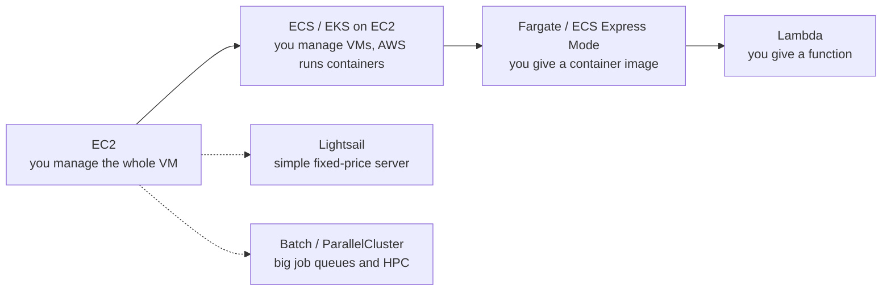

### Which one should I use?

| Service | You provide | AWS manages | Scales to zero? | GPU? | Good for | Watch out for |
| --- | --- | --- | --- | --- | --- | --- |
| **EC2** | A VM (OS, software, patches) | Hardware | No (you stop it) | Yes | Full control, GPUs, self-hosted LLMs | You patch, secure and scale it; idle VMs still cost money |
| **Lightsail** | A small server or container | Most of the setup | No | No | A blog, a demo, a tiny app at a fixed monthly price | Limited sizes and features |
| **Elastic Beanstalk** | Your code | Servers, load balancer, scaling (on EC2) | No | Via EC2 types | Classic web apps without learning containers | Less flexible than ECS |
| **ECS Express Mode** | A container image + 2 IAM roles | Fargate service, load balancer, HTTPS, autoscaling | No (minimum 1 task) | No | Simplest way to run a containerised web API (replaces App Runner) | You still pay for the load balancer and tasks while idle |
| **ECS on Fargate** | A container + task definition | Servers | Can scale to 0 tasks | No | Web APIs, workers, most AI app backends | More settings than Express Mode |
| **ECS / EKS on EC2 or Managed Instances** | Containers + instance type | Scheduling (and instances for Managed Instances) | No | Yes | Containers that need GPUs | More moving parts |
| **EKS** | Kubernetes manifests | Kubernetes control plane (and nodes with Auto Mode) | Nodes can scale down | Yes | Teams that already use Kubernetes | Steep learning curve; hourly cluster fee |
| **Lambda** | A function (or a small web server) | Everything | Yes | No | Event handlers, small APIs, glue code, cron jobs | 15-minute limit for normal functions, cold starts, no GPU |
| **Batch** | A container + job definition | Job queue and machine fleet | Yes | Yes | Many offline jobs: batch inference, embeddings, simulations | Not for web requests |
| **ParallelCluster / PCS** | HPC job scripts | A Slurm cluster | Compute nodes yes | Yes | Scientific HPC, multi-node GPU training with Slurm | Needs HPC knowledge |

**Rule of thumb for an AI app:** start with **ECS Express Mode** (or Lambda for small event-driven pieces). Use **EC2 with GPUs** or **SageMaker AI** only when you must host your own model. Use **Batch** for big offline jobs. Use **EKS** only if your team already knows Kubernetes.

- **Amazon EC2 (Elastic Compute Cloud)** - rent virtual machines by the second, in hundreds of sizes, including NVIDIA GPU, AWS Trainium and AWS Inferentia machines. **Use it** when you need full control of the OS or a GPU, for example to self-host an open-weight LLM with vLLM. **Skip it** for a simple web API (ECS Express Mode, Lambda) or for calling a hosted LLM (Bedrock). *GCP / Azure: Compute Engine / Azure Virtual Machines.*
  - Docs: https://docs.aws.amazon.com/ec2/
- **Amazon EC2 Auto Scaling** - automatically adds or removes EC2 machines based on load or a schedule, and replaces unhealthy ones. **Use it** for any fleet of EC2 machines behind a load balancer. **Skip it** with Fargate, Lambda or EKS Auto Mode, which scale for you. (AWS also has **AWS Auto Scaling** plans for scaling several services together.) *GCP / Azure: managed instance groups / Virtual Machine Scale Sets.*
  - Docs: https://docs.aws.amazon.com/autoscaling/
- **AWS Lambda** - runs your code when something happens (HTTP request, file upload, queue message, timer) and bills per millisecond, with nothing to manage. As of 2026 it offers normal event functions (up to 15 minutes), **web functions** (small HTTP servers that scale to zero), **MicroVMs** (isolated sandboxes for untrusted or AI-generated code), **durable functions** (long multi-step workflows) and **Lambda Managed Instances** (Lambda on EC2 types you choose). **Use it** for glue code, event handlers, cron jobs and low-traffic APIs that call Bedrock. **Skip it** for GPUs, huge ML libraries or steady heavy traffic. *GCP / Azure: Cloud Run functions (formerly Cloud Functions) / Azure Functions.*
  - Docs: https://docs.aws.amazon.com/lambda/
- **AWS Elastic Beanstalk** - upload your code (Python, Node.js, Java, .NET, Go, PHP, Ruby or Docker) and it builds the EC2 servers, load balancer and scaling for you. Still active in 2026. **Use it** to move a traditional web app onto AWS quickly. **Skip it** for new container apps (ECS Express Mode is simpler). *GCP / Azure: App Engine / Azure App Service.*
  - Docs: https://docs.aws.amazon.com/elastic-beanstalk/
- **AWS App Runner [CLOSED TO NEW CUSTOMERS]** - turned a container image or code repo into an HTTPS web service. Closed to new customers since 31 March 2026; existing users can keep it. **Use instead:** **Amazon ECS Express Mode** (one command creates a Fargate service, load balancer, HTTPS and autoscaling). *GCP / Azure: Cloud Run / Azure Container Apps.*
  - Docs: https://docs.aws.amazon.com/apprunner/latest/dg/apprunner-availability-change.html
- **Amazon Lightsail** - a simple virtual server (plus optional database, storage, CDN and DNS) for a fixed low monthly price. **Use it** for a personal site, WordPress, or a small Streamlit/Gradio demo. **Skip it** when you need GPUs, autoscaling or deep AWS integration (move to EC2 or ECS). *GCP / Azure: no direct match (small Compute Engine VMs) / no direct match (App Service or small VMs).*
  - Docs: https://docs.aws.amazon.com/lightsail/
- **AWS Batch** - a managed job queue: submit thousands of container jobs and Batch starts the right machines (including Spot and GPU), runs the jobs and shuts the machines down. **Use it** for nightly batch inference, embedding millions of documents or video processing. **Skip it** for anything that must answer a web request. *GCP / Azure: Batch / Azure Batch.*
  - Docs: https://docs.aws.amazon.com/batch/
- **AWS ParallelCluster** - an open-source tool that builds a high-performance computing (HPC) cluster with the Slurm scheduler in your account. **Use it** if your team already writes Slurm job scripts. **Skip it** if you just want to fine-tune a model (SageMaker AI). *GCP / Azure: Cluster Toolkit / Azure CycleCloud.*
  - Docs: https://docs.aws.amazon.com/parallelcluster/
- **AWS Parallel Computing Service (PCS)** - the fully managed version of a Slurm HPC cluster, so you do not maintain the scheduler yourself. **Use it** for HPC and multi-node training with Slurm and less admin work. **Skip it** for simple job queues (Batch). *GCP / Azure: Cluster Toolkit / Azure CycleCloud.*
  - Docs: https://docs.aws.amazon.com/pcs/
- **AWS Serverless Application Repository** - a public catalog of ready-made Lambda apps and components you can deploy in a few clicks. **Use it** to reuse a common pattern quickly. **Skip it** if you write your own functions with SAM or CDK. *GCP / Azure: no direct match.*
  - Docs: https://docs.aws.amazon.com/serverlessrepo/
- **EC2 Image Builder** - builds, tests and patches machine images (AMIs) and container images on a schedule. **Use it** when many servers must start from an approved "golden image". **Skip it** if you only build containers in CI. *GCP / Azure: no direct match (Packer) / Azure VM Image Builder.*
  - Docs: https://docs.aws.amazon.com/imagebuilder/
- **Amazon Linux** - AWS's own Linux distribution (Amazon Linux 2023), tuned for EC2 and used by Lambda runtimes. **Use it** as a default EC2 operating system. **Skip it** if your software needs Ubuntu or another distribution. *GCP / Azure: Container-Optimized OS / Azure Linux.*
  - Docs: https://docs.aws.amazon.com/linux/

> AWS Outposts, Local Zones, Wavelength and VMware options are in [Hybrid and edge](#24-hybrid-and-edge). Spot, Savings Plans and Reserved Instances are in [Cost management](#23-cost-management).

---

## 2. Containers

**In plain words:** a container packages your app and everything it needs (Python version, libraries) into one image that runs the same everywhere. On AWS you need three things: a place to **store** images (ECR), something to **run and restart** them (an "orchestrator": ECS or EKS), and **machines** to run them on (Fargate, which hides the machines, or EC2).

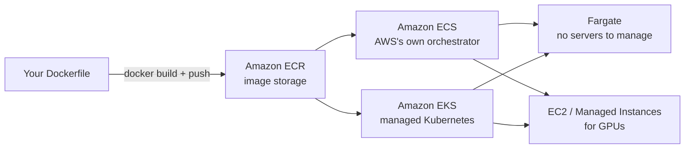

### Which one should I use?

| Question | Answer |
| --- | --- |
| First container app, want the least setup? | **ECS Express Mode** (runs on Fargate) |
| Need more control (sidecars, service-to-service calls, scheduled tasks)? | **ECS on Fargate** |
| Container needs a GPU? | **ECS Managed Instances** or **ECS/EKS on EC2 GPU instances** (Fargate has no GPUs) |
| Team already uses Kubernetes, Helm, operators? | **EKS** (try **EKS Auto Mode** so AWS manages nodes too) |
| Company runs Red Hat OpenShift? | **ROSA** |
| Where do I keep images? | **ECR** in all cases |

| | ECS | EKS |
| --- | --- | --- |
| Learning curve | Low | High (Kubernetes) |
| Control plane cost | None | Hourly cluster fee |
| Portability to other clouds | Low | High |
| Best for | Most teams that use only AWS | Platform teams, multi-cloud, Kubernetes tools |

- **Amazon ECS (Elastic Container Service)** - AWS's own system for running containers: you describe a task (image, CPU, memory) and a service (how many copies, which load balancer) and ECS keeps them running. **Express Mode** sets up a whole web service in one step; **Managed Instances** lets AWS manage EC2 machines, including GPU ones; **Service Connect** lets services call each other by name. **Use it** as the default way to run containerised APIs and workers. **Skip it** if your company standardises on Kubernetes. *GCP / Azure: Cloud Run / Azure Container Apps.*
  - Docs: https://docs.aws.amazon.com/ecs/
- **Amazon ECS Express Mode** - a feature of ECS (no extra charge) that turns a container image into an HTTPS service with load balancer and autoscaling in one command. **Use it** for your first containerised FastAPI or Node app; it is AWS's recommended replacement for App Runner. **Skip it** when you need fine control of networking (use full ECS). *GCP / Azure: Cloud Run / Azure Container Apps.*
  - Docs: https://docs.aws.amazon.com/AmazonECS/latest/developerguide/express-service-getting-started.html
- **Amazon EKS (Elastic Kubernetes Service)** - AWS-managed Kubernetes; with **EKS Auto Mode** AWS also manages worker nodes, storage and load balancers, and **EKS Pod Identity** gives pods AWS permissions. **Use it** when you need Kubernetes tools (Helm, KServe, Ray, vLLM operators) or portability. **Skip it** for one or two services with no Kubernetes experience (ECS is far simpler). *GCP / Azure: GKE / AKS.*
  - Docs: https://docs.aws.amazon.com/eks/
- **AWS Fargate** - a serverless engine for ECS and EKS: containers run without you choosing or patching any server; you pay per vCPU and GB per second. **Use it** for normal CPU workloads such as web APIs and workers. **Skip it** for GPUs or very large, steady workloads (EC2 can be cheaper). *GCP / Azure: Cloud Run / Azure Container Instances.*
  - Docs: https://docs.aws.amazon.com/AmazonECS/latest/developerguide/AWS_Fargate.html
- **Amazon ECR (Elastic Container Registry)** - a private store for container images and Helm charts, with vulnerability scanning. **Use it** whenever ECS, EKS, Lambda or SageMaker AI pull your images. **Skip it** only if you already use another registry happily. *GCP / Azure: Artifact Registry / Azure Container Registry.*
  - Docs: https://docs.aws.amazon.com/ecr/
- **Red Hat OpenShift Service on AWS (ROSA)** - managed OpenShift (Red Hat's Kubernetes platform), run jointly by AWS and Red Hat. **Use it** only if your company runs OpenShift. *GCP / Azure: OpenShift Dedicated on Google Cloud / Azure Red Hat OpenShift.*
  - Docs: https://docs.aws.amazon.com/rosa/
- **AWS App2Container** - a command-line tool that helps package existing Java and .NET apps into containers. **Use it** when containerising old apps. *GCP / Azure: Migrate to Containers / no direct match.*
  - Docs: https://docs.aws.amazon.com/app2container/
- **AWS App Mesh [RETIRED]** - a service mesh (proxies between services for traffic control). Support ended 30 September 2026. **Use instead:** ECS Service Connect or Amazon VPC Lattice. *GCP / Azure: Cloud Service Mesh / Istio add-on for AKS.*
  - Docs: https://docs.aws.amazon.com/app-mesh/

---

## 3. Serverless

**In plain words:** "serverless" is not one service; it is a style. You use building blocks that have no servers to size or patch, scale by themselves, and mostly cost nothing when idle. A typical serverless AI app is: API Gateway (front door) -> Lambda (code) -> Bedrock (LLM) -> DynamoDB (data) -> S3 (files), with SQS, EventBridge or Step Functions for background work.

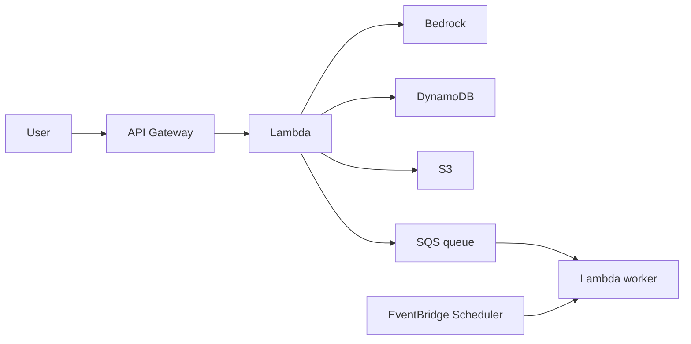

### Which serverless building block does what?

| Need | Serverless service | Section |
| --- | --- | --- |
| Run code | Lambda, Fargate | [1](#1-compute), [2](#2-containers) |
| HTTP front door | API Gateway, Lambda function URLs, AppSync (GraphQL) | [10](#10-networking-and-content-delivery), [9](#9-application-integration-and-messaging) |
| Store objects | S3 | [4](#4-storage) |
| Store data | DynamoDB, Aurora Serverless v2, Aurora DSQL | [5](#5-databases) |
| Queue / events / pub-sub | SQS, SNS, EventBridge | [9](#9-application-integration-and-messaging) |
| Multi-step workflows | Step Functions, Lambda durable functions | [9](#9-application-integration-and-messaging) |
| Query files with SQL | Athena | [6](#6-analytics) |
| Call LLMs | Bedrock | [8](#8-ai-machine-learning-and-generative-ai) |
| User login | Cognito | [11](#11-security-identity-and-compliance) |

**When serverless is a bad fit:** steady high traffic all day (containers can be cheaper), GPU work, very long single requests, or code that needs big memory and local disk for a long time.

- **AWS Serverless Application Model (SAM)** - a short-hand version of CloudFormation plus the `sam` command-line tool to define, test locally and deploy Lambda functions, APIs and tables. **Use it** when your app is mostly Lambda + API Gateway + DynamoDB. **Skip it** if you prefer CDK (code) or Terraform. *GCP / Azure: no direct match / Azure Developer CLI (azd) templates.*
  - Docs: https://docs.aws.amazon.com/serverless-application-model/

> Lambda, Fargate, DynamoDB, S3, SQS, SNS, EventBridge, Step Functions, API Gateway and AppSync have their entries in their own categories.

---
## 4. Storage

**In plain words:** there are three shapes of storage. **Object storage** (S3) is a giant bucket of files you reach over HTTP - perfect for datasets, images, model weights and backups. **Block storage** (EBS) is a virtual hard drive plugged into one EC2 machine. **File storage** (EFS, FSx) is a shared network folder many machines can open at once. **Archive storage** (the S3 Glacier storage classes) is very cheap but slow to read back.

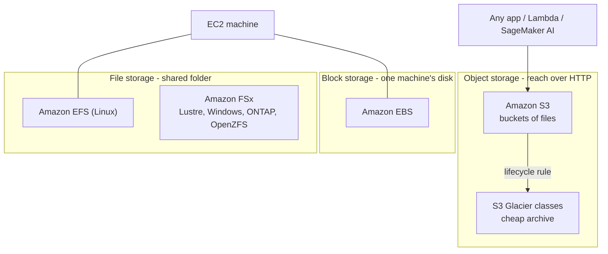

### Which one should I use?

| Need | Use | Why not the others |
| --- | --- | --- |
| Store uploads, datasets, model files, logs, static website files | **S3** (Standard or Intelligent-Tiering) | EBS/EFS cost more per GB and are tied to compute |
| Store vectors for RAG cheaply | **S3 Vectors** | A vector database is faster for heavy query traffic |
| Store analytics tables (Apache Iceberg) | **S3 Tables** | Plain S3 makes you manage table files yourself |
| A boot disk or database disk for one EC2 machine | **EBS** (gp3) | S3 is not a disk; EFS is slower and pricier per GB |
| A shared folder for many Linux machines or containers | **EFS** | EBS attaches to one machine (mostly) |
| Very fast shared storage for GPU training | **FSx for Lustre** (can link to S3) | EFS is not built for that throughput |
| Windows file shares | **FSx for Windows File Server** | EFS is Linux (NFS) only |
| Keep data for years and rarely read it | **S3 Glacier** storage classes | Standard S3 costs more |
| Backups of many services in one place | **AWS Backup** | Doing it per service is messy |

S3 storage classes in one line each: **Standard** (default, frequent access), **Intelligent-Tiering** (AWS moves objects between tiers for you; best if unsure), **Express One Zone** (fastest, single AZ), **Standard-IA** and **One Zone-IA** (infrequent access, retrieval fee), **Glacier Instant Retrieval** (archive, millisecond reads), **Glacier Flexible Retrieval** (minutes to hours), **Glacier Deep Archive** (cheapest, hours to read).

- **Amazon S3 (Simple Storage Service)** - unlimited storage for files ("objects") in "buckets", reached by URL or SDK and built to almost never lose data. **Use it** for user uploads, training data, model artifacts, logs, backups and static websites - nearly every app uses it. **Skip it** when you need a disk for one machine (EBS) or a shared folder (EFS). Keep "Block Public Access" on. *GCP / Azure: Cloud Storage / Azure Blob Storage.*
  - Docs: https://docs.aws.amazon.com/AmazonS3/latest/userguide/
- **Amazon S3 Vectors** - a bucket type that stores embeddings and runs similarity search on them, at low cost (generally available since December 2025). **Use it** as a cheap vector store for RAG, often behind Bedrock Knowledge Bases. **Skip it** when you need very low latency at high query rates (OpenSearch or a vector database). *GCP / Azure: Vector Search in Agent Platform / Azure AI Search.*
  - Docs: https://docs.aws.amazon.com/AmazonS3/latest/userguide/s3-vectors.html
- **Amazon S3 Tables** - S3 buckets built for Apache Iceberg tables, with automatic maintenance, queried by Athena, Redshift, EMR and Spark. **Use it** for a modern data lake of tables. **Skip it** for plain files. *GCP / Azure: BigLake Iceberg tables / OneLake in Microsoft Fabric.*
  - Docs: https://docs.aws.amazon.com/AmazonS3/latest/userguide/s3-tables.html
- **Amazon S3 Glacier (storage classes) and Amazon Glacier (vaults)** - the archive tiers of S3 (Instant Retrieval, Flexible Retrieval, Deep Archive) for data kept for years and rarely read. The original stand-alone "Amazon Glacier" vault API still exists, but direct vault use ("S3 Glacier Direct") is **[CLOSED TO NEW CUSTOMERS]** since October 2025. **Use** S3 lifecycle rules to move old objects into the Glacier classes. **Skip it** for data you read often (retrieval fees and 90-180 day minimums). *GCP / Azure: Cloud Storage Archive class / Blob Storage archive tier.*
  - Docs: https://docs.aws.amazon.com/AmazonS3/latest/userguide/glacier-storage-classes.html
- **Amazon EBS (Elastic Block Store)** - a virtual hard drive (SSD or HDD) attached to an EC2 machine, with snapshots for backup. **Use it** as the boot and data disk for EC2 (prefer `gp3`). **Skip it** for shared files (EFS) or cheap bulk storage (S3). Unattached volumes and old snapshots keep costing money. *GCP / Azure: Persistent Disk, Hyperdisk / Azure Managed Disks.*
  - Docs: https://docs.aws.amazon.com/ebs/
- **Amazon EFS (Elastic File System)** - a shared network folder (NFS) for Linux that grows by itself and can be mounted by many EC2 machines, containers and Lambda functions at once. **Use it** when several containers must share the same files. **Skip it** when S3 is enough (usually cheaper for ML data). *GCP / Azure: Filestore / Azure Files.*
  - Docs: https://docs.aws.amazon.com/efs/
- **Amazon FSx** - managed versions of four file systems: **Lustre** (very fast, for HPC and GPU training), **Windows File Server**, **NetApp ONTAP** and **OpenZFS**. **Use it** for large multi-GPU training (Lustre) or Windows/NetApp workloads. **Skip it** when EFS or S3 does the job. *GCP / Azure: Managed Lustre, Filestore, NetApp Volumes / Azure Managed Lustre, Azure NetApp Files.*
  - Docs: https://docs.aws.amazon.com/fsx/
- **AWS Backup** - one place to schedule, keep and restore backups of EBS, EFS, FSx, RDS, Aurora, DynamoDB, S3 and more. **Use it** for any production data from day one. **Skip it** for throwaway learning accounts. *GCP / Azure: Backup and DR Service / Azure Backup.*
  - Docs: https://docs.aws.amazon.com/aws-backup/
- **AWS Storage Gateway** - a software appliance in your own data center that lets local servers use S3 and other AWS storage as a file share, disk or tape library. **Use it** to move on-premises backups and file shares to AWS step by step. **Skip it** if everything already runs in AWS. (Its **FSx File Gateway** type is **[CLOSED TO NEW CUSTOMERS]**.) *GCP / Azure: no direct match / Azure File Sync.*
  - Docs: https://docs.aws.amazon.com/storagegateway/
- **AWS Elastic Disaster Recovery (DRS)** - keeps a live copy of your servers in AWS so you can switch over within minutes if your main site fails. **Use it** for important servers that must recover fast. **Skip it** for cloud-native apps that already run across AZs. *GCP / Azure: Backup and DR Service / Azure Site Recovery.*
  - Docs: https://docs.aws.amazon.com/drs/
- **AWS Snowball Edge [CLOSED TO NEW CUSTOMERS]** - rugged storage devices AWS mailed to you to move large data offline. The current device types have been in maintenance since October 2025 and older types are retired. **Use instead:** AWS DataSync, AWS Data Transfer Terminal, or Direct Connect. *GCP / Azure: Transfer Appliance / Azure Data Box.*
  - Docs: https://docs.aws.amazon.com/snowball/
- **AWS Snowmobile [RETIRED]** - a shipping-container truck for moving exabytes of data. Retired in 2024. **Use instead:** DataSync or Direct Connect. *GCP / Azure: no direct match.*
  - Docs: https://docs.aws.amazon.com/general/latest/gr/service-lifecycle.html
- **Amazon Data Lifecycle Manager** - creates and deletes EBS snapshots and AMIs on a schedule. **Use it** to stop old snapshots piling up. **Skip it** if AWS Backup already covers your volumes. *GCP / Azure: snapshot schedules / Azure Backup policies.*
  - Docs: https://docs.aws.amazon.com/dlm/

> Older S3 features **S3 Select**, **S3 Glacier Select** and **S3 Object Lambda** are **[CLOSED TO NEW CUSTOMERS]**; use Athena, S3 Tables or your own Lambda code instead.

---

## 5. Databases

**In plain words:** a database stores your app's data so you can find and change it quickly. AWS offers a different database for each "shape" of data. **Relational** databases (RDS, Aurora) store tables with rows and use SQL - the safe default. **Key-value** and **document** databases (DynamoDB, DocumentDB) store items by key and scale almost without limit. **In-memory** databases (ElastiCache, MemoryDB) are extremely fast and often used as a cache. **Graph**, **time-series** and **wide-column** databases suit special data. **Data warehouses** (Redshift) answer big reporting questions.

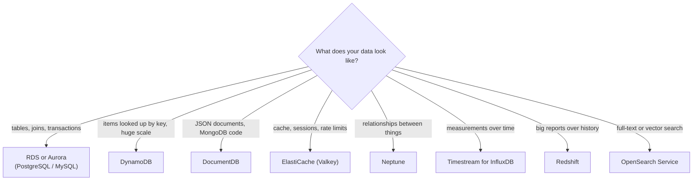

### Which one should I use?

| Service | Data shape | Typical AI-app use | Pick it when | Do not pick it when |
| --- | --- | --- | --- | --- |
| **RDS** | Relational (PostgreSQL, MySQL, MariaDB, SQL Server, Oracle, Db2) | Users, orders, chat history; pgvector for RAG | You want normal SQL on a managed server | You need near-unlimited write scale |
| **Aurora** | Relational (PostgreSQL / MySQL compatible) | Same as RDS, bigger and more resilient | You want speed, fast failover, Serverless v2 scaling | A tiny dev database |
| **Aurora DSQL** | Distributed SQL (PostgreSQL compatible) | Always-on apps across Regions | You need multi-Region writes with strong consistency | You need every PostgreSQL feature |
| **DynamoDB** | Key-value / document | Sessions, profiles, agent state, high-traffic lookups | You know your access patterns and want serverless scale | You need ad-hoc joins and reports |
| **DocumentDB** | JSON documents (MongoDB compatible) | Apps written for MongoDB | You are moving a MongoDB app | Starting fresh (DynamoDB or PostgreSQL JSONB are simpler) |
| **ElastiCache** | In-memory (Valkey, Redis OSS, Memcached) | Cache LLM answers, rate limits, sessions | You need sub-millisecond reads in front of a database | It would be the only copy of important data |
| **MemoryDB** | Durable in-memory (Valkey / Redis compatible) | Very fast primary database, in-memory vector search | You want Redis speed and durability | A cache is enough |
| **Neptune** | Graph | Knowledge graphs, GraphRAG, fraud rings | Relationships are the main question | Simple lookups |
| **Keyspaces** | Wide-column (Cassandra compatible) | Moving a Cassandra app | You run Cassandra today | You do not use Cassandra |
| **Timestream** | Time-series | Metrics, IoT sensor data | Data is mostly "value at time t" | General app data |
| **Redshift** | Columnar data warehouse | Analytics dashboards over years of data | Big SQL reports and BI | Serving your app's live traffic |
| **OpenSearch Service** | Search index ([section 6](#6-analytics)) | Full-text, log and hybrid vector search | You need search relevance and filters | A simple key lookup |

**Beginner default for an AI app:** **RDS for PostgreSQL or Aurora PostgreSQL Serverless v2** (with the pgvector extension for embeddings), **or DynamoDB** if you want fully serverless. Add **ElastiCache** only when you measure a need for caching.

- **Amazon RDS (Relational Database Service)** - AWS runs a normal SQL database for you (PostgreSQL, MySQL, MariaDB, SQL Server, Oracle or Db2) with backups, patching and optional standby copies (Multi-AZ). **Use it** as the standard choice for app data; PostgreSQL with pgvector can also store embeddings. **Skip it** when you want fully serverless scaling (DynamoDB, Aurora Serverless v2). (**RDS Custom for Oracle** is **[ENDING: 31 March 2027]**.) *GCP / Azure: Cloud SQL / Azure Database for PostgreSQL and MySQL, Azure SQL Database.*
  - Docs: https://docs.aws.amazon.com/rds/
- **Amazon Aurora** - AWS's cloud-built relational database, compatible with PostgreSQL and MySQL, with storage copied across three AZs, fast failover, read replicas, **Serverless v2** auto-scaling and **Global Database**. **Use it** for production PostgreSQL/MySQL that must be fast and highly available. **Skip it** for a very small, steady database (plain RDS can be cheaper). *GCP / Azure: AlloyDB / Azure Database for PostgreSQL flexible server.*
  - Docs: https://docs.aws.amazon.com/AmazonRDS/latest/AuroraUserGuide/
- **Amazon Aurora DSQL** - a serverless, distributed, PostgreSQL-compatible SQL database that can take writes in several Regions at once, with no servers to manage. **Use it** for always-on apps that must survive a Region failure. **Skip it** if you need full PostgreSQL compatibility (use Aurora PostgreSQL). *GCP / Azure: Spanner / no exact match (Cosmos DB is closest).*
  - Docs: https://docs.aws.amazon.com/aurora-dsql/
- **Amazon DynamoDB** - a fully serverless key-value and document database with millisecond answers at any scale, paid per request or by capacity, with global tables and change streams. **Use it** for sessions, chat history, agent memory and anything looked up by key; pairs well with Lambda. **Skip it** when you need flexible SQL queries and joins. *GCP / Azure: Firestore, Bigtable / Azure Cosmos DB.*
  - Docs: https://docs.aws.amazon.com/dynamodb/
- **Amazon ElastiCache** - managed in-memory store running **Valkey** (the open-source Redis fork), **Redis OSS** or **Memcached**, also in a Serverless mode. **Use it** to cache LLM answers or database reads, store sessions and enforce rate limits. **Skip it** until you actually have a speed problem. *GCP / Azure: Memorystore / Azure Managed Redis.*
  - Docs: https://docs.aws.amazon.com/elasticache/
- **Amazon MemoryDB** - a durable Valkey/Redis-compatible in-memory database that can be your main database, with vector search. **Use it** when you need microsecond reads and must not lose data. **Skip it** when a cache in front of another database is enough (ElastiCache). *GCP / Azure: Memorystore for Valkey / Azure Managed Redis.*
  - Docs: https://docs.aws.amazon.com/memorydb/
- **Amazon DocumentDB (with MongoDB compatibility)** - a managed JSON document database that works with MongoDB drivers, with vector search. **Use it** to move a MongoDB app to a managed AWS service. **Skip it** for new apps (DynamoDB or PostgreSQL JSONB are often simpler). *GCP / Azure: Firestore with MongoDB compatibility / Azure DocumentDB (formerly Cosmos DB for MongoDB vCore).*
  - Docs: https://docs.aws.amazon.com/documentdb/
- **Amazon Neptune** - a managed graph database (Gremlin, openCypher, SPARQL); **Neptune Analytics** adds fast graph analysis and GraphRAG with Bedrock Knowledge Bases. **Use it** for knowledge graphs, recommendations and fraud detection. **Skip it** for plain tables. *GCP / Azure: Spanner Graph / Cosmos DB for Apache Gremlin.*
  - Docs: https://docs.aws.amazon.com/neptune/
- **Amazon Timestream** - time-series databases. **Timestream for InfluxDB** runs managed InfluxDB; the older **Timestream for LiveAnalytics** is **[CLOSED TO NEW CUSTOMERS]** (since June 2025). **Use it** for IoT and monitoring data queried by time range. **Skip it** for normal app metrics (CloudWatch). *GCP / Azure: Bigtable, BigQuery / Azure Data Explorer.*
  - Docs: https://docs.aws.amazon.com/timestream/
- **Amazon Redshift** - a managed columnar data warehouse for fast SQL over terabytes to petabytes; **Redshift Serverless** removes cluster sizing and **zero-ETL** copies in data from Aurora, RDS and DynamoDB. **Use it** for BI and reporting with many daily queries. **Skip it** for small data (PostgreSQL) or rare queries (Athena). *GCP / Azure: BigQuery / Microsoft Fabric Data Warehouse, Azure Synapse.*
  - Docs: https://docs.aws.amazon.com/redshift/
- **Amazon Keyspaces (for Apache Cassandra)** - a serverless database that speaks Cassandra's query language. **Use it** to move an existing Cassandra app. **Skip it** if you are not on Cassandra (use DynamoDB). *GCP / Azure: Bigtable / Azure Managed Instance for Apache Cassandra.*
  - Docs: https://docs.aws.amazon.com/keyspaces/
- **Amazon QLDB (Quantum Ledger Database) [RETIRED]** - a tamper-evident ledger database. Support ended 31 July 2025. **Use instead:** Aurora PostgreSQL with audit tables (AWS's suggested path). *GCP / Azure: no direct match / Azure SQL Database ledger tables.*
  - Docs: https://docs.aws.amazon.com/general/latest/gr/service-lifecycle.html
- **Oracle Database@AWS** - Oracle Exadata databases run by Oracle (OCI) inside AWS data centers. **Use it** only if you must stay on Oracle Exadata. *GCP / Azure: Oracle Database@Google Cloud / Oracle Database@Azure.*
  - Docs: https://docs.aws.amazon.com/odb/
- **Amazon RDS Proxy** - a connection pool in front of RDS and Aurora. **Use it** when many Lambda functions open database connections. **Skip it** for one long-running app server with its own pool. *GCP / Azure: Cloud SQL Auth Proxy (not a pool) / built-in PgBouncer in Azure Database for PostgreSQL.*
  - Docs: https://docs.aws.amazon.com/AmazonRDS/latest/UserGuide/rds-proxy.html

---

## 6. Analytics

**In plain words:** analytics means turning lots of raw data into answers and charts. The usual AWS pattern is a **data lake**: put raw files in S3, describe them in a catalog (Glue Data Catalog), query them with SQL (Athena), process them with Spark (EMR or Glue), load the important parts into a warehouse (Redshift), and show charts (AWS Quick). Streaming services (Kinesis, MSK, Flink) handle data that arrives continuously. Since late 2024 AWS groups much of this under the umbrella name **Amazon SageMaker** (the data and AI platform, with **SageMaker Unified Studio** as one workspace) - not to be confused with **SageMaker AI**, the ML service.

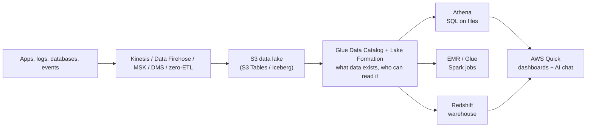

### Which one should I use?

| Need | Use | Notes |
| --- | --- | --- |
| SQL questions over files in S3, pay per query | **Athena** | Serverless; great for logs and occasional analysis |
| Fast BI over large, cleaned data, many users | **Redshift** (Serverless is easiest) | A warehouse you load data into ([section 5](#5-databases)) |
| Big data processing with Spark, Hive, Trino, Flink | **EMR** (EC2, EKS or Serverless) | Most control |
| Simple ETL jobs and a shared data catalog | **Glue** | Serverless Spark plus the catalog everything else uses |
| Search text, logs or vectors | **OpenSearch Service** | Search engine, not a warehouse |
| Dashboards and natural-language questions | **AWS Quick** | Formerly QuickSight |
| Collect a stream of events | **Kinesis Data Streams** or **MSK** (Kafka) | Kinesis = AWS-native and simple; MSK = Kafka tools |
| Deliver a stream into S3/Redshift/OpenSearch with no code | **Data Firehose** | Easiest stream loader |
| Compute on streams in real time | **Managed Service for Apache Flink** | Windows, joins, live features |
| Control who can see which data | **Lake Formation** + **DataZone / SageMaker Catalog** | Permissions and a business data catalog |

- **Amazon Athena** - a serverless SQL engine that queries files (CSV, JSON, Parquet, Iceberg) directly in S3; you pay for data scanned. **Use it** to explore logs, evaluation results or datasets without loading them anywhere. **Skip it** for all-day dashboards with many users (Redshift). Use Parquet and partitions to keep scans cheap. *GCP / Azure: BigQuery / Fabric SQL analytics endpoint, Synapse serverless SQL.*
  - Docs: https://docs.aws.amazon.com/athena/
- **Amazon Kinesis Data Streams** - a managed stream that keeps ordered events (clicks, logs, sensor readings) so several consumers can read them in real time. **Use it** for AWS-native real-time pipelines. **Skip it** if your team uses Kafka (MSK) or you only want to dump events into S3 (Data Firehose). (Kinesis Data Analytics for SQL is **[RETIRED]**; use Managed Service for Apache Flink.) *GCP / Azure: Pub/Sub / Azure Event Hubs.*
  - Docs: https://docs.aws.amazon.com/kinesis/
- **Amazon Data Firehose (formerly Kinesis Data Firehose)** - a no-code pipe that collects streaming data and delivers it to S3, Redshift, OpenSearch, Iceberg tables and more. **Use it** to save logs or LLM request records to S3 for later analysis. **Skip it** when you need custom real-time logic (Kinesis + Lambda or Flink). *GCP / Azure: Pub/Sub BigQuery subscriptions / Event Hubs Capture.*
  - Docs: https://docs.aws.amazon.com/firehose/
- **Amazon Managed Service for Apache Flink (formerly Kinesis Data Analytics)** - runs Apache Flink apps that compute over streams in real time. **Use it** for live metrics, fraud scores or real-time ML features. **Skip it** if batch processing every few minutes is fine. *GCP / Azure: Dataflow / Azure Stream Analytics.*
  - Docs: https://docs.aws.amazon.com/managed-flink/
- **Amazon MSK (Managed Streaming for Apache Kafka)** - managed Apache Kafka clusters (provisioned or Serverless) plus MSK Connect. **Use it** when your apps or tools already speak Kafka. **Skip it** for simple queues (SQS) or streams (Kinesis). *GCP / Azure: Managed Service for Apache Kafka / Event Hubs (Kafka endpoint).*
  - Docs: https://docs.aws.amazon.com/msk/
- **AWS Glue** - serverless data integration: the **Glue Data Catalog** (the shared list of your tables used by Athena, EMR and Redshift), crawlers, Spark/Python ETL jobs, **DataBrew** (no-code cleaning) and data-quality rules. (Glue **Ray jobs** are **[CLOSED TO NEW CUSTOMERS]**.) **Use it** for ETL pipelines into your data lake. **Skip it** for a few small files (a script is enough). *GCP / Azure: Dataflow + Dataplex Universal Catalog / Azure Data Factory, Fabric Data Factory.*
  - Docs: https://docs.aws.amazon.com/glue/
- **AWS Lake Formation** - fine-grained permissions (database, table, column, row) on your S3 data lake, on top of the Glue Data Catalog. **Use it** when many teams share one lake and need column- or row-level security. **Skip it** for one team and a few buckets (IAM is enough). *GCP / Azure: Dataplex with BigLake / Microsoft Purview, OneLake security.*
  - Docs: https://docs.aws.amazon.com/lake-formation/
- **Amazon EMR** - managed big-data frameworks (Spark, Hive, Trino/Presto, HBase, Flink) on EC2, on EKS, or as EMR Serverless. **Use it** for large Spark jobs where you want control of versions and tuning. **Skip it** when a Glue job or Athena query will do. *GCP / Azure: Dataproc / Azure Databricks, Fabric Spark, HDInsight.*
  - Docs: https://docs.aws.amazon.com/emr/
- **Amazon OpenSearch Service** - managed OpenSearch (a fork of Elasticsearch) for full-text search, log analytics and vector/hybrid search, as clusters or **OpenSearch Serverless**. **Use it** for site search, log dashboards or RAG that needs keyword + vector search at scale. **Skip it** for small vector sets (pgvector or S3 Vectors are cheaper); clusters cost money even when idle. *GCP / Azure: Agent Search (formerly Vertex AI Search), Elastic on Google Cloud / Azure AI Search (Foundry IQ).*
  - Docs: https://docs.aws.amazon.com/opensearch-service/
- **AWS Quick [RENAMED] (formerly Amazon QuickSight, then Amazon Quick Suite)** - an AI workspace for business users: **Quick Sight** (dashboards and BI, the old QuickSight), **Quick Flows** and **Quick Automate** (AI automations), **Quick Index** (company documents), **Quick Research** (cited reports) and app building, all through chat. It is also the successor to Amazon Q Business. **Use it** for BI dashboards, embedded analytics or an internal AI assistant. **Skip it** when building your own customer-facing AI product (Bedrock, AgentCore). *GCP / Azure: Looker, Gemini Enterprise / Power BI, Microsoft 365 Copilot.*
  - Docs: https://docs.aws.amazon.com/quick/
- **Amazon DataZone (SageMaker Catalog)** - a business data catalog where teams publish, find, request and share data and AI assets with approvals; inside the new SageMaker it appears as **SageMaker Catalog**. **Use it** when many teams share data. **Skip it** for a small team. *GCP / Azure: Dataplex Universal Catalog / Microsoft Purview.*
  - Docs: https://docs.aws.amazon.com/datazone/
- **Amazon SageMaker (Unified Studio)** - the umbrella "data and AI platform": one workspace for SQL (Athena, Redshift), Spark (EMR, Glue), notebooks, ML (SageMaker AI) and generative AI (Bedrock) over shared, governed data. **Use it** when your organisation adopts one shared data + AI workspace. **Skip it** as a solo app developer (use the individual services). *GCP / Azure: BigQuery Studio / Microsoft Fabric.*
  - Docs: https://docs.aws.amazon.com/next-generation-sagemaker/
- **AWS Clean Rooms** - lets two companies analyse their combined data without either seeing the other's raw data. **Use it** for privacy-safe joint analysis (for example, advertising measurement). *GCP / Azure: BigQuery data clean rooms / Azure Confidential Clean Rooms.*
  - Docs: https://docs.aws.amazon.com/clean-rooms/
- **AWS Data Exchange** - find and subscribe to third-party datasets and APIs, delivered into your account. **Use it** when you need outside data (weather, finance, health). *GCP / Azure: Analytics Hub / Azure Data Share.*
  - Docs: https://docs.aws.amazon.com/data-exchange/
- **AWS Entity Resolution** - matches and links records that refer to the same person or company across messy datasets. **Use it** for customer de-duplication. *GCP / Azure: no direct match.*
  - Docs: https://docs.aws.amazon.com/entityresolution/
- **AWS Data Pipeline [CLOSED TO NEW CUSTOMERS]** - an old service for scheduled data movement. In maintenance mode; no new customers. **Use instead:** Glue, Step Functions or MWAA. *GCP / Azure: Cloud Composer / Azure Data Factory.*
  - Docs: https://docs.aws.amazon.com/datapipeline/latest/DeveloperGuide/migration.html
- **Amazon FinSpace [RETIRED]** - financial data analytics (including managed kdb+). Support ended 7 October 2026. **Use instead:** general analytics services or kdb+ on EC2/EKS. *GCP / Azure: no direct match.*
  - Docs: https://docs.aws.amazon.com/finspace/
- **Amazon CloudSearch [CLOSED TO NEW CUSTOMERS]** - an older managed search service. **Use instead:** OpenSearch Service. *GCP / Azure: Agent Search / Azure AI Search.*
  - Docs: https://docs.aws.amazon.com/cloudsearch/

---

## 7. Data integration and pipelines

**In plain words:** data integration means moving data between systems on a schedule or when something changes, and orchestrating the steps (extract, clean, load, train, evaluate). AWS has a tool for each style: no-code connectors (AppFlow), Python-defined pipelines (Airflow on MWAA), serverless workflows (Step Functions, [section 9](#9-application-integration-and-messaging)), database copying (DMS, [section 15](#15-migration-and-transfer)) and automatic zero-ETL copies.

### Which one should I use?

| Need | Use |
| --- | --- |
| Pull data from Salesforce, Slack, Zendesk into S3 with no code | **Amazon AppFlow** |
| Python-defined data or ML pipelines with schedules and dependencies (Airflow DAGs) | **Amazon MWAA** |
| Chain AWS service calls with retries, branches and human approval | **AWS Step Functions** |
| Transform data with Spark or Python at scale | **AWS Glue** |
| Copy Aurora/RDS/DynamoDB data into Redshift continuously | **Zero-ETL integrations** |
| Exchange EDI business documents (X12) with partners | **AWS B2B Data Interchange** |
| Move a database to AWS | **AWS DMS** |

- **Amazon AppFlow** - a no-code service that moves data between SaaS apps (Salesforce, SAP, Slack, Zendesk, Google Analytics and others) and AWS services such as S3 and Redshift. **Use it** when a connector exists for your source. **Skip it** for unsupported sources or complex logic (Glue, Lambda). *GCP / Azure: Application Integration / Logic Apps.*
  - Docs: https://docs.aws.amazon.com/appflow/
- **Amazon MWAA (Managed Workflows for Apache Airflow)** - managed Apache Airflow for pipelines written in Python ("DAGs"); **MWAA Serverless** (late 2025) runs workflows without an always-on environment. **Use it** for scheduled data or ML pipelines with many dependent steps. **Skip it** for a few AWS steps (Step Functions) or one cron job (EventBridge Scheduler). *GCP / Azure: Cloud Composer / Apache Airflow jobs in Microsoft Fabric.*
  - Docs: https://docs.aws.amazon.com/mwaa/
- **Zero-ETL integrations** - a feature that continuously copies data from Aurora, RDS, DynamoDB and some SaaS apps into Redshift, the SageMaker lakehouse or OpenSearch, with no pipeline to build. **Use it** for dashboards over near-live app data. **Skip it** when data needs heavy transformation on the way. *GCP / Azure: Datastream / Fabric mirroring.*
  - Docs: https://docs.aws.amazon.com/redshift/latest/mgmt/zero-etl-using.html
- **AWS B2B Data Interchange** - converts EDI (X12) business documents such as invoices and purchase orders to JSON/XML and back. **Use it** when trading partners send EDI files. *GCP / Azure: no direct match / Logic Apps B2B.*
  - Docs: https://docs.aws.amazon.com/b2bi/

---
## 8. AI, machine learning and generative AI

**In plain words:** AWS offers AI at three levels. **Level 1 - ready-made AI services:** call an API to read text from a scan (Textract), turn speech into text (Transcribe), translate (Translate) and so on; no ML knowledge needed. **Level 2 - generative AI platforms:** **Amazon Bedrock** gives you many large language models (Anthropic Claude, OpenAI GPT, Amazon Nova, Meta Llama, DeepSeek, Mistral and more) behind one API, plus RAG, guardrails and fine-tuning; **Amazon Bedrock AgentCore** runs AI agents in production. **Level 3 - build your own models:** **Amazon SageMaker AI** gives you notebooks, training clusters and hosting for any model you train or fine-tune. Under all of them are AI chips (NVIDIA GPUs, AWS Trainium and Inferentia) on EC2.

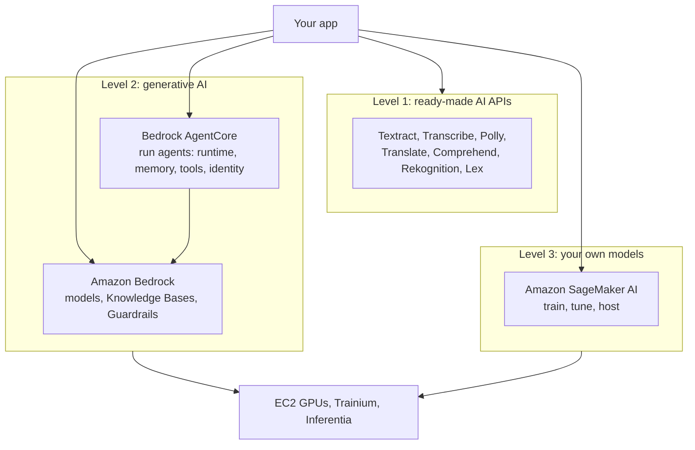

### Which one should I use?

| Your goal | Use | Why |
| --- | --- | --- |
| Chatbot, summariser, RAG over your documents, using a top LLM | **Bedrock** (+ Knowledge Bases + Guardrails) | No servers, pay per token, many models |
| An agent that uses tools, remembers users and runs for minutes | **Bedrock AgentCore** (with any framework: Strands, LangGraph, CrewAI) | Managed runtime, memory, tool gateway, identity, observability |
| Fine-tune or train your own model, or host an open-weight model with full control | **SageMaker AI** (or EC2/EKS with GPUs) | Full control of training and hosting |
| Extract text and tables from PDFs or scans | **Textract** (or Bedrock Data Automation for richer output) | Purpose-built, cheap per page |
| Speech to text / text to speech | **Transcribe** / **Polly** | Purpose-built, streaming |
| Translate text | **Translate** | Simple per-character price |
| Find faces, objects, unsafe content in images/video | **Rekognition** | Ready-made vision |
| Sentiment, entities, PII in text | **Comprehend** (or an LLM on Bedrock) | Ready-made NLP |
| Product recommendations | **Personalize** | Ready-made recommender |
| Internal AI assistant for employees over company data | **AWS Quick** | Ready-made workspace (successor to Q Business) |
| AI help while coding | **Kiro** | AWS's AI coding tool (successor to Q Developer IDE plugins) |

AWS also publishes an official decision guide, "Amazon Bedrock or Amazon SageMaker AI?" (linked in [section 31](#31-official-sources)).

### Generative AI and agents

- **Amazon Bedrock** - one API for 100+ foundation models from Amazon (Nova), Anthropic (Claude), OpenAI, Meta, Mistral, DeepSeek, xAI and others, with no servers. It supports several API styles (Bedrock Converse, Anthropic Messages, OpenAI-compatible Chat Completions and Responses), prompt caching, batch inference, cross-Region inference, model customization (fine-tuning, distillation) and **Bedrock Data Automation** (structured output from documents, images, audio, video). **Use it** whenever your app needs an LLM. **Skip it** only if you must run a custom or open-weight model with full control (SageMaker AI or EC2). *GCP / Azure: Gemini Enterprise Agent Platform, formerly Vertex AI / Microsoft Foundry Models.*
  - Docs: https://docs.aws.amazon.com/bedrock/
- **Amazon Bedrock Knowledge Bases** - managed RAG: it splits your documents, makes embeddings, stores them (in a fully managed store, S3 Vectors, OpenSearch, Aurora pgvector or others) and retrieves the right chunks; the **Managed Knowledge Base** option even runs the vector store for you, with hybrid search and an agentic retrieval API. **Use it** to build "chat with your documents" quickly. **Skip it** when you need a very custom retrieval pipeline (build it with LangChain/LlamaIndex + your own vector store). *GCP / Azure: RAG Engine in Agent Platform / Foundry IQ (Azure AI Search).*
  - Docs: https://docs.aws.amazon.com/bedrock/latest/userguide/knowledge-base.html
- **Amazon Bedrock Guardrails** - safety filters you put around any model: block harmful content and prompt attacks, deny topics, mask personal data (PII), check answers are grounded in sources. Works even on models outside Bedrock via the ApplyGuardrail API. **Use it** in every user-facing LLM app. **Skip it** only for private experiments. *GCP / Azure: Model Armor / Azure AI Content Safety in Foundry.*
  - Docs: https://docs.aws.amazon.com/bedrock/latest/userguide/guardrails.html
- **Amazon Bedrock Agents (now Bedrock Agents Classic) [CLOSED TO NEW CUSTOMERS]** - the first managed agent feature of Bedrock. In maintenance since 30 June 2026 (no new customers from 30 July 2026). **Use instead:** AgentCore Harness or a code-defined agent on AgentCore Runtime. *GCP / Azure: Agent Platform agents / Foundry Agent Service.*
  - Docs: https://docs.aws.amazon.com/bedrock/latest/userguide/agents-classic-maintenance-mode.html
- **Amazon Bedrock AgentCore** - a set of services to run AI agents in production with any framework (Strands Agents, LangGraph, CrewAI, LlamaIndex, OpenAI Agents SDK) and any model: **Runtime** (serverless, isolated sessions), **Harness** (a managed agent loop in one API call), **Memory**, **Gateway** (turn APIs and Lambda functions into MCP tools), **Identity**, **Code Interpreter**, **Browser**, **Observability**, **Evaluations**, **Optimization**, **Policy**, **Registry** and **Payments**. **Use it** when your agent must be secure, scalable and observable for real users. **Skip it** for a single prompt-and-answer call (plain Bedrock is enough). *GCP / Azure: Agent Runtime in Agent Platform (formerly Vertex AI Agent Engine) / Foundry Agent Service.*
  - Docs: https://docs.aws.amazon.com/bedrock-agentcore/
- **Amazon Nova** - Amazon's own family of foundation models (text, multimodal, speech-to-speech "Sonic", image and video generation, embeddings), used through Bedrock; **Nova Forge** lets companies build custom versions from Nova checkpoints. **Use it** when you want low cost and speed for common tasks. **Skip it** when another model clearly works better for your task - test several on Bedrock. *GCP / Azure: Gemini models / OpenAI and Microsoft models in Foundry.*
  - Docs: https://docs.aws.amazon.com/nova/
- **Amazon Nova Act** - a service and SDK for building agents that use web browsers and user interfaces like a person (click, type, fill forms). **Use it** to automate web workflows that have no API. **Skip it** when an API exists (call the API instead). *GCP / Azure: Gemini computer use / Foundry computer-use agents.*
  - Docs: https://docs.aws.amazon.com/nova-act/
- **Claude Platform on AWS** - access Anthropic's own Claude platform and features with AWS billing and security. **Use it** if you want Anthropic's native platform but pay through your AWS account. **Skip it** if Bedrock's Claude models already meet your needs. *GCP / Azure: Claude on Agent Platform / Claude in Microsoft Foundry.*
  - Docs: https://docs.aws.amazon.com/claude-platform/

### Build, train and host your own models

- **Amazon SageMaker AI (formerly Amazon SageMaker)** - the full ML platform: notebooks and **Studio**, managed **training jobs**, **HyperPod** (resilient clusters for large-scale training), **JumpStart** (ready-to-deploy open models), **Canvas** (no-code ML), **Pipelines**, **Model Registry**, **Feature Store**, and hosting as real-time, serverless, asynchronous or batch endpoints. Renamed in December 2024. Several older features (Clarify, Debugger, Model Monitor, Ground Truth, A2I, Studio Lab, Role Manager, GeoSpatial) are **[CLOSED TO NEW CUSTOMERS]** since mid-2026, and Profiler is **[ENDING: 30 June 2027]**. **Use it** to train, fine-tune or host your own models. **Skip it** when an API on Bedrock already does the job. *GCP / Azure: Gemini Enterprise Agent Platform (training, endpoints, pipelines) / Azure Machine Learning in Microsoft Foundry.*
  - Docs: https://docs.aws.amazon.com/sagemaker/
- **AWS Trainium** - AWS-designed chips for training (and serving) deep learning models, offered as EC2 Trn instances (latest Trn3 UltraServers) and programmed with the **AWS Neuron SDK** (PyTorch, JAX). **Use it** for large training jobs where price-performance matters and your model is supported by Neuron. **Skip it** if you depend on CUDA-only code (use NVIDIA GPU instances). *GCP / Azure: TPUs / no generally available equivalent (NVIDIA/AMD GPUs).*
  - Docs: https://awsdocs-neuron.readthedocs-hosted.com/
- **AWS Inferentia** - AWS-designed chips for low-cost inference, offered as EC2 Inf instances, also programmed with the Neuron SDK. **Use it** to serve supported models cheaply at high volume. **Skip it** for small traffic (Bedrock or serverless endpoints) or CUDA-only models. *GCP / Azure: TPUs / no generally available equivalent.*
  - Docs: https://awsdocs-neuron.readthedocs-hosted.com/
- **AWS Deep Learning AMIs and Deep Learning Containers** - ready-made machine images and Docker images with PyTorch, CUDA drivers and other ML libraries installed. **Use them** to start GPU work on EC2, ECS, EKS or SageMaker AI without fighting driver installs. *GCP / Azure: Deep Learning VM Images, Deep Learning Containers / Data Science Virtual Machines, Azure ML curated environments.*
  - Docs: https://docs.aws.amazon.com/dlami/

### Ready-made AI services

- **Amazon Rekognition** - image and video analysis: objects, faces, text in images, celebrity and unsafe-content detection. (Streaming events and batch image moderation are **[CLOSED TO NEW CUSTOMERS]**.) **Use it** for photo moderation or face comparison. **Skip it** for open-ended image questions (a multimodal model on Bedrock). *GCP / Azure: Cloud Vision, Video Intelligence / Azure Vision in Foundry Tools.*
  - Docs: https://docs.aws.amazon.com/rekognition/
- **Amazon Polly** - turns text into natural-sounding speech in many voices and languages. **Use it** for voice output in apps, IVR and accessibility. *GCP / Azure: Text-to-Speech / Azure Speech in Foundry Tools.*
  - Docs: https://docs.aws.amazon.com/polly/
- **Amazon Transcribe** - turns speech into text, live or from recordings, with speaker labels and PII redaction; **Transcribe Call Analytics** for contact centers. **Use it** for meeting notes, subtitles and call transcripts. *GCP / Azure: Speech-to-Text / Azure Speech in Foundry Tools.*
  - Docs: https://docs.aws.amazon.com/transcribe/
- **Amazon Translate** - machine translation between dozens of languages, with custom terminology. **Use it** for cheap, fast translation at volume. **Skip it** when you need style-aware rewriting (an LLM on Bedrock). *GCP / Azure: Cloud Translation / Azure Translator in Foundry Tools.*
  - Docs: https://docs.aws.amazon.com/translate/
- **Amazon Comprehend** - natural language processing: sentiment, key phrases, entities, language detection, PII detection and custom classifiers. (Topic modeling, event detection and prompt safety classification are **[CLOSED TO NEW CUSTOMERS]**.) **Use it** for cheap, predictable text classification at scale. **Skip it** when an LLM prompt is simpler. *GCP / Azure: Natural Language API / Azure Language in Foundry Tools.*
  - Docs: https://docs.aws.amazon.com/comprehend/
- **Amazon Comprehend Medical** - finds medical terms (conditions, medicines, dosages) and health data in clinical text. **Use it** for healthcare text. *GCP / Azure: Healthcare Natural Language API / Text Analytics for health.*
  - Docs: https://docs.aws.amazon.com/comprehend-medical/
- **Amazon Textract** - reads printed and handwritten text, tables, forms and signatures from scans and PDFs. **Use it** for invoice, ID and form processing. **Skip it** when you also need summaries or custom fields (Bedrock Data Automation or a multimodal LLM). *GCP / Azure: Document AI / Azure Document Intelligence and Content Understanding in Foundry Tools.*
  - Docs: https://docs.aws.amazon.com/textract/
- **Amazon Lex** - builds voice and text chatbots with intents and slots (the engine behind Alexa-style bots), now with LLM help. **Use it** for structured bots, especially in Amazon Connect contact centers. **Skip it** for free-form assistants (Bedrock + AgentCore). *GCP / Azure: Conversational Agents (Dialogflow CX) / Azure Bot Service, Copilot Studio.*
  - Docs: https://docs.aws.amazon.com/lex/
- **Amazon Personalize** - a ready-made recommendation engine trained on your users' clicks and purchases. **Use it** for "you may also like" without building a recommender. **Skip it** if you have an ML team and custom needs (SageMaker AI). *GCP / Azure: Vertex AI Search for commerce (recommendations) / no direct match.*
  - Docs: https://docs.aws.amazon.com/personalize/
- **Amazon Kendra [CLOSED TO NEW CUSTOMERS]** - enterprise document search. In maintenance since 30 June 2026; no new customers from 30 July 2026. **Use instead:** Amazon Bedrock Managed Knowledge Base (or Bedrock Knowledge Bases). *GCP / Azure: Agent Search / Azure AI Search.*
  - Docs: https://docs.aws.amazon.com/kendra/latest/dg/kendra-availability-change.html
- **Amazon Forecast [CLOSED TO NEW CUSTOMERS]** - time-series forecasting. Closed to new customers since July 2024. **Use instead:** SageMaker Canvas (AWS's migration path) or your own model in SageMaker AI. *GCP / Azure: BigQuery ML forecasting / Azure ML automated ML.*
  - Docs: https://docs.aws.amazon.com/forecast/
- **Amazon Lookout for Vision, Lookout for Metrics, Lookout for Equipment [RETIRED]** - anomaly detection for images, business metrics and machines. Retired in October 2025 (Vision, Metrics) and 7 October 2026 (Equipment). **Use instead:** SageMaker AI models, Rekognition Custom Labels or CloudWatch anomaly detection. *GCP / Azure: build with Agent Platform / Azure ML.*
  - Docs: https://docs.aws.amazon.com/general/latest/gr/service-lifecycle.html
- **Amazon Fraud Detector [CLOSED TO NEW CUSTOMERS]** - ready-made online fraud models. In maintenance since October 2025. **Use instead:** your own model on SageMaker AI. *GCP / Azure: no direct match / Microsoft Dynamics 365 Fraud Protection.*
  - Docs: https://docs.aws.amazon.com/frauddetector/latest/ug/frauddetector-availability-change.html
- **Amazon Augmented AI (A2I) [CLOSED TO NEW CUSTOMERS]** - human review loops for ML predictions. In maintenance since June 2026. **Use instead:** a simple review queue in your own app (for example Step Functions + a web page). *GCP / Azure: no direct match.*
  - Docs: https://docs.aws.amazon.com/augmented-ai/
- **AWS HealthLake, AWS HealthImaging, AWS HealthOmics** - managed stores for health data (FHIR records), medical images (DICOM) and genomics data with workflows. **Use them** for regulated healthcare and life-science data. (HealthOmics variant and annotation stores are **[CLOSED TO NEW CUSTOMERS]**.) *GCP / Azure: Cloud Healthcare API / Azure Health Data Services.*
  - Docs: https://docs.aws.amazon.com/healthlake/
- **Amazon Monitron [CLOSED TO NEW CUSTOMERS]** - sensors and an app that predict machine failures. In maintenance since October 2024. **Use instead:** IoT SiteWise with your own models. *GCP / Azure: no direct match.*
  - Docs: https://docs.aws.amazon.com/Monitron/
- **AWS DeepRacer (now "DeepRacer on AWS")** - learn reinforcement learning by training a model to drive a small race car in a simulator. As of September 2026 it is offered as **DeepRacer on AWS**, an open-source solution you deploy in your own account (uses SageMaker AI). **Use it** for fun RL learning events. *GCP / Azure: no direct match.*
  - Docs: https://docs.aws.amazon.com/deepracer/latest/developerguide/what-is-deepracer.html
- **AWS DeepLens, AWS DeepComposer, AWS Panorama [RETIRED]** - learning devices (camera, music keyboard) and an edge vision appliance. All retired (DeepLens January 2024, DeepComposer September 2025, Panorama May 2026). **Use instead:** IoT Greengrass with your own models. *GCP / Azure: no direct match.*
  - Docs: https://docs.aws.amazon.com/general/latest/gr/service-lifecycle.html

### AI assistants: the Amazon Q family, CodeWhisperer and Kiro

The name "Amazon Q" has covered several products. As of November 2026:

- **Amazon Q (family overview)** - **Q Developer** (AI coding help in IDEs and the command line), **Q Developer in chat applications** (ask about AWS from Slack or Microsoft Teams; formerly AWS Chatbot), and **Q Business** (closed). The chat inside the AWS console is now called the **AWS assistant**. **Use** Kiro for coding, AWS Quick for business users, the AWS assistant in the console. *GCP / Azure: Gemini Code Assist, Gemini Enterprise / GitHub Copilot, Microsoft 365 Copilot.*
  - Docs: https://docs.aws.amazon.com/amazonq/
- **Amazon Q Developer** - AI coding assistant in VS Code, JetBrains, Visual Studio, Eclipse and the terminal. Its IDE plugins are **[ENDING: 30 April 2027]**; new sign-ups were blocked from May 2026. **Use instead:** Kiro. *GCP / Azure: Gemini Code Assist / GitHub Copilot.*
  - Docs: https://docs.aws.amazon.com/amazonq/latest/qdeveloper-ug/q-developer-ide-end-of-support.html
- **Amazon CodeWhisperer [RENAMED]** - AWS's first AI code-completion tool. Became part of Amazon Q Developer in April 2024; Q Developer's IDE role is now passing to Kiro. **Use instead:** Kiro. *GCP / Azure: Gemini Code Assist / GitHub Copilot.*
  - Docs: https://docs.aws.amazon.com/amazonq/latest/qdeveloper-ug/what-is.html
- **Amazon Q Business [CLOSED TO NEW CUSTOMERS]** - an AI assistant for employees over company data. In maintenance since 30 June 2026 (no new customers from 30 July 2026). **Use instead:** AWS Quick. *GCP / Azure: Gemini Enterprise / Microsoft 365 Copilot.*
  - Docs: https://docs.aws.amazon.com/amazonq/latest/qbusiness-ug/qbusiness-availability-change.html
- **AWS assistant (formerly Amazon Q Developer in the AWS console)** - chat inside the AWS console and mobile app that answers questions about your resources, costs and errors. **Use it** to understand an error or a bill quickly. *GCP / Azure: Gemini Cloud Assist / Copilot in Azure.*
  - Docs: https://docs.aws.amazon.com/assistant/

> **Kiro** (AWS's spec-driven AI coding IDE and CLI) is in [Developer tools](#14-developer-tools-and-cicd). **AWS Quick** is in [Analytics](#6-analytics). **Amazon Machine Learning** (2015) and **Apache MXNet on AWS** are legacy names you can ignore.

---

## 9. Application integration and messaging

**In plain words:** big apps are made of small parts that must talk to each other without waiting. These services are the "post office" between parts. A **queue** (SQS) holds jobs until a worker takes them. **Pub/sub** (SNS) copies one message to many subscribers. An **event bus** (EventBridge) routes events by rules. A **stream** (Kinesis, MSK) keeps an ordered log many readers can replay. A **workflow** (Step Functions) runs steps in order with retries.

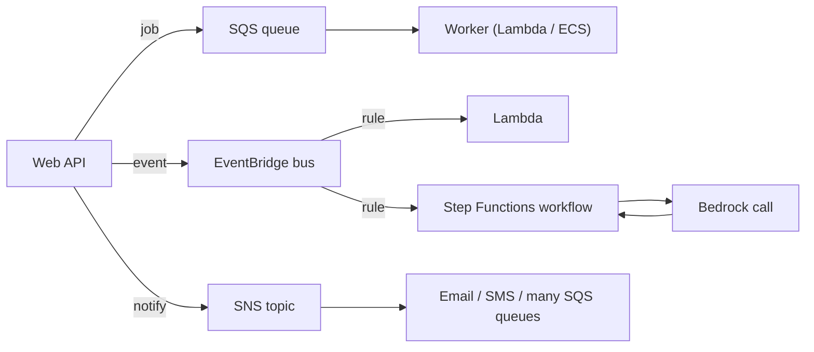

### Which one should I use?

| Service | Pattern | One message goes to | Keeps history to replay? | Use it for |
| --- | --- | --- | --- | --- |
| **SQS** | Queue | One worker | No (deleted after processing) | Background jobs, buffering LLM calls, decoupling |
| **SNS** | Pub/sub topic | Many subscribers at once | No | Fan-out, alerts, push to email/SMS |
| **EventBridge** | Event bus with rules | Matching targets | Optional archive | Reacting to AWS and SaaS events, schedules |
| **Kinesis Data Streams** | Stream | Many readers, in order | Yes (hours to 1 year) | Clickstreams, logs, real-time analytics |
| **MSK** | Kafka stream | Many readers, in order | Yes | Kafka-based systems |
| **Amazon MQ** | Classic message broker | Depends on setup | Depends | Moving apps that use ActiveMQ or RabbitMQ |
| **Step Functions** | Workflow | Steps in order | Execution history | Multi-step pipelines, AI agent workflows, human approval |
| **AppSync** | GraphQL / real-time API | Connected clients | No | Live updates to web and mobile apps |

AWS also has the official decision guide "Amazon SQS, Amazon SNS, or Amazon EventBridge?".

- **Amazon SQS (Simple Queue Service)** - a fully managed message queue: one part of your app drops a job in, a worker picks it up later. Standard queues (huge scale) and FIFO queues (strict order, no duplicates). **Use it** for background jobs (document processing, batch LLM calls) and to absorb traffic spikes. **Skip it** when many consumers need the same message (SNS or EventBridge). *GCP / Azure: Cloud Tasks, Pub/Sub / Azure Queue Storage, Service Bus queues.*
  - Docs: https://docs.aws.amazon.com/sqs/
- **Amazon SNS (Simple Notification Service)** - publish one message to a "topic" and it is delivered to every subscriber (SQS queues, Lambda, HTTP endpoints, email, SMS, mobile push). **Use it** for fan-out and alerts (for example CloudWatch alarm emails). **Skip it** for rich routing rules (EventBridge) or marketing email (SES). (SNS message data protection is **[CLOSED TO NEW CUSTOMERS]**.) *GCP / Azure: Pub/Sub / Event Grid, Service Bus topics, Notification Hubs.*
  - Docs: https://docs.aws.amazon.com/sns/
- **Amazon EventBridge** - an event bus that routes events from AWS services, SaaS apps and your code to targets using rules, plus **EventBridge Scheduler** (cron and one-off schedules at scale) and **Pipes** (point-to-point connections with filtering). **Use it** for event-driven designs ("when a file lands in S3, start this workflow") and scheduled jobs. **Skip it** for simple work queues (SQS). *GCP / Azure: Eventarc, Cloud Scheduler / Event Grid, Logic Apps.*
  - Docs: https://docs.aws.amazon.com/eventbridge/
- **AWS Step Functions** - a visual, serverless workflow engine: steps, branches, parallel runs, waits, retries and human approval, calling 200+ AWS services directly. **Use it** for multi-step AI pipelines (extract -> embed -> store), order processing and long-running jobs. **Skip it** for a single function call. *GCP / Azure: Workflows / Logic Apps, Durable Functions.*
  - Docs: https://docs.aws.amazon.com/step-functions/
- **AWS AppSync** - managed GraphQL APIs plus real-time subscriptions and **AppSync Events** (serverless WebSockets). **Use it** for live updates to web and mobile apps, such as streaming chat tokens to many clients. **Skip it** if a plain REST API is enough (API Gateway). *GCP / Azure: Firebase Data Connect / Azure API Management (GraphQL), Azure Web PubSub.*
  - Docs: https://docs.aws.amazon.com/appsync/
- **Amazon MQ** - managed Apache ActiveMQ and RabbitMQ message brokers. **Use it** to move existing apps that use those brokers. **Skip it** for new cloud apps (SQS/SNS are simpler). *GCP / Azure: no direct match (Marketplace RabbitMQ) / Azure Service Bus.*
  - Docs: https://docs.aws.amazon.com/amazon-mq/
- **Amazon SWF (Simple Workflow Service)** - an older workflow service where you write the coordination code. **Use it** only if you already have SWF apps. **Use instead:** Step Functions. *GCP / Azure: Workflows / Durable Functions.*
  - Docs: https://docs.aws.amazon.com/swf/

> **Amazon MWAA** and **Amazon AppFlow** are in [Data integration](#7-data-integration-and-pipelines). **Kinesis** and **MSK** are in [Analytics](#6-analytics).

---

## 10. Networking and content delivery

**In plain words:** networking decides who can reach what. A **VPC** is your private network in AWS, split into **subnets** (public ones reachable from the internet, private ones not). **Security groups** are firewalls around each resource. Traffic from users usually comes in through **Route 53** (DNS: name -> address), **CloudFront** (a global cache close to users), and a **load balancer** or **API Gateway** (the front door that spreads requests over your servers). **Direct Connect** and **VPN** link your office or data center to AWS.

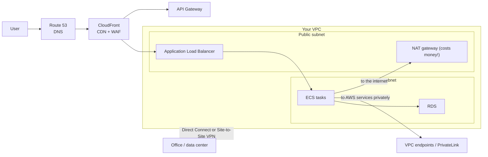

### Which one should I use?

**Front door for an API:**

| Option | Best for | Not great for |
| --- | --- | --- |
| **API Gateway** (HTTP or REST API) | Serverless APIs on Lambda, API keys, usage plans, throttling | Long requests (about 30 s default integration timeout; check quotas) |
| **Application Load Balancer (ALB)** | Containers/EC2, long-lived connections, WebSockets, streaming LLM tokens | Per-client API keys and usage plans |
| **Lambda function URLs** | The simplest HTTPS endpoint for one function | Many routes, auth options, throttling |
| **AppSync** | GraphQL and real-time subscriptions | Plain REST |
| **CloudFront** in front of any of these | Caching, global speed, WAF, HTTPS on your domain | It does not run code by itself (except small edge functions) |

**Reaching AWS services from private subnets:**

| Option | Cost shape | Use it when |
| --- | --- | --- |
| **NAT gateway** | Hourly fee + per-GB fee | Private resources must reach the public internet |
| **Gateway VPC endpoint** (S3, DynamoDB) | Free | Private resources call S3 or DynamoDB - always add these |
| **Interface VPC endpoint (PrivateLink)** | Hourly + per-GB, usually less than NAT for heavy AWS traffic | Private resources call Bedrock, ECR, Secrets Manager and others |

**Connecting other networks:** one VPC to another -> VPC peering or **Transit Gateway** (many VPCs); your office -> **Site-to-Site VPN** (quick, over internet) or **Direct Connect** (private line); remote staff -> **Client VPN** or **Verified Access**; another cloud -> **AWS Interconnect - multicloud**.

- **Amazon VPC (Virtual Private Cloud)** - your own private network inside AWS: IP ranges, subnets across AZs, route tables, internet gateway, **NAT gateways**, security groups and network ACLs. **Use it** for everything; every account has a default VPC to start. **Watch out:** NAT gateways charge per hour and per GB even when idle - a top surprise bill. *GCP / Azure: VPC / Azure Virtual Network.*
  - Docs: https://docs.aws.amazon.com/vpc/
- **Amazon CloudFront** - a content delivery network (CDN): copies of your site and files are served from 600+ edge locations close to users, with HTTPS, caching, WAF and small edge functions. **Use it** in front of S3 websites, APIs and media for speed and security; also reduces data transfer cost. **Skip it** for internal-only apps. *GCP / Azure: Cloud CDN / Azure Front Door.*
  - Docs: https://docs.aws.amazon.com/cloudfront/
- **Amazon Route 53** - DNS (turns `myapp.com` into an address), domain registration, health checks and smart routing (latency, failover, weighted). **Use it** to point your domain at CloudFront, a load balancer or API Gateway. **Skip it** only if you keep DNS elsewhere. *GCP / Azure: Cloud DNS / Azure DNS.*
  - Docs: https://docs.aws.amazon.com/route53/
- **Elastic Load Balancing (ELB)** - spreads traffic over healthy targets: **Application Load Balancer** (HTTP/HTTPS routing by path or host, WebSockets), **Network Load Balancer** (very fast TCP/UDP) and **Gateway Load Balancer** (for firewall appliances). **Use it** in front of ECS, EKS or EC2 services. **Skip it** for pure Lambda APIs (API Gateway). It charges hourly even with no traffic. *GCP / Azure: Cloud Load Balancing / Azure Load Balancer, Application Gateway.*
  - Docs: https://docs.aws.amazon.com/elasticloadbalancing/
- **Amazon API Gateway** - a managed front door for APIs: REST, HTTP and WebSocket APIs with auth, throttling, API keys, usage plans and caching. **Use it** for serverless APIs on Lambda or to sell an API with usage limits. **Skip it** for long streaming responses from containers (ALB). *GCP / Azure: API Gateway, Apigee / Azure API Management.*
  - Docs: https://docs.aws.amazon.com/apigateway/
- **AWS Direct Connect** - a private, dedicated network line from your data center or office to AWS. **Use it** for steady large data transfer or strict networking needs. **Skip it** for small teams (Site-to-Site VPN is quicker and cheaper to start). *GCP / Azure: Cloud Interconnect / ExpressRoute.*
  - Docs: https://docs.aws.amazon.com/directconnect/
- **AWS Transit Gateway** - a central hub that connects many VPCs and on-premises networks, instead of a messy web of one-to-one links. **Use it** when you have more than a handful of VPCs or accounts. **Skip it** for one or two VPCs (peering is enough). *GCP / Azure: Network Connectivity Center / Azure Virtual WAN.*
  - Docs: https://docs.aws.amazon.com/vpc/latest/tgw/
- **AWS Global Accelerator** - gives your app two fixed global IP addresses and sends users over the AWS backbone to the nearest healthy Region. **Use it** for global TCP/UDP apps (gaming, VoIP) or fast Region failover. **Skip it** for normal websites (CloudFront). *GCP / Azure: global external load balancer (anycast) / Azure Front Door, cross-region load balancer.*
  - Docs: https://docs.aws.amazon.com/global-accelerator/
- **AWS PrivateLink (VPC endpoints)** - private connections from your VPC to AWS services (Bedrock, S3, ECR, Secrets Manager) or to other companies' services, without going over the internet. **Use it** to keep traffic private and often to avoid NAT gateway data charges. **Skip it** when nothing is in a private subnet. *GCP / Azure: Private Service Connect / Azure Private Link.*
  - Docs: https://docs.aws.amazon.com/vpc/latest/privatelink/
- **AWS Client VPN** - a managed VPN so individual people can connect their laptops securely to your VPC. **Use it** for remote staff who need private resources. **Skip it** for web apps that can use Verified Access instead. *GCP / Azure: no direct match (use IAP or partner VPNs) / Azure VPN Gateway point-to-site.*
  - Docs: https://docs.aws.amazon.com/vpn/latest/clientvpn-admin/
- **AWS Site-to-Site VPN** - an encrypted tunnel over the internet between your office network and your VPC. **Use it** to connect a data center quickly, or as a backup for Direct Connect. *GCP / Azure: Cloud VPN / Azure VPN Gateway.*
  - Docs: https://docs.aws.amazon.com/vpn/latest/s2svpn/
- **AWS Cloud Map** - a service registry: your services register their name and address so others can find them. **Use it** with microservices whose addresses change (ECS Service Connect uses it). **Skip it** for one or two services behind a load balancer. *GCP / Azure: Service Directory / no direct match.*
  - Docs: https://docs.aws.amazon.com/cloud-map/
- **AWS Verified Access** - lets staff reach internal web apps without a VPN, checking who they are and how healthy their device is on every request ("zero trust"). **Use it** to replace a VPN for internal tools. *GCP / Azure: Chrome Enterprise Premium (formerly BeyondCorp) / Microsoft Entra Private Access.*
  - Docs: https://docs.aws.amazon.com/verified-access/
- **Amazon VPC Lattice** - connects services across VPCs and accounts with built-in auth and traffic rules, without managing load balancers or meshes; also the suggested replacement for App Mesh. **Use it** for service-to-service traffic across many teams and accounts. *GCP / Azure: Cloud Service Mesh / no direct match.*
  - Docs: https://docs.aws.amazon.com/vpc-lattice/
- **AWS Cloud WAN** - builds and runs a global private network across Regions and offices from one policy. **Use it** for large global companies. *GCP / Azure: Cloud WAN / Azure Virtual WAN.*
  - Docs: https://docs.aws.amazon.com/network-manager/latest/cloudwan/
- **AWS Interconnect** - managed private links from AWS to other clouds (**multicloud**) and to offices via partner networks (**last mile**), set up in minutes without routers. **Use it** when your AWS app must talk privately to another cloud. *GCP / Azure: Cross-Cloud Interconnect / no direct match.*
  - Docs: https://docs.aws.amazon.com/interconnect/
- **Amazon Application Recovery Controller (ARC)** - tools to shift traffic away from a failing AZ or Region quickly and safely. (Its Readiness Check feature is **[CLOSED TO NEW CUSTOMERS]**.) **Use it** for apps with strict uptime goals. *GCP / Azure: no direct match / Azure Traffic Manager with Site Recovery.*
  - Docs: https://docs.aws.amazon.com/amazonarc/
- **AWS RTB Fabric** - a specialised network for real-time ad bidding companies to connect with low latency. **Use it** only in ad tech. *GCP / Azure: no direct match.*
  - Docs: https://docs.aws.amazon.com/rtb-fabric/

> **AWS App Mesh [RETIRED]** is covered in [Containers](#2-containers). **AWS Private 5G** is **[RETIRED]** (May 2025). AWS Network Firewall, WAF and Shield are in [Security](#11-security-identity-and-compliance).

---
## 11. Security, identity and compliance

**In plain words:** security on AWS has five jobs. **Who are you and what may you do?** (IAM, IAM Identity Center, Cognito). **Keep secrets and data encrypted** (KMS, Secrets Manager, ACM). **Block bad traffic** (WAF, Shield, Network Firewall). **Spot threats and mistakes** (GuardDuty, Inspector, Macie, Security Hub). **Prove you follow the rules** (Artifact, Config, audit tools). Remember the **shared responsibility model**: AWS secures the data centers and the services themselves; you secure your settings, permissions, code and data.

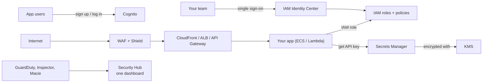

### Which one should I use?

**Storing secrets and keys:**

| Need | Use | Why |
| --- | --- | --- |
| API keys, database passwords, OAuth tokens (with automatic rotation) | **Secrets Manager** | Built for secrets; rotation; per-secret monthly fee |
| Plain config values and a few secrets on a budget | **Systems Manager Parameter Store** (SecureString) | Free standard tier; no built-in rotation |
| Encryption keys that encrypt your data in S3, EBS, RDS and more | **KMS** | Manages keys; it does not store your passwords |
| Your own dedicated hardware security module | **CloudHSM** | Only for strict compliance needs |
| HTTPS certificates for your domain | **ACM** | Free public certificates for AWS load balancers and CloudFront |

**Finding problems:**

| Service | Answers the question |
| --- | --- |
| **GuardDuty** | "Is someone attacking or misusing my account right now?" |
| **Inspector** | "Do my servers, containers, Lambda functions or code have known vulnerabilities?" |
| **Macie** | "Is there personal or sensitive data sitting in my S3 buckets?" |
| **Security Hub** | "Show me all security findings and best-practice checks in one place." |
| **Detective** | "Help me investigate what happened in this incident." |
| **Config** | "Which resources are set up against the rules, and what changed?" ([section 12](#12-management-and-governance)) |
| **CloudTrail** | "Who did what, when, through the AWS API?" ([section 13](#13-monitoring-and-observability)) |

**WAF or Shield?** **WAF** filters web requests (SQL injection, bad bots, rate limits). **Shield** protects against DDoS floods; **Shield Standard** is on for everyone for free, **Shield Advanced** is a paid upgrade. AWS has a decision guide "AWS WAF or AWS Shield?".

- **AWS IAM (Identity and Access Management)** - controls who (users, roles, services) can do which actions on which resources, using JSON policies. Free. **Use it** always: give each app its own IAM role with least privilege, and avoid long-lived access keys. **Never** use the root user for daily work. *GCP / Azure: IAM / Azure RBAC with Microsoft Entra ID.*
  - Docs: https://docs.aws.amazon.com/iam/
- **AWS IAM Identity Center (formerly AWS Single Sign-On)** - one login for your team to all AWS accounts and business apps, with short-lived credentials, connected to Google Workspace, Okta or Entra ID if you like. **Use it** instead of creating IAM users for people. *GCP / Azure: Cloud Identity / Microsoft Entra ID.*
  - Docs: https://docs.aws.amazon.com/singlesignon/
- **Amazon Cognito** - sign-up, login, password reset, social logins (Google, Apple) and MFA for your app's own users, issuing standard tokens (OAuth 2.0 / OpenID Connect). (The old **Cognito Sync** feature is **[CLOSED TO NEW CUSTOMERS]**.) **Use it** to add user accounts to a web or mobile app. **Skip it** if you already use Auth0, Clerk or similar. *GCP / Azure: Identity Platform, Firebase Authentication / Microsoft Entra External ID.*
  - Docs: https://docs.aws.amazon.com/cognito/
- **Amazon Verified Permissions** - checks fine-grained permissions inside your app ("can this user edit this document?") using the Cedar policy language. **Use it** when app permission rules get complex. *GCP / Azure: no direct match.*
  - Docs: https://docs.aws.amazon.com/verifiedpermissions/
- **AWS Directory Service** - managed Microsoft Active Directory in AWS, or a connector to your own AD. (**Simple AD** is **[CLOSED TO NEW CUSTOMERS]**; use AWS Managed Microsoft AD or AD Connector.) **Use it** for Windows workloads that need AD. *GCP / Azure: Managed Service for Microsoft AD / Microsoft Entra Domain Services.*
  - Docs: https://docs.aws.amazon.com/directory-service/
- **AWS KMS (Key Management Service)** - creates and guards encryption keys and encrypts data for 100+ AWS services; every use is logged in CloudTrail. **Use it** to encrypt S3, EBS, RDS and secrets (often on by default with AWS-managed keys). **Skip** dedicated hardware unless compliance demands it (CloudHSM). *GCP / Azure: Cloud KMS / Azure Key Vault.*
  - Docs: https://docs.aws.amazon.com/kms/
- **AWS Secrets Manager** - stores passwords, API keys (for example LLM provider keys) and tokens, encrypted with KMS, with automatic rotation and fine-grained access. **Use it** for every secret your app needs - never put secrets in code or Git. **Skip it** for plain non-secret config (Parameter Store). *GCP / Azure: Secret Manager / Azure Key Vault.*
  - Docs: https://docs.aws.amazon.com/secretsmanager/
- **AWS Certificate Manager (ACM)** - free public TLS/HTTPS certificates that renew automatically, for use with CloudFront, load balancers and API Gateway. **Use it** for HTTPS on your domain. *GCP / Azure: Certificate Manager / App Service certificates, Key Vault certificates.*
  - Docs: https://docs.aws.amazon.com/acm/
- **AWS Private Certificate Authority** - run your own private certificate authority for internal services and devices. **Use it** for internal mutual TLS or IoT device certificates. *GCP / Azure: Certificate Authority Service / no direct match.*
  - Docs: https://docs.aws.amazon.com/privateca/
- **AWS CloudHSM** - dedicated hardware security modules in AWS that only you control. **Use it** only when regulations require single-tenant hardware keys. *GCP / Azure: Cloud HSM / Azure Cloud HSM, Managed HSM.*
  - Docs: https://docs.aws.amazon.com/cloudhsm/
- **AWS WAF (Web Application Firewall)** - rules that block common web attacks, bad bots and too many requests, in front of CloudFront, ALB, API Gateway, AppSync and Cognito. (The old **WAF Classic** is **[RETIRED]** since 7 October 2026.) **Use it** on every public app; AWS managed rule groups are a good start. *GCP / Azure: Cloud Armor / Azure Web Application Firewall.*
  - Docs: https://docs.aws.amazon.com/waf/
- **AWS Shield** - protection against DDoS (flooding) attacks. **Shield Standard** is free and automatic; **Shield Advanced** adds stronger protection, cost protection and a response team. **Use** Advanced only for high-value public apps. *GCP / Azure: Cloud Armor / Azure DDoS Protection.*
  - Docs: https://docs.aws.amazon.com/shield/
- **AWS Network Firewall** - a managed network firewall for your VPCs that filters traffic by domain, IP and intrusion rules. **Use it** to control outgoing internet traffic from private subnets in regulated setups. **Skip it** for small apps (security groups are enough). *GCP / Azure: Cloud Next Generation Firewall / Azure Firewall.*
  - Docs: https://docs.aws.amazon.com/network-firewall/
- **AWS Firewall Manager** - sets WAF, Shield, security group and Network Firewall rules across all accounts in your organisation from one place. **Use it** when you have many accounts. *GCP / Azure: hierarchical firewall policies / Azure Firewall Manager.*
  - Docs: https://docs.aws.amazon.com/firewall-manager/
- **AWS Network Security Manager** - a newer service to define and deploy network security protections across your environment from one place. **Use it** in large multi-account networks. *GCP / Azure: no direct match / Azure Virtual Network Manager security rules.*
  - Docs: https://docs.aws.amazon.com/network-security-manager/
- **Amazon GuardDuty** - threat detection that watches CloudTrail, VPC traffic, DNS, S3, EKS, Lambda and runtime activity for signs of attack (stolen keys, crypto-mining). **Use it** in every account; turn it on in minutes. *GCP / Azure: Security Command Center / Microsoft Defender for Cloud.*
  - Docs: https://docs.aws.amazon.com/guardduty/
- **Amazon Inspector** - automatic vulnerability scanning of EC2, container images in ECR, Lambda functions and code repositories. (**Inspector Classic** is **[RETIRED]**.) **Use it** to find known security holes (CVEs) in what you deploy. *GCP / Azure: Artifact Analysis, Security Command Center / Microsoft Defender for Cloud.*
  - Docs: https://docs.aws.amazon.com/inspector/
- **Amazon Macie** - scans S3 buckets to find personal and sensitive data (names, card numbers, keys) and risky bucket settings. **Use it** before using S3 data to train or ground an AI model. *GCP / Azure: Sensitive Data Protection / Microsoft Purview.*
  - Docs: https://docs.aws.amazon.com/macie/
- **AWS Security Hub** - one dashboard that collects findings from GuardDuty, Inspector, Macie and partners, and checks your setup against best-practice standards. **Use it** as your security "home page" across accounts. *GCP / Azure: Security Command Center / Microsoft Defender for Cloud.*
  - Docs: https://docs.aws.amazon.com/securityhub/
- **Amazon Detective** - builds a graph of activity from logs to help you investigate a security finding ("what else did this key do?"). **Use it** during incident investigations. *GCP / Azure: Google Security Operations / Microsoft Sentinel.*
  - Docs: https://docs.aws.amazon.com/detective/
- **Amazon Security Lake** - collects security logs from AWS and other sources into your own S3 data lake in a standard format (OCSF). **Use it** when a security team wants all logs in one queryable place. *GCP / Azure: Google Security Operations / Microsoft Sentinel data lake.*
  - Docs: https://docs.aws.amazon.com/security-lake/
- **AWS Security Incident Response** - 24/7 help from AWS security responders plus tools to manage security incidents. **Use it** for production businesses that need expert help on call. *GCP / Azure: Mandiant / Microsoft Incident Response.*
  - Docs: https://docs.aws.amazon.com/security-ir/
- **AWS Security Agent** - an AI agent that reviews application designs and code and runs security testing to find issues early. **Use it** to add automated security review to development. *GCP / Azure: Security Command Center AI features / Microsoft Security Copilot.*
  - Docs: https://docs.aws.amazon.com/securityagent/
- **AWS Continuum** - finds, ranks, checks and helps fix security risks across the software lifecycle. **Use it** for organisations that want one place to manage application risk. *GCP / Azure: no direct match.*
  - Docs: https://docs.aws.amazon.com/continuum/
- **AWS Artifact** - download AWS's compliance reports (SOC, ISO, PCI) and sign agreements such as a HIPAA BAA. **Use it** when an auditor or customer asks for AWS's certifications. Free. *GCP / Azure: Compliance Reports Manager / Service Trust Portal.*
  - Docs: https://docs.aws.amazon.com/artifact/
- **AWS Audit Manager [CLOSED TO NEW CUSTOMERS]** - collected evidence for audits against frameworks. In maintenance since 31 March 2026. **Use instead:** AWS Assurance, Security Hub and Config conformance packs. *GCP / Azure: Audit Manager / Microsoft Purview Compliance Manager.*
  - Docs: https://docs.aws.amazon.com/audit-manager/latest/userguide/audit-manager-availability-change.html
- **AWS Assurance** - automated readiness checks that show how your AWS workloads line up with compliance frameworks. **Use it** to prepare for an audit. *GCP / Azure: Compliance Manager-style tools (Assured Workloads / Microsoft Purview Compliance Manager).*
  - Docs: https://docs.aws.amazon.com/ (listed under Management and Governance; its own page did not load when checked)
- **AWS RAM (Resource Access Manager)** - share resources such as subnets, Transit Gateways and license configs with other accounts in your organisation. **Use it** to share one network across many accounts. *GCP / Azure: Shared VPC / no direct match (Azure Lighthouse is closest).*
  - Docs: https://docs.aws.amazon.com/ram/
- **AWS Payment Cryptography** - managed payment-industry cryptography (card PINs, payment keys). **Use it** only for payment processing systems. *GCP / Azure: no direct match / Azure Payment HSM.*
  - Docs: https://docs.aws.amazon.com/payment-cryptography/
- **AWS Signer** - code signing for Lambda packages, container images and IoT firmware, so only trusted code runs. *GCP / Azure: Binary Authorization / Notation with Azure Key Vault.*
  - Docs: https://docs.aws.amazon.com/signer/
- **Amazon Cloud Directory [CLOSED TO NEW CUSTOMERS]** - a hierarchical directory store. **Use instead:** DynamoDB or Neptune. *GCP / Azure: no direct match.*
  - Docs: https://docs.aws.amazon.com/clouddirectory/
- **AWS GovCloud (US)** - isolated AWS Regions for US government and regulated workloads. **Use it** only if your contracts require it. *GCP / Azure: Assured Workloads / Azure Government.*
  - Docs: https://docs.aws.amazon.com/govcloud-us/

---

## 12. Management and governance

**In plain words:** once you have more than one project, you need rules and housekeeping. **Organizations** groups many AWS accounts (for example dev, staging, prod) under one bill and one set of guard rails. **Control Tower** sets that up for you with good defaults. **Config** records how every resource is configured and flags rule breaks. **Systems Manager** is a toolbox for running and patching servers and storing settings. **Trusted Advisor** and the **Well-Architected Tool** tell you what to improve.

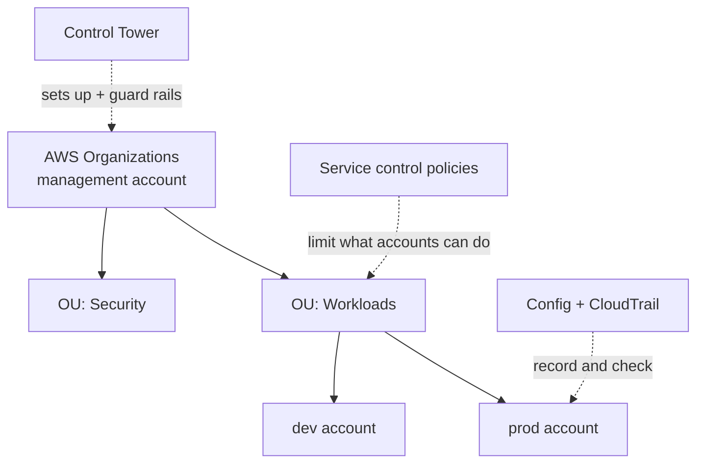

### Which one should I use?

| Need | Use |
| --- | --- |
| Several AWS accounts with one bill and shared rules | **Organizations** |
| A ready-made, well-configured multi-account setup ("landing zone") | **Control Tower** |
| Check resources against rules and see configuration history | **Config** |
| Patch servers, run commands, open a shell without SSH keys, store parameters | **Systems Manager** |
| Approved templates that other teams can launch | **Service Catalog** |
| Advice on cost, security, limits and reliability | **Trusted Advisor** |
| A structured review of your architecture | **Well-Architected Tool** (or Well-Architected Agent) |
| Know about AWS outages and maintenance that affect you | **AWS Health** |
| Check or raise service limits | **Service Quotas** |

- **AWS Organizations** - manage many AWS accounts as one group: one bill, organisational units, and **service control policies** that limit what any account can do. Free. **Use it** as soon as you have more than one account (keep production separate). *GCP / Azure: Resource Manager organization and folders / management groups.*
  - Docs: https://docs.aws.amazon.com/organizations/
- **AWS Control Tower** - sets up a secure multi-account "landing zone" with logging, guard rails (controls) and account vending. **Use it** when a company starts on AWS seriously. **Skip it** for a single personal learning account. *GCP / Azure: Cloud Foundation setup / Azure landing zones.*
  - Docs: https://docs.aws.amazon.com/controltower/
- **AWS Config** - records the configuration of your resources over time and checks them against rules ("no public S3 buckets", "EBS must be encrypted"), with automatic fixes. **Use it** for compliance and change tracking. It charges per recorded item, so scope it in small accounts. *GCP / Azure: Cloud Asset Inventory, Organization Policy / Azure Policy, Resource Graph.*
  - Docs: https://docs.aws.amazon.com/config/
- **AWS Systems Manager** - a toolbox for servers and settings: **Parameter Store** (config and secrets), **Session Manager** (shell access without SSH or open ports), **Patch Manager**, **Run Command**, **Automation** runbooks, **Fleet Manager** and inventory, for EC2 and on-premises machines. (Application Manager, Change Manager and Incident Manager are **[CLOSED TO NEW CUSTOMERS]**.) **Use** Parameter Store and Session Manager from day one. *GCP / Azure: VM Manager, IAP SSH / Azure Arc, Azure Automation, Update Manager.*
  - Docs: https://docs.aws.amazon.com/systems-manager/
- **AWS Service Catalog** - a catalog of approved CloudFormation or Terraform templates other teams can launch on their own. (Its AppRegistry feature is **[CLOSED TO NEW CUSTOMERS]**.) **Use it** in larger companies with a platform team. *GCP / Azure: Service Catalog / Azure Managed Applications service catalog.*
  - Docs: https://docs.aws.amazon.com/servicecatalog/
- **AWS Trusted Advisor** - automatic checks with advice on cost savings, security, fault tolerance, performance and service limits. Basic checks are free; full checks come with Business support or higher. **Use it** for a quick health check of your account. *GCP / Azure: Recommender (Active Assist) / Azure Advisor.*
  - Docs: https://docs.aws.amazon.com/awssupport/latest/user/trusted-advisor.html
- **AWS Health (AWS Health Dashboard)** - shows AWS service issues, scheduled maintenance and notices that affect your own resources, with events you can automate on. **Use it** when "is it me or is it AWS?". *GCP / Azure: Personalized Service Health / Azure Service Health.*
  - Docs: https://docs.aws.amazon.com/health/
- **AWS License Manager** - tracks software licenses (Windows, SQL Server, Oracle) so you do not break license terms. **Use it** when you bring your own licenses. *GCP / Azure: no direct match / Azure Hybrid Benefit tracking in Cost Management.*
  - Docs: https://docs.aws.amazon.com/license-manager/
- **AWS Well-Architected Tool** - a free questionnaire that reviews a workload against the six pillars (operations, security, reliability, performance, cost, sustainability) and makes an improvement plan. The **Well-Architected Agent** is an AI-powered helper for the same goal. **Use it** before a big launch. *GCP / Azure: Google Cloud Architecture Framework / Azure Well-Architected Review.*
  - Docs: https://docs.aws.amazon.com/wellarchitected/
- **Service Quotas** - see and request increases to limits such as "how many GPU vCPUs may I run". **Use it** before launching GPU instances or big jobs - new accounts often start with GPU quota of zero. *GCP / Azure: Quotas page / Azure quotas.*
  - Docs: https://docs.aws.amazon.com/servicequotas/
- **AWS Resource Explorer, Resource Groups and Tag Editor** - search all resources across Regions, group them by tags, and edit tags in bulk. **Use them** to find forgotten resources that cost money. *GCP / Azure: Cloud Asset Inventory / Azure Resource Graph.*
  - Docs: https://docs.aws.amazon.com/ARG/
- **AWS AppConfig** - safely roll out feature flags and app settings without redeploying, with automatic rollback. **Use it** to switch prompts or models on and off gradually. *GCP / Azure: Firebase Remote Config / Azure App Configuration.*
  - Docs: https://docs.aws.amazon.com/appconfig/
- **AWS Resilience Hub** - assesses whether an app can meet its recovery goals and suggests fixes. **Use it** for apps with strict uptime targets. *GCP / Azure: no direct match / Azure Chaos Studio plus Advisor.*
  - Docs: https://docs.aws.amazon.com/resilience-hub/
- **AWS Launch Wizard** - guided deployment of common enterprise apps such as SAP and SQL Server. *GCP / Azure: Workload Manager / Azure Center for SAP solutions.*
  - Docs: https://docs.aws.amazon.com/launchwizard/
- **AWS Management Console, AWS CLI, AWS CloudShell and Console Mobile Application** - the ways you work with AWS: website, command line (`aws ...`), a browser shell with the CLI pre-installed and logged in, and a phone app. **Use** CloudShell for quick commands without installing anything. *GCP / Azure: Cloud Console, gcloud, Cloud Shell / Azure portal, az CLI, Azure Cloud Shell.*
  - Docs: https://docs.aws.amazon.com/cli/
- **AWS User Notifications and Amazon Q Developer in chat applications (formerly AWS Chatbot)** - send AWS alerts to email, mobile and chat, and ask about or act on AWS from Slack or Microsoft Teams. **Use them** to get alarms where your team already talks. *GCP / Azure: Cloud Monitoring notification channels / Azure Monitor action groups.*
  - Docs: https://docs.aws.amazon.com/chatbot/
- **AWS DevOps Agent** - an AI agent that investigates and helps resolve operational incidents in your AWS environment and suggests ways to prevent them. **Use it** to speed up on-call troubleshooting. *GCP / Azure: Gemini Cloud Assist / Azure SRE Agent.*
  - Docs: https://docs.aws.amazon.com/devopsagent/
- **AWS Account Management** - change account contacts, Regions you allow, and close accounts. *GCP / Azure: project settings / subscription settings.*
  - Docs: https://docs.aws.amazon.com/accounts/latest/reference/accounts-welcome.html
- **AWS Proton [RETIRED]** - templates for platform teams to give developers ready-made infrastructure. Support ended 7 October 2026 (deployed resources stay). **Use instead:** Service Catalog, CDK or Terraform modules. *GCP / Azure: no direct match.*
  - Docs: https://docs.aws.amazon.com/proton/
- **AWS OpsWorks (Stacks, for Chef Automate, for Puppet Enterprise) [RETIRED]** - managed Chef and Puppet configuration management. Retired in May 2024. **Use instead:** Systems Manager (State Manager, Automation) or Ansible/Chef/Puppet on your own. *GCP / Azure: no direct match / Azure Automation State Configuration.*
  - Docs: https://docs.aws.amazon.com/general/latest/gr/service-lifecycle.html
- **Smaller management services** - **AWS Telco Network Builder** (deploy telecom 5G network functions), **AWS Sustainability** (carbon footprint data), **AWS Service Management Connector** (links AWS to ServiceNow and Jira; **[ENDING: 31 March 2027]**). *GCP / Azure: Telecom Network Automation, Carbon Footprint / Azure Operator Nexus, Emissions Impact Dashboard.*
  - Docs: https://docs.aws.amazon.com/tnb/

> **Compute Optimizer**, **Cost Explorer** and **Budgets** are in [Cost management](#23-cost-management). **CloudFormation** and **CDK** are in [Developer tools](#14-developer-tools-and-cicd).

---

## 13. Monitoring and observability

**In plain words:** "observability" means being able to see what your app and your account are doing. **CloudWatch** collects metrics (numbers over time), logs and alarms for your apps. **CloudTrail** records every action anyone takes through the AWS API (who deleted that bucket?). **Config** records how resources are configured. **X-Ray** (and CloudWatch Application Signals) follows one request across many services as a "trace". For LLM apps, CloudWatch also has a generative AI view of model calls and AgentCore agents.

### Which one should I use?

| Question you are asking | Service |
| --- | --- |
| "Is my app healthy? How many errors, how slow, how much CPU?" | **CloudWatch** metrics, logs, alarms, dashboards |
| "Who changed or deleted this resource, and when?" | **CloudTrail** |
| "What did this resource look like last Tuesday, and is it compliant?" | **Config** |
| "Which service in the chain made this request slow?" | **X-Ray** / CloudWatch Application Signals (OpenTelemetry traces) |
| "How many tokens and how much latency do my Bedrock calls and agents have?" | **CloudWatch generative AI observability** + AgentCore Observability |
| "I want Prometheus metrics and Grafana dashboards" | **Managed Service for Prometheus** + **Managed Grafana** |

AWS has the decision guide "AWS CloudTrail or Amazon CloudWatch?".

- **Amazon CloudWatch** - the main monitoring service: metrics, logs (CloudWatch Logs and Logs Insights queries), alarms, dashboards, **Application Signals** (app health and traces), **Synthetics** (scripted checks of your site), **RUM** (real user monitoring), **Internet Monitor**, anomaly detection and a generative AI observability view. **Use it** for every app; set alarms on errors, latency and cost. **Watch out:** high log volumes and long retention cost money - set retention periods. *GCP / Azure: Cloud Monitoring and Cloud Logging / Azure Monitor (Log Analytics, Application Insights).*
  - Docs: https://docs.aws.amazon.com/cloudwatch/
- **AWS CloudTrail** - an audit log of API calls in your account (who, what, when, from where); the last 90 days of management events are free to view. (**CloudTrail Lake** is **[CLOSED TO NEW CUSTOMERS]**; query trails with Athena or CloudWatch instead.) **Use it** always; create an organisation trail to S3 for long-term records. *GCP / Azure: Cloud Audit Logs / Azure Activity Log.*
  - Docs: https://docs.aws.amazon.com/cloudtrail/
- **AWS X-Ray** - distributed tracing: follows a request through API Gateway, Lambda, ECS and databases to show where time goes. AWS now steers new tracing toward OpenTelemetry and CloudWatch Application Signals. **Use it** when a slow request crosses several services. *GCP / Azure: Cloud Trace / Application Insights.*
  - Docs: https://docs.aws.amazon.com/xray/
- **Amazon Managed Service for Prometheus** - managed, scalable Prometheus-compatible metric storage, common with EKS. **Use it** if you already use Prometheus. *GCP / Azure: Managed Service for Prometheus / Azure Monitor managed service for Prometheus.*
  - Docs: https://docs.aws.amazon.com/prometheus/
- **Amazon Managed Grafana** - managed Grafana dashboards connected to CloudWatch, Prometheus, X-Ray and other sources. **Use it** if your team likes Grafana. *GCP / Azure: no direct match (self-host Grafana) / Azure Managed Grafana.*
  - Docs: https://docs.aws.amazon.com/grafana/
- **AWS Distro for OpenTelemetry (ADOT)** - AWS's supported build of OpenTelemetry for sending traces, metrics and logs from your code to CloudWatch, X-Ray, Prometheus or other tools. **Use it** to instrument apps and agents in a vendor-neutral way. *GCP / Azure: OpenTelemetry with Google-built collector / Azure Monitor OpenTelemetry Distro.*
  - Docs: https://aws-otel.github.io/docs/introduction
- **Amazon DevOps Guru [ENDING: 29 September 2027]** - ML-based detection of unusual operational behaviour. Sunset announced September 2026. **Use instead:** CloudWatch anomaly detection, Application Signals and the AWS DevOps Agent. *GCP / Azure: no direct match / Azure Monitor smart detection.*
  - Docs: https://docs.aws.amazon.com/devops-guru/latest/userguide/devops-guru-end-of-support.html
- **AWS Systems Manager Incident Manager [CLOSED TO NEW CUSTOMERS]** - on-call rotations and incident response plans. In maintenance since November 2025. **Use instead:** a third-party on-call tool (PagerDuty, Opsgenie-style) or CloudWatch alarms + SNS + chat. *GCP / Azure: no direct match.*
  - Docs: https://docs.aws.amazon.com/incident-manager/latest/userguide/incident-manager-availability-change.html

---

## 14. Developer tools and CI/CD

**In plain words:** developer tools help you write code, store it, test it, and ship it to AWS automatically. **CI/CD** means "continuous integration and continuous delivery": every push to Git builds, tests and deploys your app. **Infrastructure as code (IaC)** means describing your AWS resources in files (CloudFormation, CDK, Terraform) so you can recreate them exactly. Many teams use **GitHub Actions** for CI/CD and log in to AWS with OIDC roles (no stored keys); AWS's own Code* services are the native alternative.

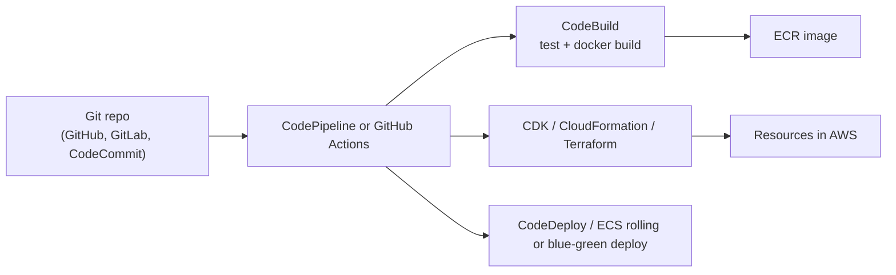

### Which one should I use?

**Infrastructure as code:**

| Tool | You write | Best for |
| --- | --- | --- |
| **CloudFormation** | YAML/JSON templates | The native base layer; everything else on AWS can compile to it |
| **AWS CDK** | Python, TypeScript, Java, Go, C# code | Developers who prefer real code, loops and reusable components |
| **AWS SAM** | Short YAML for serverless | Lambda + API Gateway + DynamoDB apps |
| **Terraform / OpenTofu** (not AWS) | HCL | Teams using several clouds |

**CI/CD:** already on GitHub or GitLab -> use their pipelines with an AWS OIDC role. Want everything inside AWS -> **CodePipeline + CodeBuild** (+ **CodeDeploy** for EC2/Lambda/ECS blue-green).

- **AWS CloudFormation** - describe AWS resources in a template and AWS creates, updates or deletes them together as a "stack", rolling back on errors. **Use it** directly or through CDK/SAM for repeatable environments. **Skip** hand-clicking in the console for anything you will need again. *GCP / Azure: Infrastructure Manager (Terraform) / ARM templates and Bicep.*
  - Docs: https://docs.aws.amazon.com/cloudformation/
- **AWS CDK (Cloud Development Kit)** - write infrastructure in Python or TypeScript (and others) using ready-made building blocks; it generates CloudFormation. **Use it** if you are a developer who prefers code over YAML. **Skip it** if your team standardises on Terraform. *GCP / Azure: no direct match (Pulumi) / Bicep.*
  - Docs: https://docs.aws.amazon.com/cdk/
- **AWS CodePipeline** - a managed release pipeline: source -> build -> test -> deploy stages, triggered by Git pushes. **Use it** for CI/CD that stays inside AWS. **Skip it** if GitHub Actions or GitLab CI already work well for you. *GCP / Azure: Cloud Build + Cloud Deploy / Azure Pipelines.*
  - Docs: https://docs.aws.amazon.com/codepipeline/
- **AWS CodeBuild** - runs build and test commands in fresh containers, pay per minute; can also run GitHub Actions jobs on AWS machines. **Use it** to build Docker images and run tests in AWS. *GCP / Azure: Cloud Build / Azure Pipelines.*
  - Docs: https://docs.aws.amazon.com/codebuild/
- **AWS CodeDeploy** - automates deployments to EC2, on-premises servers, Lambda and ECS, including blue/green and canary rollouts with automatic rollback. **Use it** for safe rollouts of new versions. *GCP / Azure: Cloud Deploy / Azure Pipelines.*
  - Docs: https://docs.aws.amazon.com/codedeploy/
- **AWS CodeCommit** - private Git repositories hosted by AWS, using IAM for access. It was closed to new customers in July 2024, but AWS reopened it to new customers on 24 November 2025. **Use it** if you want Git inside AWS with IAM. **Skip it** if you already use GitHub or GitLab (most teams do). *GCP / Azure: Secure Source Manager / Azure Repos.*
  - Docs: https://docs.aws.amazon.com/codecommit/
- **AWS CodeArtifact** - a private package repository for pip, npm, Maven, NuGet and others, which can also cache public packages. **Use it** to share internal Python packages or control which public packages builds may use. *GCP / Azure: Artifact Registry / Azure Artifacts.*
  - Docs: https://docs.aws.amazon.com/codeartifact/
- **Amazon CodeGuru** - **CodeGuru Profiler** finds slow and expensive lines in running Java and Python apps (still available). **CodeGuru Reviewer** (automated code review) is **[CLOSED TO NEW CUSTOMERS]** since October 2025, and CodeGuru Security's code scanning moved to Amazon Inspector. **Use** Profiler for performance tuning; use Inspector or Kiro for code checks. *GCP / Azure: Cloud Profiler / Application Insights Profiler.*
  - Docs: https://docs.aws.amazon.com/codeguru/
- **Kiro** - AWS's AI coding IDE and command-line tool with "spec-driven development" (it writes requirements and a design before code), agent hooks and MCP support; the successor to the Amazon Q Developer IDE plugins (and, before that, CodeWhisperer). **Use it** for AI-assisted coding on any project. *GCP / Azure: Gemini Code Assist / GitHub Copilot.*
  - Docs: https://kiro.dev/docs/
- **AWS Cloud9 [CLOSED TO NEW CUSTOMERS]** - a browser-based IDE on an EC2 machine. Closed to new customers since July 2024. **Use instead:** CloudShell, VS Code with the AWS Toolkit, or SageMaker Studio Code Editor. *GCP / Azure: Cloud Workstations / GitHub Codespaces.*
  - Docs: https://docs.aws.amazon.com/cloud9/
- **AWS CloudShell** - a free browser terminal in the AWS console with the AWS CLI, Python and Git ready, already logged in as you. **Use it** for quick commands and learning. *GCP / Azure: Cloud Shell / Azure Cloud Shell.*
  - Docs: https://docs.aws.amazon.com/cloudshell/
- **AWS Fault Injection Service (FIS)** - "chaos engineering": safely break things on purpose (stop instances, add latency, fail an AZ) to test that your app recovers. **Use it** before you promise high availability. *GCP / Azure: no direct match / Azure Chaos Studio.*
  - Docs: https://docs.aws.amazon.com/fis/
- **AWS Toolkits for IDEs, AWS SDKs and AWS Tools for PowerShell** - plugins for VS Code, JetBrains and Visual Studio, and code libraries for Python (`boto3`), JavaScript, Java, Go, .NET, Rust and more. **Use** `boto3` from Python notebooks and apps. *GCP / Azure: Cloud Code, Google Cloud client libraries / Azure Tools for VS Code, Azure SDKs.*
  - Docs: https://docs.aws.amazon.com/sdk-for-python/
- **AWS Infrastructure Composer [ENDING: 29 September 2027]** - a visual drag-and-drop designer for serverless and CloudFormation architectures; the standalone console ends 7 December 2026. **Use instead:** CDK or SAM, or the AWS Toolkit in VS Code. *GCP / Azure: no direct match.*
  - Docs: https://docs.aws.amazon.com/infrastructure-composer/latest/dg/composer-availability-change.html
- **AWS Cloud Control API** - one standard create/read/update/delete API for hundreds of AWS resource types, used by tools such as Terraform's AWS Cloud Control provider. **Use it** when building your own infrastructure tools. *GCP / Azure: no direct match / Azure Resource Manager API.*
  - Docs: https://docs.aws.amazon.com/cloudcontrolapi/
- **AWS Emulator** - test your code against AWS APIs locally with no AWS account. **Use it** for fast, free local testing (similar in idea to the open-source LocalStack). *GCP / Azure: Cloud emulators (Firestore, Pub/Sub) / Azurite and Cosmos DB emulator.*
  - Docs: https://docs.aws.amazon.com/emulator/
- **Agent Toolkit for AWS** - tools, knowledge and guard rails that AI coding agents use to build, deploy and manage apps on AWS (for example through MCP servers). **Use it** when you let an AI coding agent work with your AWS account. *GCP / Azure: Google Cloud MCP servers / Azure MCP Server.*
  - Docs: https://docs.aws.amazon.com/agent-toolkit/
- **AWS App Studio** - a generative-AI, low-code tool to build internal business apps by describing them in plain language. **Use it** for simple internal tools without coding. *GCP / Azure: AppSheet / Power Apps.*
  - Docs: https://docs.aws.amazon.com/appstudio/
- **Amazon Corretto** - a free, long-term-supported build of OpenJDK (Java) from AWS. **Use it** for Java apps on AWS. *GCP / Azure: no direct match / Microsoft Build of OpenJDK.*
  - Docs: https://docs.aws.amazon.com/corretto/
- **Amazon CodeCatalyst [CLOSED TO NEW CUSTOMERS]** - an all-in-one software development service. In maintenance since November 2025. **Use instead:** GitHub/GitLab with CodeBuild or CodePipeline. *GCP / Azure: no direct match / Azure DevOps.*
  - Docs: https://docs.aws.amazon.com/codecatalyst/latest/userguide/migration.html
- **AWS CodeStar [RETIRED]** - project templates that wired up Code* services. Retired July 2024. **Use instead:** CodePipeline or GitHub Actions templates. *GCP / Azure: no direct match.*
  - Docs: https://docs.aws.amazon.com/general/latest/gr/service-lifecycle.html
- **AWS .NET modernization tools [CLOSED TO NEW CUSTOMERS]** - Porting Assistant for .NET, Microservice Extractor for .NET and Toolkit for .NET Refactoring. **Use instead:** AWS Transform for .NET. *GCP / Azure: no direct match.*
  - Docs: https://docs.aws.amazon.com/portingassistant/

> **AWS Amplify** and **AWS Device Farm** are in [Front-end web and mobile](#21-front-end-web-and-mobile). **AWS X-Ray** is in [Monitoring](#13-monitoring-and-observability). **AWS SAM** is in [Serverless](#3-serverless).

---
## 15. Migration and transfer

**In plain words:** migration services help you move existing servers, databases, files and code from your own data center (or another cloud) into AWS. The usual order is: **discover** what you have, **move** servers (Transform MGN) and databases (DMS), **copy** files (DataSync, Transfer Family), then **modernise** (AWS Transform uses AI agents to help rewrite old code).

### Which one should I use?

| Moving... | Use |
| --- | --- |
| Whole servers (physical, VMware, other clouds) as they are ("lift and shift") | **AWS Transform MGN** (formerly Application Migration Service) |
| A database, with little downtime | **AWS DMS** (+ **Schema Conversion** if the engine changes, for example Oracle to PostgreSQL) |
| Large file shares or object stores, online | **AWS DataSync** |
| Files from partners over SFTP/FTPS/AS2 | **AWS Transfer Family** |
| Many terabytes from physical drives | **AWS Data Transfer Terminal** |
| VMware environments as they are | **Amazon Elastic VMware Service (EVS)** |
| Old code (.NET, Java, mainframe COBOL, VMware) that needs modernising | **AWS Transform** |

- **AWS Transform** - uses AI agents to plan and speed up migration and modernisation: .NET to cross-platform .NET, mainframe code, VMware moves and Java upgrades. **Use it** for large modernisation projects. *GCP / Azure: Migration Center with Gemini / Azure Migrate with GitHub Copilot app modernization.*
  - Docs: https://docs.aws.amazon.com/transform/
- **AWS Transform MGN [RENAMED] (formerly AWS Application Migration Service, MGN)** - copies your servers block by block into AWS continuously, then launches them on EC2 with a short cutover. **Use it** for "lift and shift" of many servers. **Skip it** for containers or serverless rewrites. *GCP / Azure: Migrate to Virtual Machines / Azure Migrate.*
  - Docs: https://docs.aws.amazon.com/mgn/
- **AWS DMS (Database Migration Service)** - moves databases into AWS while the source keeps running, and can keep replicating changes; **DMS Schema Conversion** converts schemas between engines. (DMS Fleet Advisor is **[RETIRED]**.) **Use it** to move a production database with minimal downtime. *GCP / Azure: Database Migration Service / Azure Database Migration Service.*
  - Docs: https://docs.aws.amazon.com/dms/
- **AWS Schema Conversion Tool (SCT)** - a desktop app that converts database schemas and code (for example Oracle PL/SQL to PostgreSQL). Newer projects often use DMS Schema Conversion in the console instead. **Use it** for complex engine changes. *GCP / Azure: Database Migration Service conversion workspaces / SQL Server Migration Assistant.*
  - Docs: https://docs.aws.amazon.com/SchemaConversionTool/
- **AWS DataSync** - fast, online copying of files and objects between on-premises storage, other clouds and S3/EFS/FSx, with checks and scheduling. **Use it** to move datasets or keep them in sync. *GCP / Azure: Storage Transfer Service / Azure Storage Mover, AzCopy.*
  - Docs: https://docs.aws.amazon.com/datasync/
- **AWS Transfer Family** - managed SFTP, FTPS, FTP and AS2 servers that store files directly in S3 or EFS. **Use it** when partners send files by SFTP. *GCP / Azure: no direct match / Azure Blob Storage SFTP.*
  - Docs: https://docs.aws.amazon.com/transfer/
- **AWS Migration Hub [CLOSED TO NEW CUSTOMERS]** - a dashboard for tracking migrations. In maintenance since November 2025. **Use instead:** AWS Transform. *GCP / Azure: Migration Center / Azure Migrate.*
  - Docs: https://docs.aws.amazon.com/migrationhub/latest/ug/migrationhub-availability-change.html
- **AWS Application Discovery Service [CLOSED TO NEW CUSTOMERS]** - collected server inventory and dependencies before a migration. In maintenance since October 2025. **Use instead:** AWS Transform discovery features or partner tools. *GCP / Azure: Migration Center / Azure Migrate discovery.*
  - Docs: https://docs.aws.amazon.com/application-discovery/latest/userguide/application-discovery-service-availability-change.html
- **AWS Mainframe Modernization** - tools to analyse, refactor or replatform mainframe (COBOL) apps. Its managed runtime and self-managed experiences are **[CLOSED TO NEW CUSTOMERS]**; AWS Transform for mainframe is the main path. *GCP / Azure: Mainframe Modernization tools / Azure mainframe migration partners.*
  - Docs: https://docs.aws.amazon.com/m2/latest/userguide/mainframe-modernization-availability-change.html
- **AWS Data Transfer Terminal** - secure AWS locations where you bring physical drives and upload data quickly to AWS. **Use it** for very large one-off uploads (replaces many Snowball uses). *GCP / Azure: Transfer Appliance / Azure Data Box.*
  - Docs: https://docs.aws.amazon.com/datatransferterminal/
- **AWS Server Migration Service (SMS) [RETIRED]** - older server migration tool, retired 2023. **Use instead:** AWS Transform MGN. *GCP / Azure: Migrate to Virtual Machines / Azure Migrate.*
  - Docs: https://docs.aws.amazon.com/general/latest/gr/service-lifecycle.html

> **Snowball** and **Snowmobile** are in [Storage](#4-storage). **Elastic Disaster Recovery** is in [Storage](#4-storage). VMware options are in [Hybrid and edge](#24-hybrid-and-edge).

---

## 16. End-user computing

**In plain words:** these services give people a desktop, an app or a browser that actually runs in AWS and is streamed to their laptop, tablet or thin client. Companies use them for remote staff, contractors, call centers and secure access to sensitive data, because nothing is stored on the user's device.

| Need | Use |
| --- | --- |
| A full Windows or Linux desktop per person | **WorkSpaces** (Personal) |
| Stream single apps to a browser | **WorkSpaces Applications** (formerly AppStream 2.0) |
| Your own VDI software on AWS machines | **WorkSpaces Core** |
| Remote access to powerful 3D/graphics machines | **Amazon DCV** |

- **Amazon WorkSpaces** - persistent virtual Windows or Linux desktops in the cloud, paid monthly or hourly. (**WorkSpaces Pools** and the **PCoIP** protocol are **[ENDING: 30 June 2027]**; use WorkSpaces Applications and the DCV protocol.) **Use it** for remote staff who need a full desktop. *GCP / Azure: no direct match (partners) / Azure Virtual Desktop, Windows 365.*
  - Docs: https://docs.aws.amazon.com/workspaces/
- **Amazon WorkSpaces Applications [RENAMED] (formerly Amazon AppStream 2.0)** - streams individual desktop applications to a web browser; it also offers MCP tools so AI agents can operate desktop apps. **Use it** to give users one heavy app (CAD, analytics tools) without installing it. *GCP / Azure: no direct match / Azure Virtual Desktop RemoteApp.*
  - Docs: https://docs.aws.amazon.com/appstream2/
- **Amazon WorkSpaces Core** - AWS infrastructure for running third-party VDI software (Citrix, Omnissa and others). **Use it** if you already use such a VDI product. *GCP / Azure: no direct match / Azure Virtual Desktop with partners.*
  - Docs: https://docs.aws.amazon.com/workspaces-core/
- **Amazon DCV (formerly NICE DCV)** - a high-performance remote display protocol for graphics-heavy and 3D apps on remote servers (also used inside WorkSpaces). **Use it** to work on a GPU EC2 machine with a smooth remote desktop. *GCP / Azure: no direct match / no direct match.*
  - Docs: https://docs.aws.amazon.com/dcv/
- **Amazon WorkSpaces Secure Browser [CLOSED TO NEW CUSTOMERS]** - a locked-down browser streamed from AWS for reaching internal websites. In maintenance since 29 September 2026. **Use instead:** AWS Verified Access or WorkSpaces Applications. *GCP / Azure: Chrome Enterprise Premium / Microsoft Edge for Business with Entra.*
  - Docs: https://docs.aws.amazon.com/workspaces-web/latest/adminguide/workspaces-secure-browser-maintenance-mode.html
- **Amazon WorkSpaces Thin Client [ENDING: 31 March 2027]** - a small low-cost device for connecting to WorkSpaces. **Use instead:** standard thin clients or laptops with the WorkSpaces client. *GCP / Azure: ChromeOS devices / Windows 365 Link.*
  - Docs: https://docs.aws.amazon.com/workspaces-thin-client/latest/ug/workspacesthinclient-end-of-support.html
- **Amazon WorkDocs [RETIRED]** - document storage and sharing. Retired 25 April 2025. **Use instead:** S3 with your own app, or Google Drive / Microsoft OneDrive / Box. *GCP / Azure: Google Drive / OneDrive, SharePoint.*
  - Docs: https://docs.aws.amazon.com/general/latest/gr/service-lifecycle.html

---

## 17. Internet of Things (IoT)

**In plain words:** IoT means physical devices (sensors, machines, cars, cameras) sending data to the cloud and receiving commands. **IoT Core** is the secure meeting point where millions of devices connect (usually with MQTT messages). **Greengrass** runs code, even ML models, on a local gateway near the devices. **Device Management** and **Device Defender** keep fleets updated and safe. **SiteWise** and **TwinMaker** model industrial equipment. AWS retired several older IoT services in 2025-2026, so many old tutorials no longer work.

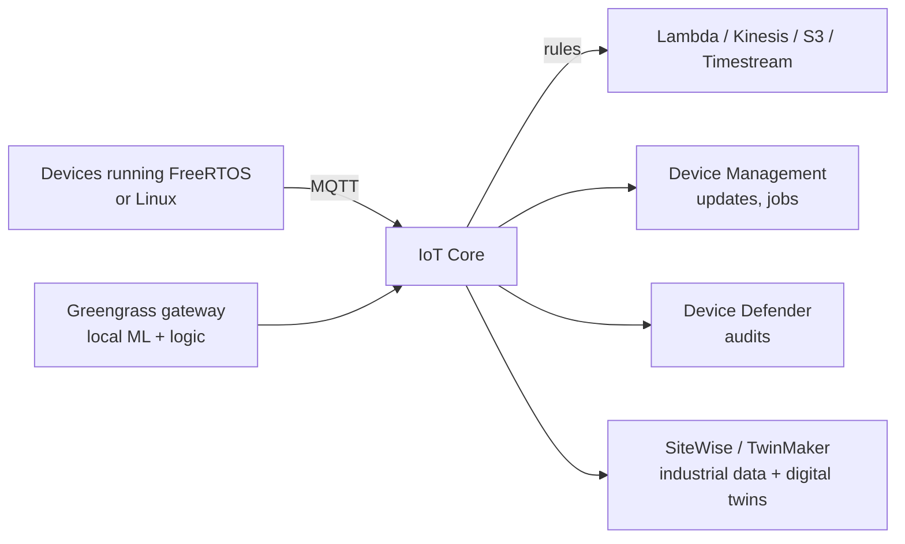

| Need | Use |
| --- | --- |
| Connect devices and route their messages | **IoT Core** |
| Run code or ML on a local gateway | **IoT Greengrass** (V2) |
| Organise, update and monitor a large fleet | **IoT Device Management** |
| Audit device security settings | **IoT Device Defender** (Audit) |
| Collect and model factory equipment data | **IoT SiteWise** |
| 3D digital twins of buildings or factories | **IoT TwinMaker** |
| Store and analyse IoT data (instead of retired IoT Analytics) | S3 + Glue + Athena, or Timestream for InfluxDB |
| React to device events (instead of retired IoT Events) | IoT Core rules + Lambda or Step Functions |

- **AWS IoT Core** - a managed service where devices connect securely (MQTT, HTTPS), send messages and receive commands; rules forward data to Lambda, S3, Kinesis and more. **Use it** as the starting point for any IoT project. *GCP / Azure: no first-party match since Cloud IoT Core was retired (partners) / Azure IoT Hub.*
  - Docs: https://docs.aws.amazon.com/iot/
- **AWS IoT Greengrass** - software for edge gateways that runs Lambda functions, containers and ML models locally, even when offline, and syncs with the cloud. (**Greengrass V1** is **[RETIRED]**; use V2.) **Use it** for local processing near machines or cameras. *GCP / Azure: Google Distributed Cloud edge / Azure IoT Edge.*
  - Docs: https://docs.aws.amazon.com/greengrass/
- **AWS IoT Device Management** - register, organise, search, update (over-the-air) and remotely control fleets of devices. (Fleet Hub is **[RETIRED]**.) **Use it** when you have more than a few devices. *GCP / Azure: no direct match / Azure IoT Hub device management, Device Update.*
  - Docs: https://docs.aws.amazon.com/iot-device-management/
- **AWS IoT Device Defender** - audits device and cloud settings for security problems. Its **Detect** feature (behaviour monitoring) is **[CLOSED TO NEW CUSTOMERS]** since August 2026; Audit continues. **Use it** to check fleet security. *GCP / Azure: no direct match / Microsoft Defender for IoT.*
  - Docs: https://docs.aws.amazon.com/iot-device-defender/
- **AWS IoT SiteWise** - collects, stores and models data from industrial equipment (factories, wind farms). (SiteWise **Monitor** and the data processing pack are **[CLOSED TO NEW CUSTOMERS]**.) **Use it** for industrial IoT data. *GCP / Azure: Manufacturing Data Engine / Azure IoT Operations.*
  - Docs: https://docs.aws.amazon.com/iot-sitewise/
- **AWS IoT TwinMaker** - builds digital twins (live 3D models) of real places and machines from IoT and other data. **Use it** for visual factory or building monitoring. *GCP / Azure: no direct match / Azure Digital Twins.*
  - Docs: https://docs.aws.amazon.com/iot-twinmaker/
- **AWS IoT FleetWise [CLOSED TO NEW CUSTOMERS]** - collected vehicle data from cars and trucks. In maintenance since 31 March 2026. **Use instead:** IoT Core with your own vehicle data pipeline, or partner solutions. *GCP / Azure: no direct match.*
  - Docs: https://docs.aws.amazon.com/iot-fleetwise/latest/developerguide/iotfleetwise-availability-change.html
- **FreeRTOS** - a free, open-source real-time operating system for small microcontrollers, with libraries to connect to IoT Core. **Use it** on tiny devices. *GCP / Azure: no direct match / Eclipse ThreadX (formerly Azure RTOS).*
  - Docs: https://docs.aws.amazon.com/freertos/
- **AWS IoT ExpressLink** - ready-made connectivity modules (from partner hardware makers) that connect a device to AWS with simple commands. **Use it** to add secure cloud connectivity to hardware quickly. *GCP / Azure: no direct match.*
  - Docs: https://docs.aws.amazon.com/iot-expresslink/
- **AWS IoT Wireless (IoT Core for LoRaWAN and Amazon Sidewalk)** - connect low-power, long-range wireless devices to IoT Core. **Use it** for sensors spread over large areas. *GCP / Azure: no direct match.*
  - Docs: https://docs.aws.amazon.com/iot-wireless/
- **AWS IoT Analytics [RETIRED]** - IoT data processing and storage. Retired 15 December 2025. **Use instead:** IoT Core rules to S3/Kinesis, then Glue, Athena or Timestream for InfluxDB. *GCP / Azure: BigQuery / Azure Data Explorer.*
  - Docs: https://docs.aws.amazon.com/general/latest/gr/service-lifecycle.html
- **AWS IoT Events [RETIRED]** - detected device states and triggered actions. Retired 20 May 2026. **Use instead:** IoT Core rules with Lambda or Step Functions. *GCP / Azure: no direct match / Azure Stream Analytics.*
  - Docs: https://docs.aws.amazon.com/general/latest/gr/service-lifecycle.html
- **AWS IoT 1-Click, IoT Things Graph, IoT RoboRunner [RETIRED]** - older IoT services, all retired between 2022 and 2025. *GCP / Azure: no direct match.*
  - Docs: https://docs.aws.amazon.com/general/latest/gr/service-lifecycle.html

---

## 18. Media and game tech

**In plain words:** media services process and deliver video. A live stream goes **in** (MediaConnect or MediaLive), gets **encoded** (MediaLive for live, MediaConvert for files), **packaged** for phones and TVs (MediaPackage), has **ads inserted** (MediaTailor) and is **delivered** by CloudFront. **IVS** packs the whole live pipeline into one simple service. Game tech services host multiplayer game servers and stream games.

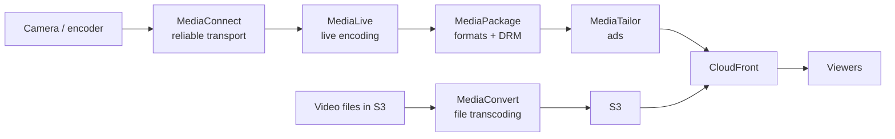

| Need | Use |
| --- | --- |
| Simple live streaming or video chat inside your app | **Amazon IVS** |
| Convert uploaded video files to web formats | **Elemental MediaConvert** (Elastic Transcoder is retired) |
| Professional live TV channels | **MediaConnect + MediaLive + MediaPackage** (+ MediaTailor for ads) |
| Stream video from cameras for ML analysis | **Kinesis Video Streams** |
| Render farm for 3D and visual effects | **AWS Deadline Cloud** |
| Multiplayer game servers | **GameLift Servers** |

- **AWS Elemental MediaConvert** - converts video files into formats and sizes for phones, web and TV, with captions and DRM. **Use it** for any user-uploaded video. The modern replacement for Elastic Transcoder. *GCP / Azure: Transcoder API / no first-party match since Azure Media Services retired (partners).*
  - Docs: https://docs.aws.amazon.com/mediaconvert/
- **AWS Elemental MediaLive** - broadcast-grade live video encoding for 24/7 channels and events. **Use it** for professional live streams. **Skip it** for simple app streaming (IVS). *GCP / Azure: Live Stream API / partners.*
  - Docs: https://docs.aws.amazon.com/medialive/
- **AWS Elemental MediaPackage** - prepares and protects video for delivery (HLS, DASH, DRM, time-shift). **Use it** with MediaLive for live channels. *GCP / Azure: Live Stream API, Video Stitcher / partners.*
  - Docs: https://docs.aws.amazon.com/mediapackage/
- **AWS Elemental MediaConnect** - reliable, secure transport of live video into and across AWS. **Use it** to get broadcast feeds into the cloud. *GCP / Azure: no direct match / partners.*
  - Docs: https://docs.aws.amazon.com/mediaconnect/
- **AWS Elemental MediaTailor** - inserts personalised ads into streams (server-side ad insertion) and builds linear channels from files. **Use it** to monetise streaming video. *GCP / Azure: Video Stitcher API / partners.*
  - Docs: https://docs.aws.amazon.com/mediatailor/
- **AWS Elemental Inference** - applies machine learning models to video (for example detecting events or creating clips). **Use it** to add AI analysis to video workflows. *GCP / Azure: Video Intelligence API / Azure AI Video Indexer.*
  - Docs: https://docs.aws.amazon.com/elemental-inference/
- **Amazon IVS (Interactive Video Service)** - live streaming and real-time video for apps, with low latency and chat, in a few API calls. **Use it** for live shopping, classes, creator streams or video calls inside your app. *GCP / Azure: Live Stream API / Azure Communication Services video.*
  - Docs: https://docs.aws.amazon.com/ivs/
- **Amazon Kinesis Video Streams** - securely streams video from cameras and devices into AWS for storage, playback and ML analysis, plus WebRTC for two-way video. **Use it** for security cameras, smart-home video and computer-vision pipelines. *GCP / Azure: Vision AI (Vertex AI Vision) / no direct match.*
  - Docs: https://docs.aws.amazon.com/kinesisvideostreams/latest/dg/what-is-kinesis-video.html
- **Amazon Elastic Transcoder [RETIRED]** - old file video transcoding. Retired 13 November 2025. **Use instead:** Elemental MediaConvert. *GCP / Azure: Transcoder API / partners.*
  - Docs: https://docs.aws.amazon.com/general/latest/gr/service-lifecycle.html
- **AWS Elemental MediaStore [RETIRED]** - storage optimised for live video origin. Retired 12 November 2025. **Use instead:** S3 with CloudFront, or MediaPackage. *GCP / Azure: Cloud Storage / Blob Storage.*
  - Docs: https://docs.aws.amazon.com/general/latest/gr/service-lifecycle.html
- **AWS Deadline Cloud** - a managed render farm for 3D animation and visual effects. **Use it** for rendering jobs with tools such as Blender, Maya or Houdini. *GCP / Azure: no direct match / no direct match.*
  - Docs: https://docs.aws.amazon.com/deadline-cloud/
- **AWS Thinkbox (Deadline 10 and other Thinkbox tools) [CLOSED TO NEW CUSTOMERS]** - the older self-hosted render manager AWS bought from Thinkbox Software. Deadline 10 has been in maintenance since November 2025. **Use instead:** AWS Deadline Cloud. *GCP / Azure: no direct match.*
  - Docs: https://docs.thinkboxsoftware.com/
- **AWS Elemental On-Premises and Cloud Digital Interface (CDI) SDK** - Elemental video appliances for your own facility, and an SDK for moving uncompressed live video between EC2 machines. **Use them** only in broadcast engineering. *GCP / Azure: no direct match.*
  - Docs: https://docs.aws.amazon.com/elemental-on-premises/
- **Amazon GameLift Servers (formerly Amazon GameLift)** - hosts and scales dedicated multiplayer game servers around the world, matchmaking included (FlexMatch). **Use it** for session-based multiplayer games. *GCP / Azure: Agones on GKE (open source) / no direct match.*
  - Docs: https://docs.aws.amazon.com/gameliftservers/
- **Amazon GameLift Streams** - streams games at high frame rate to browsers and devices, so players need no download. **Use it** for cloud gaming or playable demos. *GCP / Azure: no direct match.*
  - Docs: https://docs.aws.amazon.com/gameliftstreams/
- **Open 3D Engine (O3DE)** - a free, open-source 3D game engine run by the Linux Foundation, which grew out of Amazon Lumberyard (retired 2021). Not an AWS service, but AWS contributed it. **Use it** if you want an open-source engine. *GCP / Azure: no direct match.*
  - Docs: https://docs.o3de.org/
- **Amazon Nimble Studio [RETIRED]** - cloud studios for artists; retired June 2024. **Use instead:** Deadline Cloud plus WorkSpaces or DCV. *GCP / Azure: no direct match.*
  - Docs: https://docs.aws.amazon.com/general/latest/gr/service-lifecycle.html

---

## 19. Business applications and contact center

**In plain words:** these are finished applications for business teams, not building blocks for developers. The biggest is the **Amazon Connect** family: in 2026 the name "Amazon Connect" became a set of agentic AI solutions, and the contact-center product is now **Amazon Connect Customer**. Others cover email, secure messaging and SaaS security.

- **Amazon Connect Customer [RENAMED] (formerly Amazon Connect)** - a cloud contact center: phone, chat, SMS and email routing, AI agents and agent assist, call recording, analytics and outbound campaigns, paid per use. **Use it** to run a customer support center without phone hardware. *GCP / Azure: Customer Engagement Suite (Contact Center AI Platform) / Dynamics 365 Contact Center.*
  - Docs: https://docs.aws.amazon.com/connect/
- **Amazon Connect Decisions (formerly AWS Supply Chain)** - AI-driven supply chain planning and decision making (demand, inventory, supply). The AWS docs index now points AWS Supply Chain to this name. **Use it** for supply chain teams. *GCP / Azure: Supply Chain Twin (partners) / Microsoft Dynamics 365 Supply Chain Management.*
  - Docs: https://docs.aws.amazon.com/connect-decisions/
- **Amazon Connect Health** - agentic AI for healthcare workflows such as patient communication and documentation. **Use it** in healthcare organisations. *GCP / Azure: Google Cloud healthcare AI solutions / Microsoft Dragon Copilot.*
  - Docs: https://docs.aws.amazon.com/connecthealth/
- **Amazon Connect Talent** - AI-powered hiring support and candidate evaluation for recruiters. **Use it** in HR and recruiting teams. *GCP / Azure: no direct match / no direct match.*
  - Docs: https://docs.aws.amazon.com/talent/
- **Amazon Chime SDK** - building blocks to add audio, video, screen sharing, messaging and phone calls to your own app. Still available; some features are closing (**SIP media applications** are **[CLOSED TO NEW CUSTOMERS]** since 29 September 2026, and Proxy sessions and Carrier Voice Focus are **[RETIRED]**). **Use it** for in-app video calls. **Consider also** Amazon IVS real-time streaming. *GCP / Azure: no direct match / Azure Communication Services.*
  - Docs: https://docs.aws.amazon.com/chime-sdk/
- **Amazon Chime (meetings app) [RETIRED]** - AWS's meetings and chat app. AWS ended support on 20 February 2026; this did not affect the Chime SDK. **Use instead:** Zoom, Google Meet, Microsoft Teams or Slack. *GCP / Azure: Google Meet / Microsoft Teams.*
  - Docs: https://docs.aws.amazon.com/chime/
- **Amazon WorkMail [ENDING: 31 March 2027]** - managed business email and calendars. **Use instead:** Google Workspace or Microsoft 365 (use SES for app-sent email). *GCP / Azure: Gmail / Exchange Online.*
  - Docs: https://docs.aws.amazon.com/workmail/latest/adminguide/workmail-end-of-support.html
- **AWS Wickr** - end-to-end encrypted messaging, calls and file sharing for organisations, with admin controls and data retention. **Use it** for secure team communication in regulated or government settings. *GCP / Azure: no direct match / Microsoft Teams (with compliance features).*
  - Docs: https://docs.aws.amazon.com/wickr/
- **AWS AppFabric** - connects SaaS apps (Slack, Zoom, Okta and others) to pull their security logs into a standard format. **Use it** to monitor SaaS security in one place. *GCP / Azure: no direct match / Microsoft Defender for Cloud Apps.*
  - Docs: https://docs.aws.amazon.com/appfabric/
- **Amazon Honeycode [RETIRED]** - a no-code app builder based on spreadsheets. Shut down 29 February 2024. **Use instead:** AWS App Studio, or tools such as Airtable or Microsoft Power Apps. *GCP / Azure: AppSheet / Power Apps.*
  - Docs: https://docs.aws.amazon.com/general/latest/gr/service-lifecycle.html

> **AWS Quick** (business AI assistant and dashboards) is in [Analytics](#6-analytics). **Amazon Q Business** is in [AI](#8-ai-machine-learning-and-generative-ai).

---

## 20. Customer engagement and messaging

**In plain words:** these services let your app talk to *people* (not to other services): email, SMS, voice calls, WhatsApp and mobile push. Note the change in 2026: **Amazon Pinpoint** (marketing campaigns and journeys) reached end of support on 30 October 2026. Its sending channels live on as **AWS End User Messaging**, email goes through **Amazon SES**, and campaigns move to **Amazon Connect** outbound campaigns.

### Which one should I use?

| Need | Use | Why not the others |
| --- | --- | --- |
| Transactional email (sign-up, password reset, receipts) and bulk email | **Amazon SES** | SNS email is only for simple notifications to subscribed addresses |
| SMS, voice messages, WhatsApp, one-time passwords | **AWS End User Messaging** (SMS, Social) | SNS can send SMS but with fewer controls |
| Mobile push notifications | **AWS End User Messaging Push** or **SNS mobile push** | - |
| System alerts to your team (alarm emails) | **Amazon SNS** | Simplest for internal alerts |
| Marketing campaigns, journeys, segments | **Amazon Connect** outbound campaigns + Customer Profiles | Pinpoint is retired |

- **Amazon SES (Simple Email Service)** - send and receive email at scale through SMTP or the API, with DKIM, bounce and complaint tracking and a deliverability dashboard. New accounts start in a "sandbox" (only verified addresses, small daily limit) until you request production access. **Use it** for all app email. *GCP / Azure: no first-party service (use SendGrid, Mailgun) / Azure Communication Services Email.*
  - Docs: https://docs.aws.amazon.com/ses/
- **AWS End User Messaging (formerly the Amazon Pinpoint SMS, voice and push channels)** - send SMS, voice messages, WhatsApp messages (Social) and mobile push, with phone number management, sender registration and opt-out handling. **Use it** for OTP codes, order alerts and WhatsApp messages. *GCP / Azure: no first-party match (partners such as Twilio) / Azure Communication Services SMS, Notification Hubs.*
  - Docs: https://docs.aws.amazon.com/sms-voice/
- **Amazon Pinpoint [RETIRED]** - customer engagement (segments, campaigns, journeys, analytics). Support ended 30 October 2026. **Use instead:** End User Messaging for sending, SES for email, Amazon Connect outbound campaigns and Customer Profiles for campaigns. *GCP / Azure: no direct match / Dynamics 365 Customer Insights - Journeys.*
  - Docs: https://docs.aws.amazon.com/pinpoint/latest/userguide/migrate.html

> **Amazon SNS** is in [Application integration](#9-application-integration-and-messaging). **Amazon Connect Customer** is in [Business applications](#19-business-applications-and-contact-center).

---

## 21. Front-end web and mobile

**In plain words:** front-end services help you put a website or mobile app in front of users and connect it to a backend. **Amplify** is the "all-in-one" option: it hosts your React/Next.js/Vue site with CI/CD and can create a backend (auth, data, storage) from TypeScript code. Under the hood it uses S3, CloudFront, Cognito, AppSync and Lambda, which you can also use directly.

### Which one should I use?

| Front end | Use |
| --- | --- |
| React/Vue/Next.js site with Git-based deploys and preview branches | **Amplify Hosting** |
| Plain static site where you want full control | **S3 + CloudFront** (+ ACM + Route 53) |
| A Streamlit or Gradio demo | **Lightsail** container or **ECS Express Mode** |
| Server-rendered Python app (Flask/FastAPI templates) | **ECS Express Mode** or **Elastic Beanstalk** |
| Test your mobile app on many real phones | **Device Farm** |
| Maps and location features | **Location Service** |

- **AWS Amplify** - hosting for web front ends (with CI/CD from Git, preview branches, custom domains and server-side rendering) plus **Amplify Gen 2**, which builds a backend (auth with Cognito, data with AppSync/DynamoDB, storage with S3, functions with Lambda) from TypeScript. **Use it** to ship a React or Next.js app quickly. **Skip it** if you need full control of every resource (use the services directly with CDK). *GCP / Azure: Firebase App Hosting / Azure Static Web Apps.*
  - Docs: https://docs.aws.amazon.com/amplify/
- **AWS Device Farm** - test Android and iOS apps and websites on real phones, tablets and browsers in AWS. **Use it** to catch device-specific bugs before release. *GCP / Azure: Firebase Test Lab / no direct match.*
  - Docs: https://docs.aws.amazon.com/devicefarm/
- **Amazon Location Service** - maps, place search, routes, geofences and device tracking, from several data providers. **Use it** to add maps and "find nearby" features with AWS billing. *GCP / Azure: Google Maps Platform / Azure Maps.*
  - Docs: https://docs.aws.amazon.com/location/
- **Smaller front-end items** - **Amazon Silk** (the web browser on Amazon Fire devices, for web developers testing on Fire), **AWS Events API** (browse and reserve sessions at AWS events), **AWS Mobile SDKs** (older SDKs for Android/iOS/Unity; Amplify libraries are the newer path). **AWS Mobile Hub** is **[RETIRED]**. *GCP / Azure: no direct match.*
  - Docs: https://docs.aws.amazon.com/silk/

> **AWS AppSync** is in [Application integration](#9-application-integration-and-messaging), **CloudFront** in [Networking](#10-networking-and-content-delivery), **Cognito** in [Security](#11-security-identity-and-compliance).

---

## 22. Blockchain, quantum, robotics, satellite and simulation

**In plain words:** these are specialist services for research and niche industries. Most beginners will never use them, and several (robotics, large-scale simulation) have been retired.

- **Amazon Braket** - run quantum computing programs on real quantum computers from several hardware makers (and on simulators) through one SDK, paid per task. **Use it** to learn and experiment with quantum algorithms. *GCP / Azure: Google Quantum AI (limited access) / Azure Quantum.*
  - Docs: https://docs.aws.amazon.com/braket/
- **AWS Ground Station** - rent satellite antennas to talk to your satellites and download their data straight into AWS, paid per minute. **Use it** if you operate satellites. *GCP / Azure: no direct match / no direct match.*
  - Docs: https://docs.aws.amazon.com/ground-station/
- **Amazon Managed Blockchain [ENDING: 29 September 2027]** - managed Hyperledger Fabric networks and access to public blockchains such as Ethereum. Sunset announced September 2026. **Use instead:** self-managed nodes on EC2 or a blockchain node provider. *GCP / Azure: Blockchain Node Engine / no direct match.*
  - Docs: https://docs.aws.amazon.com/managed-blockchain/latest/hyperledger-fabric-dev/managed-blockchain-end-of-support.html
- **AWS Blockchain Templates** - old CloudFormation templates for blockchain frameworks; not maintained for new work. *GCP / Azure: no direct match.*
  - Docs: https://docs.aws.amazon.com/blockchain-templates/
- **AWS RoboMaker [RETIRED]** - robotics simulation and fleet management. Retired 10 September 2025. **Use instead:** run ROS and Gazebo/Isaac Sim simulations on EC2 GPU instances or AWS Batch. *GCP / Azure: no direct match.*
  - Docs: https://docs.aws.amazon.com/general/latest/gr/service-lifecycle.html
- **AWS SimSpace Weaver [RETIRED]** - very large spatial simulations (cities, crowds). Retired in 2026. **Use instead:** your own simulation on EC2, EKS or Batch. *GCP / Azure: no direct match.*
  - Docs: https://docs.aws.amazon.com/general/latest/gr/service-lifecycle.html

---

## 23. Cost management

**In plain words:** AWS charges for what you use, by the second, the GB and the request. That is great when you are small, and dangerous when you forget something running. Cost tools let you **see** spending (Cost Explorer), **get warned** (Budgets, Cost Anomaly Detection), **analyse in detail** (Cost and Usage Reports) and **pay less** for steady use (Savings Plans, Reserved Instances, Spot). See also [section 29 Cost safety](#29-cost-safety).

### Which one should I use?

| Goal | Use |
| --- | --- |
| Get an email before you spend too much | **AWS Budgets** (do this on day one) |
| Be told about unusual spending spikes | **Cost Anomaly Detection** |
| See where the money goes, by service and tag | **Cost Explorer** |
| Line-by-line billing data for analysis | **Cost and Usage Reports (CUR 2.0) / Data Exports** |
| Estimate before you build | **Pricing Calculator** |
| Cheaper steady compute | **Savings Plans** (flexible) or **Reserved Instances** |
| Cheaper interruptible compute (batch, training with checkpoints) | **EC2 Spot Instances** |
| Find oversized machines | **Compute Optimizer**, **Cost Optimization Hub** |

- **AWS Billing and Cost Management** - the console area for bills, payments, credits, tax settings and all the tools below. **Use it** to check your bill and credits each week while learning. *GCP / Azure: Cloud Billing / Microsoft Cost Management + Billing.*
  - Docs: https://docs.aws.amazon.com/account-billing/
- **AWS Free Tier** - free usage and credits for new accounts. As of late 2025-2026, new accounts get up to USD 200 in credits (100 at sign-up and up to 100 more for trying key services) and choose a **Free plan** (no charges; the account closes after 6 months or when credits run out unless you upgrade) or a **Paid plan**; 30+ services also have always-free monthly limits. **Use it** to learn safely, but still set a budget. *GCP / Azure: Google Cloud Free Program / Azure free account.*
  - Docs: https://docs.aws.amazon.com/awsaccountbilling/latest/aboutv2/free-tier.html
- **AWS Cost Explorer** - charts and tables of your costs and usage over time, filterable by service, account, Region and tag, with forecasts. **Use it** weekly to see what is costing money. *GCP / Azure: Cloud Billing reports / Cost analysis in Cost Management.*
  - Docs: https://docs.aws.amazon.com/cost-management/latest/userguide/ce-what-is.html
- **AWS Budgets** - set a monthly amount and get an email or SNS alert when actual or forecast spend passes a threshold; can also trigger actions. **Use it** in every account from the first day (for example alerts at 50%, 80% and 100% of a small amount). *GCP / Azure: Cloud Billing budgets / Cost Management budgets.*
  - Docs: https://docs.aws.amazon.com/cost-management/latest/userguide/budgets-managing-costs.html
- **AWS Cost Anomaly Detection** - uses ML to spot unusual spending (for example a GPU left on) and alerts you. Free. **Use it** alongside Budgets. *GCP / Azure: Cloud Billing anomaly detection / Cost Management anomaly alerts.*
  - Docs: https://docs.aws.amazon.com/cost-management/latest/userguide/manage-ad.html
- **AWS Cost and Usage Reports (CUR 2.0) and Data Exports** - the most detailed billing data (every resource, every hour) delivered to S3, ready for Athena or AWS Quick. (The older **AWS Usage Report** is **[CLOSED TO NEW CUSTOMERS]**.) **Use it** when you need to analyse costs deeply or charge teams back. *GCP / Azure: Cloud Billing export to BigQuery / Cost Management exports.*
  - Docs: https://docs.aws.amazon.com/cur/latest/userguide/what-is-cur.html
- **Savings Plans** - commit to spend a fixed amount per hour for 1 or 3 years in exchange for a large discount on EC2, Fargate, Lambda (Compute Savings Plans) or SageMaker AI. **Use it** only for usage you are sure will continue. *GCP / Azure: committed use discounts / Azure savings plan for compute.*
  - Docs: https://docs.aws.amazon.com/savingsplans/
- **Reserved Instances and capacity reservations** - discounts for committing to specific instance types (EC2, RDS, ElastiCache, OpenSearch, Redshift), and reservations that guarantee capacity (including **EC2 Capacity Blocks for ML** to book GPUs for a set time). **Use them** for steady databases or planned GPU training. *GCP / Azure: committed use discounts, reservations / Azure Reservations.*
  - Docs: https://docs.aws.amazon.com/AWSEC2/latest/UserGuide/ec2-reserved-instances.html
- **EC2 Spot Instances** - spare EC2 capacity at a big discount that AWS can take back with a two-minute warning. **Use it** for batch jobs, CI and training that saves checkpoints. **Skip it** for web servers that must not stop. *GCP / Azure: Spot VMs / Azure Spot Virtual Machines.*
  - Docs: https://docs.aws.amazon.com/AWSEC2/latest/UserGuide/using-spot-instances.html
- **AWS Compute Optimizer and Cost Optimization Hub** - recommendations to right-size EC2, EBS, Lambda, ECS and RDS, and one list of all savings opportunities. **Use them** monthly. *GCP / Azure: Recommender / Azure Advisor cost recommendations.*
  - Docs: https://docs.aws.amazon.com/compute-optimizer/
- **AWS Pricing Calculator** - estimate the monthly cost of an architecture before you build it. **Use it** for every new project plan. *GCP / Azure: Google Cloud Pricing Calculator / Azure pricing calculator.*
  - Docs: https://docs.aws.amazon.com/pricing-calculator/
- **AWS Flat-Rate Plans** - simplified, fixed-price bundles of AWS services (for example for websites). **Use it** if you prefer a predictable monthly price. *GCP / Azure: no direct match.*
  - Docs: https://docs.aws.amazon.com/PricingPlanManager/latest/UserGuide/overview.html
- **AWS Billing Conductor** - custom billing views and rates, for resellers and companies that recharge internal teams. *GCP / Azure: no direct match / Cost Management cost allocation.*
  - Docs: https://docs.aws.amazon.com/billingconductor/latest/userguide/what-is-billingconductor.html

---

## 24. Hybrid and edge

**In plain words:** sometimes code must run outside a normal AWS Region: in your own building (for data rules or very low latency), in a big city close to users, or inside a mobile phone network. These services bring AWS hardware or AWS management to those places.

| Need | Use |
| --- | --- |
| AWS racks inside your own data center | **Outposts** |
| Lower latency for users in a specific large city | **Local Zones** |
| Ultra-low latency for 5G mobile devices | **Wavelength** |
| Run ECS or EKS on your own servers | **ECS Anywhere**, **EKS Anywhere**, **EKS Hybrid Nodes** |
| Run VMware workloads on AWS | **Amazon EVS** (AWS) or **VMware Cloud on AWS** (sold by Broadcom) |

- **AWS Outposts** - AWS-owned racks or servers installed in your data center, running EC2, EBS, S3, ECS, EKS and RDS with the same APIs as the cloud. **Use it** when data must stay on-site or needs very low latency to local systems. *GCP / Azure: Google Distributed Cloud / Azure Local (formerly Azure Stack HCI).*
  - Docs: https://docs.aws.amazon.com/outposts/
- **AWS Local Zones** - small extensions of a Region placed in large cities, for single-digit millisecond latency to nearby users. **Use it** for gaming, live media or real-time apps in a specific metro area. *GCP / Azure: no direct match / Azure Extended Zones.*
  - Docs: https://docs.aws.amazon.com/local-zones/
- **AWS Wavelength** - AWS compute placed inside telecom 5G networks, so mobile devices reach your app with very low latency. **Use it** for connected cars, AR/VR and real-time mobile apps with a partner carrier. *GCP / Azure: Google Distributed Cloud Edge / Azure Operator Nexus.*
  - Docs: https://docs.aws.amazon.com/wavelength/
- **Amazon ECS Anywhere, Amazon EKS Anywhere and EKS Hybrid Nodes** - run and manage containers on your own servers with ECS or EKS tools. **Use them** when some containers must run on-premises but you want one way to manage them. *GCP / Azure: GKE Enterprise (attached / on-prem clusters) / Azure Arc-enabled Kubernetes.*
  - Docs: https://docs.aws.amazon.com/AmazonECS/latest/developerguide/ecs-anywhere.html
- **Amazon Elastic VMware Service (EVS)** - run VMware Cloud Foundation (VCF) directly on EC2 bare-metal machines inside your own VPC, self-managed or partner-managed. **Use it** to move VMware workloads to AWS without rebuilding them. *GCP / Azure: Google Cloud VMware Engine / Azure VMware Solution.*
  - Docs: https://docs.aws.amazon.com/evs/
- **VMware Cloud on AWS** - VMware's own managed service running on AWS hardware. Since Broadcom bought VMware it has been sold and supported by Broadcom rather than resold by AWS (from 2024). **Use it** if you already have a Broadcom VMware contract; otherwise compare with EVS. *GCP / Azure: Google Cloud VMware Engine / Azure VMware Solution.*
  - Docs: https://docs.aws.amazon.com/evs/latest/userguide/what-is-evs.html
- **AWS Private 5G [RETIRED]** - private mobile networks; retired May 2025. *GCP / Azure: no direct match / Azure Private 5G Core (also retired).*
  - Docs: https://docs.aws.amazon.com/general/latest/gr/service-lifecycle.html

> **Storage Gateway** and **Snowball** (storage) and **Direct Connect**, **Site-to-Site VPN** and **AWS Interconnect** (networking) are also hybrid tools.

---

## 25. Support, training and marketplace

**In plain words:** these are not technical building blocks; they are ways to get help, learn, and buy software that runs on AWS.

- **AWS Support plans** - Basic (free: billing help, docs, re:Post), Developer, Business and Enterprise plans with faster technical help, full Trusted Advisor checks and, at higher tiers, technical account managers. **Use** Developer or Business support for production apps. *GCP / Azure: Cloud Customer Care / Azure support plans.*
  - Docs: https://docs.aws.amazon.com/aws-support/
- **AWS re:Post** - the free official community Q&A site for AWS, with answers from AWS experts. (**AWS re:Post Private** for companies is **[ENDING: 30 June 2027]**.) **Use it** when you are stuck. *GCP / Azure: Google Cloud Community / Microsoft Q&A.*
  - Docs: https://repost.aws/
- **AWS Incident Detection and Response** - AWS engineers monitor your critical workloads and help run incidents, for Enterprise support customers. *GCP / Azure: Premium Support / Microsoft Unified Support.*
  - Docs: https://docs.aws.amazon.com/aws-support/
- **AWS Managed Services (AMS)** - AWS operates your infrastructure for you. (**AMS Advanced** is **[ENDING: 30 June 2027]**; AMS Accelerate continues.) **Use it** if you want to outsource cloud operations. *GCP / Azure: partner managed services.*
  - Docs: https://docs.aws.amazon.com/managedservices/
- **AWS Professional Services and AWS IQ** - Professional Services are AWS's own consultants. **AWS IQ** (a marketplace of freelance AWS experts) is **[RETIRED]** since May 2026. *GCP / Azure: Google Cloud Consulting / Microsoft Industry Solutions Delivery.*
  - Docs: https://aws.amazon.com/professional-services/
- **AWS Training and Certification and AWS Builder Center** - free and paid courses, labs (AWS Skill Builder) and certifications such as AI Practitioner, Machine Learning Engineer - Associate and Generative AI Developer - Professional. **Use it** to structure your learning after this course. *GCP / Azure: Google Cloud Skills Boost / Microsoft Learn.*
  - Docs: https://aws.amazon.com/training/
- **AWS Marketplace** - a catalog where you buy and deploy third-party software, datasets, AI models and SaaS, billed through your AWS account. **Use it** to buy tools (for example a vector database or an AI model) on your AWS bill. *GCP / Azure: Google Cloud Marketplace / Azure Marketplace.*
  - Docs: https://docs.aws.amazon.com/marketplace/

---
## 26. Renamed, closed and retired services (one table)

Use this table when an old tutorial, course or blog post mentions a name you cannot find. Dates come from the AWS Lifecycle Changes pages and each service's own availability page (checked 13 November 2026).

### Renamed (same or successor product)

| Old name | Current name (late 2026) |
| --- | --- |
| Amazon SageMaker (the ML service) | **Amazon SageMaker AI** (Dec 2024); "Amazon SageMaker" is now the data + AI umbrella with Unified Studio |
| Amazon QuickSight -> Amazon Quick Suite -> Amazon Quick | **AWS Quick** (QuickSight lives on as **Quick Sight**) |
| Amazon CodeWhisperer | Amazon Q Developer (2024) -> **Kiro** for IDE coding (Q Developer IDE plugins end 30 Apr 2027) |
| Amazon Q Developer in the AWS console | **AWS assistant** |
| AWS Chatbot | **Amazon Q Developer in chat applications** |
| Amazon Connect | **Amazon Connect Customer** (Connect is now a family: Customer, Decisions, Health, Talent) |
| AWS Supply Chain | **Amazon Connect Decisions** (per the AWS docs index) |
| Amazon AppStream 2.0 | **Amazon WorkSpaces Applications** |
| NICE DCV | **Amazon DCV** |
| AWS Application Migration Service (MGN) | **AWS Transform MGN** |
| Kinesis Data Firehose | **Amazon Data Firehose** |
| Kinesis Data Analytics (for Apache Flink) | **Amazon Managed Service for Apache Flink** |
| Amazon Pinpoint SMS / voice / push channels | **AWS End User Messaging** |
| Amazon GameLift | **Amazon GameLift Servers** (plus new GameLift Streams) |
| Amazon Bedrock Agents | **Amazon Bedrock Agents Classic** (closed; successor: AgentCore) |
| AWS Single Sign-On | **AWS IAM Identity Center** |
| Amazon Lumberyard | **Open 3D Engine** (open source, Linux Foundation) |

### Closed to new customers (maintenance) - do not start new projects on these

| Service | Since | Use instead |
| --- | --- | --- |
| AWS App Runner | 31 Mar 2026 | Amazon ECS Express Mode |
| Amazon Kendra | 30 Jun 2026 (no new customers from 30 Jul 2026) | Bedrock Managed Knowledge Base / Knowledge Bases |
| Amazon Q Business | 30 Jun 2026 (no new customers from 30 Jul 2026) | AWS Quick |
| Amazon Bedrock Agents Classic | 30 Jun 2026 | Bedrock AgentCore (Harness / Runtime) |
| SageMaker AI features: Clarify, Debugger, Model Monitor, Ground Truth, A2I, Studio Lab, Role Manager, GeoSpatial | 30 Jun 2026 | Your own evaluation/monitoring code, AgentCore Evaluations, CloudWatch |
| AWS Cloud9 | 25 Jul 2024 | CloudShell, VS Code + AWS Toolkit, SageMaker Studio Code Editor |
| Amazon CodeCatalyst | 7 Nov 2025 | GitHub/GitLab + CodeBuild/CodePipeline |
| Amazon CodeGuru Reviewer | 7 Oct 2025 | Amazon Inspector code scanning, Kiro |
| AWS Data Pipeline | 2024 | Glue, Step Functions, MWAA |
| Amazon Forecast | 29 Jul 2024 | SageMaker Canvas |
| Amazon Fraud Detector | 7 Oct 2025 | Custom model on SageMaker AI |
| Amazon Monitron | 31 Oct 2024 | IoT SiteWise + custom models |
| Amazon CloudSearch | 25 Jul 2024 | OpenSearch Service |
| Amazon Timestream for LiveAnalytics | 20 Jun 2025 | Timestream for InfluxDB |
| AWS Snowball Edge devices | 7 Oct 2025 | DataSync, Data Transfer Terminal, Direct Connect |
| S3 Select, S3 Glacier Select, S3 Object Lambda, S3 Glacier Direct (vaults) | 2024-2025 | Athena, S3 Tables, Lambda, S3 Glacier storage classes |
| AWS Audit Manager | 31 Mar 2026 | AWS Assurance, Security Hub, Config |
| CloudTrail Lake | 31 Mar 2026 | CloudTrail to S3 + Athena, CloudWatch |
| AWS Migration Hub, Application Discovery Service | Nov / Oct 2025 | AWS Transform |
| Systems Manager Incident Manager, Change Manager, Application Manager | 2025-2026 | Third-party on-call tools, CloudWatch + SNS |
| AWS IoT FleetWise, IoT SiteWise Monitor, IoT Device Defender Detect | 2025-2026 | IoT Core-based pipelines |
| Amazon WorkSpaces Secure Browser | 29 Sep 2026 | Verified Access, WorkSpaces Applications |
| Directory Service Simple AD, Cognito Sync, Cloud Directory | 2025-2026 | Managed Microsoft AD / AD Connector, AppSync/DynamoDB |
| Chime SDK SIP media applications | 29 Sep 2026 | Amazon Connect Customer or partner telephony |
| AWS Thinkbox Deadline 10, .NET modernization tools | 7 Nov 2025 | Deadline Cloud, AWS Transform |

### Ending soon (sunset)

| Service | End of support | Use instead |
| --- | --- | --- |
| AWS Infrastructure Composer (standalone console 7 Dec 2026) | 29 Sep 2027 | CDK, SAM, AWS Toolkit |
| Amazon RDS Custom for Oracle | 31 Mar 2027 | RDS for Oracle, Oracle Database@AWS |
| Amazon WorkMail | 31 Mar 2027 | Google Workspace, Microsoft 365 |
| Amazon WorkSpaces Thin Client | 31 Mar 2027 | Standard thin clients |
| AWS Service Management Connector | 31 Mar 2027 | Partner integrations |
| Amazon Q Developer IDE plugins | 30 Apr 2027 | Kiro |
| WorkSpaces Pools, WorkSpaces PCoIP protocol | 30 Jun 2027 | WorkSpaces Applications, DCV protocol |
| AWS re:Post Private, AMS Advanced, SageMaker AI Profiler | 30 Jun 2027 | Stack Overflow for Teams, AMS Accelerate, framework profilers |
| Amazon DevOps Guru | 29 Sep 2027 | CloudWatch anomaly detection, AWS DevOps Agent |
| Amazon Managed Blockchain | 29 Sep 2027 | Self-managed nodes, node providers |

### Retired (already switched off)

| Service | Ended | Replacement |
| --- | --- | --- |
| Amazon Pinpoint | 30 Oct 2026 | End User Messaging, SES, Connect outbound campaigns |
| AWS Proton, AWS WAF Classic, AWS IoT Greengrass V1, Amazon FinSpace, Amazon Lookout for Equipment | 7 Oct 2026 | Service Catalog/CDK, AWS WAF, Greengrass V2, analytics services, SageMaker AI |
| AWS App Mesh | 30 Sep 2026 | ECS Service Connect, VPC Lattice |
| Amazon Mechanical Turk integration in SageMaker AI | 29 Sep 2026 | Your own labelling workflow |
| AWS IoT Events, AWS Panorama, AWS IQ, Amazon Inspector Classic, DMS Fleet Advisor, Connect Voice ID | 20 May 2026 | IoT Core rules + Lambda, Greengrass, partners, Inspector |
| AWS SimSpace Weaver | 2026 | Simulation on EC2/EKS/Batch |
| Amazon Chime (meetings app) | 20 Feb 2026 | Zoom, Meet, Teams (Chime SDK continues) |
| Kinesis Data Analytics for SQL | 27 Jan 2026 | Managed Service for Apache Flink |
| AWS IoT Analytics | 15 Dec 2025 | S3 + Glue + Athena |
| Amazon Elastic Transcoder, AWS Elemental MediaStore | Nov 2025 | MediaConvert; S3 + CloudFront / MediaPackage |
| Amazon Lookout for Vision, Lookout for Metrics | Oct 2025 | SageMaker AI, Rekognition Custom Labels, CloudWatch anomaly detection |
| AWS RoboMaker, AWS DeepComposer | Sep 2025 | ROS on EC2/Batch |
| Amazon QLDB | 31 Jul 2025 | Aurora PostgreSQL with audit tables |
| AWS Private 5G, DataSync Discovery | May 2025 | - |
| Amazon WorkDocs | 25 Apr 2025 | Drive / OneDrive / Box, S3 |
| AWS CodeStar, AWS OpsWorks (all editions), Amazon Nimble Studio, AWS Snowmobile | 2024 | CodePipeline, Systems Manager, Deadline Cloud, DataSync |
| Amazon Honeycode | 29 Feb 2024 | App Studio, Power Apps, Airtable |
| AWS DeepLens | 31 Jan 2024 | Greengrass + your own models |
| AWS Server Migration Service, Amazon Sumerian, Amazon WorkLink, AWS Mobile Hub, Amazon Lumberyard | 2021-2023 | Transform MGN, Amplify, O3DE |

**Back from the edge:** **AWS CodeCommit** was closed to new customers in July 2024, but AWS reopened it to new customers on 24 November 2025 (AWS DevOps blog). **AWS DeepRacer** now lives on as the open-source **DeepRacer on AWS** solution (September 2026).

---

## 27. Starter kit for an AI web app on AWS

You do not need 200 services. A typical AI web app - a chat or RAG assistant with user login, file uploads and background jobs - uses about 20. Here they are **in the order you would set them up**.

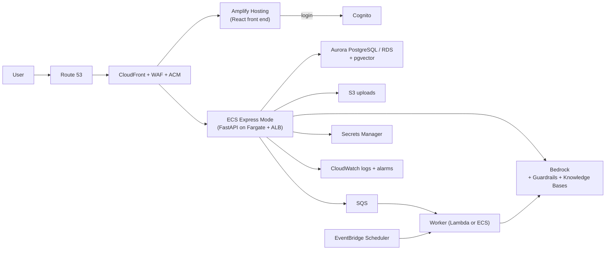

| Step | Service | What it does in your app | Notes |
| --- | --- | --- | --- |
| 1 | **AWS account + Organizations** | A separate account for the project (or for prod) | Turn on MFA for the root user, then stop using root |
| 2 | **AWS Budgets** (+ Cost Anomaly Detection) | Email you before costs grow | Do this before creating anything else |
| 3 | **IAM Identity Center + IAM roles** | Your login; one role per app component | No long-lived access keys |
| 4 | **VPC** | The private network | The default VPC is fine to learn; avoid NAT gateways at first (see [section 29](#29-cost-safety)) |
| 5 | **ECR** | Store your Docker images | Turn on image scanning |
| 6 | **ECS Express Mode (Fargate + ALB)** | Runs your FastAPI/Node backend over HTTPS | Or **Lambda + API Gateway** for low traffic |
| 7 | **Amazon Bedrock** | Calls the LLM | Request model access in your Region; start with a small, cheap model |
| 8 | **Bedrock Guardrails** | Filters harmful input/output and PII | Attach to every user-facing call |
| 9 | **S3** | Stores uploads and documents | Block Public Access on; lifecycle rules for old files |
| 10 | **Bedrock Knowledge Bases (with S3 Vectors or Aurora pgvector)** | RAG over your documents | Or build RAG yourself with pgvector |
| 11 | **RDS for PostgreSQL / Aurora Serverless v2** (or **DynamoDB**) | Users, chats, settings | Enable automated backups |
| 12 | **Secrets Manager** (and **Parameter Store**) | API keys, database password, config | Never put secrets in Git or environment files committed to Git |
| 13 | **KMS** | Encrypts S3, RDS and secrets | AWS-managed keys are on by default |
| 14 | **Cognito** | User sign-up and login | Or a third-party auth provider |
| 15 | **SQS** (+ a Lambda or ECS worker) | Background jobs: document ingestion, long LLM tasks | Add a dead-letter queue |
| 16 | **EventBridge Scheduler** | Nightly re-indexing, clean-up jobs | Replaces cron servers |
| 17 | **Amplify Hosting** (or S3 + CloudFront) | Hosts the React/Next.js front end | Preview branches for testing |
| 18 | **Route 53 + ACM + CloudFront** | Your domain, HTTPS certificate, global caching | ACM public certificates are free |
| 19 | **AWS WAF** | Blocks bad bots and rate-limits abuse | Rate limits also protect your LLM bill |
| 20 | **CloudWatch + CloudTrail** | Logs, metrics, alarms; audit trail | Set log retention; alarm on 5xx errors and latency |
| + | **CI/CD: GitHub Actions with OIDC (or CodePipeline + CodeBuild)** and **IaC: CDK, CloudFormation or Terraform** | Repeatable deploys | Build everything as code once it works |
| + | **Bedrock AgentCore** | When your assistant becomes a real agent with tools and memory | Add later, not on day one |

---

## 28. Common beginner mistakes

1. **Using the root user every day.** Turn on MFA for root, create an IAM Identity Center user, and use that.
2. **Putting access keys in code or Git.** Use IAM roles for apps and OIDC for CI/CD. If a key leaks, deactivate it at once - bots scan GitHub for AWS keys within minutes.
3. **Making S3 buckets public to "make it work".** Keep Block Public Access on; serve files through CloudFront or pre-signed URLs.
4. **No budget alert.** Set AWS Budgets on day one. AWS will not stop your resources for you when you pass a budget unless you set up budget actions.
5. **Forgetting which Region you are in.** Resources in another Region keep running (and billing) while you look at the wrong one. Check all Regions with Resource Explorer or Cost Explorer grouped by Region.
6. **Choosing EKS for a first app.** Kubernetes is a big learning project of its own. Use ECS Express Mode or Lambda first.
7. **Opening security groups to `0.0.0.0/0` on SSH (port 22) or database ports.** Use Session Manager instead of SSH, and keep databases in private subnets.
8. **Building on a closed or retired service from an old tutorial** (App Runner, Kendra, Q Business, Cloud9, Pinpoint, QLDB). Check [section 26](#26-renamed-closed-and-retired-services-one-table) first.
9. **Calling an LLM synchronously for long tasks.** API Gateway and load balancers have timeouts. Stream responses, or put long work on SQS + a worker and poll for the result.
10. **No limits on LLM usage.** One abusive user or a retry loop can burn through credits. Add per-user rate limits (WAF, API Gateway usage plans or app logic), max token settings and alarms on Bedrock spend.
11. **Not requesting GPU or model quotas early.** New accounts often have zero GPU quota and limited Bedrock throughput. Check Service Quotas before your demo day.
12. **Clicking everything in the console and never writing it down.** After the first experiment, capture it as CDK, CloudFormation or Terraform so you can delete and recreate it.
13. **Never deleting test resources.** At the end of each learning session, delete stacks, stop instances and empty test buckets.

---

## 29. Cost safety

### Before you build

- **Know what you get for free.** New accounts (from mid-2025) get up to USD 200 in credits and choose a **Free plan** (no charges; closes after 6 months or when credits run out unless you upgrade) or a **Paid plan**. Many services also have always-free monthly allowances. Check the current terms at the AWS Free Tier page, because they change.
- **Credits are not a safety net for everything.** Some services are not covered by Free-plan credits, and on the Paid plan anything beyond credits is billed to your card.
- **Estimate with the Pricing Calculator** before you start anything with GPUs, NAT gateways, OpenSearch clusters or large databases.

### Set up guard rails on day one

1. **AWS Budgets:** a monthly cost budget with email alerts at 50%, 80% and 100% (actual) and 100% (forecast).
2. **Cost Anomaly Detection:** turn it on (free) with a daily email.
3. **Billing alerts in CloudWatch** (optional extra) and **AWS Health** notifications.
4. **Tags:** tag every resource with `project` and `owner`, then activate them as cost allocation tags so Cost Explorer can group by them.
5. **Service Control Policies (with Organizations):** in learning accounts you can deny expensive instance families or unused Regions.

### Services that commonly cause surprise bills

| Surprise | Why it costs money | How to avoid it |
| --- | --- | --- |
| **NAT gateway** | Charged per hour **and** per GB processed, even with little traffic; often created by "private subnet" templates in each AZ | Use public subnets for learning, add **free gateway endpoints** for S3/DynamoDB, interface endpoints for heavy AWS API traffic, and delete NAT gateways when done |
| **Idle GPU instances and endpoints** | GPU EC2 and SageMaker AI real-time endpoints bill every hour they exist, even with zero requests | Stop or delete after use; use SageMaker AI serverless/async endpoints that scale to zero, Bedrock on-demand, or Batch/Spot for jobs |
| **Forgotten SageMaker AI notebooks and Studio apps** | Running notebook instances and Studio apps bill per hour | Shut down apps; set idle shutdown |
| **Data transfer out** | Data leaving AWS to the internet, and between Regions or AZs, is charged per GB | Serve through CloudFront, keep services in one Region/AZ when you can, avoid cross-Region copies you do not need |
| **Load balancers, OpenSearch clusters, provisioned databases** | Hourly charges even when idle | Delete test stacks; use serverless options (Aurora Serverless v2 with low minimums, OpenSearch Serverless with care, DynamoDB on-demand) |
| **Elastic IP addresses and public IPv4** | Every public IPv4 address is charged per hour | Release unused Elastic IPs; avoid public IPs on private resources |
| **CloudWatch Logs** | Ingestion per GB plus storage forever by default | Set log retention (for example 7-30 days), avoid logging full prompts and responses at high volume |
| **EBS volumes and snapshots** | Remain after an instance is terminated (unless set to delete) | Delete unattached volumes; use Data Lifecycle Manager |
| **Bedrock tokens** | Large prompts, long context, agents that loop | Set max tokens, cache prompts, use smaller models for simple steps, limit agent steps, track cost per request |
| **Resources in other Regions** | You forgot they exist | Check Cost Explorer grouped by Region; delete what you do not need |
| **Support plan, Shield Advanced, Savings Plans** | Monthly or long-term commitments | Do not buy them for a learning account |

### End-of-session checklist

- Delete CloudFormation/CDK stacks you created today (`cdk destroy`, `terraform destroy`).
- Stop or terminate EC2 and GPU instances; delete SageMaker AI endpoints and stop notebooks.
- Delete NAT gateways, load balancers, OpenSearch domains and test databases (take a snapshot if needed).
- Release Elastic IPs; delete unattached EBS volumes and old snapshots.
- Look at Cost Explorer for yesterday's cost by service and Region.

---

## 30. Related course notebooks

| Notebook | What it adds to this guide |
| --- | --- |
| [18_Cloud/06_aws_core_services_for_ai_engineers.ipynb](../06_aws_core_services_for_ai_engineers.ipynb) | Hands-on view of the core services (IAM, VPC, S3, compute, databases, messaging, monitoring) for AI engineers |
| [18_Cloud/07_aws_ai_services_sagemaker_bedrock_agentcore.ipynb](../07_aws_ai_services_sagemaker_bedrock_agentcore.ipynb) | Deep dive into Bedrock, SageMaker AI and AgentCore |
| [18_Cloud/12_cloud_building_blocks_compared_aws_gcp_azure.ipynb](../12_cloud_building_blocks_compared_aws_gcp_azure.ipynb) | Side-by-side comparison of AWS, Google Cloud and Azure building blocks |
| [16_Deployment/06_deploying_an_ai_saas_application_end_to_end.ipynb](../../16_Deployment/06_deploying_an_ai_saas_application_end_to_end.ipynb) | Deploying a complete AI SaaS application end to end |
| [16_Deployment/07_free_tier_deployment_frontend_backend_and_database.ipynb](../../16_Deployment/07_free_tier_deployment_frontend_backend_and_database.ipynb) | Deploying front end, backend and database on free tiers |
| [18_Cloud/01_aws_for_ai.ipynb](../01_aws_for_ai.ipynb) | The original AWS-for-AI overview |
| [18_Cloud/04_cloud_cost_optimization.ipynb](../04_cloud_cost_optimization.ipynb) | More on cloud cost optimisation |

---

## 31. Official sources

All checked on 13 November 2026.

**Service catalogs**
- AWS documentation index (every service and its docs link): https://docs.aws.amazon.com/
- Overview of Amazon Web Services whitepaper - services by category: https://docs.aws.amazon.com/whitepapers/latest/aws-overview/amazon-web-services-cloud-platform.html
- AWS products page: https://aws.amazon.com/products/

**Lifecycle (closed, sunset, retired)**
- AWS Lifecycle Changes: https://docs.aws.amazon.com/general/latest/gr/service-lifecycle.html
- Services in Maintenance: https://docs.aws.amazon.com/general/latest/gr/maintenance_services.html
- Services in Sunset: https://docs.aws.amazon.com/general/latest/gr/sunset_services.html
- AWS service availability updates, June 2026: https://aws.amazon.com/about-aws/whats-new/2026/06/aws-service-availability/
- App Runner availability change (ECS Express Mode): https://docs.aws.amazon.com/apprunner/latest/dg/apprunner-availability-change.html
- Kendra availability change (Bedrock Managed Knowledge Base): https://docs.aws.amazon.com/kendra/latest/dg/kendra-availability-change.html
- Amazon Q Developer (Kiro, AWS assistant notices): https://docs.aws.amazon.com/amazonq/latest/qdeveloper-ug/what-is.html
- Amazon Pinpoint migration: https://docs.aws.amazon.com/pinpoint/latest/userguide/migrate.html
- AWS Data Pipeline (maintenance notice): https://docs.aws.amazon.com/datapipeline/latest/DeveloperGuide/what-is-datapipeline.html
- Amazon Chime end of support notice: https://aws.amazon.com/chime/

**Renames and current product definitions**
- What is AWS Quick: https://docs.aws.amazon.com/quick/latest/userguide/what-is.html
- What is Amazon SageMaker AI (rename note): https://docs.aws.amazon.com/sagemaker/latest/dg/whatis.html
- What is Amazon Bedrock: https://docs.aws.amazon.com/bedrock/latest/userguide/what-is-bedrock.html
- What is Amazon Bedrock AgentCore: https://docs.aws.amazon.com/bedrock-agentcore/latest/devguide/what-is-bedrock-agentcore.html
- What is Connect Customer: https://docs.aws.amazon.com/connect/latest/adminguide/what-is-amazon-connect.html
- What is AWS Transform MGN: https://docs.aws.amazon.com/mgn/latest/ug/what-is-application-migration-service.html
- What is Amazon WorkSpaces Applications: https://docs.aws.amazon.com/appstream2/latest/developerguide/what-is-appstream.html
- What is AWS Interconnect: https://docs.aws.amazon.com/interconnect/latest/userguide/what-is.html
- S3 storage classes: https://docs.aws.amazon.com/AmazonS3/latest/userguide/storage-class-intro.html
- AWS CodeCommit user guide: https://docs.aws.amazon.com/codecommit/latest/userguide/welcome.html
- AWS CodeCommit returns to general availability (24 Nov 2025): https://aws.amazon.com/blogs/devops/aws-codecommit-returns-to-general-availability/
- DeepRacer on AWS: https://docs.aws.amazon.com/deepracer/latest/developerguide/what-is-deepracer.html

**Decision guides (official "which one should I use?" pages)**
- All decision guides: https://docs.aws.amazon.com/decision-guides/
- Amazon Bedrock or Amazon SageMaker AI?: https://docs.aws.amazon.com/decision-guides/latest/bedrock-or-sagemaker/bedrock-or-sagemaker.html
- Choosing a generative AI service: https://docs.aws.amazon.com/decision-guides/latest/generative-ai-on-aws-how-to-choose/guide.html

**Cost**
- AWS Free Tier: https://aws.amazon.com/free/
- AWS Pricing Calculator: https://calculator.aws/

**Cross-cloud comparisons used for the Google Cloud / Azure names**
- Google Cloud products compared to AWS and Azure: https://docs.cloud.google.com/docs/get-started/aws-azure-gcp-service-comparison
- Azure for AWS professionals: https://learn.microsoft.com/en-us/azure/architecture/aws-professional/
