# Every Azure Service Explained Simply

> **Last checked:** 13 November 2026, against the official Azure product directory (azure.microsoft.com/products), the Azure documentation directory (learn.microsoft.com/azure) and the Microsoft Learn retirement pages listed in [Official sources](#official-sources).
>
> **Who is this for:** beginners who open the Azure portal, see hundreds of services, and want to know what each one is, why it exists, and which one to pick.
>
> **How to use it:** do not read it top to bottom. Jump to a category, read the "In plain words" paragraph and the "Which one should I use?" table, and only then read the entries you need.
>
> **Related course notebooks:** [08 Azure core services](../08_azure_core_services_for_ai_engineers.ipynb), [09 Azure AI: Microsoft Foundry and Azure OpenAI](../09_azure_ai_microsoft_foundry_and_azure_openai.ipynb), [12 Cloud building blocks compared](../12_cloud_building_blocks_compared_aws_gcp_azure.ipynb), and the deployment notebooks 06 and 07 in [16_Deployment](../../16_Deployment/). See [Where to go next in this course](#where-to-go-next-in-this-course).

Azure changes fast. Names change, services retire, and new ones appear every few months. Treat any date in this guide as "true when last checked" and look at the linked official page before you make a real decision.

---

## Table of contents

1. [How to read each entry](#how-to-read-each-entry)
2. [Azure in 60 seconds: the words you need first](#azure-in-60-seconds-the-words-you-need-first)
3. [Compute (virtual machines and friends)](#1-compute-virtual-machines-and-friends)
4. [Containers and Kubernetes (AKS)](#2-containers-and-kubernetes-aks)
5. [Serverless, app hosting, web and mobile](#3-serverless-app-hosting-web-and-mobile)
6. [Storage](#4-storage)
7. [Databases](#5-databases)
8. [Analytics and Microsoft Fabric](#6-analytics-and-microsoft-fabric)
9. [Data integration (moving and transforming data)](#7-data-integration-moving-and-transforming-data)
10. [AI and machine learning](#8-ai-and-machine-learning)
11. [Integration and messaging](#9-integration-and-messaging)
12. [Networking](#10-networking)
13. [Identity (the Microsoft Entra family)](#11-identity-the-microsoft-entra-family)
14. [Security](#12-security)
15. [Management and governance](#13-management-and-governance)
16. [Monitoring](#14-monitoring)
17. [Developer tools and DevOps](#15-developer-tools-and-devops)
18. [Migration](#16-migration)
19. [Hybrid and multicloud](#17-hybrid-and-multicloud)
20. [Internet of Things (IoT)](#18-internet-of-things-iot)
21. [Media and communication](#19-media-and-communication)
22. [Virtual desktops and labs](#20-virtual-desktops-and-labs)
23. [Cost management](#21-cost-management)
24. [Industry and specialist services](#22-industry-and-specialist-services)
25. [Retired and retiring services in one table](#retired-and-retiring-services-in-one-table)
26. [Starter kit for an AI web app on Azure](#starter-kit-for-an-ai-web-app-on-azure)
27. [Common beginner mistakes](#common-beginner-mistakes)
28. [Cost safety checklist](#cost-safety-checklist)
29. [Where to go next in this course](#where-to-go-next-in-this-course)
30. [Official sources](#official-sources)

---

## How to read each entry

Every main service is a short entry of three lines:

1. **What it is and why it exists**, in everyday words.
2. **Use it when** (the right situations) and **Skip it when** (the wrong situations, with the simpler option to use instead).
3. **AWS / Google Cloud:** the closest service on the other two big clouds (rarely a perfect match).

Old names are shown in brackets, for example "Microsoft Foundry (formerly Azure AI Foundry, before that Azure AI Studio)".

Small or very specialised services are grouped in short tables so the guide stays readable.

**Status tags** (in the heading of an entry):

| Tag | Meaning |
|---|---|
| (no tag) | Generally available (GA): finished, supported, has an SLA (a written uptime promise). |
| **[Preview]** | Still being tested. Can change, often has no SLA. Fine for learning, careful in production. |
| **[Retiring DATE]** | Still works for existing users, but will be switched off on that date. Do not start new projects on it. |
| **[Retired]** | Already switched off or closed. Listed only so you recognise the name in old tutorials. |
| **[Renamed]** | Same service, new name. The old name is shown so old blog posts make sense. |

---

## Azure in 60 seconds: the words you need first

Before any service makes sense, you need six words. Think of Azure as a very large hotel.

| Word | Everyday meaning | Hotel analogy |
|---|---|---|
| **Tenant** | Your organisation's identity space in Microsoft Entra ID. All your users and apps live here. | The company that books the hotel. |
| **Management group** | A folder that groups subscriptions so you can apply rules to all of them at once. | A floor of rooms with the same house rules. |
| **Subscription** | A billing and access boundary. Every resource belongs to exactly one subscription, and the bill is per subscription. | One room booking with its own bill. |
| **Resource group** | A folder inside a subscription that holds related resources. Delete the group and everything in it is deleted. | A suitcase. Pack one app's things in one suitcase. |
| **Resource** | One thing you created: a VM, a database, a storage account. | One item in the suitcase. |
| **Region** | A geographic area with one or more data centers, for example "East US" or "West Europe". Many regions also have **availability zones** (separate buildings with their own power and cooling). | Which city the hotel is in. |

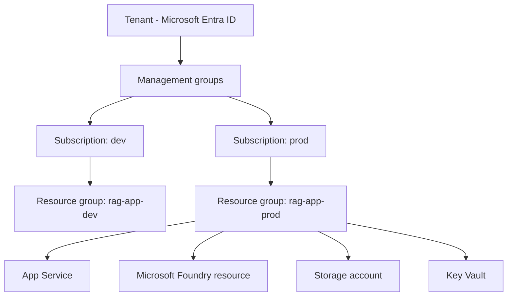

Two more ideas appear in almost every entry:

- **Control plane vs data plane.** The control plane is "create, change, delete the resource" (handled by Azure Resource Manager). The data plane is "use the resource" (read a blob, call a model). Permissions for the two are often separate.
- **IaaS, PaaS, SaaS.** IaaS (Infrastructure as a Service) gives you raw machines, you manage the operating system. PaaS (Platform as a Service) runs your code, Azure manages the machines. SaaS (Software as a Service) is a finished product you just use. The more "managed" a service is, the less work and the less control you have.

A rule of thumb for beginners: **start with the most managed service that does the job**, and move down to more control only when you hit a real limit.

---

## 1. Compute (virtual machines and friends)

### In plain words

"Compute" means the processors and memory that run your code. On Azure the basic unit is a **virtual machine (VM)**: a slice of a real server that behaves like your own computer. Everything else in this section is a variation: many identical VMs that grow and shrink (scale sets), cheap VMs that can be taken back (Spot), whole physical servers just for you (Dedicated Host), big batches of jobs (Batch), or special hardware (GPU VMs for AI). If you do not want to manage operating systems at all, skip ahead to containers (section 2) or serverless (section 3).

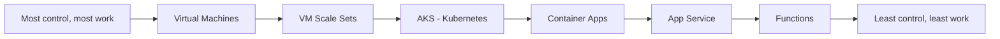

### Which one should I use?

This table covers the most common "where do I run my code?" question. Containers and serverless options are explained in sections 2 and 3, but they are compared here because beginners face this choice first.

| Your situation | Pick | Why |
|---|---|---|
| You need full control of the operating system, special drivers, or a GPU you configure yourself | **Virtual Machines** | You own everything from the OS up. |
| Many identical VMs that should grow with traffic | **VM Scale Sets** | Autoscaling and rolling upgrades for VMs. |
| Many containers, a platform team, need for Kubernetes features (custom networking, operators, GPU node pools) | **AKS** | Full Kubernetes, managed control plane. |
| A containerised web app, API, or worker, and you do not want to learn Kubernetes | **Container Apps** | Serverless containers, scale to zero, built on Kubernetes but hidden. |
| Run one container for a short task, no scaling needed | **Container Instances** | Fastest way to "just run this container". |
| A normal web app or API in Python, Node, .NET, Java, PHP | **App Service** | Upload code, get a URL, TLS, slots and scaling. |
| Small pieces of code that react to events (a file upload, a queue message, a timer) | **Functions** | Pay per execution, no server to think about. |
| Thousands of independent compute jobs (rendering, simulations, batch scoring) | **Batch** | Schedules jobs across a pool of VMs for you. |
| Training a model or running ML pipelines | **Azure Machine Learning compute** (section 8) | Built for ML jobs, tracks experiments. |

### Entries

#### Azure Virtual Machines (Linux and Windows)
A computer you rent in a Microsoft data center and control completely. Some software needs a full operating system, admin rights, or custom drivers that managed services do not allow.
**Use it when:** you lift an existing server to the cloud, run software that needs a specific OS setup, or need a GPU box for experiments. **Skip it when:** you just want to host a web app or API. **Simpler option:** App Service or Container Apps (you do not patch the OS).
*AWS / Google Cloud:* Amazon EC2 / Compute Engine.
Docs: https://learn.microsoft.com/azure/virtual-machines/

#### GPU and AI-accelerated VM sizes (ND, NC, NV families)
VM sizes with NVIDIA or AMD GPUs attached. ND sizes (for example ND H100 v5, ND H200 v5, ND GB200 v6, ND GB300 v6, ND MI300X v5) are for large training and inference; NC sizes are for smaller training and inference; NV sizes are for graphics and visualisation. Training and serving neural networks needs the parallel maths that GPUs do well.
**Use it when:** you train or fine-tune your own models, or serve open-weight models with your own server (for example vLLM). **Skip it when:** you only call a hosted model like GPT or Claude. **Simpler option:** a serverless model deployment in Microsoft Foundry (no GPU to manage, pay per token). Also check your **GPU quota** first: new subscriptions often have zero GPU quota and must request it.
*AWS / Google Cloud:* EC2 P and G instances / Compute Engine A3, A4 and G2 machine types (and TPUs).
Docs: https://learn.microsoft.com/azure/virtual-machines/sizes/overview

#### Azure Spot Virtual Machines
Spare Azure capacity sold at a large discount that Azure can take back with short notice. It makes interruptible work (batch jobs, training with checkpoints, CI runners) much cheaper.
**Use it when:** the job can stop and restart without harm, for example training that saves checkpoints. **Skip it when:** the workload must stay up (a production API or database). **Simpler option:** normal VMs with a reservation or savings plan.
*AWS / Google Cloud:* EC2 Spot Instances / Spot VMs.
Docs: https://learn.microsoft.com/azure/virtual-machines/spot-vms

#### Virtual Machine Scale Sets (VMSS)
A group of identical VMs that Azure adds or removes automatically based on rules. Traffic goes up and down; you want more machines at peak and fewer at night without doing it by hand.
**Use it when:** you run a VM-based service that must scale out, or you build your own GPU inference fleet on VMs. **Skip it when:** your app is already containerised. **Simpler option:** Container Apps or AKS node autoscaling.
*AWS / Google Cloud:* EC2 Auto Scaling groups / Managed instance groups.
Docs: https://learn.microsoft.com/azure/virtual-machine-scale-sets/

#### Azure Dedicated Host
A whole physical server reserved only for your VMs. Some licences or compliance rules require that no other customer shares your hardware.
**Use it when:** a regulator or a software licence demands physical isolation. **Skip it when:** you have no such rule. **Simpler option:** normal VMs (or confidential VMs for strong isolation of data in use).
*AWS / Google Cloud:* EC2 Dedicated Hosts / Sole-tenant nodes.
Docs: https://learn.microsoft.com/azure/virtual-machines/dedicated-hosts/overview

#### Azure Compute Fleet
One request that creates a large mix of VM sizes and pricing types (Spot and normal) for you. Getting thousands of cores is easier when Azure can pick among many sizes and fall back from Spot to normal VMs.
**Use it when:** you need a large, flexible pool of VMs, for example for big batch or rendering jobs. (Multi-region fleets and attribute-based VM selection were still in preview when checked.) **Skip it when:** you need a handful of VMs. **Simpler option:** a VM Scale Set.
*AWS / Google Cloud:* EC2 Fleet / Compute Engine bulk instance API and flexible managed instance groups.
Docs: https://learn.microsoft.com/azure/azure-compute-fleet/overview

#### Azure VM Image Builder and Azure Compute Gallery
Image Builder bakes a "golden" VM image (OS plus your software and patches); Compute Gallery stores and shares those images across regions and subscriptions. Every new VM should start from the same tested image, not from a hand-built one.
**Use it when:** you run many VMs or VM Scale Sets and want repeatable, patched images. **Skip it when:** you deploy containers; the container image already plays this role.
*AWS / Google Cloud:* EC2 Image Builder plus AMIs / custom images with Packer and image families.
Docs: https://learn.microsoft.com/azure/virtual-machines/image-builder-overview

#### Azure Batch
A job scheduler that runs many tasks in parallel on a pool of VMs it manages. Running ten thousand independent jobs by hand is painful; Batch queues them, starts machines, and retries failures.
**Use it when:** you do large-scale rendering, simulations, or offline batch scoring of a model. **Skip it when:** you have a few jobs. **Simpler option:** Container Apps jobs or Azure Machine Learning batch endpoints.
*AWS / Google Cloud:* AWS Batch / Google Cloud Batch.
Docs: https://learn.microsoft.com/azure/batch/

#### Azure CycleCloud
A tool that builds and manages traditional HPC (high-performance computing) clusters, for example with the Slurm scheduler, on Azure VMs. Research and engineering teams already use Slurm; CycleCloud gives them the same experience in the cloud.
**Use it when:** you need a classic HPC cluster for large training runs or simulations with a scheduler your team knows. **Skip it when:** you do not already use HPC schedulers. **Simpler option:** Azure Batch or Azure Machine Learning compute clusters.
*AWS / Google Cloud:* AWS ParallelCluster / Google Cloud Cluster Toolkit.
Docs: https://learn.microsoft.com/azure/cyclecloud/

#### Azure VMware Solution
Real VMware environments (vSphere, vSAN, NSX) running on dedicated Azure hardware. Companies with many VMware VMs can move them to Azure without rebuilding them.
**Use it when:** you are migrating a VMware data center and want the same tools. **Skip it when:** you are building something new. **Simpler option:** native Azure VMs or containers.
*AWS / Google Cloud:* Amazon Elastic VMware Service / Google Cloud VMware Engine.
Docs: https://learn.microsoft.com/azure/azure-vmware/

#### Smaller compute services

| Service | What it is | Use it when | AWS / Google Cloud |
|---|---|---|---|
| [**Nutanix Cloud Clusters on Azure**](https://learn.microsoft.com/azure/nutanix/about-nc2-on-azure) | Nutanix's private-cloud software on Azure bare-metal servers. | You run Nutanix on-premises and want the same in Azure. | Nutanix on AWS / no direct match |
| [**Azure Linux**](https://learn.microsoft.com/azure/azure-linux/) | Microsoft's own lightweight Linux distribution, used as a container host (for example for AKS nodes). | You want a small, Microsoft-supported Linux for AKS nodes. | Bottlerocket or Amazon Linux / Container-Optimized OS |
| [**Windows Server on Azure**](https://learn.microsoft.com/azure/virtual-machines/windows/) | Windows Server VMs, with extra benefits such as extended security updates for older versions. | You run Windows workloads. | Windows on EC2 / Windows on Compute Engine |
| [**Azure Quantum**](https://learn.microsoft.com/azure/quantum/) | Access to quantum computing tools and simulators, including resource estimation for quantum programs. | You study or experiment with quantum algorithms. | Amazon Braket / Google Quantum AI (research access) |
| [**Cloud Services (extended support)**](https://learn.microsoft.com/azure/cloud-services-extended-support/overview) **[Retiring 31 Mar 2027]** | The old "web role / worker role" app platform, moved onto Azure Resource Manager. Deprecated since 31 Mar 2025. The older **Cloud Services (classic)** is already **[Retired]**. | Only for existing apps that are being migrated. Move to App Service, Container Apps, VM Scale Sets, AKS or Service Fabric. | Elastic Beanstalk / App Engine |
| [**Azure Arc**](https://learn.microsoft.com/azure/azure-arc/) | Lets you manage servers and Kubernetes clusters running outside Azure (on-premises or other clouds) from the Azure portal. Full entry in section 17. | You have machines outside Azure. | AWS Systems Manager hybrid nodes / Google Distributed Cloud |
| [**Azure Stack**](https://learn.microsoft.com/azure-stack/) (family name) [Renamed parts] | Azure hardware and software you run in your own building. Today it means **Azure Local** (formerly Azure Stack HCI), **Azure Stack Hub** and **Azure Stack Edge**. Full entries in section 17. | Data must stay on-site or you need Azure services with no internet. | AWS Outposts / Google Distributed Cloud |
| [**Data Science Virtual Machine**](https://learn.microsoft.com/azure/machine-learning/data-science-virtual-machine/overview) | A VM image with Python, Jupyter, CUDA and ML libraries preinstalled. | You want a ready-made GPU or CPU box for experiments. See section 8. | AWS Deep Learning AMIs / Deep Learning VM Images |

---

## 2. Containers and Kubernetes (AKS)

### In plain words

A **container** is your app plus everything it needs (libraries, runtime) packed into one image that runs the same way everywhere. You build the image once, push it to a **registry**, and then any container service can run it. **Kubernetes** is the most popular system for running many containers across many machines; it restarts crashed containers, spreads load, and rolls out new versions. Azure gives you Kubernetes in a managed form (**AKS**), and also simpler ways to run containers without learning Kubernetes (**Container Apps**, **Container Instances**).

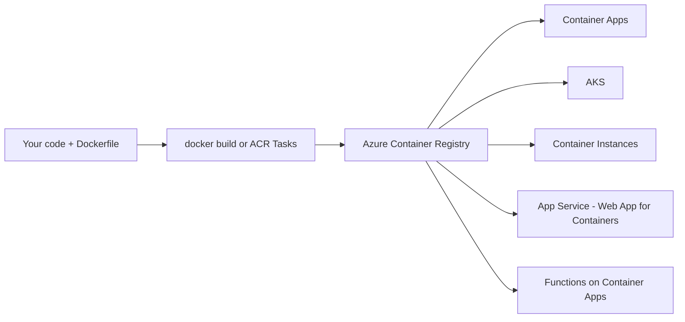

### Which one should I use?

| Question | Container Instances | Container Apps | AKS | Azure Red Hat OpenShift |
|---|---|---|---|---|
| Do I need to know Kubernetes? | No | No | Yes | Yes (OpenShift) |
| Scale to zero when idle | Not applicable (runs until it stops) | Yes | Only with extra setup | No |
| Good for | One-off tasks, simple sidecars, quick tests | Web APIs, workers, event-driven jobs, AI agents, small GPU inference | Large platforms, many teams, custom networking, heavy GPU work | Teams already standardised on OpenShift |
| GPUs | No (GPU container groups retired 14 Jul 2025) | Serverless GPUs (for example A100 and T4 profiles) | GPU node pools you fully control | GPU nodes |
| Effort to run | Very low | Low | Medium to high | Medium to high |

**Beginner default:** start on Container Apps. Move to AKS only when you need Kubernetes features Container Apps does not give you.

### Entries

#### Azure Kubernetes Service (AKS)
Managed Kubernetes; Azure runs the Kubernetes control plane and you run your containers on node pools (groups of VMs). Large container platforms need scheduling, self-healing, rolling updates, and a huge ecosystem of tools (Helm, operators, service meshes).
**Use it when:** you run many services, need custom networking or GPU node pools, or your company standardises on Kubernetes. **AKS Automatic** (GA) is a more hands-off mode where Azure picks sensible defaults for nodes, scaling and security. **Skip it when:** you have one or two services and no Kubernetes skills. **Simpler option:** Container Apps.
*AWS / Google Cloud:* Amazon EKS / Google Kubernetes Engine (GKE).
Docs: https://learn.microsoft.com/azure/aks/

#### Azure Container Apps
A serverless place to run containers; you give it an image and it handles servers, scaling (including to zero), HTTPS and revisions. You get most benefits of Kubernetes without managing a cluster.
**Use it when:** you deploy a FastAPI backend, a background worker, a scheduled job (Container Apps **jobs**), an AI agent, or a small model server on **serverless GPUs**. **Dynamic sessions** give you safe sandboxes, for example to run code that an LLM wrote. **Skip it when:** you need full Kubernetes APIs (custom operators, special CNI networking). **Use instead:** AKS.
*AWS / Google Cloud:* Amazon ECS on Fargate (ECS Express Mode for simple web apps; AWS App Runner is closed to new customers) / Cloud Run.
Docs: https://learn.microsoft.com/azure/container-apps/

#### Azure Container Instances (ACI)
Run a single container (or a small group) in seconds, billed per second, with no cluster. Sometimes you just want "run this image now" with no setup.
**Use it when:** you run a short task, a test, or burst capacity for AKS (virtual nodes). **Skip it when:** you need autoscaling, revisions, a long-running web app, or a GPU (ACI GPU support retired on 14 Jul 2025). **Use instead:** Container Apps.
*AWS / Google Cloud:* ECS tasks on Fargate / Cloud Run jobs.
Docs: https://learn.microsoft.com/azure/container-instances/

#### Azure Container Registry (ACR)
A private place to store your container images and other OCI artifacts (for example Helm charts). Every container service needs to pull images from somewhere private and close by.
**Use it when:** you build any container on Azure. **ACR Tasks** can build images in the cloud for you; geo-replication copies images to other regions. **Skip it when:** never really for production; for public open-source images Docker Hub or GitHub Container Registry is fine.
*AWS / Google Cloud:* Amazon ECR / Artifact Registry.
Docs: https://learn.microsoft.com/azure/container-registry/

#### Azure Kubernetes Fleet Manager
A tool to manage many AKS clusters as one group (update them in waves, place workloads across them). Big companies run dozens of clusters in many regions; updating them one by one is risky.
**Use it when:** you run several AKS clusters. **Skip it when:** you have one cluster.
*AWS / Google Cloud:* no single direct match (EKS with GitOps tools) / GKE fleets.
Docs: https://learn.microsoft.com/azure/kubernetes-fleet/

#### Azure Red Hat OpenShift (ARO)
Red Hat OpenShift (a Kubernetes distribution with extra developer tools) run jointly by Microsoft and Red Hat. Many enterprises already use OpenShift on-premises.
**Use it when:** your organisation has standardised on OpenShift. **Skip it when:** you have no OpenShift investment. **Simpler option:** AKS.
*AWS / Google Cloud:* Red Hat OpenShift Service on AWS (ROSA) / OpenShift Dedicated on Google Cloud.
Docs: https://learn.microsoft.com/azure/openshift/

#### Azure Container Storage
A storage layer built for Kubernetes that gives containers fast persistent volumes (including local NVMe disks). Stateful containers (databases, caches, model weight caches) need storage that follows them.
**Use it when:** you run stateful or storage-heavy workloads on AKS. **Skip it when:** your containers are stateless. **Simpler option:** keep state in a managed database or Blob Storage.
*AWS / Google Cloud:* EBS CSI driver / Persistent Disk CSI driver.
Docs: https://learn.microsoft.com/azure/storage/container-storage/container-storage-introduction

#### Smaller container services

| Service | What it is | Use it when | AWS / Google Cloud |
|---|---|---|---|
| [**Azure Service Fabric**](https://learn.microsoft.com/azure/service-fabric/) | Microsoft's older platform for microservices and stateful services (it runs parts of Azure itself). | You maintain existing Service Fabric apps. New projects usually choose AKS or Container Apps. | no direct match |
| [**Web App for Containers**](https://learn.microsoft.com/azure/app-service/quickstart-custom-container) | App Service running your container image instead of your code. | You like App Service features (slots, easy auth) but ship a container. | Elastic Beanstalk (Docker) / Cloud Run |
| [**Application Gateway for Containers**](https://learn.microsoft.com/azure/application-gateway/for-containers/overview) | A modern layer-7 load balancer made for AKS, using the Kubernetes Gateway API. | You need advanced HTTP routing into AKS. See networking. | AWS Load Balancer Controller / GKE Gateway |
| [**AKS Edge Essentials**](https://learn.microsoft.com/azure/aks-hybrid-edge/edge-essentials/aks-edge-overview) | A small Kubernetes for Windows or Linux PCs at the edge. | You run containers on factory or store PCs. See hybrid. | EKS Anywhere / Google Distributed Cloud |

---

## 3. Serverless, app hosting, web and mobile

### In plain words

"Serverless" does not mean there are no servers. It means **you never see them**: you upload code or a container, Azure runs it, scales it, and bills you mostly for what you use. **App Service** is the classic "upload your web app and get a URL" service. **Functions** runs small pieces of code when something happens (an HTTP call, a new file, a timer). **Static Web Apps** hosts websites made only of HTML, CSS and JavaScript (plus small APIs). The rest of this section covers helpers that web and mobile apps often need: real-time messaging, push notifications and maps.

### Which one should I use?

| You want to... | Pick |
|---|---|
| Host a Python, Node, .NET, Java or PHP web app or API with little setup | **App Service** |
| Host a React, Vue or plain HTML site, maybe with a few API endpoints | **Static Web Apps** |
| Run code when an event happens, and pay almost nothing when idle | **Functions** (Flex Consumption plan) |
| Long-running, multi-step workflows in code (fan-out, wait for human approval) | **Durable Functions** |
| Run a container image with scale to zero | **Container Apps** (section 2) |
| Workflows built by clicking, with hundreds of ready connectors (Outlook, Salesforce, SAP) | **Logic Apps** (section 9) |
| Push live updates to browsers (chat, live dashboards, streaming LLM tokens to many clients) | **SignalR Service** or **Web PubSub** |
| Send push notifications to phones | **Notification Hubs** |

### Entries

#### Azure App Service
A managed home for web apps and APIs: you deploy code (or a container) and get a URL with HTTPS, scaling and deployment slots. It removes OS patching, web server setup and load balancer setup for normal web apps.
**Use it when:** you host a FastAPI, Flask, Django, Express, ASP.NET or Spring web app. **Deployment slots** let you test a new version and swap it into production with no downtime. **Easy Auth** adds sign-in with Entra ID without code. **Skip it when:** you need scale to zero or GPU. **Use instead:** Container Apps or Functions.
*AWS / Google Cloud:* AWS Elastic Beanstalk / App Engine (or Cloud Run).
Docs: https://learn.microsoft.com/azure/app-service/

#### Azure Functions
Small functions that run when triggered (HTTP, timer, queue, blob upload, event) without managing servers. Lots of app work is "glue": resize this image, process this message, call this API every hour.
**Use it when:** you have short, event-driven tasks, or want to host MCP tools for agents. Pick the **Flex Consumption** plan (the older Linux Consumption plan is **[Retiring 30 Sep 2028]**). **Skip it when:** a full web app with steady traffic; use App Service or Container Apps.
*AWS / Google Cloud:* AWS Lambda / Cloud Run functions (formerly Cloud Functions).
Docs: https://learn.microsoft.com/azure/azure-functions/

#### Azure Static Web Apps
Hosting for static front-ends (HTML, CSS, JavaScript frameworks) with built-in CI/CD from GitHub and optional serverless APIs. A front-end does not need a full server; this makes it cheap, global and simple.
**Use it when:** you host a React, Vue, Angular, Svelte or documentation site, maybe calling a backend API. **Skip it when:** your app renders pages on the server with heavy logic. **Use instead:** App Service or Container Apps.
*AWS / Google Cloud:* AWS Amplify Hosting / Firebase Hosting.
Docs: https://learn.microsoft.com/azure/static-web-apps/

#### Azure Spring Apps [Retiring 31 Mar 2028] (→ Azure Container Apps)
A managed platform for Java Spring Boot apps. It used to be the easy way to run Spring apps on Azure.
**Use it when:** only to keep existing apps running while you migrate. Basic, Standard and Enterprise plans retire on 31 Mar 2028; the Standard consumption and dedicated plan already retired on 31 Mar 2025. **Skip it when:** starting anything new. **Use instead:** Azure Container Apps (Microsoft's recommended target) or App Service.
*AWS / Google Cloud:* Elastic Beanstalk (Java) / Cloud Run.
Docs: https://learn.microsoft.com/azure/spring-apps/basic-standard/retirement-announcement

#### Azure SignalR Service
A managed real-time messaging service for apps built with ASP.NET SignalR. Keeping thousands of open connections (WebSockets) is hard; this service holds them for you.
**Use it when:** you build live chat, live dashboards, or stream updates to many browsers, and you use .NET. **Skip it when:** you are not on .NET. **Use instead:** Web PubSub.
*AWS / Google Cloud:* API Gateway WebSocket APIs / no direct match (Firebase Realtime Database).
Docs: https://learn.microsoft.com/azure/azure-signalr/

#### Azure Web PubSub
Managed WebSocket messaging that works with any language. Same reason as SignalR, but for Python, JavaScript, Java and others.
**Use it when:** you need real-time push to browsers or devices, for example a collaborative AI chat room. **Skip it when:** you only stream one LLM response to one user. **Simpler option:** server-sent events (SSE) from your own API.
*AWS / Google Cloud:* API Gateway WebSocket APIs or AWS AppSync Events / no direct match.
Docs: https://learn.microsoft.com/azure/azure-web-pubsub/

#### Azure Notification Hubs
A service that sends push notifications to iOS, Android and Windows devices at scale. Each phone platform has its own push system; this gives you one API for all.
**Use it when:** your mobile app needs to send alerts to many users. **Skip it when:** you send email or SMS. **Use instead:** Azure Communication Services.
*AWS / Google Cloud:* Amazon SNS mobile push / Firebase Cloud Messaging.
Docs: https://learn.microsoft.com/azure/notification-hubs/

#### Azure Maps
Map, search, routing, geocoding and weather APIs. Location features (show a map, find the nearest store, plan a route) need map data.
**Use it when:** you add maps or location intelligence to an app or an AI agent tool. **Skip it when:** you only need a static map image in a document.
*AWS / Google Cloud:* Amazon Location Service / Google Maps Platform.
Docs: https://learn.microsoft.com/azure/azure-maps/

#### Smaller web and mobile services

| Service | What it is | Use it when | AWS / Google Cloud |
|---|---|---|---|
| [**Azure Fluid Relay**](https://learn.microsoft.com/azure/azure-fluid-relay/) | A hosted backend for the Fluid Framework (real-time co-editing of shared data). | You build collaborative editing features. | no direct match / no direct match |
| [**Visual Studio App Center**](https://learn.microsoft.com/appcenter/retirement) **[Retired]** | Old mobile build, test and distribute service. Retired 31 Mar 2025; only its analytics and diagnostics features were extended, to the end of March 2027. | Do not use; use GitHub Actions or Azure Pipelines plus Azure Monitor. | AWS Amplify / Firebase App Distribution |
| [**Azure App Configuration**](https://learn.microsoft.com/azure/azure-app-configuration/) | Central place for app settings and feature flags. See section 15. | Many services share settings or you need feature flags. | AWS AppConfig / Parameter Manager |

---

## 4. Storage

### In plain words

Storage is where your files and data live when no program is running. On Azure most storage starts with a **storage account**: one named container that can hold blobs (files), file shares, queues and tables. **Blob Storage** is the giant bucket for any file (datasets, PDFs for RAG, model weights, backups). **Azure Files** is a shared network drive. **Disks** are the hard drives attached to VMs. The rest are specialised: very fast shared file systems for high-performance computing (Managed Lustre, NetApp Files), block storage pools (Elastic SAN), and tools for moving data in and out (Data Box, Storage Mover, AzCopy).

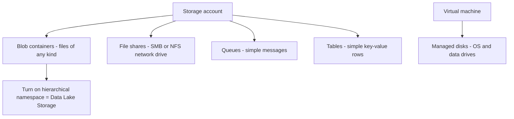

### Which one should I use?

| You need | Pick | Notes |
|---|---|---|
| Store any file cheaply (documents, images, datasets, model files) | **Blob Storage** | Default choice for almost everything. |
| A data lake for analytics and Spark | **Data Lake Storage** (Blob with hierarchical namespace) | Folders and fine-grained permissions for big data tools. |
| A shared drive that many VMs or containers mount (SMB or NFS) | **Azure Files** | Lift-and-shift apps that expect a file path. |
| The hard drive of a VM | **Managed Disks** | Choose Standard HDD, Standard SSD, Premium SSD, Premium SSD v2 or Ultra Disk by speed needs. |
| Very fast enterprise NAS (SAP, Oracle, big shared file workloads) | **Azure NetApp Files** | Premium speed and features, premium price. |
| Feed thousands of GPUs during training with a parallel file system | **Azure Managed Lustre** | Built for HPC and large AI training. |
| A pool of block storage shared by many apps (SAN in the cloud) | **Azure Elastic SAN** | Consolidating many disks; iSCSI access. |
| Long-term, rarely read data (legal hold, old logs) | **Blob archive tier** | Cheapest to store, slow and costly to read back. |

### Entries

#### Storage accounts
The top-level "drive" that holds your blobs, file shares, queues and tables, with one name and one set of settings (redundancy, network rules, encryption). Almost every Azure solution stores something; the account is where you choose how safely and how cheaply.
**Use it when:** always, as the first storage step. Choose redundancy: LRS (copies in one data center), ZRS (across zones), GRS or GZRS (also copied to a paired region). **Skip it when:** you need a database with queries. **Use instead:** a database from section 5.
*AWS / Google Cloud:* there is no exact match; the nearest idea is an S3 bucket plus its settings / a Cloud Storage bucket.
Docs: https://learn.microsoft.com/azure/storage/common/storage-account-overview

#### Azure Blob Storage
Object storage: a huge, cheap place to keep any file, reached by URL or SDK. Datasets, uploads, documents for RAG, model checkpoints and backups all need a home.
**Use it when:** you store files of any size. Pick an **access tier**: hot (used often), cool, cold, archive (rarely used). **Smart tier** (GA April 2026) moves blobs between hot, cool and cold for you based on use. Lifecycle rules can delete or move old data automatically. **Skip it when:** your app expects a normal file path or needs file locking. **Use instead:** Azure Files.
*AWS / Google Cloud:* Amazon S3 / Cloud Storage.
Docs: https://learn.microsoft.com/azure/storage/blobs/

#### Azure Data Lake Storage
Blob Storage with a "hierarchical namespace" switched on, so it has real folders and folder-level permissions. Big data engines (Spark, Fabric, Databricks, Synapse) work faster and safer with real folders and ACLs.
**Use it when:** you build a data lake or lakehouse. (The old **Data Lake Storage Gen1** is **[Retired]**; "Data Lake Storage" today means the Blob-based version, once called Gen2.) **Skip it when:** you just store app uploads. **Simpler option:** plain Blob Storage. In Microsoft Fabric, OneLake plays this role.
*AWS / Google Cloud:* Amazon S3 (with Lake Formation) / Cloud Storage (with BigLake).
Docs: https://learn.microsoft.com/azure/storage/blobs/data-lake-storage-introduction

#### Azure Files
Managed file shares that machines mount like a network drive (SMB or NFS). Older apps and some tools need a shared folder, not an object API.
**Use it when:** many VMs or containers need the same files, or you replace an on-premises file server. **Azure File Sync** keeps a copy cached on Windows servers in your offices. **Skip it when:** you only read and write whole files from code. **Cheaper option:** Blob Storage.
*AWS / Google Cloud:* Amazon EFS and FSx for Windows File Server / Filestore.
Docs: https://learn.microsoft.com/azure/storage/files/

#### Azure Disk Storage (managed disks)
Virtual hard drives for VMs. Every VM needs an OS disk and often data disks.
**Use it when:** you run VMs. Standard HDD for cheap tests, Standard SSD for light use, Premium SSD for production, **Premium SSD v2** and **Ultra Disk** when you need high, tunable speed (databases). **Skip it when:** data must be shared by many machines. **Use instead:** Azure Files or Blob.
*AWS / Google Cloud:* Amazon EBS / Persistent Disk and Hyperdisk.
Docs: https://learn.microsoft.com/azure/virtual-machines/managed-disks-overview

#### Azure NetApp Files
Enterprise-grade, very fast file storage based on NetApp technology, run as an Azure service. Some workloads (SAP HANA, large databases, EDA, VDI profiles) need high and steady file performance with snapshots.
**Use it when:** Azure Files is not fast enough or you already use NetApp on-premises. **Skip it when:** you have normal file needs. **Cheaper option:** Azure Files.
*AWS / Google Cloud:* Amazon FSx for NetApp ONTAP / Google Cloud NetApp Volumes.
Docs: https://learn.microsoft.com/azure/azure-netapp-files/

#### Azure Managed Lustre
A managed Lustre parallel file system that many machines read from at very high speed, linked to Blob Storage. Large training jobs on many GPUs can be slowed down by storage; Lustre keeps GPUs fed with data.
**Use it when:** you run large HPC or distributed AI training. It replaces the **Azure HPC Cache** **[Retired 30 Sep 2025]**. **Skip it when:** you train on one machine. **Simpler option:** local NVMe disk plus Blob Storage.
*AWS / Google Cloud:* Amazon FSx for Lustre / Google Cloud Managed Lustre.
Docs: https://learn.microsoft.com/azure/azure-managed-lustre/

#### Azure Elastic SAN
A storage area network (SAN) in the cloud: one pool of block storage you carve into volumes for many VMs or AKS clusters. Managing hundreds of separate disks is hard and wasteful; a shared pool is easier.
**Use it when:** you consolidate many disks or move an on-premises SAN. **Skip it when:** you have a few VMs. **Simpler option:** managed disks.
*AWS / Google Cloud:* no direct match (EBS volumes) / no direct match (Hyperdisk storage pools are closest).
Docs: https://learn.microsoft.com/azure/storage/elastic-san/

#### Azure Queue Storage
A very simple, cheap message queue inside a storage account. It lets one part of an app hand work to another part without waiting.
**Use it when:** you need a basic queue (for example "process this uploaded file") with no ordering or transactions. **Skip it when:** you need ordering, sessions, dead-letter queues or publish-subscribe. **Use instead:** Service Bus (section 9).
*AWS / Google Cloud:* Amazon SQS / Cloud Tasks (or Pub/Sub).
Docs: https://learn.microsoft.com/azure/storage/queues/

#### Azure Table Storage
A simple, cheap NoSQL key-value store inside a storage account. Small apps sometimes need to store rows without a full database.
**Use it when:** you store simple records (settings, logs, IDs) cheaply. **Skip it when:** you need global scale, rich queries or vector search. **Use instead:** Cosmos DB (it also offers a Table API).
*AWS / Google Cloud:* Amazon DynamoDB / Firestore or Bigtable.
Docs: https://learn.microsoft.com/azure/storage/tables/

#### Archive Storage (Blob archive tier)
The cheapest Blob tier, for data you almost never read. Laws or policies often require keeping data for years.
**Use it when:** data can wait hours to be "rehydrated" before reading. **Skip it when:** you might need the data quickly. **Use instead:** cool or cold tier.
*AWS / Google Cloud:* Amazon S3 Glacier Deep Archive / Cloud Storage Archive class.
Docs: https://learn.microsoft.com/azure/storage/blobs/access-tiers-overview

#### Azure Backup
Managed backup for VMs, disks, files, SQL and PostgreSQL databases, AKS and Blobs, with retention rules and protection against deletion (soft delete, immutable vaults). Backups save you from mistakes, ransomware and bugs.
**Use it when:** any data or machine in production must be recoverable. **Skip it when:** you only need a copy in another region for disaster recovery; that is Site Recovery (and many PaaS databases already include automatic backups).
*AWS / Google Cloud:* AWS Backup / Backup and DR Service.
Docs: https://learn.microsoft.com/azure/backup/

#### Azure Site Recovery
Disaster recovery: it keeps a running copy of your VMs in another region (or from on-premises to Azure) and fails over if the main site goes down.
**Use it when:** a VM-based app must come back quickly after a regional outage. **Skip it when:** your app is built on PaaS services with built-in geo-replication, or you just need to restore files (use Backup).
*AWS / Google Cloud:* AWS Elastic Disaster Recovery / Backup and DR Service.
Docs: https://learn.microsoft.com/azure/site-recovery/

#### Smaller storage services and tools

| Service | What it is | Use it when | AWS / Google Cloud |
|---|---|---|---|
| [**Azure Storage Actions**](https://learn.microsoft.com/azure/storage-actions/storage-tasks/) | Serverless jobs that act on millions of blobs (tag, move, delete) by rules. | You need bulk clean-up or tagging of storage. | S3 Batch Operations / Storage batch operations |
| [**Azure Storage Discovery**](https://learn.microsoft.com/azure/storage-discovery/) | Reports on what you store across many storage accounts, with insights. | You want to understand storage use and cost at scale. | S3 Storage Lens / Storage Insights |
| [**Azure Storage Mover**](https://learn.microsoft.com/azure/storage-mover/) | Managed service to copy file shares from on-premises into Azure. | You migrate NAS or file servers. | AWS DataSync / Storage Transfer Service |
| [**Azure Data Box**](https://learn.microsoft.com/azure/databox/) | Physical devices Microsoft ships to you to copy large data offline. | Uploading over the network would take weeks. | AWS Snowball / Transfer Appliance |
| [**Azure Data Share**](https://learn.microsoft.com/azure/data-share/overview) **[Retiring]** | Shares data with other organisations. No new accounts can be created; in maintenance mode until 12 Nov 2029. | Only for existing shares. New projects: OneLake shortcuts and external data sharing in Microsoft Fabric. | AWS Data Exchange / BigQuery sharing (Analytics Hub) |
| [**Azure Storage Explorer**](https://learn.microsoft.com/azure/storage/storage-explorer/vs-azure-tools-storage-manage-with-storage-explorer) | A free desktop app to browse and upload to storage accounts. | You want a visual file browser for Blob, Files, Queues, Tables. | (console) / (console) |
| [**AzCopy**](https://learn.microsoft.com/azure/storage/common/storage-use-azcopy-v10) | A command-line tool for fast copying to and from storage. | You copy large amounts of data in scripts. | AWS CLI `s3 sync` / `gcloud storage cp` |
| [**Azure File Sync**](https://learn.microsoft.com/azure/storage/file-sync/) | Keeps on-premises Windows file servers in sync with Azure Files. | Offices need local speed plus a cloud copy. | AWS Storage Gateway / no direct match |
| [**Azure Container Storage**](https://learn.microsoft.com/azure/storage/container-storage/container-storage-introduction) | Persistent volumes for AKS. See section 2. | Stateful workloads on AKS. | EBS CSI / Persistent Disk CSI |

---

## 5. Databases

### In plain words

A database stores data so you can search, update and relate it quickly and safely. Azure has three big families. **Relational** databases (Azure SQL, PostgreSQL, MySQL) store tables with rows and columns and use SQL; they are the safe default for most apps. **NoSQL** databases (Cosmos DB, Azure DocumentDB, Cassandra) store flexible documents or key-value items and scale across the world. **In-memory caches** (Azure Managed Redis) keep hot data in RAM for very fast reads. For AI apps, many of these now also store **vectors** (number lists that represent meaning), so you can do similarity search for RAG without a separate vector database.

### Which one should I use?

| Your situation | Pick |
|---|---|
| A normal business app, you like Microsoft SQL Server, or you need T-SQL | **Azure SQL Database** |
| Moving an existing SQL Server with many instance-level features (SQL Agent, cross-database queries) | **Azure SQL Managed Instance** |
| You need full control of SQL Server (OS access, unusual versions) | **SQL Server on Azure VMs** |
| Open-source relational, great extensions, popular for AI (pgvector) | **Azure Database for PostgreSQL** (Flexible Server) |
| Your app is built on MySQL (for example WordPress, many PHP apps) | **Azure Database for MySQL** (Flexible Server) |
| Global scale, single-digit millisecond reads, flexible JSON, chat history, vector search | **Azure Cosmos DB for NoSQL** |
| Your app uses the MongoDB API and you want a MongoDB-compatible service | **Azure DocumentDB** (or Cosmos DB for MongoDB RU) |
| Cache, session store, rate limits, semantic cache for LLM answers | **Azure Managed Redis** |
| Large analytics over billions of rows (dashboards, reports) | **Microsoft Fabric** warehouse or lakehouse (section 6), not an app database |
| Search over documents with keyword plus vector (hybrid) search and ranking | **Azure AI Search** (section 8) |
| Logs and time-series with fast ad-hoc queries | **Azure Data Explorer** or Fabric Eventhouse (section 6) |

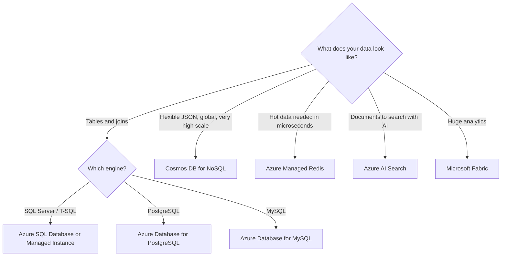

### Entries

#### Azure SQL Database
A fully managed Microsoft SQL Server database; Azure handles backups, patching and high availability. Most business apps need a reliable relational database without a DBA team.
**Use it when:** you build a new app on SQL Server technology. The **serverless** option pauses when idle (cheap for dev), **Hyperscale** grows to very large sizes, and it supports vector data types and functions for AI search. **Skip it when:** you need instance-level SQL Server features. **Use instead:** SQL Managed Instance. If you prefer open source, use PostgreSQL.
*AWS / Google Cloud:* Amazon RDS for SQL Server / Cloud SQL for SQL Server.
Docs: https://learn.microsoft.com/azure/azure-sql/database/

#### Azure SQL Managed Instance
A managed SQL Server instance that is almost 100 percent compatible with on-premises SQL Server. Moving old SQL Server apps is easier when SQL Agent jobs, linked servers and cross-database queries keep working.
**Use it when:** you migrate existing SQL Server estates with few code changes. **Skip it when:** you build a new app. **Simpler option:** Azure SQL Database.
*AWS / Google Cloud:* Amazon RDS Custom for SQL Server / Cloud SQL for SQL Server.
Docs: https://learn.microsoft.com/azure/azure-sql/managed-instance/

#### SQL Server on Azure Virtual Machines
SQL Server installed on a VM you control. Some apps need OS access, special versions, or features no managed service gives.
**Use it when:** you need full control or a version the PaaS options do not support. **Skip it when:** you can use a managed option (less patching and backup work).
*AWS / Google Cloud:* SQL Server on EC2 / SQL Server on Compute Engine.
Docs: https://learn.microsoft.com/azure/azure-sql/virtual-machines/

#### Azure SQL (the family name)
The umbrella name for SQL Database, SQL Managed Instance and SQL Server on VMs (and SQL database in Microsoft Fabric). It helps you compare the options in one place in the portal.
**Use it when:** you are choosing which SQL Server option fits. **Skip it when:** not applicable; it is a family, not a separate product.
*AWS / Google Cloud:* Amazon RDS / Cloud SQL.
Docs: https://learn.microsoft.com/azure/azure-sql/

#### Azure Database for PostgreSQL (Flexible Server)
Managed PostgreSQL, the popular open-source relational database. PostgreSQL is reliable, free of licence fees, and has strong extensions.
**Use it when:** a new app, especially an AI app (**pgvector** stores embeddings, **pg_diskann** adds a fast vector index, **elastic clusters** scale out). **Skip it when:** you need multi-region writes worldwide; use Cosmos DB. (Single Server is **[Retired]**; **Azure Cosmos DB for PostgreSQL** is on a retirement path, so use elastic clusters instead.)
*AWS / Google Cloud:* Amazon RDS for PostgreSQL or Aurora PostgreSQL / Cloud SQL for PostgreSQL or AlloyDB.
Docs: https://learn.microsoft.com/azure/postgresql/

#### Azure HorizonDB [Preview]
A new cloud-native database service built on PostgreSQL, designed for very large scale and AI workloads. It aims to give PostgreSQL compatibility with the scale of a cloud-native storage design.
**Use it when:** you want to evaluate it for future large PostgreSQL workloads. **Skip it when:** you need a production database today. **Use instead:** Azure Database for PostgreSQL.
*AWS / Google Cloud:* Amazon Aurora PostgreSQL / AlloyDB.
Docs: https://learn.microsoft.com/azure/horizondb/overview

#### Azure Database for MySQL (Flexible Server)
Managed MySQL. Many web apps and CMSs are built on MySQL.
**Use it when:** your app or framework expects MySQL. (MySQL **Single Server** is **[Retired]**. **Azure Database for MariaDB** is retired; Microsoft points MariaDB users to MySQL Flexible Server.) **Skip it when:** you are free to choose; many teams pick PostgreSQL for its extensions.
*AWS / Google Cloud:* Amazon RDS for MySQL or Aurora MySQL / Cloud SQL for MySQL.
Docs: https://learn.microsoft.com/azure/mysql/

#### Azure Database for MariaDB [Retired] (→ Azure Database for MySQL)
Was managed MariaDB (versions 10.2 and 10.3). Microsoft put it on the retirement path (retirement announced for 19 Sep 2025) and its docs are now archived.
**Use it when:** do not use; only migrate remaining data. **Skip it when:** always; move to Azure Database for MySQL Flexible Server.
*AWS / Google Cloud:* Amazon RDS for MariaDB / no direct match.
Docs: https://learn.microsoft.com/previous-versions/azure/mariadb/overview

#### Azure Cosmos DB
A globally distributed NoSQL database with automatic scaling and very fast reads and writes. Apps with users around the world, huge traffic, or flexible JSON data outgrow a single relational server.
**Use it when:** chat history, user profiles, IoT data, agent state, or vector search next to your data. Pick the **NoSQL** API for new apps (MongoDB RU, Cassandra, Gremlin and Table APIs also exist); throughput is measured in RUs (request units), with serverless and autoscale options. **Skip it when:** you need complex joins and reports; use Azure SQL or PostgreSQL.
*AWS / Google Cloud:* Amazon DynamoDB / Firestore (and Spanner for global relational).
Docs: https://learn.microsoft.com/azure/cosmos-db/

#### Azure DocumentDB [Renamed] (formerly Azure Cosmos DB for MongoDB vCore)
A MongoDB-compatible document database, based on the open-source DocumentDB engine. Teams with MongoDB apps want a managed service without rewriting code.
**Use it when:** you have MongoDB code or skills and want vCore (server-size) pricing and vector search. **Skip it when:** you start fresh with no MongoDB tie. **Consider:** Cosmos DB for NoSQL or PostgreSQL.
*AWS / Google Cloud:* Amazon DocumentDB / Firestore with MongoDB compatibility.
Docs: https://learn.microsoft.com/azure/documentdb/

#### Azure Managed Instance for Apache Cassandra
Managed Apache Cassandra clusters (the real open-source engine) run in your network. Some teams run Cassandra and want Azure to handle repairs and patching.
**Use it when:** you have Cassandra workloads and need full Cassandra compatibility. **Skip it when:** you start a new app. **Simpler option:** Cosmos DB for NoSQL (or its Cassandra API).
*AWS / Google Cloud:* Amazon Keyspaces / no direct match (Bigtable is similar in spirit).
Docs: https://learn.microsoft.com/azure/managed-instance-apache-cassandra/

#### Azure Managed Redis
Managed Redis (in-memory data store) built on Redis Enterprise, with modules such as search and JSON. Reading from memory is far faster than from a database; caches cut latency and cost.
**Use it when:** you cache API results, store sessions, do rate limiting, or keep a **semantic cache** of LLM answers (API Management's AI gateway can use it). **Skip it when:** your data must be the permanent source of truth. **Use instead:** a database, with Redis in front.
*AWS / Google Cloud:* Amazon ElastiCache / Memorystore.
Docs: https://learn.microsoft.com/azure/redis/

#### Azure Cache for Redis [Retiring] (→ Azure Managed Redis)
The older managed Redis service. Only for existing caches.
**Use it when:** you are planning a move. Enterprise and Enterprise Flash tiers retire **31 Mar 2027**; Basic, Standard and Premium tiers retire **30 Sep 2028**. Creating new caches was blocked for new customers from 1 Apr 2026 and for existing customers from 1 Oct 2026. **Skip it when:** starting anything new. **Use instead:** Azure Managed Redis.
*AWS / Google Cloud:* Amazon ElastiCache / Memorystore.
Docs: https://learn.microsoft.com/azure/azure-cache-for-redis/cache-whats-new

#### Azure Database Migration Service (DMS)
A managed tool that moves databases (SQL Server, MySQL, PostgreSQL, MongoDB and others) into Azure, online (little downtime) or offline.
**Use it when:** you migrate an existing database to Azure SQL, PostgreSQL, MySQL or Cosmos DB. **Skip it when:** the database is tiny; a dump and restore is simpler.
*AWS / Google Cloud:* AWS Database Migration Service / Database Migration Service.
Docs: https://learn.microsoft.com/azure/dms/

#### Smaller database services

| Service | What it is | Use it when | AWS / Google Cloud |
|---|---|---|---|
| [**Azure confidential ledger**](https://learn.microsoft.com/azure/confidential-ledger/) | A tamper-proof, append-only record store backed by secure hardware. | You must prove that records (audit logs, AI decisions) were not changed. | no current direct match / no direct match |
| [**SQL database in Microsoft Fabric**](https://learn.microsoft.com/fabric/database/sql/overview) | An Azure SQL-based database inside Fabric, auto-mirrored to OneLake. | Your team lives in Fabric and needs an app database there. | no direct match / no direct match |
| [**Azure SQL Edge**](https://learn.microsoft.com/previous-versions/azure/azure-sql-edge/overview) **[Retired 30 Sep 2025]** | Small SQL engine for IoT devices. | Do not use; store on-device data elsewhere and sync to Azure. | - |

---

## 6. Analytics and Microsoft Fabric

### In plain words

Apps write data in small pieces; analytics reads **a lot of it at once** to answer questions like "how many users asked about refunds last month?". Analytics systems use different storage and engines than app databases. **Microsoft Fabric** is Microsoft's all-in-one analytics platform (software as a service): one data lake called **OneLake**, plus workloads for data engineering (Spark), data warehousing (SQL), real-time data, data science and **Power BI** reports, all in one place. Before Fabric, the same jobs were spread over separate Azure services such as **Azure Synapse Analytics**, **Azure Data Factory** and **Azure Data Explorer**; those still exist, but new analytics projects on Microsoft's stack usually start in Fabric. **Azure Databricks** is the main alternative: a Spark and lakehouse platform made with Databricks, popular for data engineering and machine learning.

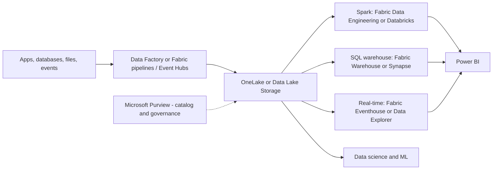

### Which one should I use?

| Your situation | Pick |
|---|---|
| New analytics project on Microsoft's stack, want one platform with BI | **Microsoft Fabric** |
| Heavy Spark data engineering, ML on big data, multi-cloud lakehouse | **Azure Databricks** |
| You already have Synapse workspaces running well | Keep **Azure Synapse Analytics**; plan new work in Fabric |
| Logs, telemetry, time series, fast ad-hoc queries over billions of rows | **Azure Data Explorer** or Fabric **Eventhouse** |
| Simple real-time filters and aggregations on a stream with SQL | **Azure Stream Analytics** (or Fabric Eventstreams) |
| Existing Hadoop, Hive, Kafka or HBase clusters you want to keep | **HDInsight** |
| Dashboards and reports for business users | **Power BI** |
| Put Power BI reports inside your own app for your customers | **Power BI Embedded** |
| Find and govern data across the company (catalog, lineage, sensitivity labels) | **Microsoft Purview** |

### Entries

#### Microsoft Fabric
An all-in-one, software-as-a-service analytics platform: data lake (OneLake), pipelines, Spark, SQL warehouse, real-time analytics, data science, Power BI and AI features under one licence (capacity units). Building analytics from many separate services means many bills, copies and permission models; Fabric puts them on one lake.
**Use it when:** you start a new analytics, BI or data platform project, or want **mirroring** (near real-time copies of operational databases into OneLake without ETL). **Fabric IQ** adds a business-meaning layer that AI agents can use. **Skip it when:** you need a small app database or one simple report. **Simpler option:** query your database directly from Power BI.
*AWS / Google Cloud:* no single match; pieces are Amazon Redshift, AWS Glue and Amazon Quick (formerly QuickSight) / BigQuery, Dataflow and Looker.
Docs: https://learn.microsoft.com/fabric/

#### OneLake (part of Fabric)
One logical data lake for the whole organisation, built on Data Lake Storage, that every Fabric workload reads and writes in the open Delta/Parquet format. It avoids copying the same data into many systems. **Shortcuts** let OneLake point at data in other storage (including S3) without copying.
**Use it when:** you use Fabric; it comes with it. **Skip it when:** you are not on Fabric. **Use instead:** Data Lake Storage.
*AWS / Google Cloud:* Amazon S3 with Lake Formation / Cloud Storage with BigLake.
Docs: https://learn.microsoft.com/fabric/onelake/onelake-overview

#### Azure Synapse Analytics
An older unified analytics service with dedicated SQL pools (data warehouse), serverless SQL, Spark pools and pipelines. Many companies built their warehouses on it.
**Use it when:** you maintain an existing Synapse solution. It is still generally available. (Its **Data Explorer pools** were **[Retired 7 Oct 2025]**; Microsoft points those users to Fabric Eventhouse.) **Skip it when:** starting a new analytics project. **Use instead:** Microsoft Fabric (Microsoft's current analytics direction) or Databricks.
*AWS / Google Cloud:* Amazon Redshift / BigQuery.
Docs: https://learn.microsoft.com/azure/synapse-analytics/

#### Azure Databricks
The Databricks lakehouse platform (Spark, Delta Lake, notebooks, MLflow, Unity Catalog) run as a first-party Azure service. It is a leading platform for large-scale data engineering and machine learning on a lakehouse.
**Use it when:** your team writes a lot of Spark or Python on big data, trains ML on lakehouse data, or wants the same platform on several clouds. **Skip it when:** your data is small. **Simpler option:** pandas or DuckDB on a single machine, or Fabric if you also want Power BI in one product.
*AWS / Google Cloud:* Databricks on AWS (or Amazon EMR) / Databricks on Google Cloud (or Dataproc).
Docs: https://learn.microsoft.com/azure/databricks/

#### Azure Data Explorer
A very fast analytics database for logs, telemetry and time-series data, queried with KQL (Kusto Query Language). Searching billions of log lines or sensor readings in seconds needs a special engine. (Azure Monitor Log Analytics uses the same KQL language.)
**Use it when:** you analyse telemetry, IoT data, security logs or LLM traces at large scale. In Fabric the same engine is called **Eventhouse**. **Skip it when:** your logs are small. **Simpler option:** Log Analytics workspace.
*AWS / Google Cloud:* Amazon OpenSearch Service or Amazon Timestream / BigQuery.
Docs: https://learn.microsoft.com/azure/data-explorer/

#### Azure Stream Analytics
A service that runs SQL-like queries continuously on streaming data (events from Event Hubs or IoT Hub). Some answers are needed now, not tomorrow: "alert if temperature is above 80 for 5 minutes".
**Use it when:** you need simple real-time filtering, windows and aggregates without writing stream code. **Skip it when:** your logic is complex. **Use instead:** Spark Structured Streaming in Databricks or Fabric, or Fabric Eventstreams.
*AWS / Google Cloud:* Amazon Managed Service for Apache Flink / Dataflow.
Docs: https://learn.microsoft.com/azure/stream-analytics/

#### Azure HDInsight
Managed open-source big data clusters (Hadoop, Spark, Hive, Kafka, HBase). Some companies still run classic Hadoop-ecosystem jobs.
**Use it when:** you maintain existing Hadoop-style workloads. (**HDInsight on AKS** was **[Retired 31 Jan 2025]**.) **Skip it when:** starting new. **Use instead:** Fabric or Databricks.
*AWS / Google Cloud:* Amazon EMR / Dataproc.
Docs: https://learn.microsoft.com/azure/hdinsight/

#### Power BI
Microsoft's tool for interactive reports and dashboards, now part of Fabric. Business users need to see data in charts without writing code.
**Use it when:** you build reports for people inside your organisation. **Skip it when:** you need a chart inside a custom web app for the public. **Use instead:** Power BI Embedded or a charting library.
*AWS / Google Cloud:* Amazon Quick (formerly QuickSight) / Looker.
Docs: https://learn.microsoft.com/power-bi/

#### Power BI Embedded
A way to put Power BI reports inside your own application, billed by capacity. You can give customers analytics without building charts from scratch.
**Use it when:** your SaaS product needs built-in dashboards. **Skip it when:** only internal staff use the reports. **Use instead:** normal Power BI.
*AWS / Google Cloud:* Amazon Quick embedded analytics / Looker embedded.
Docs: https://learn.microsoft.com/power-bi/developer/embedded/

#### Microsoft Purview
Data governance and data security: a catalog of your data, lineage (where data came from), sensitivity labels, data loss prevention and compliance tools. Companies must know what data they have, who uses it, and whether it is sensitive, especially when AI apps read it.
**Use it when:** you need a data catalog, labels that follow files and AI answers, or audit for Copilot and AI apps. It replaces **Azure Data Catalog** **[Retired 15 May 2024]** and absorbed **Azure Information Protection** labelling. **Skip it when:** you are a single developer learning. It is an organisation-level tool.
*AWS / Google Cloud:* AWS Glue Data Catalog, Lake Formation and Amazon Macie / Dataplex Universal Catalog and Sensitive Data Protection.
Docs: https://learn.microsoft.com/purview/

#### Azure Analysis Services
A managed semantic model engine (tabular models) for BI, the same engine family as Power BI datasets. Older BI solutions keep business logic in Analysis Services models.
**Use it when:** you maintain existing models. It is still available. **Skip it when:** starting new. **Use instead:** semantic models in Power BI / Fabric.
*AWS / Google Cloud:* no direct match / Looker semantic layer.
Docs: https://learn.microsoft.com/analysis-services/azure-analysis-services/analysis-services-overview

#### Smaller analytics services

| Service | What it is | Use it when | AWS / Google Cloud |
|---|---|---|---|
| [**Microsoft Graph Data Connect**](https://learn.microsoft.com/graph/data-connect-concept-overview) **[Preview listing]** | Bulk export of Microsoft 365 data (mail, Teams metadata) into Azure for analytics, with consent controls. | You analyse organisation-wide Microsoft 365 data. | no direct match / no direct match |
| [**Azure Open Datasets**](https://learn.microsoft.com/azure/open-datasets/) | Curated public datasets (weather, holidays, census) ready to use in Azure. | You need public data to enrich ML features. | Registry of Open Data on AWS / Google Cloud public datasets |
| [**Microsoft Planetary Computer Pro**](https://learn.microsoft.com/azure/planetary-computer/) | Geospatial data platform for satellite and map data at scale. | You build geospatial analytics or AI. | Amazon SageMaker geospatial / Earth Engine |
| [**Azure Data Lake Analytics**](https://learn.microsoft.com/previous-versions/azure/data-lake-analytics/data-lake-analytics-overview) **[Retired 29 Feb 2024]** | Old U-SQL analytics service. | Do not use; use Fabric or Synapse. | - |
| [**Azure Time Series Insights**](https://learn.microsoft.com/previous-versions/azure/time-series-insights/overview-what-is-tsi) **[Retired 7 Jul 2024]** | Old IoT time-series explorer. | Do not use; use Fabric Real-Time Intelligence or Data Explorer. | - |
| [**Event Hubs**](https://learn.microsoft.com/azure/event-hubs/) | Ingests millions of events per second (clicks, logs, telemetry) for analytics; Kafka-compatible. Full entry in section 9. | You stream big event volumes into analytics. | Amazon Kinesis Data Streams or MSK / Pub/Sub |
| [**Azure Chaos Studio**](https://learn.microsoft.com/azure/chaos-studio/) | Breaks things on purpose (shut down a VM, add network delay) to test that your app survives. Listed under analytics on the product page; full entry in section 13. | You test resilience before real outages happen. | AWS Fault Injection Service / no direct match |

---

## 7. Data integration (moving and transforming data)

### In plain words

Data rarely starts where you need it. **Data integration** means copying data from many sources into one place and cleaning it on the way. This is often called **ETL** (extract, transform, load) or **ELT** (load first, transform inside the warehouse). On Azure the main tool is **Azure Data Factory**, a managed service where you build pipelines with a visual designer and 90+ connectors. Inside Microsoft Fabric the same idea is called **Data Factory in Fabric** (pipelines and dataflows). For "keep a live copy of my database in the lake", Fabric **mirroring** removes the need to build pipelines at all.

### Which one should I use?

| Need | Pick |
|---|---|
| Scheduled copy and transform jobs between many systems, standalone on Azure | **Azure Data Factory** |
| Same, but your analytics already lives in Fabric | **Data Factory in Microsoft Fabric** (pipelines, Dataflow Gen2) |
| Near real-time copy of Azure SQL, Cosmos DB, PostgreSQL, Snowflake and others into the lake | **Fabric mirroring** |
| Business workflow that moves a few records between SaaS apps (CRM to email) | **Logic Apps** or Power Automate (section 9) |
| Huge offline transfer (hundreds of TB) | **Azure Data Box** (section 4) |
| Streams of events | **Event Hubs** plus Stream Analytics or Fabric Eventstreams |
| Change data capture from databases into Kafka-style streams | **Event Hubs** (Kafka API) with Debezium or Fabric Eventstreams |

### Entries

#### Azure Data Factory
A managed, serverless data integration service: visual pipelines, 90+ connectors, mapping data flows (Spark-based transforms), scheduling and monitoring. Copying data between databases, files and SaaS apps on a schedule is common and error-prone by hand.
**Use it when:** you build ETL/ELT pipelines, feed a data lake, or prepare documents for a RAG index on a schedule. A **self-hosted integration runtime** reaches data inside your own network. **Skip it when:** you need a one-off copy. **Simpler option:** AzCopy or a short script.
*AWS / Google Cloud:* AWS Glue / Cloud Data Fusion (and Dataflow).
Docs: https://learn.microsoft.com/azure/data-factory/

#### Data Factory in Microsoft Fabric
Fabric's version of Data Factory: pipelines and Dataflow Gen2 (Power Query) that write into OneLake. Your data movement lives next to your lakehouse and reports, with one security model.
**Use it when:** your team uses Fabric. **Skip it when:** you are not on Fabric. **Use instead:** Azure Data Factory.
*AWS / Google Cloud:* AWS Glue / Dataflow and Cloud Composer.
Docs: https://learn.microsoft.com/fabric/data-factory/

#### Fabric mirroring
A Fabric feature that keeps a near real-time, read-only copy of an operational database in OneLake. It gives analytics fresh data with no pipeline code.
**Use it when:** you want reports or AI over data in Azure SQL, Cosmos DB, PostgreSQL, Snowflake and other supported sources. **Skip it when:** you need to transform data heavily on the way. **Use instead:** pipelines.
*AWS / Google Cloud:* zero-ETL integrations into Redshift / Datastream into BigQuery.
Docs: https://learn.microsoft.com/fabric/mirroring/overview

#### Synapse pipelines
The Data Factory engine built into Azure Synapse workspaces. Synapse users get pipelines without a separate Data Factory.
**Use it when:** you maintain existing Synapse solutions. **Skip it when:** starting new. **Use instead:** Data Factory or Fabric.
*AWS / Google Cloud:* AWS Glue workflows / Cloud Composer.
Docs: https://learn.microsoft.com/azure/synapse-analytics/get-started-pipelines

#### Smaller data integration tools

| Tool | What it is | Use it when | AWS / Google Cloud |
|---|---|---|---|
| [**Self-hosted integration runtime**](https://learn.microsoft.com/azure/data-factory/create-self-hosted-integration-runtime) | A small agent you install on-premises so Data Factory can reach private data. | Your sources are inside a company network. | AWS Glue connections / Data Fusion private connectivity |
| [**Dataflow Gen2**](https://learn.microsoft.com/fabric/data-factory/dataflows-gen2-overview) | Power Query (low-code data shaping) in Fabric. | Analysts clean data without code. | AWS Glue DataBrew / Dataprep (third party) |
| [**Fabric Eventstreams**](https://learn.microsoft.com/fabric/real-time-intelligence/event-streams/overview) | No-code real-time ingestion and routing inside Fabric. | You bring streaming data into Fabric. | Kinesis Data Firehose / Pub/Sub to BigQuery subscriptions |
| [**Azure Data Box**](https://learn.microsoft.com/azure/databox/) / [**Storage Mover**](https://learn.microsoft.com/azure/storage-mover/) | Offline and online bulk transfer. See section 4. | Moving large data sets. | Snowball, DataSync / Transfer Appliance, Storage Transfer Service |

---

## 8. AI and machine learning

### In plain words

Azure AI has four layers. Learn the layers first and the many product names become easier.

1. **Microsoft Foundry** (formerly Azure AI Foundry, before that Azure AI Studio) is the main platform for **generative AI apps and agents**. One Foundry resource holds projects, a catalogue of models (OpenAI, Microsoft Phi, Meta, Mistral, Anthropic, DeepSeek and many more), the **Agent Service**, knowledge (**Foundry IQ**, built on Azure AI Search), safety guardrails, evaluation and tracing.
2. **Foundry Tools** (formerly Azure AI Services, before that Cognitive Services) are ready-made AI APIs: speech, translation, language, vision, document reading, content safety. You call them; you do not train anything.
3. **Azure Machine Learning** is for **training and operating your own models** (classic ML and custom deep learning): data, compute clusters, experiments with MLflow, pipelines, a model registry and endpoints.
4. **Low-code and business tools** sit on top: **Microsoft Copilot Studio** (build agents with little code, mostly for Microsoft 365 and business users) and Power Platform.

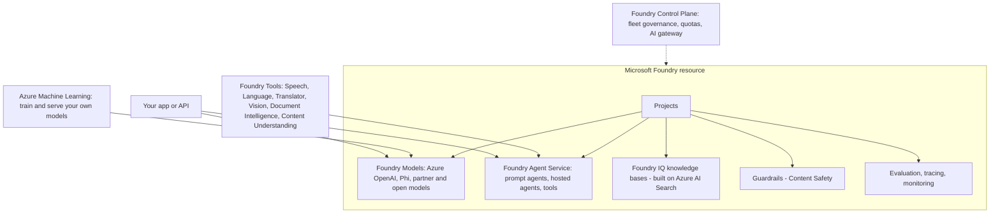

### Which one should I use?

| Your goal | Pick | Why |
|---|---|---|
| Chatbot, RAG app, or AI agent using a large language model | **Microsoft Foundry** (models + Agent Service + Foundry IQ) | Everything for gen-AI apps in one place, with keyless auth and guardrails. |
| Just call GPT-style models from code | **Azure OpenAI in Foundry Models** (a serverless deployment) | Pay per token, OpenAI-compatible `/openai/v1/` API. |
| Transcribe audio, translate text, read invoices, describe images | **Foundry Tools** (Speech, Translator, Document Intelligence, Vision, Content Understanding) | Prebuilt, no training needed. |
| Train your own model on your own tabular, image or text data; MLOps | **Azure Machine Learning** | Experiments, pipelines, registry, managed endpoints. |
| Big data feature engineering plus ML on a lakehouse | **Azure Databricks** (or Fabric Data Science) | Spark plus MLflow next to the data. |
| A business user wants an agent inside Teams or Microsoft 365 with little code | **Microsoft Copilot Studio** | Low-code, connectors, publishing to Microsoft 365. |
| Run a small model on a laptop or device, offline | **Foundry Local** | On-device runtime, no Azure subscription needed. |
| Govern many AI apps and agents across a company (quotas, policies, costs) | **Foundry Control Plane** plus **API Management AI gateway** | Central view and control. |

**Where do I keep my vectors for RAG?**

| Option | Pick it when |
|---|---|
| **Azure AI Search** / **Foundry IQ** | You need the best retrieval quality: hybrid (keyword + vector) search, semantic ranking, chunking and indexers from Blob, SharePoint, OneLake. Default for serious RAG. |
| **Cosmos DB for NoSQL** vector search | Your app data and chat history already live in Cosmos DB and you want vectors next to them. |
| **Azure Database for PostgreSQL** with pgvector / pg_diskann | Your app already uses PostgreSQL and you want SQL plus vectors. |
| **Azure SQL Database** vector type | Your app is on SQL Server technology. |
| **Azure Managed Redis** | Very fast semantic caching of answers, not a main document store. |

### Entries: Microsoft Foundry and its parts

#### Microsoft Foundry [Renamed] (formerly Azure AI Foundry, before that Azure AI Studio)
Microsoft's platform for building generative AI apps and agents: one **Foundry resource** with **projects**, a model catalogue, agents, knowledge, guardrails and evaluation, in a portal (ai.azure.com) and SDKs (`azure-ai-projects`). The older hub-based setup now lives in the "Foundry (classic)" portal.
**Use it when:** you build any LLM app, RAG system or agent on Azure. **Skip it when:** you only need speech-to-text or OCR (call a Foundry Tool directly) or you train classic ML models (Azure Machine Learning).
*AWS / Google Cloud:* Amazon Bedrock (with AgentCore) / Gemini Enterprise Agent Platform (formerly Vertex AI).
Docs: https://learn.microsoft.com/azure/foundry/what-is-foundry

#### Foundry Models (model catalogue and deployments)
The catalogue of models you can deploy in Foundry: models sold by Azure (all Azure OpenAI models plus selected others) and models from partners and the community. Deployment types include Global Standard (pay per token, the usual start), Data Zone, Provisioned (reserved throughput units, PTU) and Batch (cheaper, slower).
**Use it when:** you choose and deploy a model. Start with a serverless Global Standard deployment. **Skip it when:** you need full control over a GPU server; then use managed compute in Foundry, Azure Machine Learning, AKS or Container Apps GPUs.
*AWS / Google Cloud:* Amazon Bedrock model catalogue / Model Garden.
Docs: https://learn.microsoft.com/azure/foundry/concepts/deployments-overview

#### Azure OpenAI in Foundry Models [Renamed] (formerly Azure OpenAI Service)
OpenAI's models (GPT, reasoning, embeddings, image, audio) hosted by Microsoft with Azure security, private networking and Entra ID sign-in. Now part of Foundry Models; an Azure OpenAI resource can be upgraded to a Foundry resource. New code uses the OpenAI SDK against the stable `/openai/v1/` route and the **Responses API**.
**Use it when:** you want OpenAI models with enterprise controls in your Azure tenant. **Skip it when:** another model in the catalogue is cheaper or better for the task; compare first.
*AWS / Google Cloud:* OpenAI models on Amazon Bedrock / OpenAI open-weight models in Model Garden (no direct match for hosted GPT models).
Docs: https://learn.microsoft.com/azure/foundry/openai/api-version-lifecycle

#### Foundry Agent Service [Renamed] (formerly Azure AI Agent Service)
A managed service to build, run and publish AI agents: **prompt agents** (configuration only), **voice agents** (Voice Live) and **hosted agents** (your own container, for example with Microsoft Agent Framework or LangGraph). It manages conversations, tools (MCP, web search, file search, code interpreter, AI Search), identity and tracing.
**Use it when:** your app needs an agent that calls tools and keeps conversation state. **Skip it when:** one model call with a good prompt is enough; just call the model.
*AWS / Google Cloud:* Amazon Bedrock AgentCore / Agent Runtime on the Gemini Enterprise Agent Platform.
Docs: https://learn.microsoft.com/azure/foundry/agents/overview

#### Foundry IQ
A managed knowledge layer for agents: you create a **knowledge base** that connects to sources (Blob, SharePoint, OneLake, the web) and Foundry IQ does "agentic retrieval" (splits a question into sub-queries, searches, reranks and returns cited results), respecting user permissions. It is built on Azure AI Search.
**Use it when:** you want RAG for agents without building the retrieval pipeline yourself. **Skip it when:** you need full control of the index design; use Azure AI Search directly.
*AWS / Google Cloud:* Amazon Bedrock Knowledge Bases / RAG Engine on the Agent Platform.
Docs: https://learn.microsoft.com/azure/foundry/agents/concepts/what-is-foundry-iq

#### Azure AI Search
Search-as-a-service: build an index from your documents, then query with keywords, vectors or both (**hybrid**), with **semantic ranking** that reorders results by meaning. Indexers and skills can pull, chunk and embed content. Microsoft now also markets it under the Foundry IQ name (same service, same API and pricing).
**Use it when:** you build RAG or a search box over company documents. **Skip it when:** you have a few hundred chunks for a demo; an in-memory vector store or pgvector is enough.
*AWS / Google Cloud:* Amazon OpenSearch Service or Amazon Kendra / Vertex AI Search (part of the Agent Platform).
Docs: https://learn.microsoft.com/azure/search/

#### Azure AI Content Safety and Foundry guardrails (listed as "Content Safety in Foundry Control Plane")
Detects harmful text and images (hate, sexual, violence, self-harm), **Prompt Shields** for jailbreaks and indirect prompt injection, protected material, and task adherence for agents. In Foundry, **guardrails** apply these checks to user input, tool calls, tool responses and output. Note: the groundedness detection preview is **[Retiring 30 Apr 2027]**.
**Use it when:** any user-facing AI app; it is your safety filter. **Skip it when:** never skip for public apps; for internal tests the default guardrail is usually enough.
*AWS / Google Cloud:* Amazon Bedrock Guardrails / Model Armor.
Docs: https://learn.microsoft.com/azure/ai-services/content-safety/overview

#### Foundry Control Plane (and Observability in Foundry Control Plane)
A central place to see and govern all AI apps and agents in a subscription: inventory, compliance with Azure Policy, quotas, cost and token use, evaluations, tracing (OpenTelemetry) and red-teaming. Advanced governance uses an AI gateway in API Management.
**Use it when:** a company runs many AI projects and needs one view of risk and spend. **Skip it when:** you have one learning project; the project's own evaluation and tracing pages are enough.
*AWS / Google Cloud:* AgentCore Observability and Policy / Agent Registry and Agent Gateway on the Agent Platform.
Docs: https://learn.microsoft.com/azure/foundry/control-plane/overview

#### Foundry Local
A small on-device runtime that runs open models (for example Phi, Qwen, Mistral, Whisper) on Windows, macOS or Linux using the GPU, NPU or CPU, with an OpenAI-compatible API. No Azure subscription needed.
**Use it when:** you need offline, private or low-cost inference on a laptop or edge PC. **Skip it when:** many users share one server; use vLLM on a GPU VM, AKS or Foundry managed compute.
*AWS / Google Cloud:* no direct match / no direct match (on-device options such as Gemini Nano are device-specific).
Docs: https://learn.microsoft.com/azure/foundry-local/what-is-foundry-local

#### Microsoft Agent Framework (SDK)
Microsoft's open-source code library for building agents and multi-agent workflows in Python and .NET; it is the successor of Semantic Kernel and AutoGen.
**Use it when:** you write agent logic in code and want first-class Foundry support. **Skip it when:** a prompt agent in the Foundry portal is enough, or your team already uses LangGraph (also supported as a hosted agent).
*AWS / Google Cloud:* Strands Agents SDK / Agent Development Kit (ADK).
Docs: https://learn.microsoft.com/agent-framework/

#### Phi open models
Microsoft's family of small language models with open weights, available in Foundry and for local use.
**Use it when:** you want a small, cheap model for simple tasks, on-device use or fine-tuning. **Skip it when:** the task needs a frontier model's reasoning.
*AWS / Google Cloud:* Amazon Nova (lite models) / Gemma.
Docs: https://azure.microsoft.com/products/phi

### Entries: Foundry Tools (ready-made AI APIs)

#### Foundry Tools [Renamed] (formerly Azure AI Services, before that Cognitive Services)
The family name for Microsoft's prebuilt AI APIs. Many have a free F0 tier for testing. Product names now end in "in Foundry Tools", for example "Azure Speech in Foundry Tools".
**Use it when:** you need a standard AI capability (speech, OCR, translation) without training. **Skip it when:** a general LLM does the job just as well with one prompt; compare quality and price.
*AWS / Google Cloud:* AWS AI services / Google Cloud AI APIs.
Docs: https://learn.microsoft.com/azure/ai-services/what-are-ai-services

#### Azure Speech in Foundry Tools (formerly Azure AI Speech)
Speech-to-text, text-to-speech with natural voices, speech translation and real-time voice (**Voice Live**) for voice agents.
**Use it when:** you build call-centre transcription, captions, voice assistants or read-aloud features. **Skip it when:** a speech-capable LLM model already gives you what you need end to end.
*AWS / Google Cloud:* Amazon Transcribe and Amazon Polly / Speech-to-Text and Text-to-Speech.
Docs: https://learn.microsoft.com/azure/ai-services/speech-service/

#### Azure Language in Foundry Tools (formerly Azure AI Language)
Text analysis APIs: sentiment, key phrases, named entities, PII detection and redaction, summarisation, conversational language understanding (the successor of the retired LUIS) and custom question answering (successor of the retired QnA Maker).
**Use it when:** you need cheap, consistent, high-volume text classification or PII redaction. **Skip it when:** you need open-ended reasoning; use an LLM.
*AWS / Google Cloud:* Amazon Comprehend / Natural Language API.
Docs: https://learn.microsoft.com/azure/ai-services/language-service/

#### Azure Translator in Foundry Tools (formerly Azure AI Translator)
Translates text and whole documents between 100+ languages, with custom terminology.
**Use it when:** you translate UI text, documents or chat at scale. **Skip it when:** you need creative rewriting; an LLM may suit better.
*AWS / Google Cloud:* Amazon Translate / Cloud Translation.
Docs: https://learn.microsoft.com/azure/ai-services/translator/

#### Azure Vision in Foundry Tools (formerly Azure AI Vision)
Image analysis: captions, tags, object detection, OCR (reading text in images) and video analysis features.
**Use it when:** you need standard image understanding or OCR at volume. **Skip it when:** you need open-ended questions about images; use a multimodal LLM or Content Understanding.
*AWS / Google Cloud:* Amazon Rekognition / Cloud Vision API.
Docs: https://learn.microsoft.com/azure/ai-services/computer-vision/

#### Azure AI Face
Face detection, verification and liveness checks. **Limited Access:** identification features are only for approved Microsoft-managed customers; emotion and gender inference were retired for responsible-AI reasons.
**Use it when:** an approved identity-verification scenario (for example liveness at sign-up). **Skip it when:** you just need to blur faces or count people; Vision can do that.
*AWS / Google Cloud:* Amazon Rekognition face features / no direct match (Cloud Vision detects faces only).
Docs: https://learn.microsoft.com/azure/ai-services/face/overview-identity

#### Azure Document Intelligence in Foundry Tools (formerly Form Recognizer)
Reads documents (PDFs, scans, photos) and extracts text, tables, key-value pairs and fields from invoices, receipts, IDs or your own custom forms. Its layout model is a common first step in RAG pipelines.
**Use it when:** you process forms and documents, or turn PDFs into clean text and tables for RAG. **Skip it when:** you have plain text files.
*AWS / Google Cloud:* Amazon Textract / Document AI.
Docs: https://learn.microsoft.com/azure/ai-services/document-intelligence/

#### Azure Content Understanding in Foundry Tools
Uses generative AI to turn documents, images, audio and video into structured data you define (fields, summaries, segments) with one API.
**Use it when:** you need multimodal extraction (for example "get the speaker, topic and action items from this call recording"). **Skip it when:** you only need classic OCR or form fields; Document Intelligence may be cheaper.
*AWS / Google Cloud:* Amazon Bedrock Data Automation / Document AI with Gemini.
Docs: https://learn.microsoft.com/azure/ai-services/content-understanding/

#### Azure AI Custom Vision [Retiring 25 Sep 2028]
Train a custom image classifier or object detector with a few labelled images. Microsoft gives existing customers full support until 25 Sep 2028.
**Use it when:** only for existing projects. **Skip it when:** starting new; use Azure Machine Learning AutoML for images, a vision model from the Foundry catalogue, or Content Understanding.
*AWS / Google Cloud:* Amazon Rekognition Custom Labels / AutoML image models on the Agent Platform.
Docs: https://learn.microsoft.com/azure/ai-services/custom-vision-service/overview

#### Azure AI Immersive Reader
A reading tool you embed in apps: reads text aloud, highlights syllables, translates and helps people with dyslexia or language learners.
**Use it when:** you build education or accessibility features. **Skip it when:** you only need text-to-speech; use Speech.
*AWS / Google Cloud:* no direct match / no direct match.
Docs: https://learn.microsoft.com/azure/ai-services/immersive-reader/overview

#### Azure AI Video Indexer
Analyses videos to extract transcripts, topics, faces (limited access), objects and scenes, and makes them searchable. Can also run at the edge with Azure Arc.
**Use it when:** you need searchable insights from a video library. **Skip it when:** you only need a transcript; use Speech.
*AWS / Google Cloud:* Amazon Rekognition Video and Amazon Transcribe / Video Intelligence API.
Docs: https://learn.microsoft.com/azure/azure-video-indexer/video-indexer-overview

#### Retired Foundry Tools (do not use for new work)

| Service | Status | Use instead |
|---|---|---|
| [**Anomaly Detector**](https://learn.microsoft.com/previous-versions/azure/ai-services/anomaly-detector/overview) | **[Retired 1 Oct 2026]** | Anomaly detection in Microsoft Fabric Real-Time Intelligence, or the open-source anomaly-detector library |
| [**Personalizer**](https://learn.microsoft.com/previous-versions/azure/ai-services/personalizer/) | **[Retired]** (listed as retired by Microsoft) | Your own recommender model in Azure Machine Learning |
| [**Metrics Advisor**](https://learn.microsoft.com/previous-versions/azure/ai-services/metrics-advisor/) | **[Retired]** | Fabric Real-Time Intelligence, Azure Monitor alerts |
| [**Language Understanding (LUIS)**](https://learn.microsoft.com/previous-versions/azure/ai-services/luis/) | **[Retired]** | Conversational language understanding in Azure Language, or an LLM |
| [**QnA Maker**](https://learn.microsoft.com/previous-versions/azure/ai-services/qnamaker/) | **[Retired]** | Custom question answering in Azure Language, or RAG with Foundry IQ |
| [**Content Moderator**](https://learn.microsoft.com/azure/ai-services/content-moderator/) | **[Retired]** | Azure AI Content Safety |

### Entries: training your own models

#### Azure Machine Learning
A platform for the whole life of your own ML models: workspace, compute instances and clusters (CPU/GPU), **MLflow** tracking, AutoML, pipelines, model registry, and online and batch endpoints. Use SDK v2 (`azure-ai-ml`); SDK v1 support ended 30 Jun 2026, and **Prompt flow** is **[Retiring 20 Apr 2027]**.
**Use it when:** you train, fine-tune, track and deploy custom models with MLOps. **Skip it when:** you only call hosted LLMs; use Foundry.
*AWS / Google Cloud:* Amazon SageMaker AI / Gemini Enterprise Agent Platform (formerly Vertex AI) training and pipelines.
Docs: https://learn.microsoft.com/azure/machine-learning/

#### Data Science Virtual Machine (DSVM)
A ready-made Windows or Linux VM image with Python, Jupyter, CUDA and popular ML libraries.
**Use it when:** you want a quick personal GPU or CPU workstation for experiments. **Skip it when:** you want managed, shareable compute and tracking; use an Azure ML compute instance.
*AWS / Google Cloud:* AWS Deep Learning AMIs / Deep Learning VM Images.
Docs: https://learn.microsoft.com/azure/machine-learning/data-science-virtual-machine/overview

#### Azure Databricks (for ML)
Also listed in section 6. For AI work it gives notebooks, Spark for feature engineering, MLflow, model serving and vector search on lakehouse data.
**Use it when:** your training data is big and already in a lakehouse. **Skip it when:** your data fits on one machine.
*AWS / Google Cloud:* Databricks on AWS / Databricks on Google Cloud.
Docs: https://learn.microsoft.com/azure/databricks/

### Entries: bots, copilots and AI assistants

#### Microsoft Copilot Studio
A low-code tool (part of Microsoft's Power Platform, not an Azure resource) for building agents and chatbots with topics, knowledge sources, connectors and actions, published to Teams, Microsoft 365 Copilot, websites and more. It can connect to Foundry agents and Foundry IQ.
**Use it when:** business teams build internal agents quickly, especially in Microsoft 365. **Skip it when:** you need full code control, custom UIs, or deep integration in your own product; use Foundry Agent Service.
*AWS / Google Cloud:* Amazon Quick agents / Gemini Enterprise.
Docs: https://learn.microsoft.com/microsoft-copilot-studio/

#### Azure AI Bot Service
Hosts and connects bots to channels (Teams, web chat, Slack and others). Microsoft's docs now point new development to the **Microsoft 365 Agents SDK** and Copilot Studio rather than the older Bot Framework SDK.
**Use it when:** you need to publish a code-built bot or agent to channels such as Teams. **Skip it when:** you build a normal web chat UI in your own app; call your agent's API directly.
*AWS / Google Cloud:* Amazon Lex / Conversational Agents (Dialogflow CX).
Docs: https://learn.microsoft.com/azure/bot-service/

#### Healthcare agent service [Renamed] (formerly Azure Health Bot)
A managed service for healthcare chat assistants with medical content, triage protocols and compliance features.
**Use it when:** you build a patient-facing or clinician-facing healthcare assistant. **Skip it when:** you are outside healthcare.
*AWS / Google Cloud:* no direct match / no direct match.
Docs: https://learn.microsoft.com/azure/health-bot/overview

#### Smaller AI assistants and related services

| Service | What it is | Use it when | AWS / Google Cloud |
|---|---|---|---|
| [**Azure SRE Agent**](https://learn.microsoft.com/azure/sre-agent/overview) | An AI agent that watches your Azure apps, investigates incidents and suggests or applies fixes. Still labelled Preview on the product page; the docs show live billing in "Azure Agent Units". | You run production apps and want AI help with on-call work. | AWS DevOps Agent / Gemini Cloud Assist investigations |
| [**Microsoft Security Copilot**](https://learn.microsoft.com/copilot/security/) | A generative AI assistant for security teams, working with Defender, Sentinel, Entra and Purview. | Security analysts investigate incidents. | no direct match / Gemini in Google Security Operations |
| [**Microsoft 365 Copilot extensibility**](https://learn.microsoft.com/microsoft-365/copilot/extensibility/) | Ways to extend Microsoft 365 Copilot with declarative agents, connectors and MCP servers. | Your agent should appear inside Microsoft 365 Copilot. | Amazon Quick / Gemini Enterprise |
| [**GitHub Copilot**](https://docs.github.com/copilot) | AI coding assistant and coding agent. See section 15. | You write code. | Kiro (formerly Amazon Q Developer IDE) / Gemini Code Assist |
| [**Azure Copilot**](https://learn.microsoft.com/azure/copilot/) | An AI assistant inside the Azure portal and CLI for questions, troubleshooting and generating scripts. See section 13. | You manage Azure resources. | Amazon Q Developer in the console / Gemini Cloud Assist |
| [**Prompt flow**](https://learn.microsoft.com/azure/foundry-classic/how-to/prompt-flow-migration-overview) **[Retiring 20 Apr 2027]** | Old visual tool for building LLM flows in Azure ML and Foundry (classic). | Only for existing flows; migrate to Microsoft Agent Framework. | - |
| [**AI gateway in API Management**](https://learn.microsoft.com/azure/api-management/genai-gateway-capabilities) | Puts API Management in front of model and agent APIs: token limits, load balancing across deployments, semantic caching, content safety, MCP servers. Full entry in section 9. | Many apps share models and you need cost control and failover. | Amazon Bedrock with API Gateway / Apigee AI gateway features |

---

## 9. Integration and messaging

### In plain words

Parts of a system need to talk to each other without waiting or breaking when one part is slow. **Messaging** services sit in the middle and hold messages until the receiver is ready. Learn one key difference: a **message** is a command or piece of work that exactly one receiver must handle ("process order 42"); an **event** is a notice that something happened, which any number of listeners may react to ("a file was uploaded"). **Service Bus** is for important messages, **Event Grid** for reacting to events, **Event Hubs** for huge streams of events. **Logic Apps** builds workflows that connect apps, and **API Management** is the front door for your APIs, including AI model APIs.

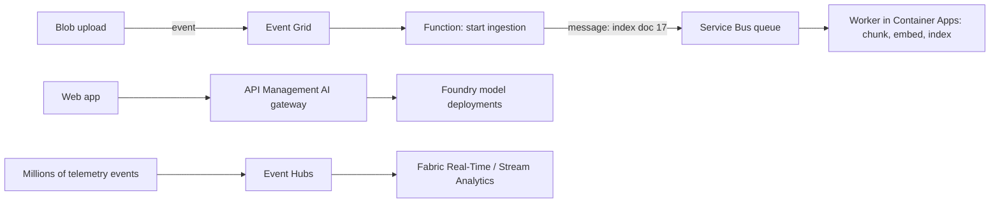

### Which one should I use?

| Need | Service Bus | Event Grid | Event Hubs | Queue Storage | Logic Apps |
|---|---|---|---|---|---|
| Kind of thing | Business messages | Discrete events ("X happened") | Streams of many events | Simple messages | Workflows |
| Typical volume | Thousands per second | Millions of events, push-based | Millions per second | High, simple | Per workflow run |
| Ordering, sessions, transactions | Yes | No | Ordered per partition | No | Not applicable |
| Dead-letter queue | Yes | Yes (dead-letter to storage) | No (consumers track offsets) | No (poison queue pattern only) | Retry policies |
| Replay old data | No | No | Yes, within retention | No | Run history |
| Example | "Process this payment", "index this document" | "New blob uploaded, start processing" | Clickstream, logs, IoT telemetry, Kafka apps | Small background jobs | "When an email arrives, save the attachment and notify Teams" |

### Entries

#### Azure Service Bus
A reliable message broker with **queues** (one receiver) and **topics** (many subscribers), plus sessions for ordering, transactions, scheduled messages and a dead-letter queue for messages that keep failing.
**Use it when:** work must not be lost, for example orders, payments or document-ingestion jobs. **Skip it when:** you only react to "something happened" (Event Grid) or need a simple cheap queue (Queue Storage).
*AWS / Google Cloud:* Amazon SQS and SNS (or Amazon MQ) / Pub/Sub.
Docs: https://learn.microsoft.com/azure/service-bus-messaging/

#### Azure Event Grid
A fully managed event router: Azure services (Blob Storage, Key Vault, resource changes) and your apps publish events, and Event Grid pushes them to subscribers (Functions, webhooks, queues). It also has an **MQTT broker** for devices.
**Use it when:** you want "when X happens, run Y" without polling. **Skip it when:** you need guaranteed ordered processing of commands; use Service Bus.
*AWS / Google Cloud:* Amazon EventBridge / Eventarc.
Docs: https://learn.microsoft.com/azure/event-grid/

#### Azure Event Hubs
A big-data streaming platform that ingests millions of events per second and keeps them for a set time so many consumers can read and replay. It speaks the **Apache Kafka** protocol, so Kafka apps work without code changes.
**Use it when:** you collect telemetry, logs, clickstreams or LLM usage events for analytics. **Skip it when:** you have a few messages per second that need individual handling; use Service Bus.
*AWS / Google Cloud:* Amazon Kinesis Data Streams or Amazon MSK / Pub/Sub or Managed Service for Apache Kafka.
Docs: https://learn.microsoft.com/azure/event-hubs/

#### Azure Logic Apps
Builds automations visually with hundreds of ready connectors (Office 365, Salesforce, SAP, SQL, HTTP). Plans: **Consumption** (pay per run) and **Standard** (single-tenant, can run in your network; replaces the **[Retired]** Integration Service Environment). Workflows can also be tools for AI agents.
**Use it when:** you connect business apps with little code. **Skip it when:** the logic is complex code; use Functions or Durable Functions.
*AWS / Google Cloud:* AWS Step Functions (plus Amazon AppFlow) / Workflows and Application Integration.
Docs: https://learn.microsoft.com/azure/logic-apps/

#### Azure API Management (APIM)
A gateway in front of your APIs: one URL, keys or OAuth, rate limits, caching, transformations, a developer portal and analytics. Its **AI gateway** features add token-based limits, load balancing and failover across model deployments, semantic caching (with Azure Managed Redis), content safety checks, and exposing REST APIs as **MCP servers** for agents.
**Use it when:** many clients or teams share APIs or models and you need control and cost tracking. **Skip it when:** you have one small API and one client; call it directly.
*AWS / Google Cloud:* Amazon API Gateway / Apigee (and API Gateway).
Docs: https://learn.microsoft.com/azure/api-management/

#### Azure Relay
Lets cloud apps call a service inside your company network securely without opening firewall ports (hybrid connections).
**Use it when:** a cloud app must reach an on-premises API and you cannot set up a VPN. **Skip it when:** you can use a VPN, ExpressRoute or Private Link; they are the standard paths.
*AWS / Google Cloud:* no direct match / no direct match.
Docs: https://learn.microsoft.com/azure/azure-relay/

#### Durable Functions
An extension of Azure Functions for long-running, stateful workflows in code: chaining, fan-out/fan-in, waiting for external events or human approval.
**Use it when:** a workflow has many steps and must survive restarts. **Skip it when:** the workflow is simple; plain Functions or Logic Apps are easier.
*AWS / Google Cloud:* AWS Step Functions or Lambda durable functions / Workflows.
Docs: https://learn.microsoft.com/azure/durable-task/durable-functions/durable-functions-overview

#### Smaller integration services

| Service | What it is | Use it when | AWS / Google Cloud |
|---|---|---|---|
| [**Azure Web PubSub**](https://learn.microsoft.com/azure/azure-web-pubsub/) | Real-time WebSocket messaging to browsers and devices. Full entry in section 3. | Live updates to many clients. | API Gateway WebSocket APIs / no direct match |
| [**Azure Notification Hubs**](https://learn.microsoft.com/azure/notification-hubs/) | Push notifications to mobile devices. Full entry in section 3. | Mobile alerts at scale. | Amazon SNS mobile push / Firebase Cloud Messaging |
| [**Azure Queue Storage**](https://learn.microsoft.com/azure/storage/queues/) | Simple queue in a storage account. Full entry in section 4. | Basic background jobs. | Amazon SQS / Cloud Tasks |
| [**Power Automate**](https://learn.microsoft.com/power-automate/) | Low-code workflow tool in Power Platform (shares connectors with Logic Apps). | Business users automate their own tasks. | no direct match / no direct match |
| [**Azure Health Data Services**](https://learn.microsoft.com/azure/healthcare-apis/) | FHIR, DICOM and MedTech data APIs for healthcare. Full entry in section 22. | Healthcare data exchange. | AWS HealthLake / Cloud Healthcare API |

---

## 10. Networking

### In plain words

Networking decides **who can reach what**. Your resources live in a **virtual network (VNet)**, a private network split into **subnets**. **Network security groups (NSGs)** are simple allow/deny lists on subnets and network cards. To let the internet in, you put a **load balancer** or a web front door in front. To let your services reach Azure PaaS services privately, you use **Private Link** (private endpoints), so traffic never crosses the public internet. To connect your office or data center, you use a **VPN Gateway** (over the internet, encrypted) or **ExpressRoute** (a private line). Big companies use a **hub-and-spoke** design: a central hub VNet with the firewall and gateways, and one spoke VNet per app.

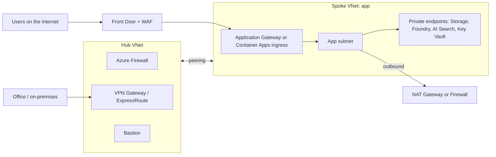

### Which one should I use?

**Getting traffic into your app**

| Need | Pick |
|---|---|
| Spread TCP/UDP traffic across VMs in one region (layer 4) | **Load Balancer** (Standard) |
| HTTP routing, TLS termination and WAF inside one region | **Application Gateway** (v2) |
| Global HTTP entry point, CDN caching, WAF, fast failover between regions | **Front Door** (Standard or Premium) |
| DNS-based routing between regions or clouds (any protocol) | **Traffic Manager** |
| HTTP routing into AKS with the Kubernetes Gateway API | **Application Gateway for Containers** |

**Connecting networks**

| Need | Pick |
|---|---|
| Connect two VNets | **VNet peering** |
| Office to Azure over the internet, encrypted | **VPN Gateway** (site-to-site) |
| Laptop to Azure | **VPN Gateway** (point-to-site) or Entra Private Access |
| Private, high-bandwidth line from your data center | **ExpressRoute** |
| Many offices, regions and VNets in one managed mesh | **Virtual WAN** |
| Admin access to VMs without public IPs | **Bastion** |

**Protecting traffic**

| Need | Pick |
|---|---|
| Basic allow/deny rules by IP and port on subnets | **NSG** (free) |
| Central filtering of all outbound and east-west traffic, FQDN rules, threat intelligence | **Azure Firewall** |
| Blocking web attacks (SQL injection, bots) on HTTP apps | **Web Application Firewall** (on Front Door or Application Gateway) |
| Protection from large network floods | **DDoS Protection** |
| Reach PaaS services privately | **Private Link** (private endpoints) |

### Entries

#### Azure Virtual Network (VNet)
Your private network in Azure, divided into subnets, with peering to other VNets. Azure reserves 5 IP addresses in every subnet. For new VNets created with recent API versions (after 31 Mar 2026), subnets are **private by default** (no automatic "default outbound access" to the internet), so you add a NAT Gateway or firewall for outbound traffic.
**Use it when:** almost always for production: VMs, AKS, private endpoints and VNet-integrated PaaS need one. **Skip it when:** a quick public demo on App Service or Container Apps; you can add a VNet later.
*AWS / Google Cloud:* Amazon VPC / VPC network.
Docs: https://learn.microsoft.com/azure/virtual-network/

#### Network security groups (NSGs) and application security groups (ASGs)
Free allow/deny rule lists (source, destination, port, protocol) on subnets and network cards; ASGs let you name groups of VMs ("web", "db") in rules.
**Use it when:** every subnet should have one. **Skip it when:** you need domain-name filtering or deep inspection; add Azure Firewall.
*AWS / Google Cloud:* security groups and network ACLs / VPC firewall rules.
Docs: https://learn.microsoft.com/azure/virtual-network/network-security-groups-overview

#### Azure DNS (public zones, private zones and DNS Private Resolver)
Hosts your domain names (public DNS zones), private names inside VNets (private DNS zones, essential for private endpoints), and the **DNS Private Resolver** for hybrid name resolution with on-premises DNS.
**Use it when:** you own a domain or use private endpoints. **Skip it when:** your domain is already managed elsewhere and you have no private endpoints.
*AWS / Google Cloud:* Amazon Route 53 / Cloud DNS.
Docs: https://learn.microsoft.com/azure/dns/

#### Azure Load Balancer
A fast layer-4 (TCP/UDP) load balancer, public or internal, zone-redundant. The **Basic** SKU was **[Retired 30 Sep 2025]**; use **Standard**.
**Use it when:** you spread non-HTTP or high-throughput traffic across VMs. **Skip it when:** you need URL routing or WAF; use Application Gateway or Front Door.
*AWS / Google Cloud:* Network Load Balancer / Network Load Balancer (passthrough).
Docs: https://learn.microsoft.com/azure/load-balancer/

#### Azure Application Gateway
A regional layer-7 (HTTP/HTTPS) load balancer with URL-path routing, TLS termination, autoscaling and an optional WAF. **v1** was **[Retired 28 Apr 2026]**; use **v2**.
**Use it when:** you route web traffic to backends in one region, often inside a VNet. **Skip it when:** you serve users worldwide; Front Door is better at the global edge.
*AWS / Google Cloud:* Application Load Balancer / regional external Application Load Balancer.
Docs: https://learn.microsoft.com/azure/application-gateway/

#### Azure Front Door
A global entry point at Microsoft's edge: HTTP load balancing across regions, CDN caching, TLS, WAF and bot protection, Private Link to origins (Premium). **Front Door (classic)** is **[Retiring 31 Mar 2027]**; use Standard or Premium.
**Use it when:** a public web app or API should be fast and protected worldwide, or fail over between regions. **Skip it when:** an internal-only app; use Application Gateway or internal load balancers.
*AWS / Google Cloud:* Amazon CloudFront (plus AWS Global Accelerator) / Cloud CDN with the global external Application Load Balancer.
Docs: https://learn.microsoft.com/azure/frontdoor/

#### Azure CDN [Retiring] (Azure CDN Standard from Microsoft (classic) → Azure Front Door)
The older content delivery network. **Azure CDN Standard from Microsoft (classic)** is **[Retiring 30 Sep 2027]** (no new profiles since 15 Aug 2025); **Azure CDN from Edgio** was **[Retired 15 Jan 2025]**. CDN features now live in Azure Front Door Standard/Premium.
**Use it when:** only to keep existing profiles running while you migrate. **Skip it when:** starting new; use Front Door.
*AWS / Google Cloud:* Amazon CloudFront / Cloud CDN.
Docs: https://learn.microsoft.com/azure/cdn/classic-cdn-retirement-faq

#### Azure Traffic Manager
DNS-based traffic routing: it answers DNS queries with the best endpoint (by priority, performance, weight or geography). Works for any protocol and even non-Azure endpoints.
**Use it when:** you need multi-region failover for non-HTTP services. **Skip it when:** your app is HTTP; Front Door fails over faster and adds caching and WAF.
*AWS / Google Cloud:* Route 53 routing policies / Cloud DNS routing policies.
Docs: https://learn.microsoft.com/azure/traffic-manager/

#### Azure Web Application Firewall (WAF)
Rules that block common web attacks (OWASP top 10, bots) on Front Door or Application Gateway.
**Use it when:** any public web app or API. **Skip it when:** traffic is not HTTP; use Azure Firewall and NSGs.
*AWS / Google Cloud:* AWS WAF / Cloud Armor.
Docs: https://learn.microsoft.com/azure/web-application-firewall/

#### Azure Firewall (and Azure Firewall Manager)
A managed, stateful network firewall (Basic, Standard, Premium) with application (FQDN) rules, threat intelligence and TLS inspection (Premium). **Firewall Manager** manages policies across many firewalls and hubs.
**Use it when:** you need central control of outbound internet traffic and traffic between VNets, for example to allow only your model endpoint and package mirrors. **Skip it when:** a small dev setup; NSGs and NAT Gateway are cheaper.
*AWS / Google Cloud:* AWS Network Firewall (with Firewall Manager) / Cloud Next Generation Firewall.
Docs: https://learn.microsoft.com/azure/firewall/

#### Azure DDoS Protection
Extra protection and support against distributed denial-of-service floods on public IPs (per-network plan or per-IP).
**Use it when:** business-critical public apps. **Skip it when:** learning projects; Azure's basic infrastructure protection is always on.
*AWS / Google Cloud:* AWS Shield Advanced / Cloud Armor (Managed Protection Plus).
Docs: https://learn.microsoft.com/azure/ddos-protection/

#### Azure Private Link (private endpoints)
Gives a PaaS service (Storage, Foundry, AI Search, SQL, Key Vault) a private IP inside your VNet, so traffic stays off the public internet and you can turn public access off.
**Use it when:** production apps handling company data. **Skip it when:** quick demos; but remember to add it before real data arrives. You also need private DNS zones.
*AWS / Google Cloud:* AWS PrivateLink / Private Service Connect.
Docs: https://learn.microsoft.com/azure/private-link/

#### Azure NAT Gateway
Gives resources in a subnet a fixed public IP for **outbound** internet traffic, with high scale.
**Use it when:** private subnets need to reach the internet (package downloads, external APIs), or a partner must allow-list your IP. **Skip it when:** all outbound traffic must be filtered; route it through Azure Firewall instead.
*AWS / Google Cloud:* NAT gateway / Cloud NAT.
Docs: https://learn.microsoft.com/azure/nat-gateway/

#### Azure VPN Gateway
Encrypted tunnels over the internet: site-to-site (office to Azure), point-to-site (laptop to Azure) and VNet-to-VNet.
**Use it when:** you need a hybrid connection quickly and cheaply. **Skip it when:** you need high, steady bandwidth or a private line; use ExpressRoute.
*AWS / Google Cloud:* AWS Site-to-Site VPN and Client VPN / Cloud VPN.
Docs: https://learn.microsoft.com/azure/vpn-gateway/

#### Azure ExpressRoute
A private connection from your data center to Microsoft's network through a connectivity provider, not over the public internet.
**Use it when:** large companies need predictable, high-bandwidth hybrid links (for example to move training data). **Skip it when:** small sites; VPN is enough.
*AWS / Google Cloud:* AWS Direct Connect / Cloud Interconnect.
Docs: https://learn.microsoft.com/azure/expressroute/

#### Azure Virtual WAN
A Microsoft-managed global network hub service that connects branches, VPN users, ExpressRoute and VNets with automatic routing.
**Use it when:** many sites and regions; you want a managed hub-and-spoke. **Skip it when:** one or two VNets; peering is simpler.
*AWS / Google Cloud:* AWS Cloud WAN and Transit Gateway / Network Connectivity Center.
Docs: https://learn.microsoft.com/azure/virtual-wan/

#### Azure Bastion
Browser-based (or native client) RDP and SSH to your VMs through the Azure portal, so VMs need no public IP.
**Use it when:** admins must reach VMs securely. **Skip it when:** you have no VMs (PaaS and containers only).
*AWS / Google Cloud:* AWS Systems Manager Session Manager / Identity-Aware Proxy TCP forwarding.
Docs: https://learn.microsoft.com/azure/bastion/

#### Smaller networking services

| Service | What it is | Use it when | AWS / Google Cloud |
|---|---|---|---|
| [**Public IP addresses**](https://learn.microsoft.com/azure/virtual-network/ip-services/public-ip-addresses) | Internet-facing IPs for load balancers, gateways and VMs. Basic SKU public IPs are retired; use Standard. | Something must be reachable from the internet. | Elastic IP / static external IP |
| [**Azure Route Server**](https://learn.microsoft.com/azure/route-server/) | Exchanges routes (BGP) between your network appliances and VNets. | You run third-party routers or firewalls in Azure. | VPC Route Server / Cloud Router |
| [**Azure Virtual Network Manager**](https://learn.microsoft.com/azure/virtual-network-manager/) | Central management of connectivity and security rules across many VNets and subscriptions. | Large organisations with many VNets. | AWS Network Manager / Network Connectivity Center |
| [**Azure Network Watcher**](https://learn.microsoft.com/azure/network-watcher/) | Network troubleshooting: connection checks, flow logs, packet capture, topology. | Debugging "why can't A reach B?". | VPC Reachability Analyzer and Flow Logs / Network Intelligence Center |
| [**Application Gateway for Containers**](https://learn.microsoft.com/azure/application-gateway/for-containers/overview) | Layer-7 load balancing for AKS using the Gateway API. | Advanced HTTP routing into AKS. | AWS Load Balancer Controller / GKE Gateway controller |
| [**Azure Multicloud Interconnect**](https://azure.microsoft.com/en-us/products) **[Preview]** | Listed on the product page as private connectivity between Azure and other clouds. Details were not verified for this guide. | You link Azure and another cloud privately. | AWS Interconnect - multicloud / Cross-Cloud Interconnect |
| [**Azure Network Function Manager**](https://learn.microsoft.com/azure/databox-online/) | Deployed partner network functions (for example mobile packet core) on Azure Stack Edge. Its docs now redirect to Azure Stack Edge; status unclear. | Telecom edge scenarios only. | - |

---

## 11. Identity (the Microsoft Entra family)

### In plain words

Identity answers two questions: **who are you?** (authentication) and **what may you do?** (authorisation). **Microsoft Entra ID** (formerly Azure Active Directory) is the directory of users, groups and app identities for your organisation; every Azure sign-in goes through it. **Azure RBAC** (role-based access control) then decides what each identity may do on each resource. For apps talking to Azure services, the best practice is a **managed identity**: Azure gives your app its own identity, so you never store passwords or API keys in code. For customer sign-in (your app's end users), use **Entra External ID**.

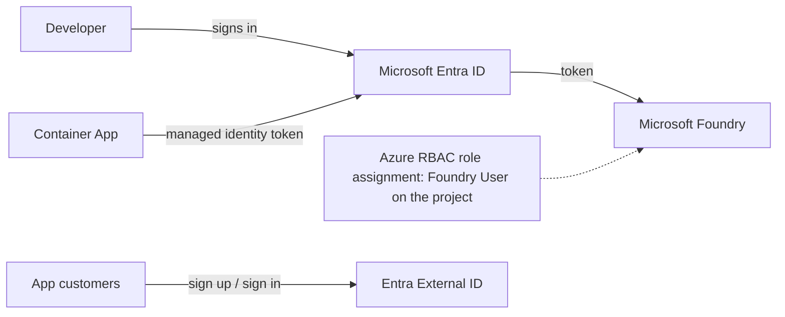

### Which one should I use?

| Who or what needs an identity? | Pick |
|---|---|
| Employees and admins | **Microsoft Entra ID** users and groups, with MFA and Conditional Access |
| Your app or VM calling Azure services | **Managed identity** (system- or user-assigned) |
| GitHub Actions, Kubernetes pods or another cloud calling Azure | **Workload identity federation** (Entra Workload ID), no secrets |
| Customers or partners signing in to your app | **Entra External ID** |
| Old apps that need classic Active Directory (Kerberos, LDAP, domain join) | **Entra Domain Services** |
| AI agents that act on their own | **Entra Agent ID** (agent identities) |
| Admins who need high privileges only sometimes | **Privileged Identity Management (PIM)** |

### Entries

#### Microsoft Entra ID [Renamed] (formerly Azure Active Directory, Azure AD)
The cloud directory and sign-in service for users, groups, apps and devices, with single sign-on, MFA, **Conditional Access** (rules like "require MFA outside the office") and Identity Protection. Licences: Free, P1, P2.
**Use it when:** always; every Azure tenant has it. **Skip it when:** not applicable; for app customers use External ID.
*AWS / Google Cloud:* AWS IAM Identity Center / Cloud Identity.
Docs: https://learn.microsoft.com/entra/fundamentals/what-is-entra

#### Azure role-based access control (Azure RBAC)
Assigns **roles** (sets of permissions such as Reader, Contributor, Storage Blob Data Reader, Foundry User) to identities at a **scope** (management group, subscription, resource group, resource).
**Use it when:** always; give the smallest role at the smallest scope (least privilege). **Skip it when:** not applicable. Note that Owner and Contributor do not include data-plane rights like reading blobs.
*AWS / Google Cloud:* IAM policies and roles / IAM roles.
Docs: https://learn.microsoft.com/azure/role-based-access-control/

#### Managed identities for Azure resources
An identity that Azure creates for your app, VM or function, so it can get tokens for other Azure services with no secret to store or rotate.
**Use it when:** any Azure-hosted code calls Storage, Key Vault, Foundry, AI Search or SQL. **Skip it when:** code runs outside Azure; use workload identity federation instead.
*AWS / Google Cloud:* IAM roles for EC2, Lambda and ECS tasks / service accounts attached to resources.
Docs: https://learn.microsoft.com/entra/identity/managed-identities-azure-resources/overview

#### Microsoft Entra Workload ID (workload identity federation)
Identities for software (apps, services, pipelines). **Federation** lets GitHub Actions, AKS pods or other clouds swap their own token for an Entra token, so no client secret is needed.
**Use it when:** CI/CD pipelines or Kubernetes workloads deploy to or call Azure. **Skip it when:** code runs on Azure compute; a managed identity is simpler.
*AWS / Google Cloud:* IAM OIDC identity providers and IRSA / EKS Pod Identity / Workload Identity Federation.
Docs: https://learn.microsoft.com/entra/workload-id/workload-identities-overview

#### Microsoft Entra External ID
Customer identity: sign-up and sign-in pages, social logins (Google, Facebook), and partner (B2B) access for your apps. It is the successor of **Azure AD B2C**, which Microsoft no longer sells to new customers.
**Use it when:** your app has external users who need accounts. **Skip it when:** only employees use the app; use Entra ID.
*AWS / Google Cloud:* Amazon Cognito / Identity Platform.
Docs: https://learn.microsoft.com/entra/external-id/

#### Microsoft Entra Domain Services
Managed classic Active Directory domain services (domain join, LDAP, Kerberos, NTLM) without running domain controllers.
**Use it when:** you move old apps that need classic AD to Azure. **Skip it when:** modern apps; they use Entra ID with OAuth/OpenID Connect.
*AWS / Google Cloud:* AWS Managed Microsoft AD / Managed Service for Microsoft Active Directory.
Docs: https://learn.microsoft.com/entra/identity/domain-services/overview

#### Microsoft Entra Verified ID
Issues and checks digital credentials (like a digital employee badge or diploma) based on open standards for verifiable credentials.
**Use it when:** you need reusable, privacy-friendly proof of identity or qualifications. **Skip it when:** a normal login is enough.
*AWS / Google Cloud:* no direct match / no direct match.
Docs: https://learn.microsoft.com/entra/verified-id/

#### Smaller Entra services

| Service | What it is | Use it when | AWS / Google Cloud |
|---|---|---|---|
| [**Microsoft Entra ID Governance**](https://learn.microsoft.com/entra/id-governance/) | Access reviews, entitlement management and lifecycle workflows. | You must regularly prove who has access to what. | IAM Access Analyzer / Policy Intelligence |
| [**Privileged Identity Management (PIM)**](https://learn.microsoft.com/entra/id-governance/privileged-identity-management/pim-configure) | Just-in-time admin roles with approval and time limits. | Reduce standing admin rights. | Temporary elevated access in IAM Identity Center / Privileged Access Manager |
| [**Microsoft Entra Connect**](https://learn.microsoft.com/entra/identity/hybrid/connect/whatis-azure-ad-connect) | Syncs on-premises Active Directory users to Entra ID. | Hybrid organisations. | AD Connector / Google Cloud Directory Sync |
| [**Global Secure Access (Entra Private Access and Internet Access)**](https://learn.microsoft.com/entra/global-secure-access/) | Zero-trust network access to private apps and secure web access, replacing classic VPNs. | Remote staff reach internal apps without a VPN. | AWS Verified Access / Chrome Enterprise Premium |
| [**Microsoft Entra Agent ID**](https://learn.microsoft.com/entra/agent-id/) | Identities and a registry for AI agents (Foundry hosted agents get one). | Agents act on their own and need audited permissions. | AgentCore Identity / Agent Identity on the Agent Platform |

---

## 12. Security

### In plain words

Security on Azure is layered. **Identity** (section 11) and **network** controls (section 10) keep attackers out. **Key Vault** keeps secrets, keys and certificates out of your code. **Microsoft Defender for Cloud** checks your setup for weak spots (posture) and watches workloads for attacks, including AI workloads. **Microsoft Sentinel** collects security logs from everywhere and helps a security team detect and respond. **Microsoft Purview** protects the data itself with labels and policies. **Confidential computing** protects data even while it is being processed.

### Which one should I use?

| Need | Pick |
|---|---|
| Store API keys, passwords, connection strings, certificates | **Key Vault** |
| Store encryption keys in a dedicated, single-tenant FIPS 140-3 Level 3 HSM | **Key Vault Managed HSM** or **Azure Cloud HSM** |
| "Is my Azure setup secure?" score, recommendations and threat alerts | **Defender for Cloud** |
| Company-wide security monitoring, detections and automated response (SIEM/SOAR) | **Microsoft Sentinel** |
| Label and protect sensitive files and AI prompts/answers | **Microsoft Purview** (Information Protection, DLP) |
| Prevent wrong configurations before they happen | **Azure Policy** (section 13) |
| Protect data while in use (in memory) | **Azure confidential computing** |

### Entries

#### Azure Key Vault
A secure store for secrets, encryption keys and certificates, with access control, logging and rotation. Apps read secrets using their managed identity.
**Use it when:** any secret exists; never put keys in code, notebooks or environment files committed to Git. **Skip it when:** you can avoid the secret entirely with a managed identity (even better).
*AWS / Google Cloud:* AWS Secrets Manager and AWS KMS / Secret Manager and Cloud KMS.
Docs: https://learn.microsoft.com/azure/key-vault/

#### Microsoft Defender for Cloud
Cloud security posture management (a secure score and recommendations across Azure, AWS and Google Cloud) plus workload protection plans (servers, containers, storage, databases, APIs, AI services) that raise alerts on attacks.
**Use it when:** always turn on the free posture features; add paid plans for production workloads. **Skip it when:** not really; at least read the free recommendations.
*AWS / Google Cloud:* AWS Security Hub, Amazon GuardDuty and Amazon Inspector / Security Command Center.
Docs: https://learn.microsoft.com/azure/defender-for-cloud/

#### Microsoft Sentinel
A cloud SIEM (collects and analyses security logs) and SOAR (automates responses), built on Log Analytics. The Azure portal experience is **[Retiring 31 Mar 2027]**; Sentinel moves fully into the Microsoft Defender portal.
**Use it when:** a security team monitors many systems and needs detections, hunting and incident handling. **Skip it when:** a single small app; Defender for Cloud alerts are enough.
*AWS / Google Cloud:* Amazon Security Lake with partner SIEMs / Google Security Operations.
Docs: https://learn.microsoft.com/azure/sentinel/

#### Azure confidential computing
VMs and containers that run inside hardware-based trusted execution environments (AMD SEV-SNP, Intel TDX, confidential GPUs), so even the cloud operator cannot read data in memory.
**Use it when:** very sensitive data (health, finance, private model weights) must be protected while processed. **Skip it when:** normal encryption at rest and in transit meets your rules.
*AWS / Google Cloud:* AWS Nitro Enclaves / Confidential VMs and Confidential Space.
Docs: https://learn.microsoft.com/azure/confidential-computing/

#### Azure Information Protection [Renamed] (→ Microsoft Purview Information Protection)
The old name for Microsoft's file labelling and protection. The AIP add-in is retired; sensitivity labels are now built into Microsoft 365 apps and managed in **Microsoft Purview Information Protection**. Azure Rights Management (the encryption service behind it) continues.
**Use it when:** you see the name in older docs; manage labels in Purview today. **Skip it when:** starting new; go straight to Purview.
*AWS / Google Cloud:* Amazon Macie / Sensitive Data Protection.
Docs: https://learn.microsoft.com/azure/information-protection/what-is-information-protection

#### Azure Dedicated HSM [Retiring] (→ Azure Cloud HSM)
Physical hardware security modules dedicated to one customer. No new customers are accepted; existing customers are supported until **31 Jul 2028**.
**Use it when:** only for existing deployments while migrating. **Skip it when:** starting new; use **Azure Cloud HSM** (the named successor, GA) or Key Vault Managed HSM.
*AWS / Google Cloud:* AWS CloudHSM / Cloud HSM.
Docs: https://learn.microsoft.com/azure/dedicated-hsm/overview

#### Smaller security services

| Service | What it is | Use it when | AWS / Google Cloud |
|---|---|---|---|
| [**Azure Cloud HSM**](https://learn.microsoft.com/azure/cloud-hsm/overview) | Single-tenant HSM clusters (FIPS 140-3 Level 3); successor of Dedicated HSM. | Regulations require you to control the HSM. | AWS CloudHSM / Cloud HSM |
| [**Key Vault Managed HSM**](https://learn.microsoft.com/azure/key-vault/managed-hsm/) | Fully managed, single-tenant HSM for keys. | Strict key-custody rules, but you want a managed service. | AWS KMS custom key store / Cloud HSM |
| [**Azure Payment HSM**](https://learn.microsoft.com/azure/payment-hsm/) | HSMs certified for payment processing. | Card payment workloads. | AWS Payment Cryptography / no direct match |
| [**Microsoft Azure Attestation**](https://learn.microsoft.com/azure/attestation/) | Checks that a confidential VM or enclave is genuine before giving it secrets. | Confidential computing setups. | Nitro Enclaves attestation / Confidential Space attestation |
| [**Azure confidential ledger**](https://learn.microsoft.com/azure/confidential-ledger/) | Tamper-proof, append-only record store. | Proving audit records were never changed. | no current direct match / no direct match |
| [**Microsoft Defender External Attack Surface Management (EASM)**](https://learn.microsoft.com/azure/external-attack-surface-management/) | Finds your internet-facing assets that attackers could see. | You want to know your exposed domains, IPs and certificates. | no direct match / Security Command Center attack surface features |
| [**Microsoft Defender for IoT**](https://learn.microsoft.com/azure/defender-for-iot/) | Finds and monitors IoT and industrial (OT) devices for threats. | Factories and building networks. | AWS IoT Device Defender / no direct match |
| [**Microsoft Defender XDR**](https://learn.microsoft.com/defender-xdr/) | Unified portal for endpoint, email, identity and cloud-app security (and now Sentinel). | Security operations teams. | no direct match / Google Security Operations |
| [**Microsoft Purview**](https://learn.microsoft.com/purview/) | Data governance and data security. Full entry in section 6. | Protect and govern data used by people and AI. | Amazon Macie, Lake Formation / Dataplex, Sensitive Data Protection |
| [**Azure Policy**](https://learn.microsoft.com/azure/governance/policy/) | Rules that allow, deny or fix resource settings. Full entry in section 13. | Enforce security guardrails. | SCPs and AWS Config rules / Organization Policy |
| [**Microsoft Security Copilot**](https://learn.microsoft.com/copilot/security/) | AI assistant for security teams. See section 8. | Investigating incidents. | no direct match / Gemini in Security Operations |

---

## 13. Management and governance

### In plain words

Once you have more than a few resources, you need ways to **create them repeatably**, **keep them within rules**, and **keep them healthy**. **Azure Resource Manager (ARM)** is the engine behind every create, update and delete, whether you click in the portal, run the CLI or deploy a template. **Bicep** (or Terraform) describes your resources as code so you can rebuild them any time. **Azure Policy** stops people from creating things that break your rules (for example "no public storage accounts"). **Advisor**, **Service Health**, **Automation** and **Update Manager** help keep things healthy, and **Backup** and **Site Recovery** (section 4) keep them recoverable.

### Which one should I use?

| Need | Pick |
|---|---|
| Describe infrastructure as code, Azure-only | **Bicep** |
| Infrastructure as code across several clouds | **Terraform** (AzureRM / AzAPI providers) |
| Share a tested template inside the company | **Template specs** |
| Deploy and later delete a whole set of resources as one unit, and block changes outside the template | **Deployment stacks** |
| Enforce or audit rules on settings (regions, SKUs, tags, public access) | **Azure Policy** |
| Control who can do what | **Azure RBAC** (section 11) |
| Stop accidental deletion of one important resource | **Resource locks** |
| Query all resources across subscriptions | **Azure Resource Graph** |
| Let a partner or central team manage other tenants | **Azure Lighthouse** |
| Get cost, security, reliability and performance tips | **Azure Advisor** |
| Know about Azure outages and planned maintenance that affect you | **Azure Service Health** |
| Patch VMs and Arc servers | **Azure Update Manager** |
| Old "Blueprints" packages | Move to **template specs + deployment stacks** (Blueprints is retiring) |

### Entries

#### Azure Resource Manager (ARM)
The deployment and management layer for all of Azure: every portal click, CLI command or template goes through it, with RBAC, tags, locks and policies applied.
**Use it when:** always, even if you never see it. **Skip it when:** not applicable.
*AWS / Google Cloud:* AWS CloudFormation (as the engine) and the AWS control plane / Resource Manager and service control planes.
Docs: https://learn.microsoft.com/azure/azure-resource-manager/management/overview

#### ARM templates
JSON files that describe Azure resources so ARM can create them the same way every time.
**Use it when:** you maintain existing templates or a tool exports JSON. **Skip it when:** writing new code; Bicep is shorter and compiles to the same thing.
*AWS / Google Cloud:* AWS CloudFormation templates / Infrastructure Manager (Terraform).
Docs: https://learn.microsoft.com/azure/azure-resource-manager/templates/

#### Bicep
Microsoft's simple language for infrastructure as code on Azure; it compiles to ARM templates and supports modules.
**Use it when:** you deploy Azure resources from Git in a repeatable way (and `azd` templates often use it). **Skip it when:** you manage several clouds with one tool; use Terraform or OpenTofu.
*AWS / Google Cloud:* AWS CloudFormation or AWS CDK / Infrastructure Manager (Terraform).
Docs: https://learn.microsoft.com/azure/azure-resource-manager/bicep/

#### Template specs and deployment stacks
**Template specs** store versioned templates in Azure for others to deploy. **Deployment stacks** manage a group of resources as one unit: update them together, delete what was removed from the template, and deny changes made outside it. Together they replace Azure Blueprints.
**Use it when:** a platform team shares approved building blocks. **Skip it when:** a single developer deploying one app.
*AWS / Google Cloud:* AWS Service Catalog and CloudFormation StackSets / Infrastructure Manager deployments.
Docs: https://learn.microsoft.com/azure/azure-resource-manager/bicep/deployment-stacks

#### Azure Blueprints [Retiring 31 Jan 2027] (→ template specs and deployment stacks)
An old way to package templates, policies and role assignments for new subscriptions. Its retirement is phased, with the final date on 31 Jan 2027.
**Use it when:** only while migrating existing blueprint assignments. **Skip it when:** anything new; use template specs, deployment stacks and Azure Policy.
*AWS / Google Cloud:* AWS Control Tower / no direct match.
Docs: https://learn.microsoft.com/azure/governance/blueprints/overview

#### Azure Policy
Rules evaluated on every resource: **deny** bad settings, **audit** them, **modify** or **append** values, or **deploy** missing settings automatically (deployIfNotExists). Built-in initiatives cover many security standards.
**Use it when:** you want guardrails such as "only these regions", "no public IPs", "require tags", "only approved model deployment types". **Skip it when:** you want to control who can act; that is RBAC.
*AWS / Google Cloud:* Service control policies and AWS Config rules / Organization Policy Service.
Docs: https://learn.microsoft.com/azure/governance/policy/

#### Management groups, subscriptions, resource groups and tags
The folders you organise Azure with (see "Azure in 60 seconds"). **Tags** are name-value labels such as `env=prod` or `owner=team-ai` used for cost reports and automation.
**Use it when:** always; tag every resource with owner, environment and cost centre. **Skip it when:** not applicable.
*AWS / Google Cloud:* AWS Organizations OUs and accounts plus tags / folders and projects plus labels.
Docs: https://learn.microsoft.com/azure/governance/management-groups/overview

#### Azure Lighthouse
Lets one organisation (for example a managed service provider or a central IT team) manage resources in other customers' tenants with delegated, audited access.
**Use it when:** you manage many tenants. **Skip it when:** everything is in one tenant.
*AWS / Google Cloud:* cross-account IAM roles / no direct match.
Docs: https://learn.microsoft.com/azure/lighthouse/

#### Azure Advisor
A free advisor that scans your resources and gives recommendations on cost, security, reliability, performance and operations (for example "this VM is idle, resize or shut down").
**Use it when:** check it every week. **Skip it when:** never; it is free.
*AWS / Google Cloud:* AWS Trusted Advisor / Recommender (Active Assist).
Docs: https://learn.microsoft.com/azure/advisor/

#### Azure Service Health
Personalised alerts about Azure incidents, planned maintenance, health advisories and **retirement notices** that affect your subscriptions.
**Use it when:** always set up Service Health alerts for production subscriptions. **Skip it when:** not applicable.
*AWS / Google Cloud:* AWS Health Dashboard / Personalized Service Health.
Docs: https://learn.microsoft.com/azure/service-health/

#### Azure Automation
Runs scripts (PowerShell or Python runbooks) on a schedule or on demand, and manages configuration of machines. Its old **Update Management** feature is **[Retired]**; use Azure Update Manager.
**Use it when:** you need scheduled operational scripts (start or stop VMs at night). **Skip it when:** the job is app logic; use Functions or Logic Apps.
*AWS / Google Cloud:* AWS Systems Manager Automation / Cloud Scheduler with Workflows.
Docs: https://learn.microsoft.com/azure/automation/

#### Azure Update Manager
Checks and installs OS updates on Azure VMs and Azure Arc servers from one place, with schedules and reports. It replaces Automation Update Management.
**Use it when:** you run VMs or servers that need patching. **Skip it when:** you use only PaaS and containers (rebuild the image instead).
*AWS / Google Cloud:* AWS Systems Manager Patch Manager / VM Manager OS patch management.
Docs: https://learn.microsoft.com/azure/update-manager/

#### Azure Chaos Studio
Runs controlled experiments that break things on purpose (stop a VM, kill an AKS pod, add network delay) to prove your app survives failures.
**Use it when:** you test resilience before going live or before peak events. **Skip it when:** you have no monitoring yet; you will not learn anything from the experiment.
*AWS / Google Cloud:* AWS Fault Injection Service / no direct match.
Docs: https://learn.microsoft.com/azure/chaos-studio/

#### Azure Copilot (formerly Microsoft Copilot in Azure)
An AI assistant in the Azure portal and tools that answers questions about your resources, helps troubleshoot, writes CLI scripts and KQL queries.
**Use it when:** you learn Azure or investigate an issue. **Skip it when:** you need repeatable automation; turn its suggestion into a script or Bicep file.
*AWS / Google Cloud:* Amazon Q Developer in the AWS console / Gemini Cloud Assist.
Docs: https://learn.microsoft.com/azure/copilot/

#### Smaller management tools

| Service or tool | What it is | Use it when | AWS / Google Cloud |
|---|---|---|---|
| [**Azure portal**](https://learn.microsoft.com/azure/azure-portal/) | The web console at portal.azure.com. | Exploring and learning. | AWS Management Console / Google Cloud console |
| [**Azure CLI**](https://learn.microsoft.com/cli/azure/) | The `az` command-line tool. | Scripts and quick tasks. | AWS CLI / gcloud CLI |
| [**Azure PowerShell**](https://learn.microsoft.com/powershell/azure/) | PowerShell modules (`Az`) for Azure. | Windows-focused automation. | AWS Tools for PowerShell / Cloud Tools for PowerShell |
| [**Azure Cloud Shell**](https://learn.microsoft.com/azure/cloud-shell/overview) | A browser shell with `az`, PowerShell, Terraform and kubectl ready. | No local install. | AWS CloudShell / Cloud Shell |
| [**Azure Resource Graph**](https://learn.microsoft.com/azure/governance/resource-graph/) | Fast KQL queries over all your resources. | Inventory and compliance questions. | AWS Config advanced queries / Cloud Asset Inventory |
| [**Resource locks**](https://learn.microsoft.com/azure/azure-resource-manager/management/lock-resources) | CanNotDelete or ReadOnly locks on resources. | Protect production databases and vaults. | Termination protection / deletion protection |
| [**Azure Managed Applications**](https://learn.microsoft.com/azure/azure-resource-manager/managed-applications/) | Package a solution that you manage inside a customer's subscription. | Software vendors selling through Marketplace. | AWS Marketplace / Google Cloud Marketplace |
| [**Azure Resource Mover**](https://learn.microsoft.com/azure/resource-mover/) | Moves resources between regions with dependency checks. | Region change. | no direct match / no direct match |
| [**Azure Automanage**](https://learn.microsoft.com/azure/automanage/overview-about) **[Retiring 30 Sep 2027]** | Applies best-practice settings to VMs automatically (Machine Best Practices). | Existing users only; migrate to Azure Policy. | - |
| [**Azure Quotas**](https://learn.microsoft.com/azure/quotas/) | View and request limits (vCPUs, GPUs, model tokens per minute). | Before deploying GPUs or large models. | Service Quotas / Cloud Quotas |
| [**Terraform on Azure**](https://learn.microsoft.com/azure/developer/terraform/) | HashiCorp Terraform (or OpenTofu) with Azure providers. | Multi-cloud infrastructure as code. | same / same |
| [**Cloud Adoption Framework and landing zones**](https://learn.microsoft.com/azure/cloud-adoption-framework/) | Microsoft's guidance and reference setups for organising Azure. | Setting up Azure for a company. | AWS Prescriptive Guidance, Control Tower / Cloud Foundation Toolkit |
| [**Azure Well-Architected Framework**](https://learn.microsoft.com/azure/well-architected/) | Design checklists for reliability, security, cost, operations and performance (with AI workload guidance). | Reviewing a design. | AWS Well-Architected / Google Cloud Architecture Framework |
| [**Azure Infrastructure Resiliency Manager**](https://azure.microsoft.com/en-us/products) **[Preview]** | Listed on the product page as a tool to assess and improve resiliency. Details not verified for this guide. | Evaluate when it becomes GA. | AWS Resilience Hub / no direct match |

---

## 14. Monitoring

### In plain words

Monitoring tells you **what your system is doing and when it breaks**. On Azure everything flows into **Azure Monitor**, the umbrella service. It collects two main kinds of data: **metrics** (numbers over time, like CPU percent or requests per second) and **logs** (detailed records, stored in a **Log Analytics workspace** and searched with **KQL**). **Application Insights** is the part of Azure Monitor for your own app code: requests, errors, dependencies and traces, now based on **OpenTelemetry**. Foundry also sends agent and model traces to Application Insights. **Alerts** then notify you, and **workbooks** or **Grafana** dashboards show it all.

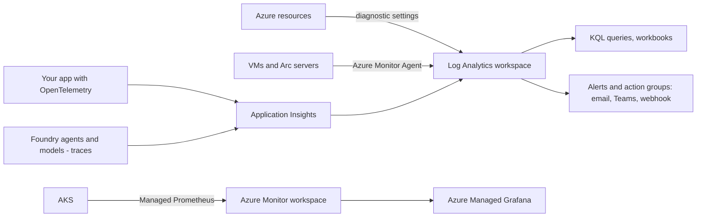

### Which one should I use?

| Question | Azure Monitor | Log Analytics | Application Insights |
|---|---|---|---|
| What is it? | The umbrella platform for all monitoring data | The log database (workspace) plus the KQL query tool | Monitoring for your application code |
| What data? | Metrics, logs, traces, alerts from everything | Logs from resources, agents, apps | Requests, failures, dependencies, traces, custom events |
| Who uses it? | Everyone | Ops, SRE, security (Sentinel sits on top) | Developers |
| Example question | "Alert me when CPU is above 80 percent" | "Which IPs called our API most yesterday?" | "Why did this chat request take 9 seconds?" |

Also: **Managed Prometheus + Managed Grafana** for Kubernetes metrics and dashboards; **Network Watcher** for network problems; **Service Health** for Azure's own incidents.

### Entries

#### Azure Monitor
The monitoring platform for Azure: collects metrics and logs, runs alerts, and hosts Application Insights, Log Analytics, Managed Prometheus, workbooks and dashboards.
**Use it when:** always; turn on diagnostic settings for important resources. **Skip it when:** not applicable; but control what you collect, because log ingestion costs money.
*AWS / Google Cloud:* Amazon CloudWatch / Google Cloud Observability (Cloud Monitoring and Cloud Logging).
Docs: https://learn.microsoft.com/azure/azure-monitor/

#### Log Analytics workspace (and KQL)
The place where Azure Monitor stores logs. You search them with **KQL** (Kusto Query Language), for example `AppRequests | where Success == false | summarize count() by bin(TimeGenerated, 5m)`.
**Use it when:** you need to search or join logs from many resources. **Skip it when:** a simple metric chart answers the question.
*AWS / Google Cloud:* CloudWatch Logs Insights / Log Analytics in Cloud Logging.
Docs: https://learn.microsoft.com/azure/azure-monitor/logs/log-analytics-workspace-overview

#### Application Insights
Application performance monitoring: request rates, response times, failures, dependency calls, distributed traces and a live metrics view. Use the **Azure Monitor OpenTelemetry Distro** for Python, .NET, Java and Node.
**Use it when:** any app you deploy; also to see LLM and agent traces from Foundry. **Skip it when:** not really; at least add it in production.
*AWS / Google Cloud:* CloudWatch Application Signals and AWS X-Ray / Cloud Trace and Error Reporting.
Docs: https://learn.microsoft.com/azure/azure-monitor/app/app-insights-overview

#### Azure Monitor alerts and action groups
Rules that watch metrics, logs or activity and notify (email, SMS, Teams, webhook) or trigger automation when something is wrong.
**Use it when:** production apps; alert on symptoms users feel (errors, latency) and on spend. **Skip it when:** you would ignore the alert; noisy alerts are worse than none.
*AWS / Google Cloud:* CloudWatch alarms with SNS / Cloud Monitoring alerting policies.
Docs: https://learn.microsoft.com/azure/azure-monitor/alerts/alerts-overview

#### Azure Monitor Agent (AMA)
The agent that collects logs and metrics from VMs and Arc servers, configured by data collection rules. It replaced the **Log Analytics agent (MMA)**, which was **[Retired 31 Aug 2024]**.
**Use it when:** you monitor VMs or servers. **Skip it when:** you only use PaaS (they send data through diagnostic settings).
*AWS / Google Cloud:* CloudWatch agent / Ops Agent.
Docs: https://learn.microsoft.com/azure/azure-monitor/agents/azure-monitor-agent-overview

#### Azure Monitor managed service for Prometheus
Fully managed Prometheus metric storage, mainly for AKS and Kubernetes; query with PromQL.
**Use it when:** you run Kubernetes and want standard Prometheus metrics without running Prometheus servers. **Skip it when:** no Kubernetes.
*AWS / Google Cloud:* Amazon Managed Service for Prometheus / Google Cloud Managed Service for Prometheus.
Docs: https://learn.microsoft.com/azure/azure-monitor/metrics/prometheus-metrics-overview

#### Azure Managed Grafana
Grafana dashboards run by Azure, connected to Azure Monitor, Prometheus and other sources with Entra sign-in.
**Use it when:** teams want Grafana dashboards across many data sources. **Skip it when:** Azure workbooks or the portal's built-in dashboards are enough.
*AWS / Google Cloud:* Amazon Managed Grafana / no managed Grafana (use Cloud Monitoring dashboards).
Docs: https://learn.microsoft.com/azure/managed-grafana/

#### Smaller monitoring features

| Feature | What it is | Use it when | AWS / Google Cloud |
|---|---|---|---|
| [**Diagnostic settings**](https://learn.microsoft.com/azure/azure-monitor/data-collection/diagnostic-settings) | Per-resource switch that sends logs and metrics to Log Analytics, Storage or Event Hubs. | Every important resource. | CloudWatch vended logs / Cloud Audit Logs and log sinks |
| [**Activity log**](https://learn.microsoft.com/azure/azure-monitor/fundamentals/activity-log) | Who created, changed or deleted which resource and when. | "Who deleted this?" | AWS CloudTrail / Cloud Audit Logs |
| [**Workbooks**](https://learn.microsoft.com/azure/azure-monitor/visualize/workbooks-overview) | Interactive reports mixing text, KQL queries and charts. | Shared troubleshooting views. | CloudWatch dashboards / Cloud Monitoring dashboards |
| [**Container insights**](https://learn.microsoft.com/azure/azure-monitor/containers/kubernetes-monitoring-overview) | Ready-made monitoring for AKS nodes, pods and logs. | You run AKS. | CloudWatch Container Insights / GKE observability |
| [**VM insights**](https://learn.microsoft.com/azure/azure-monitor/vm/monitor-vm) | Performance and dependency maps for VMs. | You run VMs. | CloudWatch agent dashboards / Ops Agent dashboards |
| [**Network Watcher**](https://learn.microsoft.com/azure/network-watcher/) | Network diagnostics. See section 10. | Connection problems. | VPC Reachability Analyzer / Network Intelligence Center |

---

## 15. Developer tools and DevOps

### In plain words

DevOps means **code goes from your laptop to production automatically and safely**: you store code in a repository, a **pipeline** builds and tests it on every change, packages it (for example as a container image in ACR), and deploys it with infrastructure as code. Microsoft offers two families. **Azure DevOps** (Boards, Repos, Pipelines, Test Plans, Artifacts) is the older, all-in-one enterprise suite. **GitHub** (Actions, Advanced Security, Copilot, Codespaces) is Microsoft's developer platform most open-source and new projects use. Both deploy to Azure well; for new projects many teams pick GitHub plus `azd`.

### Which one should I use?

| Need | Pick |
|---|---|
| Code hosting, CI/CD, AI coding help, security scanning in one place | **GitHub** (Repos, Actions, Advanced Security, Copilot) |
| Large enterprise already on Azure DevOps, needs work tracking and manual test plans | **Azure DevOps** |
| Go from a template to a running app on Azure in one command | **Azure Developer CLI (`azd`)** |
| Settings and feature flags shared by many services | **App Configuration** |
| Load test an API before launch | **Azure Load Testing** (part of Azure App Testing) |
| Run Playwright browser tests at scale | **Playwright Workspaces** (part of Azure App Testing) |
| Ready-to-code cloud workstations for developers | **Microsoft Dev Box** |
| Cheap, self-service dev/test VMs with auto-shutdown | **Azure DevTest Labs** |

### Entries

#### Azure DevOps
Microsoft's integrated DevOps suite: **Boards** (work items, sprints), **Repos** (Git), **Pipelines** (CI/CD for any language and cloud), **Test Plans** (manual and exploratory testing) and **Artifacts** (package feeds). Available as a cloud service or Azure DevOps Server on-premises.
**Use it when:** your organisation already runs on it or needs its planning and test-management features. **Skip it when:** a new small project; GitHub covers most needs.
*AWS / Google Cloud:* AWS CodePipeline and AWS CodeBuild / Cloud Build and Cloud Deploy.
Docs: https://learn.microsoft.com/azure/devops/

#### Azure Boards
Agile planning: work items, backlogs, Kanban boards, sprints and dashboards, linked to commits and builds.
**Use it when:** teams plan work inside Azure DevOps. **Skip it when:** you already use GitHub Issues and Projects or Jira.
*AWS / Google Cloud:* no direct match (third-party tools) / no direct match.
Docs: https://learn.microsoft.com/azure/devops/boards/

#### Azure Repos
Private Git repositories (and the older TFVC) with pull requests and branch policies.
**Use it when:** you are on Azure DevOps. **Skip it when:** GitHub is available to you; it has a bigger ecosystem.
*AWS / Google Cloud:* AWS CodeCommit (closed to new customers) / Secure Source Manager.
Docs: https://learn.microsoft.com/azure/devops/repos/

#### Azure Pipelines
CI/CD that builds, tests and deploys any language to any cloud, with YAML pipelines, Microsoft-hosted or self-hosted agents and approvals.
**Use it when:** you are on Azure DevOps. **Skip it when:** your code is on GitHub; GitHub Actions is the natural choice.
*AWS / Google Cloud:* AWS CodePipeline and CodeBuild / Cloud Build.
Docs: https://learn.microsoft.com/azure/devops/pipelines/

#### Azure Test Plans
Manual, exploratory and user-acceptance testing tools linked to work items and builds.
**Use it when:** you need formal test cases and traceability (often in regulated industries). **Skip it when:** you only run automated tests in CI.
*AWS / Google Cloud:* no direct match / no direct match.
Docs: https://learn.microsoft.com/azure/devops/test/

#### Azure Artifacts
Private package feeds for pip, npm, NuGet, Maven and universal packages.
**Use it when:** you share internal libraries or mirror public packages safely. **Skip it when:** you only need container images (use ACR) or GitHub Packages fits better.
*AWS / Google Cloud:* AWS CodeArtifact / Artifact Registry.
Docs: https://learn.microsoft.com/azure/devops/artifacts/

#### GitHub Actions (with Azure)
GitHub's CI/CD: workflows in YAML that run on every push or pull request. Use the `azure/login` action with **OpenID Connect (workload identity federation)** so no Azure secret is stored in GitHub.
**Use it when:** your code is on GitHub (most new projects). **Skip it when:** your company standardises on Azure Pipelines.
*AWS / Google Cloud:* GitHub Actions with AWS OIDC / GitHub Actions with Workload Identity Federation (or Cloud Build).
Docs: https://learn.microsoft.com/azure/developer/github/github-actions

#### Azure Developer CLI (`azd`)
A developer-friendly CLI that takes an app template (code + Bicep or Terraform + config) and provisions, deploys and monitors it with `azd up`. Many official AI samples use it.
**Use it when:** you want a working app on Azure quickly and a clean dev-to-prod workflow. **Skip it when:** you need low-level control of every step; use Bicep and the Azure CLI directly.
*AWS / Google Cloud:* AWS Copilot CLI (in maintenance) or AWS SAM CLI / gcloud with Cloud Run deploy commands.
Docs: https://learn.microsoft.com/azure/developer/azure-developer-cli/

#### Azure Container Registry (ACR)
Private image registry. Full entry in section 2.
**Use it when:** you build containers. **Skip it when:** only public images.
*AWS / Google Cloud:* Amazon ECR / Artifact Registry.
Docs: https://learn.microsoft.com/azure/container-registry/

#### Azure App Configuration
A central store for app settings and **feature flags**, with labels per environment and Key Vault references for secrets.
**Use it when:** several services share settings, or you want to switch features (or a new model version) on and off without redeploying. **Skip it when:** one small app; environment variables are enough.
*AWS / Google Cloud:* AWS AppConfig and Parameter Store / Parameter Manager (or Firebase Remote Config).
Docs: https://learn.microsoft.com/azure/azure-app-configuration/

#### Azure App Testing: Azure Load Testing and Playwright Workspaces
**Azure App Testing** groups two services. **Azure Load Testing** generates high-scale traffic with JMeter or Locust scripts (or just a URL) and shows where your app slows down. **Playwright Workspaces** runs end-to-end browser tests in parallel on cloud browsers; it is the successor of **Microsoft Playwright Testing**.
**Use it when:** before launch, after big changes, or in CI for performance and UI regressions. **Skip it when:** early prototypes; a local Locust or Playwright run is enough.
*AWS / Google Cloud:* Distributed Load Testing on AWS (a solution) and AWS Device Farm / no direct match.
Docs: https://learn.microsoft.com/azure/app-testing/overview-what-is-azure-app-testing

#### Microsoft Dev Box
Ready-to-code cloud workstations (Windows) managed by IT, with project-specific images.
**Use it when:** a company wants secure, consistent developer machines. **Skip it when:** you are a single developer; use your laptop or GitHub Codespaces.
*AWS / Google Cloud:* Amazon WorkSpaces / Cloud Workstations.
Docs: https://learn.microsoft.com/azure/dev-box/

#### Azure Deployment Environments [Retiring 22 Feb 2027]
Self-service creation of app environments from approved templates, sharing dev centers with Dev Box. Microsoft asks users to move to another Microsoft, Azure or partner solution by 22 Feb 2027.
**Use it when:** only existing setups while migrating. **Skip it when:** starting new; use `azd` with Bicep or Terraform in CI/CD, or deployment stacks.
*AWS / Google Cloud:* AWS Proton (discontinued) or Service Catalog / no direct match.
Docs: https://learn.microsoft.com/azure/deployment-environments/overview-what-is-azure-deployment-environments

#### Azure DevTest Labs
Self-service labs of VMs for dev and test with cost limits, auto-shutdown and approved images.
**Use it when:** teams need throwaway VMs with cost guardrails. **Skip it when:** you need full desktops for many users; use Azure Virtual Desktop or Dev Box.
*AWS / Google Cloud:* no direct match / no direct match.
Docs: https://learn.microsoft.com/azure/devtest-labs/

#### Smaller developer tools

| Tool | What it is | Use it when | AWS / Google Cloud |
|---|---|---|---|
| [**GitHub Advanced Security**](https://docs.github.com/code-security) | Code scanning, secret scanning and dependency review (also available for Azure DevOps). | Catch leaked keys and vulnerable code early. | Amazon CodeGuru Security / Security Command Center for code |
| [**GitHub Copilot**](https://docs.github.com/copilot) | AI pair programmer and coding agent. | Writing and reviewing code faster. | Kiro / Gemini Code Assist |
| [**GitHub Codespaces**](https://docs.github.com/codespaces) | Cloud dev containers in the browser or VS Code. | Ready-to-run course or project environments. | no direct match / Cloud Workstations |
| [**Visual Studio Code + Azure extensions**](https://code.visualstudio.com/docs/azure/overview) | Free editor with extensions for Azure, Functions, Containers, Foundry. | Daily coding and deploying. | AWS Toolkit / Cloud Code |
| [**Visual Studio**](https://learn.microsoft.com/visualstudio/) | Full IDE for .NET and C++ with Azure publishing. | .NET development. | AWS Toolkit for Visual Studio / Cloud Code |
| [**Azure SDKs**](https://learn.microsoft.com/azure/developer/python/sdk/azure-sdk-overview) | Client libraries for Python, JavaScript, .NET, Java, Go. Use `DefaultAzureCredential` from `azure-identity`. | Calling Azure from code. | AWS SDKs (boto3) / Google Cloud client libraries |
| [**Artifact Signing**](https://learn.microsoft.com/azure/artifact-signing/) (formerly Trusted Signing) | Managed code signing for apps and files. | You ship signed software. | AWS Signer / no direct match |
| [**Azurite and other emulators**](https://learn.microsoft.com/azure/storage/common/storage-use-azurite) | Local emulators for Storage (Azurite), Cosmos DB, Functions Core Tools, Service Bus and Event Hubs. | Develop and test offline at no cost. | LocalStack (third party) / Cloud emulators in gcloud |
| [**Azure Load Testing**](https://learn.microsoft.com/azure/app-testing/load-testing/overview-what-is-azure-load-testing) | See Azure App Testing above. | Load tests. | Distributed Load Testing on AWS / no direct match |

---

## 16. Migration

### In plain words

Migration is moving existing servers, databases, apps and data from your own data center (or another cloud) into Azure. The usual path is **assess** (what do we have and what will it cost?), **move** (replicate VMs, migrate databases, copy data), then **modernise** (switch to PaaS over time). **Azure Migrate** is the hub that ties these steps together.

### Which one should I use?

| What are you moving? | Pick |
|---|---|
| Discover servers and estimate cost and readiness | **Azure Migrate** (discovery and assessment) |
| VMs (VMware, Hyper-V, physical, other clouds) | **Azure Migrate** server migration (built on Site Recovery technology) |
| Databases | **Azure Database Migration Service** |
| Large file shares online | **Azure Storage Mover** or AzCopy |
| Tens or hundreds of TB offline | **Azure Data Box** |
| A whole VMware estate as-is | **Azure VMware Solution** |
| Resources between Azure regions | **Azure Resource Mover** |

### Entries

#### Azure Migrate
A central hub to discover on-premises servers, databases and web apps, assess readiness and cost, and migrate them, with AI-assisted guidance.
**Use it when:** you plan any data-center migration. **Skip it when:** you are building new apps in the cloud.
*AWS / Google Cloud:* AWS Application Migration Service and AWS Transform / Migration Center.
Docs: https://learn.microsoft.com/azure/migrate/

#### Smaller migration helpers (full entries elsewhere)

| Service | What it is | Use it when | AWS / Google Cloud |
|---|---|---|---|
| [**Azure Database Migration Service**](https://learn.microsoft.com/azure/dms/) | Moves databases with little downtime (section 5). | Database migration. | AWS DMS / Database Migration Service |
| [**Azure Site Recovery**](https://learn.microsoft.com/azure/site-recovery/) | Replicates VMs; also used for migration (section 4). | Disaster recovery or lift-and-shift. | AWS Elastic Disaster Recovery / Migrate to Virtual Machines |
| [**Azure Data Box**](https://learn.microsoft.com/azure/databox/) | Offline transfer devices (section 4). | Very large data. | AWS Snowball / Transfer Appliance |
| [**Azure Storage Mover**](https://learn.microsoft.com/azure/storage-mover/) | Online file share migration (section 4). | NAS to Azure Files or Blob. | AWS DataSync / Storage Transfer Service |
| [**Azure Hybrid Benefit**](https://learn.microsoft.com/azure/cost-management-billing/scope-level/overview-azure-hybrid-benefit-scope) | Reuse your existing Windows Server and SQL Server licences in Azure to pay less (section 21). | You own those licences. | Bring your own licence / BYOL |
| [**Cloud Adoption Framework: Migrate**](https://learn.microsoft.com/azure/cloud-adoption-framework/migrate/) | Microsoft's step-by-step migration guidance. | Planning a migration. | AWS Migration Acceleration Program guidance / Google Cloud migration guides |

---

## 17. Hybrid and multicloud

### In plain words

Not everything can live in an Azure region. Factories need low latency, some data must stay in a country or building, and many companies also use AWS or Google Cloud. **Azure Arc** extends Azure's management (portal, Policy, RBAC, Defender, Monitor, Update Manager) to servers and Kubernetes clusters **anywhere**. **Azure Local** (formerly Azure Stack HCI) is Microsoft-validated hardware in your building that runs VMs, AKS and some Azure services, managed through Arc. **Azure Stack Hub** runs a small, self-contained Azure region on-premises, even disconnected. The old family name **Azure Stack** now mostly refers to these.

### Which one should I use?

| Need | Pick |
|---|---|
| Manage existing servers or Kubernetes in other clouds or on-premises from Azure | **Azure Arc** |
| Run VMs, containers and AI at the edge on hardware you own, managed from Azure | **Azure Local** |
| A disconnected, Azure-consistent cloud in your own data center | **Azure Stack Hub** |
| Small rugged appliance for edge compute and data transfer | **Azure Stack Edge** |
| Kubernetes on a single Windows or Linux PC at the edge | **AKS Edge Essentials** |
| Run Foundry models on your own Arc-enabled clusters | **Foundry Local on Azure Local** [Preview] |

### Entries

#### Azure Arc
Projects servers, Kubernetes clusters, SQL Server and VMware/Hyper-V machines from anywhere into Azure Resource Manager, so you can use Azure Policy, RBAC, Defender, Monitor and Update Manager on them.
**Use it when:** you have machines outside Azure and want one management plane. **Skip it when:** everything already runs in Azure.
*AWS / Google Cloud:* AWS Systems Manager hybrid nodes and Amazon EKS Hybrid Nodes / Google Distributed Cloud and GKE attached clusters.
Docs: https://learn.microsoft.com/azure/azure-arc/

#### Azure Local [Renamed] (formerly Azure Stack HCI)
Microsoft's hybrid infrastructure on validated servers in your site: runs VMs, AKS and Azure Virtual Desktop locally, managed through Azure Arc.
**Use it when:** workloads must run on-premises or at the edge (latency, data residency, disconnected sites). **Skip it when:** a cloud region meets your needs; no hardware to buy and run.
*AWS / Google Cloud:* AWS Outposts / Google Distributed Cloud connected.
Docs: https://learn.microsoft.com/azure/azure-local/

#### Azure Stack Hub
An integrated system that runs a subset of Azure services (VMs, storage, App Service, Functions) in your own data center, able to work fully disconnected.
**Use it when:** you need Azure-consistent services with no internet connection (for example ships, defence, remote sites). **Skip it when:** Azure Local plus Arc meets your needs; it is simpler.
*AWS / Google Cloud:* AWS Outposts racks / Google Distributed Cloud air-gapped.
Docs: https://learn.microsoft.com/azure-stack/operator/

#### Azure Stack Edge
Microsoft-managed edge appliances (some with GPUs) for edge compute, AI inference and moving data to Azure.
**Use it when:** you need compute and data transfer in a remote site with a managed device. **Skip it when:** you can use your own servers with Azure Local or IoT Edge.
*AWS / Google Cloud:* AWS Snowball Edge / Google Distributed Cloud (edge).
Docs: https://learn.microsoft.com/azure/databox-online/

#### Smaller hybrid services

| Service | What it is | Use it when | AWS / Google Cloud |
|---|---|---|---|
| [**AKS enabled by Azure Arc**](https://learn.microsoft.com/azure/aks-hybrid-edge/) | AKS on Azure Local, Windows Server and edge PCs (includes AKS Edge Essentials). | Kubernetes on-premises with Azure management. | EKS Anywhere / GKE on bare metal |
| [**SQL Server enabled by Azure Arc**](https://learn.microsoft.com/sql/sql-server/azure-arc/overview) | Manage, license and protect SQL Servers anywhere through Azure. | Many on-premises SQL Servers. | no direct match / no direct match |
| [**Azure Operator Nexus**](https://learn.microsoft.com/azure/operator-nexus/) | Hybrid cloud platform for telecom network functions. | Mobile network operators. | AWS Outposts for telco / Google Distributed Cloud for telecom |
| [**Azure Operator Service Manager**](https://learn.microsoft.com/azure/operator-service-manager/) | Manages deployment of network functions for operators. | Telecom operators. | no direct match / no direct match |
| [**Azure IoT Operations**](https://learn.microsoft.com/azure/iot-operations/) | Arc-enabled edge data platform for industrial IoT. See section 18. | Factories. | AWS IoT SiteWise Edge / no direct match |

---

## 18. Internet of Things (IoT)

### In plain words

IoT means **devices and sensors that send data to the cloud and receive commands from it**: thermometers, machines, cars, cameras. You need three things: a secure way for millions of devices to connect (**IoT Hub**), a way to run logic near the devices when the network is slow (**IoT Edge**, **IoT Operations**), and a place to store and analyse the data (Event Hubs, Data Explorer, Fabric). **Azure Digital Twins** models the real world (a building, a factory) as a live graph.

### Which one should I use?

| Need | Pick |
|---|---|
| Connect and manage devices securely, two-way messages | **IoT Hub** (+ Device Provisioning Service) |
| A ready-made IoT app with dashboards and little code | **IoT Central** |
| Run containers and AI models on gateways near devices | **IoT Edge** |
| Industrial edge platform (MQTT broker, OPC UA, data flows) on Arc-enabled Kubernetes | **Azure IoT Operations** |
| Digital model of a building, factory or city | **Azure Digital Twins** |
| Lightweight MQTT publish-subscribe for devices | **Event Grid MQTT broker** |
| Secure microcontroller devices | **Azure Sphere** (check its 2027 and 2031 retirement dates) |
| Small real-time OS for microcontrollers | **Eclipse ThreadX** (formerly Azure RTOS) |

### Entries

#### Azure IoT Hub
A managed gateway that securely connects millions of devices for telemetry in and commands out, with per-device identity. The **Device Provisioning Service (DPS)** registers devices at first boot; **Device Update** sends firmware updates.
**Use it when:** you build an IoT solution with your own backend. **Skip it when:** devices only need simple MQTT pub-sub; the Event Grid MQTT broker may be enough.
*AWS / Google Cloud:* AWS IoT Core / no direct match (Google retired IoT Core in 2023; partners fill the gap).
Docs: https://learn.microsoft.com/azure/iot-hub/

#### Azure IoT Central
An IoT application platform (SaaS-like) with device templates, dashboards, rules and exports, built on IoT Hub. No retirement notice was found on its docs when checked.
**Use it when:** you want an IoT app quickly with little cloud code. **Skip it when:** you need full control of the architecture; build on IoT Hub.
*AWS / Google Cloud:* no direct match (AWS IoT SiteWise for industrial dashboards) / no direct match.
Docs: https://learn.microsoft.com/azure/iot-central/

#### Azure IoT Edge
Runs containerised modules (filters, AI models, protocol translation) on edge devices, managed from IoT Hub, and keeps working offline.
**Use it when:** you need local processing near devices. **Skip it when:** devices can send everything to the cloud directly.
*AWS / Google Cloud:* AWS IoT Greengrass / no direct match.
Docs: https://learn.microsoft.com/azure/iot-edge/

#### Azure IoT Operations
An edge data platform that runs on Arc-enabled Kubernetes: an MQTT broker, OPC UA connectors and data flows to the cloud, aimed at factories and industrial sites.
**Use it when:** an industrial site needs a modern, Kubernetes-based edge platform. **Skip it when:** you have a few devices; IoT Hub with IoT Edge is simpler.
*AWS / Google Cloud:* AWS IoT SiteWise Edge / no direct match.
Docs: https://learn.microsoft.com/azure/iot-operations/

#### Azure Digital Twins
Builds a live graph model of a physical environment (rooms, machines, sensors and how they relate) using a modelling language (DTDL), updated by IoT data.
**Use it when:** you need to reason about relationships in a building, factory or supply chain. **Skip it when:** you only chart sensor values over time.
*AWS / Google Cloud:* AWS IoT TwinMaker / no direct match.
Docs: https://learn.microsoft.com/azure/digital-twins/

#### Azure Sphere [Retiring in stages]
A secured microcontroller platform (chip, OS and security service) for connected devices. The Azure Sphere (Legacy) API and CLI retire on **27 Sep 2027** (move to Azure Sphere Integrated), and Microsoft has announced platform retirement in **2031**.
**Use it when:** you maintain existing Sphere-based devices. **Skip it when:** designing a new device line; choose a platform with a longer future.
*AWS / Google Cloud:* AWS IoT ExpressLink and FreeRTOS / no direct match.
Docs: https://learn.microsoft.com/azure-sphere/product-overview/whats-new

#### Eclipse ThreadX [Renamed] (formerly Azure RTOS)
A small real-time operating system for microcontrollers. Microsoft gave it to the Eclipse Foundation, where it is now open source (MIT licence) as **Eclipse ThreadX**; the old Azure RTOS docs redirect there.
**Use it when:** you write firmware for small devices that need a reliable RTOS. **Skip it when:** your device runs Linux.
*AWS / Google Cloud:* FreeRTOS / no direct match.
Docs: https://github.com/eclipse-threadx

#### Smaller IoT services

| Service | What it is | Use it when | AWS / Google Cloud |
|---|---|---|---|
| [**Azure Maps**](https://learn.microsoft.com/azure/azure-maps/) | Maps, geocoding and routing APIs (section 3). | Fleet tracking, location features. | Amazon Location Service / Google Maps Platform |
| [**Windows for IoT**](https://learn.microsoft.com/windows/iot/) | Windows editions for fixed-purpose devices (kiosks, industrial PCs). | Windows-based devices. | no direct match / no direct match |
| [**Event Grid MQTT broker**](https://learn.microsoft.com/azure/event-grid/mqtt-overview) | Managed MQTT publish-subscribe for devices. | Many devices exchanging small messages. | AWS IoT Core MQTT / no direct match |
| [**Microsoft Defender for IoT**](https://learn.microsoft.com/azure/defender-for-iot/) | Security monitoring for IoT/OT networks (section 12). | Industrial security. | AWS IoT Device Defender / no direct match |
| [**Azure Time Series Insights**](https://learn.microsoft.com/previous-versions/azure/time-series-insights/overview-what-is-tsi) **[Retired 7 Jul 2024]** | Old IoT time-series explorer. | Do not use; Fabric Real-Time Intelligence or Data Explorer. | - |

---

## 19. Media and communication

### In plain words

Many apps need to **talk to people**: send an SMS code, an email receipt, a WhatsApp message, place a phone call, or run a video call. **Azure Communication Services (ACS)** gives you all of these as APIs, using the same network that runs Microsoft Teams. Combined with Speech and Foundry, ACS lets you build **AI voice agents** that answer phone calls. For video content, Azure no longer runs a media encoding and streaming service; **Azure Media Services** retired in 2024, and Microsoft points to partners for encoding and streaming, with Azure AI Video Indexer for analysis and Front Door for delivery.

### Which one should I use?

| Need | Pick |
|---|---|
| SMS, email, chat, voice and video calls, WhatsApp messages from your app | **Azure Communication Services** |
| An AI agent that answers phone calls | **ACS Call Automation** + **Azure Speech (Voice Live)** + **Foundry Agent Service** |
| Live updates in a web page (not phone or video) | **Web PubSub** or **SignalR** (section 3) |
| Push notifications to phones | **Notification Hubs** (section 3) |
| Understand and search video content | **Azure AI Video Indexer** (section 8) |
| Deliver large media files fast worldwide | **Azure Front Door** (section 10) |
| Encode and stream video | Partner services (Azure Media Services is retired) |

### Entries

#### Azure Communication Services (ACS)
APIs and SDKs for voice and video calling, chat, SMS, email, WhatsApp (Advanced Messaging), phone numbers, **Call Automation** (programmable call flows) and interoperability with Microsoft Teams.
**Use it when:** your app sends messages or makes calls, including AI phone agents. **Skip it when:** you only send a few internal emails; Microsoft 365 or Logic Apps connectors are simpler.
*AWS / Google Cloud:* Amazon Connect, Amazon Chime SDK, Amazon SES and AWS End User Messaging / no direct match (partners).
Docs: https://learn.microsoft.com/azure/communication-services/

#### Smaller media and communication services

| Service | What it is | Use it when | AWS / Google Cloud |
|---|---|---|---|
| [**Azure Communications Gateway**](https://learn.microsoft.com/previous-versions/azure/communications-gateway/) **[Retired 30 Oct 2025]** | Connected telecom operators' networks to Microsoft Teams Phone and Zoom. | Do not use; operators move to another Teams Direct Routing certified session border controller. | no direct match / no direct match |
| [**Azure Media Services**](https://learn.microsoft.com/previous-versions/azure/media-services/latest/azure-media-services-retirement) **[Retired 30 Jun 2024]** | Old video encoding, live and on-demand streaming, content protection (and Azure Media Player). | Do not use; Microsoft lists partner solutions (for example Bitmovin, MediaKind) as replacements. | AWS Elemental MediaConvert and MediaLive / Transcoder API and Live Stream API |
| [**Azure AI Video Indexer**](https://learn.microsoft.com/azure/azure-video-indexer/video-indexer-overview) | Video analysis (section 8). | Searchable video insights. | Amazon Rekognition Video / Video Intelligence API |
| [**Azure Web PubSub / SignalR**](https://learn.microsoft.com/azure/azure-web-pubsub/) | Real-time web messaging (section 3). | Live dashboards and chat UIs. | API Gateway WebSockets / no direct match |

---

## 20. Virtual desktops and labs

### In plain words

Sometimes people need a **whole desktop** in the cloud: contractors who must not keep company data on their laptops, call-centre staff, students in a class, or developers who need a powerful, preconfigured machine. Azure offers full virtual desktops (**Azure Virtual Desktop**), developer workstations (**Microsoft Dev Box**) and short-lived test machines (**DevTest Labs**). The classroom service **Azure Lab Services** is retiring.

### Which one should I use?

| Need | Pick |
|---|---|
| Many employees use Windows desktops or apps from any device, multi-session to save cost | **Azure Virtual Desktop** |
| A simple per-user cloud PC with a fixed monthly price | **Windows 365** (a Microsoft 365 product, not an Azure resource) |
| Developer workstations with project tools preinstalled | **Microsoft Dev Box** |
| Temporary test VMs with cost controls | **Azure DevTest Labs** |
| Classroom or training labs | Not Azure Lab Services (retiring): use Azure Virtual Desktop, Windows 365, Dev Box or partner lab platforms |

### Entries

#### Azure Virtual Desktop (AVD)
Desktop and app virtualisation on Azure: Windows 11 and Windows Server desktops (including multi-session, where many users share one VM), managed with Entra ID and Intune, CPU or GPU VMs.
**Use it when:** an organisation needs secure remote desktops or apps for many users. **Skip it when:** one person needs a dev machine; use Dev Box, Windows 365 or a VM.
*AWS / Google Cloud:* Amazon WorkSpaces / no direct match (partner VDI on Google Cloud).
Docs: https://learn.microsoft.com/azure/virtual-desktop/

#### Azure Lab Services [Retiring 28 Jun 2027]
Classroom and training labs of VMs. New customers could not sign up after 15 Jul 2024; existing labs work until 28 Jun 2027.
**Use it when:** only to run existing labs while you migrate. **Skip it when:** anything new; Microsoft suggests Azure Virtual Desktop, Windows 365, Dev Box, DevTest Labs or partner platforms.
*AWS / Google Cloud:* no direct match / no direct match.
Docs: https://learn.microsoft.com/azure/lab-services/retirement-guide

#### Smaller desktop options

| Service | What it is | Use it when | AWS / Google Cloud |
|---|---|---|---|
| [**Windows 365**](https://learn.microsoft.com/windows-365/) | Cloud PCs with per-user monthly licensing. | Simple, predictable cloud PCs. | Amazon WorkSpaces Personal / no direct match |
| [**Microsoft Dev Box**](https://learn.microsoft.com/azure/dev-box/) | Developer workstations (section 15). | Developer machines. | Amazon WorkSpaces / Cloud Workstations |
| [**Azure DevTest Labs**](https://learn.microsoft.com/azure/devtest-labs/) | Self-service test VMs (section 15). | Short-lived test machines. | no direct match / no direct match |

---

## 21. Cost management

### In plain words

On Azure you pay mostly **for what you use, while it exists**. A forgotten GPU VM or a premium service left running is the most common way beginners get a surprise bill. **Microsoft Cost Management** shows where money goes, sets **budgets** with alerts, and gives recommendations. Then there are **ways to pay less**: commit to usage (**reservations**, **savings plans**), use spare capacity (**Spot VMs**), reuse licences you already own (**Azure Hybrid Benefit**), and use free tiers while learning.

### Which one should I use?

| Situation | Pick |
|---|---|
| You want to see and control spend | **Microsoft Cost Management** (cost analysis, budgets, alerts, exports) |
| Estimate a new design before building it | **Azure pricing calculator** |
| Steady VM, database or AI throughput for 1 or 3 years, same type and region | **Reservations** (biggest discount, least flexible) |
| Steady compute spend, but VM types or regions may change | **Azure savings plan for compute** |
| Interruptible jobs (batch, checkpointed training) | **Spot VMs** |
| Steady, high LLM traffic with strict latency needs | **Provisioned throughput (PTU)** deployments in Foundry, possibly with reservations |
| Non-urgent LLM jobs (bulk classification, evaluation) | **Batch** deployments in Foundry (cheaper, slower) |
| You own Windows Server or SQL Server licences | **Azure Hybrid Benefit** |
| Learning, prototypes | **Free account credit, always-free amounts, free tiers (F0, Free plans), Azure for Students** |

### Entries

#### Microsoft Cost Management (with Billing)
Free tools in the portal to analyse costs by service, resource group and tag, set **budgets** with email alerts, detect anomalies, and export cost data (FOCUS format) for reporting.
**Use it when:** day one of any subscription; create a budget before you create anything else. **Skip it when:** never.
*AWS / Google Cloud:* AWS Cost Explorer and AWS Budgets / Cloud Billing reports and budgets.
Docs: https://learn.microsoft.com/azure/cost-management-billing/

#### Azure reservations
Commit to a specific resource type (VMs, SQL, Cosmos DB, Foundry provisioned throughput and others) for 1 or 3 years in exchange for a large discount.
**Use it when:** usage is steady and predictable. **Skip it when:** you are still experimenting; you pay even if you stop using it.
*AWS / Google Cloud:* Reserved Instances / committed use discounts.
Docs: https://learn.microsoft.com/azure/cost-management-billing/reservations/save-compute-costs-reservations

#### Azure savings plan for compute
Commit to a fixed hourly amount of compute spend for 1 or 3 years; the discount applies across VM sizes, regions and some services.
**Use it when:** compute spend is steady but the exact VM types will change. **Skip it when:** spend is unpredictable or tiny.
*AWS / Google Cloud:* Compute Savings Plans / flexible committed use discounts.
Docs: https://learn.microsoft.com/azure/cost-management-billing/savings-plan/savings-plan-overview

#### Smaller cost tools

| Tool | What it is | Use it when | AWS / Google Cloud |
|---|---|---|---|
| [**Azure pricing calculator**](https://azure.microsoft.com/pricing/calculator/) | Estimate the monthly cost of a design. | Before building. | AWS Pricing Calculator / Google Cloud Pricing Calculator |
| [**Budgets and cost alerts**](https://learn.microsoft.com/azure/cost-management-billing/costs/tutorial-acm-create-budgets) | Email or action-group alerts when spend reaches a threshold. | Always. | AWS Budgets / Cloud Billing budgets |
| [**Azure Hybrid Benefit**](https://learn.microsoft.com/azure/cost-management-billing/scope-level/overview-azure-hybrid-benefit-scope) | Use existing Windows Server and SQL Server licences in Azure. | You own those licences. | BYOL / BYOL |
| [**Azure free account**](https://azure.microsoft.com/free/) and [**Azure for Students**](https://azure.microsoft.com/free/students/) | Starter credit plus free amounts of popular services; the student offer needs no credit card. Check the pages for current terms. | Learning. | AWS Free Tier / Google Cloud Free Program |
| [**FinOps toolkit**](https://learn.microsoft.com/cloud-computing/finops/toolkit/finops-toolkit-overview) | Open-source reports, workbooks and automation for cloud cost management. | Organisations doing FinOps. | Cloud Intelligence Dashboards / FinOps reports |
| [**Azure Advisor cost recommendations**](https://learn.microsoft.com/azure/advisor/) | Finds idle and oversized resources (section 13). | Weekly review. | AWS Trusted Advisor / Recommender |
| [**Spot VMs**](https://learn.microsoft.com/azure/virtual-machines/spot-vms) | Discounted interruptible VMs (section 1). | Interruptible jobs. | EC2 Spot / Spot VMs |

---

## 22. Industry and specialist services

Short entries for services most AI engineers meet rarely, but should recognise.

#### Azure Health Data Services
Managed healthcare data APIs: **FHIR** (clinical records), **DICOM** (medical images) and **MedTech** (device data), with de-identification. The older **Azure API for FHIR** was **[Retired 30 Sep 2026]**.
**Use it when:** you build healthcare apps that must exchange standard medical data. **Skip it when:** you are outside healthcare.
*AWS / Google Cloud:* AWS HealthLake and AWS HealthImaging / Cloud Healthcare API.
Docs: https://learn.microsoft.com/azure/healthcare-apis/

#### Azure Quantum
Quantum computing tools: the Q# language, a resource estimator, and access to quantum hardware and simulators from partners.
**Use it when:** you study or prototype quantum algorithms. **Skip it when:** normal AI work; quantum gives no practical advantage for today's ML.
*AWS / Google Cloud:* Amazon Braket / Google Quantum AI (research access).
Docs: https://learn.microsoft.com/azure/quantum/

#### Azure confidential ledger
A managed, tamper-proof, append-only ledger running in secure hardware enclaves; each entry can be verified later.
**Use it when:** you must prove that records (audit trails, AI decision logs) were never changed. **Skip it when:** normal database audit logs meet your rules.
*AWS / Google Cloud:* no current direct match (Amazon QLDB was discontinued) / no direct match.
Docs: https://learn.microsoft.com/azure/confidential-ledger/

#### Azure PlayFab
A complete backend platform for live games: player accounts, multiplayer servers, economy and in-game stores, leaderboards and game analytics.
**Use it when:** you build an online game. **Skip it when:** non-game apps.
*AWS / Google Cloud:* Amazon GameLift / no direct match (Google Cloud for Games partners).
Docs: https://learn.microsoft.com/xbox/playfab/

#### Azure Orbital Ground Station [Retired]
Was a service to communicate with and control satellites through Microsoft's ground stations. Its documentation now redirects to the retirement notice.
**Use it when:** do not use. **Skip it when:** always; use partner ground-station networks.
*AWS / Google Cloud:* AWS Ground Station / no direct match.
Docs: https://azure.microsoft.com/updates?id=azure-orbital-ground-station-retirement

#### Azure Remote Rendering [Retired]
Was a service to render very detailed 3D models in the cloud and stream them to HoloLens and other devices. Its documentation has been removed from Microsoft Learn; the related **Azure Spatial Anchors** and **Azure Object Anchors** mixed-reality services were also retired.
**Use it when:** do not use. **Skip it when:** always; consider partner 3D streaming platforms or render on-device.
*AWS / Google Cloud:* no direct match / no direct match.
Docs: no official page remains (the old docs URL now lands on the Azure documentation home page).

#### Smaller industry services

| Service | What it is | Use it when | AWS / Google Cloud |
|---|---|---|---|
| [**Azure Data Manager for Energy**](https://learn.microsoft.com/azure/energy-data-services/) (listed as Microsoft Energy Data Services) | Managed OSDU data platform for the energy industry (subsurface data). | Oil, gas and energy companies. | OSDU on AWS / no direct match |
| [**Azure Data Manager for Agriculture**](https://learn.microsoft.com/azure/data-manager-for-agri/overview-azure-data-manager-for-agriculture) **[Retired 1 Sep 2025]** | Was a farm data platform (preview). | Do not use. | - |
| [**Microsoft Planetary Computer Pro**](https://learn.microsoft.com/azure/planetary-computer/) | Geospatial data management and analysis (section 6). | Satellite and map data at scale. | Amazon SageMaker geospatial / Earth Engine |
| [**Healthcare agent service**](https://learn.microsoft.com/azure/health-bot/overview) (formerly Azure Health Bot) | Healthcare assistants (section 8). | Healthcare chat. | no direct match / no direct match |

---

## Retired and retiring services in one table

Dates are as published by Microsoft when last checked (13 Nov 2026). "Retired" means already switched off or closed to all use; "retiring" means still running for existing customers. Always check the linked page before planning.

| Service | Status and date | Move to |
|---|---|---|
| Azure AI Studio / Azure AI Foundry | **Renamed** to Microsoft Foundry (Ignite Nov 2025) | Microsoft Foundry |
| Azure AI Services / Cognitive Services | **Renamed** to Foundry Tools | Foundry Tools |
| Azure OpenAI Service | **Renamed** to Azure OpenAI in Foundry Models | Foundry resource |
| Azure AI Agent Service | **Renamed** to Foundry Agent Service | Foundry Agent Service |
| Azure Active Directory | **Renamed** to Microsoft Entra ID | Entra ID |
| Azure AD B2C | No longer sold to new customers | Entra External ID |
| Azure Stack HCI | **Renamed** to Azure Local | Azure Local |
| Azure Cosmos DB for MongoDB vCore | **Renamed** to Azure DocumentDB | Azure DocumentDB |
| Azure RTOS | **Moved** to the Eclipse Foundation as Eclipse ThreadX | Eclipse ThreadX |
| Azure Health Bot | **Renamed** to Healthcare agent service | Healthcare agent service |
| Microsoft Playwright Testing | **Replaced** by Playwright Workspaces in Azure App Testing | Azure App Testing |
| Azure Information Protection | **Folded into** Microsoft Purview Information Protection (AIP add-in retired) | Microsoft Purview |
| Azure Data Catalog | Retired 15 May 2024 | Microsoft Purview |
| Azure Data Lake Analytics | Retired 29 Feb 2024 | Microsoft Fabric, Synapse |
| Azure Data Lake Storage Gen1 | Retired | Data Lake Storage (Blob-based, formerly Gen2) |
| Azure Media Services and Azure Media Player | Retired 30 Jun 2024 | Partner solutions; Video Indexer for analysis |
| Azure Time Series Insights | Retired 7 Jul 2024 | Fabric Real-Time Intelligence |
| Log Analytics agent (MMA) | Retired 31 Aug 2024 | Azure Monitor Agent |
| Cloud Services (classic) | Retired | App Service, Container Apps, VMSS, AKS |
| Azure CDN from Edgio | Retired 15 Jan 2025 | Azure Front Door |
| HDInsight on AKS | Retired 31 Jan 2025 | Microsoft Fabric |
| Visual Studio App Center | Retired 31 Mar 2025 (analytics and diagnostics extended to end of Mar 2027) | GitHub Actions or Azure Pipelines, Azure Monitor |
| Azure Spring Apps Standard consumption and dedicated plan | Retired 31 Mar 2025 | Azure Container Apps |
| Azure Container Instances GPU | Retired 14 Jul 2025 | Container Apps serverless GPUs, AKS |
| Azure Data Manager for Agriculture | Retired 1 Sep 2025 | - |
| Azure Communications Gateway | Retired 30 Oct 2025 | A Teams Direct Routing certified session border controller |
| Azure HPC Cache | Retired 30 Sep 2025 | Azure Managed Lustre |
| Azure SQL Edge | Retired 30 Sep 2025 | Other on-device stores with sync to Azure |
| Basic Load Balancer | Retired 30 Sep 2025 | Standard Load Balancer |
| Synapse Data Explorer pools | Retired 7 Oct 2025 | Fabric Eventhouse, Azure Data Explorer |
| Application Gateway v1 | Retired 28 Apr 2026 | Application Gateway v2 |
| Azure ML SDK v1 | Support ended 30 Jun 2026 | SDK v2 (`azure-ai-ml`), CLI v2 |
| Azure API for FHIR | Retired 30 Sep 2026 | Azure Health Data Services |
| Anomaly Detector | Retired 1 Oct 2026 | Fabric Real-Time Intelligence, open-source library |
| Personalizer, Metrics Advisor, LUIS, QnA Maker, Content Moderator | Listed as retired by Microsoft | See section 8 table |
| Azure Database for MariaDB | Retired (retirement announced for 19 Sep 2025; docs archived) | Azure Database for MySQL Flexible Server |
| Azure Cosmos DB for PostgreSQL | On the retirement path; not for new projects | PostgreSQL elastic clusters |
| Default outbound access for new VNets | Off by default for API versions after 31 Mar 2026 | NAT Gateway, firewall |
| Azure Orbital Ground Station | Retired (docs redirect to retirement notice) | Partner ground stations |
| Azure Remote Rendering, Spatial Anchors, Object Anchors | Retired (docs removed) | Partner solutions |
| Logic Apps Integration Service Environment (ISE) | Retired | Logic Apps Standard |
| Automation Update Management | Retired | Azure Update Manager |
| Azure Blueprints | **Retiring 31 Jan 2027** | Template specs + deployment stacks + Azure Policy |
| Azure Deployment Environments | **Retiring 22 Feb 2027** | `azd` / IaC pipelines, partner tools |
| Cloud Services (extended support) | **Retiring 31 Mar 2027** | App Service, Container Apps, VMSS, AKS |
| Azure Front Door (classic) | **Retiring 31 Mar 2027** | Front Door Standard / Premium |
| Azure Cache for Redis Enterprise / Enterprise Flash | **Retiring 31 Mar 2027** | Azure Managed Redis |
| Microsoft Sentinel in the Azure portal | **Retiring 31 Mar 2027** | Sentinel in the Defender portal |
| Prompt flow | **Retiring 20 Apr 2027** | Microsoft Agent Framework |
| Content Safety groundedness detection (preview) | **Retiring 30 Apr 2027** | Foundry evaluations (groundedness evaluators) |
| Azure Lab Services | **Retiring 28 Jun 2027** | AVD, Windows 365, Dev Box, partners |
| Azure Sphere (Legacy) API and CLI | **Retiring 27 Sep 2027** (platform retirement announced for 2031) | Azure Sphere (Integrated) |
| Azure CDN Standard from Microsoft (classic) | **Retiring 30 Sep 2027** | Azure Front Door |
| Azure Automanage Machine Best Practices | **Retiring 30 Sep 2027** | Azure Policy |
| Azure Spring Apps (Basic, Standard, Enterprise) | **Retiring 31 Mar 2028** | Azure Container Apps |
| Azure Dedicated HSM | **Retiring** (supported until 31 Jul 2028; no new customers) | Azure Cloud HSM, Managed HSM |
| Azure AI Custom Vision | **Retiring** (full support until 25 Sep 2028) | Azure ML AutoML, Foundry models, Content Understanding |
| Azure Cache for Redis Basic / Standard / Premium | **Retiring 30 Sep 2028** (no new caches since 2026) | Azure Managed Redis |
| Azure Functions Linux Consumption plan | **Retiring 30 Sep 2028** | Flex Consumption plan |
| Azure Data Share | **Retiring** (no new accounts; maintenance mode until 12 Nov 2029) | Fabric external data sharing, OneLake shortcuts |

---

## Starter kit for an AI web app on Azure

A typical beginner project is a **chat app over your own documents** (RAG) with a web front-end and a Python API. These are the services most such apps use, **in the order you set them up**. You do not need all of them on day one; the last column tells you what can wait.

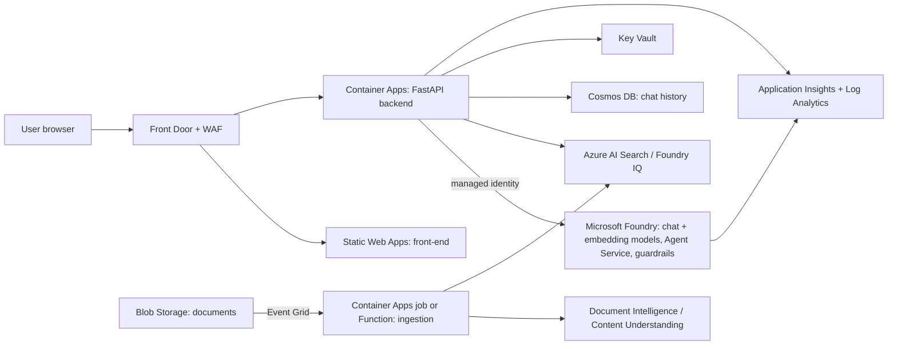

| Step | Service | Why | Can it wait? |
|---|---|---|---|
| 1 | **Microsoft Cost Management budget** | Get an email before spend surprises you. | No, do it first. |
| 2 | **Resource groups + tags** (one per environment, e.g. `rg-ragapp-dev`) | Easy clean-up and cost tracking. | No. |
| 3 | **Microsoft Entra ID + Azure RBAC** (a group for your team) | Who can do what. | No. |
| 4 | **Log Analytics workspace + Application Insights** | See errors, latency and token use from day one. | No. |
| 5 | **Key Vault** | Somewhere safe for the few secrets you cannot avoid. | No. |
| 6 | **Storage account (Blob)** | Holds the documents you will search. | No. |
| 7 | **Microsoft Foundry resource + project**, with a chat model and an embedding model deployed (Global Standard) | The brains of the app; default guardrails included. | No. |
| 8 | **Azure AI Search** (or a Foundry IQ knowledge base on top of it) | Hybrid and vector search for RAG. | No (pgvector or Cosmos DB vectors for tiny demos). |
| 9 | **Document Intelligence** or **Content Understanding** | Turn PDFs and scans into clean text and tables. | Yes, if your documents are plain text. |
| 10 | **Cosmos DB for NoSQL** (serverless) or **PostgreSQL Flexible Server** | Chat history, users, feedback. | Yes for a demo (keep it in memory). |
| 11 | **Azure Container Registry** | Stores your API image. | No if you deploy containers. |
| 12 | **Azure Container Apps** (API, plus a job for ingestion) or **App Service** | Runs your backend; scales to zero. | No. |
| 13 | **User-assigned managed identity + role assignments** (Foundry User, Search Index Data Reader, Storage Blob Data Reader, Key Vault Secrets User) | Keyless access from your app to every service. | No. Avoid API keys from the start. |
| 14 | **Static Web Apps** | Hosts the React/Vue front-end. | Yes (serve a simple page from the API). |
| 15 | **Event Grid** (+ **Service Bus** for retries) | Start ingestion automatically when a document is uploaded. | Yes (run ingestion by hand at first). |
| 16 | **GitHub Actions** with workload identity federation + **Bicep** or **`azd`** | Repeatable deployments, no stored secrets. | Soon; before a second person works on it. |
| 17 | **Azure Managed Redis** | Cache answers and sessions; semantic cache. | Yes, until traffic grows. |
| 18 | **API Management (AI gateway)** | Token limits, failover across model deployments, one gateway for many apps. | Yes, until you have several apps or teams. |
| 19 | **Virtual Network + private endpoints + private DNS** | Keep traffic to Foundry, Search, Storage and Key Vault private. | Yes for learning; required before real company data. |
| 20 | **Front Door + WAF**, **Defender for Cloud**, **Azure Policy** | Protection and guardrails for production. | Yes for learning; required for production. |

For the hands-on version of this kit, see the notebooks listed in [Where to go next in this course](#where-to-go-next-in-this-course).

---

## Common beginner mistakes

1. **Putting API keys in code or notebooks.** Use managed identities and `DefaultAzureCredential`; keep any unavoidable secret in Key Vault. Turn off key-based auth where the service allows it.
2. **Giving everything Owner or Contributor.** Use the smallest data-plane role (for example Storage Blob Data Reader). Remember Contributor cannot read blob data or call Foundry by itself.
3. **One giant resource group for everything.** Use one resource group per app and environment, so you can delete a whole test setup in one click.
4. **Forgetting resources exist.** A paused notebook still leaves its GPU compute instance, AI Search service, Bastion host or Firewall billing by the hour. Delete or stop them.
5. **Choosing AKS for a first project.** Start with Container Apps or App Service; move to AKS when you hit a real limit.
6. **Following old tutorials blindly.** Many still say "Azure AI Studio", "Cognitive Services", "Azure AD", "Form Recognizer" or use the Assistants API and monthly `api-version` strings. Map the names with this guide and use the current SDKs and `/openai/v1/` routes.
7. **Starting new work on retiring services.** Check the [retirement table](#retired-and-retiring-services-in-one-table) before you pick Azure Cache for Redis, Spring Apps, Front Door classic, Prompt flow or Custom Vision.
8. **Picking a region at random.** Models, GPUs and some AI features are only in certain regions, and quotas are per region. Check model and quota availability before you deploy.
9. **Ignoring quotas.** New subscriptions often have zero GPU quota and limited model tokens-per-minute. Request increases early.
10. **Making everything public.** Storage accounts, databases and AI endpoints should move to private endpoints before real data arrives; at least restrict by IP while learning.
11. **No monitoring.** Without Application Insights you cannot see why a chat request is slow or which prompt caused an error.
12. **Clicking everything by hand in production.** Write Bicep, Terraform or `azd` templates so you can rebuild the environment and review changes.
13. **Copying the same data into many systems.** For analytics, use OneLake shortcuts or mirroring instead of building many copy pipelines.
14. **Treating preview features as production-ready.** Previews can change or disappear and often lack an SLA.

---

## Cost safety checklist

Prices change, so this list gives no numbers; use the [pricing calculator](https://azure.microsoft.com/pricing/calculator/) and the service pricing pages.

- **Free account and credits.** A new [Azure free account](https://azure.microsoft.com/free/) usually comes with starter credit for a short period plus free monthly amounts of popular services; [Azure for Students](https://azure.microsoft.com/free/students/) gives credit without a credit card. Read the current terms: when the credit ends, some accounts move to pay-as-you-go.
- **Set a budget before your first resource.** In Cost Management, create a monthly budget with alerts at, for example, 50, 80 and 100 percent. Budgets alert; they do not stop spending, so also act on the alerts.
- **Use free and low tiers while learning.** For example the Free tier of AI Search, F0 tiers of Foundry Tools, Cosmos DB free tier or serverless, Azure SQL Database free offer or serverless, App Service Free/Basic, Container Apps consumption (scales to zero), Functions Flex Consumption.
- **Idle GPUs are the biggest risk.** Stop or delete GPU VMs and Azure ML compute instances when you finish; set **auto-shutdown** schedules and **idle shutdown**; set compute clusters to scale to **0 nodes**; prefer serverless model deployments (pay per token) over dedicated GPUs for learning.
- **Things that bill by the hour even when idle.** AI Search (paid tiers), API Management (non-consumption tiers), Application Gateway, Azure Firewall, Bastion, VPN Gateway, NAT Gateway, public IPs, Databricks clusters that are not auto-terminated, Fabric capacities that are not paused, Cosmos DB provisioned throughput, Managed Redis, provisioned throughput units (PTU) for models.
- **Premium SKUs.** Premium tiers (Firewall Premium, APIM Premium, DDoS Network Protection, Premium SSD v2, Ultra Disk, NetApp Files, AKS uptime SLA tier, Defender plans) are for production. Do not create them "to try".
- **Egress (data going out).** Data leaving Azure to the internet, and data crossing regions or availability zones, is charged. Keep your app, model, search index and storage in the **same region**, and avoid downloading large datasets repeatedly.
- **Logs cost money.** Log Analytics charges by data ingested. Turn on only the diagnostic categories you need, set retention, and use sampling in Application Insights.
- **LLM token costs.** Set token limits per request and per user, cache repeated answers, pick smaller models where they are good enough, and use Batch deployments for offline jobs.
- **Commitments are hard to undo.** Reservations, savings plans and PTU commitments save money only for steady usage. Do not buy them for experiments.
- **Clean up.** Delete the whole resource group when a lab is done. Check for leftovers: disks and snapshots from deleted VMs, unattached public IPs, old container images, and soft-deleted resources (Key Vault, Cognitive Services/Foundry accounts) that may need purging.
- **Check weekly.** Look at Cost analysis grouped by resource and at Azure Advisor cost recommendations.

---

## Where to go next in this course

| Notebook | What it adds to this guide |
|---|---|
| [18_Cloud/08 Azure core services for AI engineers](../08_azure_core_services_for_ai_engineers.ipynb) | Hands-on view of the core: resource hierarchy, Entra ID, RBAC, managed identities, Policy, networking, compute choices, storage, databases, messaging, monitoring with KQL, IaC, Key Vault and a secure RAG reference architecture. |
| [18_Cloud/09 Azure AI: Microsoft Foundry and Azure OpenAI](../09_azure_ai_microsoft_foundry_and_azure_openai.ipynb) | Deep dive into Foundry resources and projects, deployment types, the v1 API and Responses API, Agent Service, Foundry IQ and AI Search ranking, guardrails, evaluation and the AI gateway. |
| [18_Cloud/12 Cloud building blocks compared: AWS, GCP, Azure](../12_cloud_building_blocks_compared_aws_gcp_azure.ipynb) | Side-by-side mapping of the same building blocks across the three clouds. |
| [16_Deployment/06 Deploying an AI SaaS application end to end](../../16_Deployment/06_deploying_an_ai_saas_application_end_to_end.ipynb) | Puts the pieces together into a full product deployment. |
| [16_Deployment/07 Free-tier deployment: front-end, backend and database](../../16_Deployment/07_free_tier_deployment_frontend_backend_and_database.ipynb) | How to deploy a full stack cheaply, including free tiers. |
| [18_Cloud/04 Cloud cost optimization](../04_cloud_cost_optimization.ipynb) | More on keeping the bill under control. |

**Related Microsoft certifications (as of late 2026):** AZ-900 (Azure Fundamentals) for the basics in this guide; AI-901 (Azure AI Fundamentals, replaced AI-900); AI-103 "Developing AI Apps and Agents on Azure" (replaced AI-102 after 30 Jun 2026) for Foundry, RAG and agents; AI-200 "Developing AI Cloud Solutions on Azure" (replaced AZ-204) for containers, data and messaging; AI-300 (MLOps, replaced DP-100) for Azure Machine Learning and GenAIOps; AZ-104 (administrator) and AZ-400 (DevOps). Check each exam's study guide on Microsoft Learn for current status.

---

## Official sources

All pages were checked on 13 November 2026 unless noted.

**Service directories**
- Azure products by category: https://azure.microsoft.com/en-us/products
- Azure documentation directory: https://learn.microsoft.com/azure/
- Azure updates (including retirements): https://azure.microsoft.com/updates

**AI platform**
- What is Microsoft Foundry: https://learn.microsoft.com/azure/foundry/what-is-foundry
- Foundry deployments overview and deployment types: https://learn.microsoft.com/azure/foundry/concepts/deployments-overview , https://learn.microsoft.com/azure/foundry/foundry-models/concepts/deployment-types
- Foundry Agent Service: https://learn.microsoft.com/azure/foundry/agents/overview
- Foundry IQ: https://learn.microsoft.com/azure/foundry/agents/concepts/what-is-foundry-iq
- Foundry Tools (incl. retired tools list): https://learn.microsoft.com/azure/ai-services/what-are-ai-services
- Content Safety overview: https://learn.microsoft.com/azure/ai-services/content-safety/overview ; Guardrails: https://learn.microsoft.com/azure/foundry/guardrails/guardrails-overview
- Foundry Control Plane: https://learn.microsoft.com/azure/foundry/control-plane/overview ; Observability: https://learn.microsoft.com/azure/foundry/concepts/observability
- Foundry Local: https://learn.microsoft.com/azure/foundry-local/what-is-foundry-local
- Azure OpenAI v1 API lifecycle: https://learn.microsoft.com/azure/foundry/openai/api-version-lifecycle
- Prompt flow migration: https://learn.microsoft.com/azure/foundry-classic/how-to/prompt-flow-migration-overview
- Custom Vision (retirement note): https://learn.microsoft.com/azure/ai-services/custom-vision-service/overview
- Anomaly Detector (retirement note): https://learn.microsoft.com/previous-versions/azure/ai-services/anomaly-detector/overview
- Healthcare agent service: https://learn.microsoft.com/azure/health-bot/overview
- Bot Service: https://learn.microsoft.com/azure/bot-service/
- API Management AI gateway: https://learn.microsoft.com/azure/api-management/genai-gateway-capabilities

**Retirement and status pages**
- Cloud Services (extended support): https://learn.microsoft.com/azure/cloud-services-extended-support/overview
- Azure Spring Apps retirement: https://learn.microsoft.com/azure/spring-apps/basic-standard/retirement-announcement
- Azure Lab Services retirement guide: https://learn.microsoft.com/azure/lab-services/retirement-guide
- Front Door (classic) retirement FAQ: https://learn.microsoft.com/azure/frontdoor/classic-retirement-faq
- CDN (classic) retirement FAQ: https://learn.microsoft.com/azure/cdn/classic-cdn-retirement-faq
- Azure Cache for Redis what's new (retirement dates): https://learn.microsoft.com/azure/azure-cache-for-redis/cache-whats-new ; Azure Managed Redis: https://learn.microsoft.com/azure/redis/
- Application Gateway v1 retirement: https://learn.microsoft.com/azure/application-gateway/v1-retirement
- Basic Load Balancer upgrade guidance: https://learn.microsoft.com/azure/load-balancer/load-balancer-basic-upgrade-guidance
- Default outbound access: https://learn.microsoft.com/azure/virtual-network/ip-services/default-outbound-access
- Container Instances GPU: https://learn.microsoft.com/azure/container-instances/container-instances-gpu
- Functions hosting plans (Linux Consumption retirement): https://learn.microsoft.com/azure/azure-functions/functions-scale
- Deployment Environments: https://learn.microsoft.com/azure/deployment-environments/overview-what-is-azure-deployment-environments
- Azure App Testing: https://learn.microsoft.com/azure/app-testing/overview-what-is-azure-app-testing
- Dedicated HSM: https://learn.microsoft.com/azure/dedicated-hsm/overview ; Cloud HSM: https://learn.microsoft.com/azure/cloud-hsm/overview
- Automanage: https://learn.microsoft.com/azure/automanage/overview-about
- Blueprints: https://learn.microsoft.com/azure/governance/blueprints/overview
- Sentinel in the Defender portal: https://learn.microsoft.com/azure/sentinel/microsoft-sentinel-defender-portal
- Log Analytics agent (retired): https://learn.microsoft.com/previous-versions/azure/azure-monitor/agents/log-analytics-agent
- App Center retirement: https://learn.microsoft.com/appcenter/retirement
- Media Services retirement: https://learn.microsoft.com/previous-versions/azure/media-services/latest/azure-media-services-retirement
- Data Lake Analytics: https://learn.microsoft.com/previous-versions/azure/data-lake-analytics/data-lake-analytics-overview
- Data Catalog: https://learn.microsoft.com/previous-versions/azure/data-catalog/overview
- Time Series Insights: https://learn.microsoft.com/previous-versions/azure/time-series-insights/overview-what-is-tsi
- HPC Cache: https://learn.microsoft.com/previous-versions/azure/hpc-cache/hpc-cache-overview
- SQL Edge: https://learn.microsoft.com/previous-versions/azure/azure-sql-edge/overview
- Azure API for FHIR: https://learn.microsoft.com/azure/healthcare-apis/azure-api-for-fhir/overview
- Data Manager for Agriculture: https://learn.microsoft.com/azure/data-manager-for-agri/overview-azure-data-manager-for-agriculture
- Data Share: https://learn.microsoft.com/azure/data-share/overview
- Synapse Data Explorer pools: https://learn.microsoft.com/previous-versions/azure/synapse-analytics/data-explorer/data-explorer-overview
- HDInsight: https://learn.microsoft.com/azure/hdinsight/hdinsight-overview
- MariaDB (archived): https://learn.microsoft.com/previous-versions/azure/mariadb/overview
- Cosmos DB for PostgreSQL: https://learn.microsoft.com/azure/cosmos-db/postgresql/introduction
- Azure Sphere what's new: https://learn.microsoft.com/azure-sphere/product-overview/whats-new
- Azure Information Protection: https://learn.microsoft.com/azure/information-protection/what-is-information-protection
- Eclipse ThreadX (formerly Azure RTOS): https://github.com/eclipse-threadx
- Azure Orbital Ground Station retirement notice: https://azure.microsoft.com/updates?id=azure-orbital-ground-station-retirement
- Machine Learning SDK v1 deprecation: https://learn.microsoft.com/azure/machine-learning/how-to-migrate-from-v1

**Notes on verification**
- Where Microsoft's page states a date, it is shown. Where a page only says "retired" or "on the retirement path" without a date, no date is given here.
- A few items on the product page could not be verified in detail (Azure Multicloud Interconnect, Azure Infrastructure Resiliency Manager, "Azure Enclave", Network Function Manager); they are marked as such or left out.
- Equivalent AWS and Google Cloud services are the closest matches, not exact copies. Google Cloud's AI platform was renamed from Vertex AI to Gemini Enterprise Agent Platform in April 2026; AWS App Runner and AWS CodeCommit are closed to new customers.
