# Every Google Cloud Service Explained Simply

**Last checked: 13 November 2026.** Product names and statuses were checked against the official Google Cloud documentation index, product docs and release notes on that date. See [Official sources](#official-sources) at the end.

> **Who is this for:** Beginners who open the Google Cloud console, see 200+ product names, and do not know which ones matter.
>
> **What you get:** A short entry for almost every Google Cloud product: what it is, why you would use it, when to pick it or something simpler, and the closest AWS and Azure products. Each category ends with a "Which one should I use?" table.
>
> **How to read it:** You do not have to read it top to bottom. For each category, read the "In plain words" paragraph and the decision table first. Look up single entries when you meet a product name you do not know.
>
> **Related notebooks:** [10: GCP core services for AI engineers](../10_gcp_core_services_for_ai_engineers.ipynb), [11: GCP AI with the Gemini Enterprise Agent Platform](../11_gcp_ai_gemini_enterprise_agent_platform.ipynb), [12: Cloud building blocks compared across AWS, GCP and Azure](../12_cloud_building_blocks_compared_aws_gcp_azure.ipynb). [Section 22](#22-where-to-go-next-in-this-course) has more links.

**A warning about names.** Google renamed many products in 2025 and 2026. This guide uses the **current name**, with the **former name in brackets**. Blog posts, courses and some API names still use the old names. For example, the Agent Platform Python package is still `google-cloud-aiplatform`, and the Spark command group is still `gcloud dataproc`. **RETIRED**, **DEPRECATED**, **CLOSED TO NEW CUSTOMERS** and **SUNSETTING** labels are shown in bold capitals.

**How every entry is written:**

- First line: **what it is** in everyday words.
- **Use it when:** typical good fits. **Skip it when:** when something simpler or different is the better choice.
- **AWS / Azure:** the closest product on the other two big clouds. These are rarely exact matches.
- **Docs:** the official documentation page. In the short "Brief" tables, the product name itself links to its docs. Every link was checked on 13 Nov 2026.

---

## Contents

0. [How Google Cloud is organised (read this first)](#0-how-google-cloud-is-organised-read-this-first)
1. [Renames and retirements at a glance](#1-renames-and-retirements-at-a-glance)
2. [Compute](#2-compute)
3. [Containers and Kubernetes](#3-containers-and-kubernetes)
4. [Serverless](#4-serverless)
5. [Storage](#5-storage)
6. [Databases](#6-databases)
7. [Data analytics and the BigQuery ecosystem](#7-data-analytics-and-the-bigquery-ecosystem)
8. [Data integration and pipelines](#8-data-integration-and-pipelines)
9. [AI, ML and generative AI](#9-ai-ml-and-generative-ai)
10. [Application integration, messaging and APIs](#10-application-integration-messaging-and-apis)
11. [Networking and content delivery](#11-networking-and-content-delivery)
12. [Security, identity and compliance](#12-security-identity-and-compliance)
13. [Management, operations and observability](#13-management-operations-and-observability)
14. [Developer tools and CI/CD](#14-developer-tools-and-cicd)
15. [Migration](#15-migration)
16. [Hybrid and multicloud](#16-hybrid-and-multicloud)
17. [Gemini Enterprise and Workspace-adjacent products](#17-gemini-enterprise-and-workspace-adjacent-products)
18. [Firebase, Maps, media and specialised products](#18-firebase-maps-media-and-specialised-products)
19. [Cost management](#19-cost-management)
20. [Starter kit for an AI web app on Google Cloud](#20-starter-kit-for-an-ai-web-app-on-google-cloud)
21. [Common beginner mistakes and cost safety](#21-common-beginner-mistakes-and-cost-safety)
22. [Where to go next in this course](#22-where-to-go-next-in-this-course)
23. [Official sources](#official-sources)

---

## 0. How Google Cloud is organised (read this first)

**In plain words:** Google Cloud is a very large shop of rented computers and ready-made software services, with nothing to buy up front. You create a **project**, which is a box that holds your resources. You link it to a **billing account**, which is your card or invoice. Then you turn on the **APIs** (services) you need and create resources such as a virtual machine or a database. You pay for what you use, usually per second, per gigabyte or per request.

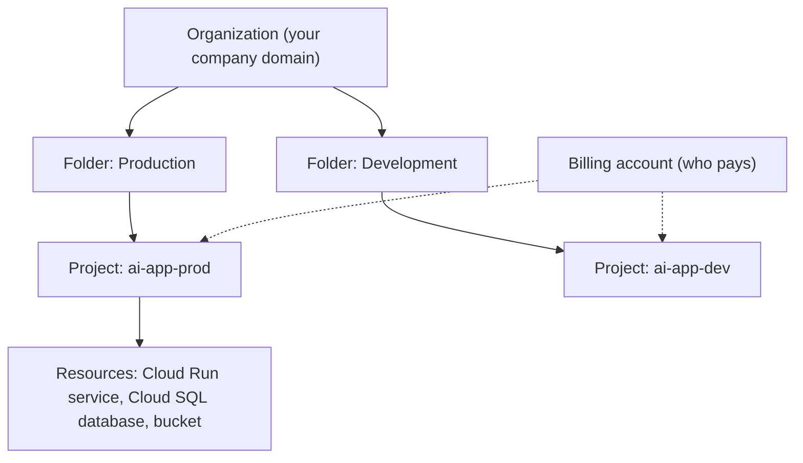

| Word | Simple meaning |
|---|---|
| **Organization** | The top of the tree. It usually matches your company domain. A personal Gmail account often has projects but no organization. |
| **Folder** | A group of projects, such as "Production". Rules set on a folder apply to every project inside it. |
| **Project** | The basic container. Every resource lives in exactly one project. Billing, permissions and APIs are all set per project. |
| **Billing account** | How you pay. One billing account can pay for many projects. |
| **Region / zone** | A region is a geographic area, such as `us-central1`. A zone is one isolated location inside a region, such as `us-central1-a`. |
| **Global / regional / zonal** | Where a resource lives. A VPC network is global, a Cloud Run service is regional, and a VM is zonal. |
| **API** | Each product must be enabled per project (for example `run.googleapis.com`) before it works. |
| **Service account** | An identity for a program, not a person. Your app uses it to call other services. |
| **Managed / serverless** | **Managed:** Google runs the servers for you. **Serverless:** you do not even pick machines, and the service scales by itself, often down to zero. |

---

## 1. Renames and retirements at a glance

Old names still appear everywhere. This table maps each one to what you should use now. The entries in later sections repeat these notes.

| Old name you may read | Use now | Status (checked Nov 2026) |
|---|---|---|
| Vertex AI | **Gemini Enterprise Agent Platform** ("Agent Platform") | Renamed 22 Apr 2026. The API is still `aiplatform.googleapis.com`. |
| Vertex AI Agent Builder | Agent Platform parts: **Agent Development Kit (ADK)**, **Agent Studio**, **Agent Garden**, **Agent Runtime** (was Agent Engine), **Agent Search** | The umbrella name was replaced in Apr 2026 |
| Vertex AI Search / Vertex AI Conversation | **Agent Search** / **Agent Conversation** | Renamed 22 Apr 2026 |
| Vertex AI Studio | **Agent Studio** | Renamed 22 Apr 2026 |
| Recommendations AI, Retail API, Vertex AI Search for commerce | **AI Commerce Search** | Renamed (current docs name) |
| Google Agentspace | **Gemini Enterprise** | Renamed Oct 2025 |
| Cloud Functions | **Cloud Run functions** | Renamed 2024 |
| Container Registry (`gcr.io`) | **Artifact Registry** | **RETIRED**: shut down 18 Mar 2025 |
| Cloud Deployment Manager | **Infrastructure Manager** (Terraform) | **DISCONTINUED**: support ended Mar/Apr 2026, new users blocked 30 Jun 2026, turned off 30 Jun 2027 |
| Cloud Source Repositories | **Secure Source Manager**, GitHub or GitLab | **CLOSED TO NEW CUSTOMERS** since 17 Jun 2024 |
| Cloud Composer | **Managed Service for Apache Airflow** | Renamed 15 Apr 2026 |
| Dataproc, Dataproc Serverless | **Managed Service for Apache Spark** | Renamed 3 Apr 2026. API, `gcloud dataproc` and IAM roles did not change. |
| Dataplex (Dataplex Universal Catalog) | **Knowledge Catalog** | Renamed 2026 |
| Data Catalog | **Knowledge Catalog** | **RETIRED**: discontinued 30 Jan 2026 |
| BigLake | **Lakehouse** | Renamed 20 Apr 2026. APIs still say `biglake`. |
| Looker Studio (earlier: Google Data Studio) | **Data Studio** | Renamed 16 Apr 2026 |
| Analytics Hub | **BigQuery sharing** | Renamed |
| Datastore | **Firestore** (Datastore mode is kept for old apps) | Firestore is the official successor |
| Traffic Director | **Cloud Service Mesh** | Merged 2024 |
| BeyondCorp Enterprise | **Chrome Enterprise Premium** | Renamed 2024 |
| Chronicle | **Google Security Operations** | Renamed 2024 |
| Cloud DLP | **Sensitive Data Protection** | Renamed 2023 |
| reCAPTCHA Enterprise | Part of **Google Cloud Fraud Defense** | 2026 |
| Contact Center AI (CCAI), CCAI Platform, CCAI Insights | **Google Cloud CCaaS**, **Agent Assist**, **Customer Experience Insights**, **Conversational Agents** | Renamed / split |
| Dialogflow CX | **Conversational Agents (Dialogflow CX)** | Renamed |
| GKE Enterprise / Anthos | **GKE** (one single offering) | Merged Sep 2025 |
| Pub/Sub Lite | **Pub/Sub** or **Managed Service for Apache Kafka** | **DEPRECATED**: turned off 31 Jan 2027 |
| Memorystore for Memcached | **Memorystore for Valkey** | **DEPRECATED** 20 Jan 2026, shuts down 31 Jan 2029 |
| Gemini Code Assist | **Antigravity** (inside Gemini Enterprise editions) | **SUNSETTING**: no new subscriptions from 9 Oct 2026 |
| Cloud Life Sciences | **Batch** | **RETIRED**: shut down 8 Jul 2025 |
| Game Servers | Open-source **Agones** on GKE | **RETIRED**: 30 Jun 2023 |
| Cloud IoT Core, Cloud Debugger | Partner IoT platforms; Cloud Logging / Trace / snapshot debugging in your IDE | **RETIRED** in 2023 |
| Stackdriver, Operations Suite | **Google Cloud Observability** | Renamed |
| Architecture Framework | **Well-Architected Framework** | Renamed. It has six pillars plus an AI/ML perspective. |

---

## 2. Compute

**In plain words:** "Compute" means renting processors and memory to run your code. The basic option is a **virtual machine (VM)**, which is a computer in Google's data center that you fully control. Google also offers ways to run many machines for one big job (Batch), special chips for AI (GPUs and TPUs), and dedicated hardware for business software. If you just want to put a web app online, **do not start here**. Start with Cloud Run in [section 4](#4-serverless).

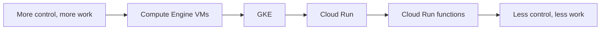

#### Compute Engine
Rent virtual machines (Linux or Windows) of almost any size, billed per second.
- **Use it when:** you need a full OS, special drivers, self-managed software or a GPU box for experiments. **Skip it when:** you only need to run a container or an API. Cloud Run is simpler and you never patch it.
- **AWS / Azure:** EC2 / Azure Virtual Machines.
- **Docs:** https://docs.cloud.google.com/compute/docs

#### Spot VMs
Spare Compute Engine capacity at a large discount. Google can take a Spot VM back with about 30 seconds' notice.
- **Use it when:** batch jobs, or training that saves checkpoints and can restart. **Skip it when:** a web server or database must stay up.
- **AWS / Azure:** EC2 Spot Instances / Azure Spot VMs.
- **Docs:** https://docs.cloud.google.com/compute/docs/instances/spot

#### Cloud GPUs
NVIDIA GPUs that you attach to VMs, GKE nodes, Cloud Run, Batch or Agent Platform jobs.
- **Use it when:** training, fine-tuning or self-hosting open models. **Skip it when:** you only call a hosted model such as Gemini through an API. Idle GPUs are a top cause of surprise bills.
- **AWS / Azure:** EC2 P/G instances / Azure N-series VMs.
- **Docs:** https://docs.cloud.google.com/compute/docs/gpus

#### Batch
Runs large numbers of batch tasks (scripts or containers). It creates the VMs, retries failed tasks and deletes the VMs when done.
- **Use it when:** simulations, rendering, genomics, or embedding millions of documents. **Skip it when:** one container finishes in under 24 hours. A Cloud Run job is simpler.
- **AWS / Azure:** AWS Batch / Azure Batch.
- **Docs:** https://docs.cloud.google.com/batch/docs

#### Bare Metal Solution
Dedicated physical servers in facilities next to Google Cloud, linked by a fast private connection. Google runs the hardware; you run everything on it.
- **Use it when:** software that needs the bare hardware or special licences, such as some Oracle setups. **Skip it when:** a normal VM works. Compute Engine also offers bare metal machine types.
- **AWS / Azure:** EC2 bare metal instances / Azure BareMetal Infrastructure.
- **Docs:** https://docs.cloud.google.com/bare-metal/docs (bare metal VMs: https://docs.cloud.google.com/compute/docs/instances/bare-metal-instances)

#### Google Cloud VMware Engine
Real VMware environments (vSphere, vSAN, NSX) on dedicated Google hardware.
- **Use it when:** you want to move VMware VMs to the cloud without changing them. **Skip it when:** you are building new apps.
- **AWS / Azure:** VMware Cloud on AWS / Azure VMware Solution.
- **Docs:** https://docs.cloud.google.com/vmware-engine/docs

#### AI Hypercomputer, Cluster Director and Cluster Toolkit
**AI Hypercomputer** is Google's name for its whole AI infrastructure stack: chips, networking, storage, software and ways to buy capacity. **Cluster Director** builds and runs large GPU or TPU clusters, including Slurm clusters. **Cluster Toolkit** is open-source blueprints for HPC and AI clusters.
- **Use it when:** large training runs on many accelerators. **Skip it when:** your job fits on one or a few GPUs.
- **AWS / Azure:** EC2 UltraClusters, SageMaker HyperPod / Azure CycleCloud.
- **Docs:** https://docs.cloud.google.com/ai-hypercomputer/docs (https://docs.cloud.google.com/cluster-director/docs ; https://docs.cloud.google.com/cluster-toolkit/docs)

**Smaller compute items**

| Product | What it is | AWS / Azure |
|---|---|---|
| [**Container-Optimized OS**](https://docs.cloud.google.com/container-optimized-os/docs) | A small, locked-down Linux made for running containers. It is the default OS on GKE nodes. | Bottlerocket / Azure Linux |
| [**Deep Learning VM Images**](https://docs.cloud.google.com/deep-learning-vm/docs) | VM images with CUDA, PyTorch and JAX preinstalled. | Deep Learning AMIs / Data Science VM |
| [**Shielded VM, Confidential VM**](https://docs.cloud.google.com/confidential-computing/confidential-vm/docs) | Hardened boot, and memory that stays encrypted while in use. Both are covered in [section 12](#12-security-identity-and-compliance). | Nitro / Azure confidential VMs |
| [**Managed instance groups, instance templates**](https://docs.cloud.google.com/compute/docs/instance-groups) | Groups of identical VMs that autoscale and repair themselves. | Auto Scaling groups / VM Scale Sets |
| [**Sole-tenant nodes**](https://docs.cloud.google.com/compute/docs/nodes/sole-tenant-nodes) | A physical server that only your VMs use, for licence or compliance rules. | Dedicated Hosts / Azure Dedicated Host |
| [**Flex-start VMs (Dynamic Workload Scheduler), reservations**](https://docs.cloud.google.com/compute/docs/instances/reservations-overview) | Queue up for scarce GPUs or TPUs, or reserve capacity ahead of time. | EC2 Capacity Blocks / Azure capacity reservations |
| [**VM Manager, Capacity Planner**](https://docs.cloud.google.com/compute/vm-manager/docs) | VM Manager patches and inventories many VMs. Capacity Planner shows how your VMs use resources. | Systems Manager / Azure Update Manager |
| [**SAP on Google Cloud, Workload Manager**](https://docs.cloud.google.com/sap/docs) | Certified setups for SAP, plus a tool that checks SAP and SQL Server against best practices. | SAP on AWS / Azure Center for SAP |
| [**Oracle Database@Google Cloud**](https://docs.cloud.google.com/oracle/database/docs) | Oracle Exadata and Autonomous Database, run by Oracle inside Google data centers. | Oracle Database@AWS / @Azure |
| [**Cluster Services for OpenShift**](https://docs.cloud.google.com/openshift-cluster) | Connects self-managed Red Hat OpenShift clusters to Google services. | ROSA / Azure Red Hat OpenShift |

### Which compute option should I use?

| Your situation | Best first choice |
|---|---|
| A web app or API in a container (most AI apps) | **Cloud Run** |
| A small function that reacts to an event | **Cloud Run functions** |
| A script that runs and finishes in under 24 hours | **Cloud Run jobs** |
| Thousands of tasks, possibly on Spot VMs or GPUs | **Batch** |
| Many microservices, long-running GPU or TPU serving | **GKE** (start with Autopilot) |
| A full OS, special drivers, a fixed server | **Compute Engine** |
| Big multi-node training | **Managed Training** (Agent Platform) or **GKE / Cluster Director** |
| VMware or special hardware needs | **VMware Engine** / **Bare Metal Solution** |
| An existing App Engine app | Keep it, or move it to Cloud Run |

---

## 3. Containers and Kubernetes

**In plain words:** A **container** packs your app together with its libraries and settings, so it runs the same everywhere. **Kubernetes** is open-source software that runs many containers across many machines, restarts them when they crash and scales them. **GKE** is Kubernetes managed by Google. Choose GKE only when you need Kubernetes features. Cloud Run also runs containers and is much simpler.

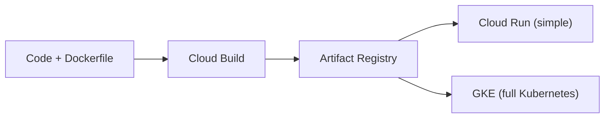

#### Google Kubernetes Engine (GKE)
Managed Kubernetes. Google always runs the control plane. In **Autopilot** mode (the recommended default) Google also runs the worker nodes. In **Standard** mode you manage the node pools yourself. Since Sep 2025, GKE is **one single offering**: the old GKE Enterprise/Anthos features are now part of it.
- **Use it when:** you have many services, need GPU or TPU node pools for model serving, or use tools like Helm and operators. Useful AI features include **GKE Inference Gateway**, which routes LLM requests to the least busy model server with the best cache, and **Inference Quickstart**, which recommends tested setups. **Skip it when:** you only have one or a few web services. Use Cloud Run.
- **AWS / Azure:** Amazon EKS / Azure Kubernetes Service (AKS).
- **Docs:** https://docs.cloud.google.com/kubernetes-engine/docs (Inference Gateway: https://docs.cloud.google.com/kubernetes-engine/docs/concepts/about-gke-inference-gateway)

#### Cloud Service Mesh (includes the former Traffic Director)
A managed, Istio-based service mesh. It encrypts traffic between services (mTLS), splits traffic between versions, retries failed calls and collects metrics, without code changes. Traffic Director users now run on Cloud Service Mesh's control plane.
- **Use it when:** many microservices need strict security or traffic control. **Skip it when:** you have a few services. Cloud Run service-to-service authentication is enough.
- **AWS / Azure:** Amazon VPC Lattice / Istio add-on for AKS.
- **Docs:** https://docs.cloud.google.com/service-mesh/docs

#### Config Sync, Policy Controller, Config Controller
**Config Sync** keeps clusters matching what is stored in Git (GitOps). **Policy Controller** blocks settings that break your rules. **Config Controller** creates Google Cloud resources from Kubernetes-style files.
- **Use it when:** you run many clusters and want Git to be the source of truth. **Skip it when:** you have one cluster. Helm plus CI, or Argo CD, is enough.
- **AWS / Azure:** Argo CD/Flux on EKS, ACK / Flux GitOps for AKS, Azure Policy.
- **Docs:** https://docs.cloud.google.com/kubernetes-engine/config-sync/docs (https://docs.cloud.google.com/kubernetes-engine/policy-controller/docs ; https://docs.cloud.google.com/kubernetes-engine/enterprise/config-controller/docs/overview)

#### Backup for GKE
Backs up and restores GKE workloads and their disks.
- **Use it when:** your clusters hold state, such as databases or vector stores. **Skip it when:** everything can be rebuilt from Git.
- **AWS / Azure:** AWS Backup for EKS / Azure Backup for AKS.
- **Docs:** https://docs.cloud.google.com/kubernetes-engine/docs/add-on/backup-for-gke/concepts/backup-for-gke

**Brief:** [**Knative serving**](https://knative.dev/docs/) is the open-source project behind the Cloud Run API, which you can install on any Kubernetes cluster. **Container Registry** is **RETIRED**; use **Artifact Registry** ([section 14](#14-developer-tools-and-cicd)). **Binary Authorization** is in [section 12](#12-security-identity-and-compliance), and **GKE Multi-Cloud** is in [section 16](#16-hybrid-and-multicloud).

### Which container option should I use?

| Question | Cloud Run | GKE Autopilot | GKE Standard | VM + Docker |
|---|---|---|---|---|
| Must I learn Kubernetes? | No | Basics | Yes | No |
| Scales to zero? | Yes | No | No | No |
| GPUs / TPUs | GPUs only | Both | Both | Both |
| Best for | Web APIs, AI backends, jobs | Many services, model serving | Custom nodes, full control | One special machine |
| Ops work | Lowest | Low | Medium to high | Medium |

---

## 4. Serverless

**In plain words:** Serverless means you hand Google your code or container and it runs it. You never pick, patch or resize servers. When nobody is using the app, it can **scale to zero** and cost almost nothing. When traffic arrives, it starts more copies. The trade-offs are less control and a short **cold start** delay while a new copy starts.

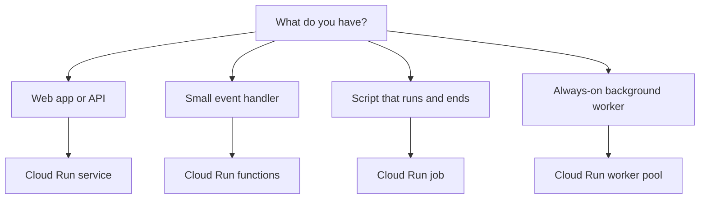

#### Cloud Run
Runs any container, or your source code which it builds for you, as a serverless service with an HTTPS address. It offers **services** (handle web requests), **jobs** (run to completion), **worker pools** (always-on background workers) and **functions**. GPUs can be added to services and jobs.
- **Use it when:** FastAPI backends, agent backends, Streamlit or Gradio demos, webhooks, nightly jobs. It is **the default choice** for the AI apps in this course. **Skip it when:** you need TPUs or dozens of tightly linked services; use GKE.
- **AWS / Azure:** ECS on Fargate (App Runner closed to new customers in 2026; AWS points to ECS Express Mode) / Azure Container Apps.
- **Docs:** https://docs.cloud.google.com/run/docs

#### Cloud Run functions (formerly Cloud Functions)
Write one function that runs when an HTTP request or an event arrives. There is no Dockerfile and no web framework. It runs on Cloud Run behind the scenes.
- **Use it when:** small glue code, such as "when a PDF lands in a bucket, extract its text". **Skip it when:** the code grows into an app with many routes. Use a Cloud Run service.
- **AWS / Azure:** AWS Lambda / Azure Functions.
- **Docs:** https://docs.cloud.google.com/run/docs/functions/overview

#### App Engine
Google's older platform for web apps: upload your code and Google runs it. It has standard and flexible environments.
- **Use it when:** you maintain an existing App Engine app. **Skip it when:** you are starting something new. Google's docs recommend **Cloud Run** for new users.
- **AWS / Azure:** Elastic Beanstalk / Azure App Service.
- **Docs:** https://docs.cloud.google.com/appengine/docs

**Brief:** [**Google Cloud's buildpacks**](https://docs.cloud.google.com/docs/buildpacks/overview) turn source code into a container image without a Dockerfile. They power `gcloud run deploy --source .`.

### Which serverless option should I use?

| Need | Use | Avoid |
|---|---|---|
| HTTP API or web app | Cloud Run service | Starting new apps on App Engine |
| Small event handler | Cloud Run functions | A full service for one route |
| Script that finishes | Cloud Run job | A VM left running |
| Always-on queue consumer | Cloud Run worker pool | A function that polls in a loop |
| Hours of work on many machines | Batch | One huge Cloud Run job |
| Multi-step process with waits and retries | Workflows calling Cloud Run | Code that sleeps and polls |

---

## 5. Storage

**In plain words:** Storage has three basic shapes. **Object storage** (Cloud Storage) is a huge bucket of files that you reach by name over the internet. It is cheap and nearly unlimited, and it is where datasets, model weights, PDFs and backups go. **Block storage** (Persistent Disk, Hyperdisk, Local SSD) is a hard drive attached to one VM. **File storage** (Filestore, NetApp Volumes, Managed Lustre) is a shared network folder that many machines mount at the same time. The rest of this category is about backups and moving data in.

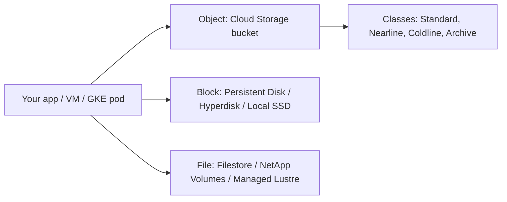

#### Cloud Storage
Object storage for any amount of files ("objects") in "buckets". **Storage classes** trade lower storage price for higher access cost: **Standard** (frequent access), **Nearline** (about once a month), **Coldline** (about once a quarter) and **Archive** (about once a year). **Autoclass** moves objects between classes for you. **Rapid Cache (formerly Anywhere Cache)** is an SSD read cache in the same zone as your GPUs.
- **Use it when:** you store datasets, model files, user uploads, RAG source documents, backups or static website files. **Skip it when:** a program needs a normal disk or a shared POSIX folder. Use a disk or Filestore.
- **AWS / Azure:** Amazon S3 / Azure Blob Storage.
- **Docs:** https://docs.cloud.google.com/storage/docs

#### Persistent Disk
Network-attached disks for VMs. Your data survives when the VM stops.
- **Use it when:** you need a boot disk or a data disk for a normal VM. **Skip it when:** you need very high or adjustable performance. Use Hyperdisk.
- **AWS / Azure:** Amazon EBS / Azure Managed Disks.
- **Docs:** https://docs.cloud.google.com/compute/docs/disks/persistent-disks

#### Hyperdisk
The newer generation of block storage. You set capacity, speed (IOPS) and throughput separately, and some types can be shared or pooled.
- **Use it when:** databases, model-loading on new machine types (many new VM series support only Hyperdisk) and AI workloads that need fast disks. **Skip it when:** a basic small disk is enough.
- **AWS / Azure:** EBS io2/gp3 / Azure Premium SSD v2 and Ultra Disk.
- **Docs:** https://docs.cloud.google.com/compute/docs/disks/hyperdisks

#### Local SSD
Very fast SSDs physically inside the host machine. **Data is lost** when the VM stops or is deleted.
- **Use it when:** scratch space, caches, temporary training data. **Skip it when:** the data must survive.
- **AWS / Azure:** EC2 instance store / Azure local NVMe temp disk.
- **Docs:** https://docs.cloud.google.com/compute/docs/disks/local-ssd

#### Filestore
Managed NFS file servers: a shared folder that many VMs or GKE pods mount at once.
- **Use it when:** old apps expect a shared file system, or several machines share files. **Skip it when:** objects in Cloud Storage would work, which is cheaper.
- **AWS / Azure:** Amazon EFS / Azure Files.
- **Docs:** https://docs.cloud.google.com/filestore/docs

#### NetApp Volumes
NetApp's enterprise file storage (NFS and SMB) run as a Google Cloud service.
- **Use it when:** you need enterprise features such as snapshots, clones and Windows shares, or you already use NetApp. **Skip it when:** simple NFS is enough (use Filestore).
- **AWS / Azure:** Amazon FSx for NetApp ONTAP / Azure NetApp Files.
- **Docs:** https://docs.cloud.google.com/netapp/volumes/docs

#### Managed Lustre
A managed parallel file system: a very fast shared folder for thousands of GPUs or TPUs.
- **Use it when:** large training jobs read huge datasets or write checkpoints quickly. **Skip it when:** you train on one machine.
- **AWS / Azure:** Amazon FSx for Lustre / Azure Managed Lustre.
- **Docs:** https://docs.cloud.google.com/managed-lustre/docs

#### Backup and DR Service
One central place for backups and disaster recovery of VMs, databases (SQL Server, SAP HANA and others) and VMware, with immutable "vaults".
- **Use it when:** you need scheduled, policy-based backups that an attacker cannot delete. **Skip it when:** the product's built-in backups (for example Cloud SQL backups) are enough.
- **AWS / Azure:** AWS Backup / Azure Backup.
- **Docs:** https://docs.cloud.google.com/backup-disaster-recovery/docs

#### Storage Transfer Service
Copies large amounts of data online into Cloud Storage from AWS S3, Azure, HTTP sources or your own servers, once or on a schedule.
- **Use it when:** you move a dataset or keep two buckets in sync. **Skip it when:** you copy a few files (use `gcloud storage cp`).
- **AWS / Azure:** AWS DataSync / Azure Storage Mover, AzCopy.
- **Docs:** https://docs.cloud.google.com/storage-transfer/docs/overview

#### Transfer Appliance
A physical storage device that Google ships to you. You fill it with data and ship it back.
- **Use it when:** you have hundreds of terabytes or petabytes and a slow network. **Skip it when:** your network can move the data in reasonable time.
- **AWS / Azure:** AWS Snowball family / Azure Data Box.
- **Docs:** https://docs.cloud.google.com/transfer-appliance/docs/4.0/overview

#### Cloud Storage for Firebase
Cloud Storage with Firebase SDKs and security rules, so mobile and web apps can upload user files (photos, voice notes) directly and safely.
- **Use it when:** a Firebase app needs user uploads. **Skip it when:** you have a server-side app. Use Cloud Storage with signed URLs.
- **AWS / Azure:** S3 with Amplify Storage / Blob Storage with SAS tokens.
- **Docs:** https://firebase.google.com/docs/storage

**Brief:** [Cloud FTP](https://docs.cloud.google.com/cloud-ftp/overview) moves files in and out of Cloud Storage over SFTP for partners who only speak FTP (AWS Transfer Family / Azure Blob SFTP). [Storage Insights](https://docs.cloud.google.com/storage/docs/insights/storage-insights) gives inventory reports about your buckets. [Backup for GKE](#backup-for-gke) is in section 3.

### Which storage should I use?

| Need | Use |
|---|---|
| Datasets, model weights, uploads, documents for RAG | Cloud Storage (Standard) |
| Old backups you rarely read | Cloud Storage Coldline or Archive (or turn on Autoclass) |
| Boot or data disk for a VM | Hyperdisk (newer VMs) or Persistent Disk |
| Fast temporary scratch space | Local SSD |
| Shared folder for many machines | Filestore (simple) or NetApp Volumes (enterprise) |
| Shared, very fast folder for a big training cluster | Managed Lustre |
| Fast reads of bucket data next to GPUs | Rapid Cache on Cloud Storage |
| Protected backups for many systems | Backup and DR Service |
| Move a lot of data in | Storage Transfer Service (online) or Transfer Appliance (offline) |

---

## 6. Databases

**In plain words:** A database stores your app's data so you can find and change it quickly. **Relational (SQL)** databases store tables with strict columns and support joins and transactions. Use them for users, orders and app state. **NoSQL** databases store documents or key-value pairs, scale easily and have flexible shapes. **In-memory** databases (caches) keep hot data in RAM for very fast reads. Most AI apps need one SQL database (often PostgreSQL with the `pgvector` extension for embeddings) and maybe a cache. Analytics belongs in BigQuery ([section 7](#7-data-analytics-and-the-bigquery-ecosystem)), not in your app database.

#### Cloud SQL
Managed MySQL, PostgreSQL or SQL Server. Google handles backups, patches, replicas and failover.
- **Use it when:** you need a normal app database. It is the **default choice**. Cloud SQL for PostgreSQL supports `pgvector` for small to medium RAG apps. **Skip it when:** you need very high performance (AlloyDB) or global scale (Spanner).
- **AWS / Azure:** Amazon RDS / Azure Database for PostgreSQL or MySQL, Azure SQL Database.
- **Docs:** https://docs.cloud.google.com/sql/docs

#### AlloyDB for PostgreSQL
Google's high-performance, PostgreSQL-compatible database. It has fast analytics on the same data, strong vector search (ScaNN index) and built-in AI functions. **AlloyDB Omni** is a downloadable version that runs anywhere.
- **Use it when:** busy PostgreSQL apps, or large vector search inside your database. **Skip it when:** a small app, where Cloud SQL is cheaper and simpler.
- **AWS / Azure:** Amazon Aurora PostgreSQL / Azure Database for PostgreSQL (Flexible Server).
- **Docs:** https://docs.cloud.google.com/alloydb/docs (Omni: https://docs.cloud.google.com/alloydb/omni/docs)

#### Spanner
A relational database that spreads across many machines and regions while keeping strong consistency and very high availability. It also supports graph, full-text and vector search. **Spanner Omni** is a self-managed version.
- **Use it when:** global apps, banking-style transactions at huge scale, or a need for no planned downtime. **Skip it when:** one region and modest traffic. Cloud SQL is much cheaper.
- **AWS / Azure:** Amazon Aurora DSQL / Azure Cosmos DB (closest).
- **Docs:** https://docs.cloud.google.com/spanner/docs (Omni: https://docs.cloud.google.com/spanner-omni)

#### Firestore
A serverless NoSQL document database with real-time updates and offline support for mobile and web apps. Its modes are **Native mode**, **with MongoDB compatibility** (use MongoDB drivers) and **Datastore mode** (see below).
- **Use it when:** chat histories, user profiles, mobile apps and quick prototypes where you do not want to run a server. It scales to zero cost when idle. **Skip it when:** you need complex joins or reports. Use SQL or BigQuery.
- **AWS / Azure:** Amazon DynamoDB (DocumentDB for MongoDB API) / Azure Cosmos DB.
- **Docs:** https://docs.cloud.google.com/firestore/docs (MongoDB compatibility: https://docs.cloud.google.com/firestore/mongodb-compatibility/docs/overview)

#### Datastore (now Firestore in Datastore mode)
The older NoSQL database used by App Engine apps. Google calls Firestore its **successor**. Datastore now runs as a compatibility mode on Firestore.
- **Use it when:** you maintain an old app that uses the Datastore API. **Skip it when:** you are building anything new. Use Firestore Native mode.
- **AWS / Azure:** DynamoDB / Cosmos DB.
- **Docs:** https://docs.cloud.google.com/datastore/docs/firestore-or-datastore

#### Bigtable
A wide-column NoSQL database for huge, fast-growing data (terabytes to petabytes) with single-digit-millisecond reads.
- **Use it when:** time series, IoT, ad tech, very large feature stores, user-event history. **Skip it when:** the data is small. Bigtable is overkill, so use Firestore or Cloud SQL.
- **AWS / Azure:** Amazon DynamoDB, Amazon Keyspaces / Azure Cosmos DB for Apache Cassandra.
- **Docs:** https://docs.cloud.google.com/bigtable/docs

#### Memorystore (Valkey, Redis Cluster, Redis; Memcached DEPRECATED)
Managed in-memory caches. **Memorystore for Valkey** (open-source Redis fork) is the recommended choice for new caches. **Memorystore for Redis Cluster** and **for Redis** remain available. **Memorystore for Memcached** is **DEPRECATED** (20 Jan 2026): no new instances in new projects after 1 Feb 2027, and it shuts down 31 Jan 2029.
- **Use it when:** you cache LLM answers or sessions, need rate limits or leaderboards, or need a fast semantic cache. **Skip it when:** the data must be permanent. A cache is not the main database.
- **AWS / Azure:** Amazon ElastiCache, MemoryDB / Azure Managed Redis.
- **Docs:** https://docs.cloud.google.com/memorystore/docs/valkey (Memcached deprecation: https://docs.cloud.google.com/memorystore/docs/memcached/release-notes)

#### Database Migration Service
Moves databases (MySQL, PostgreSQL, SQL Server, Oracle) into Cloud SQL or AlloyDB with minimal downtime, using continuous replication.
- **Use it when:** you migrate from on-premises or another cloud. **Skip it when:** the database is small enough to dump and restore.
- **AWS / Azure:** AWS Database Migration Service / Azure Database Migration Service.
- **Docs:** https://docs.cloud.google.com/database-migration/docs

**Brief:** [Database Center](https://docs.cloud.google.com/database-center/docs) gives one view of the health and security of all your databases. [Oracle Database@Google Cloud](https://docs.cloud.google.com/oracle/database/docs) is in [section 2](#2-compute). [Datastream](#datastream) (change data capture) is in [section 8](#8-data-integration-and-pipelines).

### Which database should I use?

| Need | Use | Why not the others |
|---|---|---|
| Normal app data (users, chats, billing) | **Cloud SQL for PostgreSQL** | Cheapest managed SQL. Add `pgvector` for embeddings. |
| Heavy PostgreSQL load or large in-database vector search | **AlloyDB** | Faster than Cloud SQL, but costs more |
| Global, always-on SQL at huge scale | **Spanner** | Overkill and costly for small apps |
| Serverless documents, mobile sync, prototypes | **Firestore** | No joins, limited reporting |
| Petabyte time series or event data, very low latency | **Bigtable** | Needs scale to be worth it |
| Cache, sessions, rate limits | **Memorystore for Valkey** | RAM only, not a system of record |
| Reports and analytics over everything | **BigQuery** | Not for app transactions |
| Vectors only, at very large scale | **Vector Search** ([section 9](#9-ai-ml-and-generative-ai)) | A separate service to manage |

---

## 7. Data analytics and the BigQuery ecosystem

**In plain words:** Analytics means asking questions of large amounts of data, such as "how many users asked about refunds last month?". Google's center of gravity is **BigQuery**: a serverless data warehouse where you write SQL over terabytes and pay per query or per reserved capacity. Around it are tools to **govern** the data (Knowledge Catalog), keep it in **open formats** (Lakehouse), **share** it (BigQuery sharing) and **visualise** it (Looker, Data Studio).

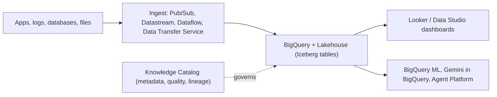

#### BigQuery
A serverless data warehouse: load or stream data, query it with SQL and only think about the data. It includes **BigQuery ML** (train and use models with SQL), AI functions that call Gemini from SQL, vector search, notebooks and **BigQuery Omni** (query data in AWS or Azure). Billing is on-demand (per data scanned) or by capacity (slots).
- **Use it when:** analytics over large data, LLM usage logs, billing exports, training data preparation, batch LLM jobs over tables. **Skip it when:** you need app transactions with many small reads and writes. Use Cloud SQL or Firestore.
- **AWS / Azure:** Amazon Redshift + Athena / Microsoft Fabric (Synapse is the older option).
- **Docs:** https://docs.cloud.google.com/bigquery/docs

#### Looker
An enterprise business-intelligence platform. You define metrics once in a semantic model (LookML) and everyone gets the same numbers in dashboards and through its API. Gemini in Looker answers questions in plain language.
- **Use it when:** a company needs governed dashboards with one trusted definition of "revenue". **Skip it when:** you need a free, quick dashboard. Use Data Studio.
- **AWS / Azure:** Amazon Quick (formerly QuickSight) / Power BI.
- **Docs:** https://docs.cloud.google.com/looker/docs

#### Data Studio (formerly Looker Studio, originally Google Data Studio)
A free, drag-and-drop dashboard and report tool that connects to BigQuery, Google Sheets and hundreds of sources. It was renamed back to Data Studio on 16 Apr 2026. **Data Studio Pro** adds team management.
- **Use it when:** quick charts for a project, cost dashboards from billing export. **Skip it when:** you need governed enterprise metrics. Use Looker.
- **AWS / Azure:** Amazon Quick / Power BI.
- **Docs:** https://docs.cloud.google.com/data-studio

#### Knowledge Catalog (formerly Dataplex Universal Catalog; replaces the RETIRED Data Catalog)
One catalog of your data. It finds tables and files automatically, tracks lineage (where data came from), runs data quality checks, holds a business glossary and offers semantic search. It can also give AI agents context about your data through MCP and the LookupContext API. **Data Catalog** was **discontinued on 30 Jan 2026**.
- **Use it when:** many teams and datasets, governance needs, or grounding data agents. **Skip it when:** you have a handful of tables owned by one person.
- **AWS / Azure:** AWS Glue Data Catalog, SageMaker Catalog / Microsoft Purview.
- **Docs:** https://docs.cloud.google.com/knowledge-catalog/docs (Data Catalog retirement: https://docs.cloud.google.com/data-catalog/docs/release-notes)

#### BigQuery sharing (formerly Analytics Hub)
Share datasets with other teams or companies without copying them. Others subscribe to "listings" in an exchange, and "data clean rooms" allow joint analysis without exposing raw rows.
- **Use it when:** you publish or consume shared datasets. **Skip it when:** sharing inside one project. Plain IAM is enough.
- **AWS / Azure:** AWS Data Exchange, Clean Rooms / Microsoft Fabric external data sharing.
- **Docs:** https://docs.cloud.google.com/bigquery/docs/analytics-hub-introduction

#### Lakehouse (formerly BigLake)
Keeps data in open **Apache Iceberg** tables on Cloud Storage. BigQuery, Spark and other engines can then all read and write the same tables with one set of permissions. BigLake metastore is now the **Lakehouse runtime catalog**.
- **Use it when:** you want open formats and several engines on one copy of the data. **Skip it when:** BigQuery's own storage is all you need. That is simpler.
- **AWS / Azure:** S3 Tables + Lake Formation / OneLake in Microsoft Fabric.
- **Docs:** https://docs.cloud.google.com/lakehouse/docs

**Brief analytics items**

| Product | What it is | AWS / Azure |
|---|---|---|
| [**BigQuery Data Transfer Service**](https://docs.cloud.google.com/bigquery/docs/dts-introduction) | Scheduled, no-code loads into BigQuery from SaaS apps, other clouds and Google ads products. | AppFlow / Data Factory |
| [**BigQuery Migration Service**](https://docs.cloud.google.com/bigquery/docs/migration-intro) | Translates SQL and moves data from other warehouses (Teradata, Redshift, Snowflake...). | AWS SCT / Azure Migrate guides |
| [**Gemini in BigQuery / Looker / Data Studio**](https://docs.cloud.google.com/gemini/docs/bigquery/overview) | AI help that writes and explains SQL and Python, builds charts and data agents. | Amazon Q in QuickSight / Copilot in Fabric and Power BI |
| [**Data Agent Kit**](https://docs.cloud.google.com/data-agent-kit) | Tools to manage datasets, run queries and deploy pipelines from your IDE or CLI, including with AI agents. | none exact |
| [**Dataproc Metastore**](https://docs.cloud.google.com/dataproc-metastore/docs) | Managed Apache Hive metastore (table definitions for Spark and Hive). | AWS Glue Data Catalog / Hive metastore on HDInsight |
| [**Cortex Framework**](https://docs.cloud.google.com/cortex/docs) | Open-source data models and templates for SAP, Salesforce and marketing data in BigQuery. | AWS reference architectures / Fabric templates |
| [**Blockchain Analytics**](https://docs.cloud.google.com/blockchain-analytics/docs) | Indexed public blockchain data ready to query in BigQuery. | Amazon Managed Blockchain Query / none |
| [**Manufacturing Data Engine**](https://docs.cloud.google.com/manufacturing-data-engine/docs) | Connects factory machines to the cloud for analytics and AI. | AWS IoT SiteWise / Azure IoT Operations |
| [**Earth Engine**](https://developers.google.com/earth-engine) | Petabytes of satellite and map data with tools to analyse them (also in [section 18](#18-firebase-maps-media-and-specialised-products)). | Amazon SageMaker geospatial / Microsoft Planetary Computer |

### Which analytics tool should I use?

| Need | Use |
|---|---|
| SQL over big data, LLM logs, cost exports | BigQuery |
| Free charts and reports | Data Studio |
| Company-wide trusted metrics | Looker |
| Find, document, quality-check and govern data | Knowledge Catalog |
| Open Iceberg tables shared by Spark and BigQuery | Lakehouse |
| Share data with another company | BigQuery sharing |
| A quick ML model on table data with only SQL | BigQuery ML |

---

## 8. Data integration and pipelines

**In plain words:** A **data pipeline** moves data from where it is created to where it is used, cleaning and changing it on the way. **Batch** pipelines run on a schedule ("every night"). **Streaming** pipelines handle each event within seconds. **ETL** means extract, transform, load. **CDC (change data capture)** copies every change in a database as it happens. **Orchestration** means running many steps in the right order with retries.

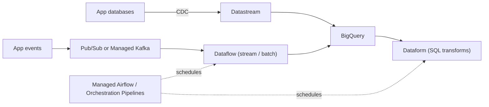

#### Dataflow
A serverless engine for batch and streaming pipelines, based on open-source **Apache Beam**. It autoscales workers for you.
- **Use it when:** you stream events into BigQuery, do large ETL, or generate embeddings over millions of records. **Skip it when:** SQL inside BigQuery can do the work. That is simpler.
- **AWS / Azure:** Amazon Managed Service for Apache Flink, AWS Glue / Azure Stream Analytics, Fabric.
- **Docs:** https://docs.cloud.google.com/dataflow/docs

#### Managed Service for Apache Spark (formerly Dataproc and Serverless for Apache Spark)
Managed Apache Spark and Hadoop, either on clusters or serverless. It was renamed on 3 Apr 2026. The API, `gcloud dataproc` commands and IAM roles are unchanged.
- **Use it when:** you have Spark or PySpark code, data science on big data, or are moving existing Hadoop jobs. **Skip it when:** you are starting fresh with SQL-friendly work. Use BigQuery.
- **AWS / Azure:** Amazon EMR / Azure Databricks, Fabric Spark (HDInsight is the older option).
- **Docs:** https://docs.cloud.google.com/managed-spark/docs (rename note: https://docs.cloud.google.com/dataproc/docs/release-notes)

#### Pub/Sub
A global messaging service: producers publish messages to a topic, and subscribers get them. It is described fully in [section 10](#pubsub-messaging); it is also the usual entry point for streaming data.
- **Docs:** https://docs.cloud.google.com/pubsub/docs

#### Managed Service for Apache Kafka
Managed Apache Kafka clusters (event streaming with replay).
- **Use it when:** your team or tools already use Kafka, or you are moving off **Pub/Sub Lite**. **Skip it when:** you are building new on Google Cloud. Pub/Sub has less to manage.
- **AWS / Azure:** Amazon MSK / Azure Event Hubs (Kafka endpoint).
- **Docs:** https://docs.cloud.google.com/managed-service-for-apache-kafka/docs

#### Managed Service for Apache Airflow (formerly Cloud Composer)
Managed **Apache Airflow** for scheduling and monitoring workflows written as Python DAGs. It was renamed on 15 Apr 2026, and the docs call it "Managed Airflow".
- **Use it when:** you run many data and ML jobs with dependencies ("run step B after A succeeds, every day at 2 AM"). **Skip it when:** you only call a few APIs in a chain. Workflows is lighter and cheaper.
- **AWS / Azure:** Amazon MWAA / Azure Data Factory (with Airflow).
- **Docs:** https://docs.cloud.google.com/composer/docs (rename note: https://docs.cloud.google.com/composer/docs/release-notes)

#### Dataform
Write SQL transformations for BigQuery, keep them in Git, test them and run them in the right order (similar to dbt).
- **Use it when:** you turn raw tables into clean tables in BigQuery. **Skip it when:** you have only one or two scheduled queries.
- **AWS / Azure:** dbt on Redshift / dbt or dataflows on Fabric.
- **Docs:** https://docs.cloud.google.com/dataform/docs

#### Datastream
Serverless change data capture: it copies every insert, update and delete from MySQL, PostgreSQL, Oracle or SQL Server into BigQuery or Cloud Storage in near real time.
- **Use it when:** analytics must be fresh without loading your production database. **Skip it when:** a nightly export is enough.
- **AWS / Azure:** AWS DMS (CDC), zero-ETL integrations / Fabric mirroring, Data Factory CDC.
- **Docs:** https://docs.cloud.google.com/datastream/docs

#### Cloud Data Fusion
A visual, drag-and-drop pipeline builder (based on open-source CDAP) with many connectors.
- **Use it when:** teams that prefer no-code ETL. **Skip it when:** your team writes code or SQL. Dataflow or Dataform give more control.
- **AWS / Azure:** AWS Glue Studio / Azure Data Factory.
- **Docs:** https://docs.cloud.google.com/data-fusion/docs

**Brief:** [**Orchestration Pipelines**](https://docs.cloud.google.com/orchestration-pipelines) is a newer, declarative framework to orchestrate and deploy data and AI pipelines. [**Pub/Sub Lite**](https://docs.cloud.google.com/pubsub/lite/docs) is **DEPRECATED**: no new customers since 24 Sep 2024, and it is turned off on 31 Jan 2027. Move to Pub/Sub or Managed Kafka.

### Which pipeline tool should I use?

| Need | Use |
|---|---|
| Stream app events into BigQuery | Pub/Sub, then a BigQuery subscription (simplest) or Dataflow (if you transform) |
| Copy database changes to BigQuery | Datastream |
| Big batch or streaming transforms in code | Dataflow |
| Existing Spark code | Managed Service for Apache Spark |
| SQL transforms inside BigQuery | Dataform |
| Many scheduled jobs with dependencies | Managed Service for Apache Airflow |
| A few API calls in sequence | Workflows ([section 10](#10-application-integration-messaging-and-apis)) |
| No-code ETL | Cloud Data Fusion |
| Existing Kafka | Managed Service for Apache Kafka |

---

## 9. AI, ML and generative AI

**In plain words:** Google Cloud offers AI at four levels, from easiest to most work:

1. **Ready-made AI apps** for employees and customers: Gemini Enterprise ([section 17](#17-gemini-enterprise-and-workspace-adjacent-products)), Gemini Enterprise for CX.
2. **Pre-trained APIs**: send an image, a PDF or audio and get a result back (Vision, Document AI, Speech, Translation). No ML knowledge needed.
3. **Gemini Enterprise Agent Platform (formerly Vertex AI)**: call Gemini and 200+ other models, and build, deploy, secure and evaluate agents and RAG apps.
4. **Your own models**: training on GPUs or TPUs with Managed Training, GKE or Compute Engine.

**Name change:** On **22 Apr 2026**, Vertex AI became the **Gemini Enterprise Agent Platform** ("Agent Platform"). The API endpoint is still `aiplatform.googleapis.com`, and many old docs links redirect. The **Vertex AI Agent Builder** umbrella was replaced by the platform's own parts: ADK, Agent Studio, Agent Garden, Agent Runtime and Agent Search. The official overview groups the platform into **Build, Scale, Govern and Optimize**.

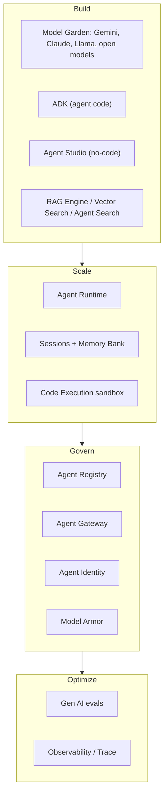

### 9.1 The platform and models

#### Gemini Enterprise Agent Platform (formerly Vertex AI)
Google Cloud's main AI platform. It gives you models through an API, tools to build and run agents, RAG and search, classic ML (training, pipelines, endpoints) and governance, all with Google Cloud security (IAM, VPC Service Controls, data residency, customer-managed keys).
- **Use it when:** you build a production AI app or agent on Google Cloud and need enterprise controls. **Skip it when:** a quick personal prototype. The Gemini Developer API with an API key is simpler.
- **AWS / Azure:** Amazon Bedrock + SageMaker AI + Bedrock AgentCore / Microsoft Foundry + Azure Machine Learning.
- **Docs:** https://docs.cloud.google.com/gemini-enterprise-agent-platform/overview (rename table: https://docs.cloud.google.com/gemini-enterprise-agent-platform/release-notes)

#### Gemini API (two ways to call it)
The API for Google's Gemini models (text, images, audio, video, code, tool calling, long context).
- **Gemini API on Agent Platform:** billed to your Cloud project, uses IAM and service accounts, offers Provisioned Throughput, data residency and enterprise terms. Use it for production on Google Cloud.
- **Gemini Developer API with Google AI Studio:** uses an API key, has a free tier with limits and is the fastest way to start. Use it for learning, hackathons and prototypes.
- Both are called with the same **Google Gen AI SDK** (`google-genai`). One setting switches between them.
- **AWS / Azure:** Bedrock Runtime API / Foundry Models (Azure OpenAI) API.
- **Docs:** https://ai.google.dev/gemini-api/docs (Agent Platform models: https://docs.cloud.google.com/gemini-enterprise-agent-platform/models ; SDK: https://docs.cloud.google.com/gemini-enterprise-agent-platform/models/sdks/overview)

#### Model Garden
A catalog of 200+ models you can try and deploy: Google models (Gemini, Imagen, Veo, Gemma), partner models served as a managed API (for example Anthropic Claude, Meta Llama, Mistral) and open models you can deploy to your own endpoint or GKE.
- **Use it when:** you compare models or want a non-Google model under the same billing and security. **Skip it when:** you already know you only need Gemini.
- **AWS / Azure:** Bedrock model catalog, SageMaker JumpStart / Foundry Models catalog.
- **Docs:** https://docs.cloud.google.com/gemini-enterprise-agent-platform/models/model-garden/explore-models

#### Agent Studio (formerly Vertex AI Studio)
A web console to try prompts, compare models, tune models and build or test agents without code. **Agent Media Studio** (formerly Vertex AI Media Studio) does the same for image, video and audio generation.
- **Use it when:** you experiment with prompts and settings before writing code. **Skip it when:** you are ready to write the agent in code with ADK.
- **AWS / Azure:** Bedrock playgrounds / Foundry portal playgrounds.
- **Docs:** https://docs.cloud.google.com/gemini-enterprise-agent-platform/agent-studio/quickstart

#### Model tuning and Provisioned Throughput
**Tuning** adapts a model to your data (supervised fine-tuning, preference tuning). **Provisioned Throughput** buys reserved model capacity for steady, predictable traffic. The alternative is pay-as-you-go per token.
- **Use it when:** prompting plus RAG is not good enough (tuning), or you have high, steady traffic and need guaranteed capacity (Provisioned Throughput). **Skip it when:** you are a beginner. Start with prompting, RAG and pay-as-you-go.
- **AWS / Azure:** Bedrock custom models, provisioned throughput / Foundry fine-tuning, provisioned deployments (PTU).
- **Docs:** https://docs.cloud.google.com/gemini-enterprise-agent-platform/models/tuning (https://docs.cloud.google.com/gemini-enterprise-agent-platform/models/provisioned-throughput)

### 9.2 Building and running agents

#### Agent Development Kit (ADK)
An open-source framework (Python, Go, Java and TypeScript) for writing agents in code: tools, multi-agent setups, memory, evaluation and the A2A protocol. You can run it anywhere, and it deploys easily to Agent Runtime or Cloud Run.
- **Use it when:** you write agents in code. **Skip it when:** you already use LangGraph, CrewAI or LlamaIndex. Those also run on Agent Runtime.
- **AWS / Azure:** Strands Agents SDK / Microsoft Agent Framework.
- **Docs:** https://adk.dev/ (on Agent Platform: https://docs.cloud.google.com/gemini-enterprise-agent-platform/build/adk)

#### Agent Garden
A library of sample agents and tools that you can copy and adapt.
- **Use it when:** you start a new agent from a working example. **Skip it when:** you need a custom design from scratch.
- **AWS / Azure:** Bedrock AgentCore samples / Foundry agent catalog.
- **Docs:** https://docs.cloud.google.com/gemini-enterprise-agent-platform/build/agent-garden

#### Agent Runtime (formerly Vertex AI Agent Engine)
A managed service that hosts and scales your agent (ADK, LangGraph, LlamaIndex, CrewAI, AG2 or any container). It comes with **Sessions** (conversation history), **Memory Bank** (long-term memories about users) and a **Code Execution** sandbox. The API resource is still called `reasoningEngines`.
- **Use it when:** you want agent hosting with memory and security handled for you. **Skip it when:** your agent is a simple FastAPI app. Cloud Run may be cheaper and familiar.
- **AWS / Azure:** Bedrock AgentCore Runtime + Memory / Foundry Agent Service (hosted agents).
- **Docs:** https://docs.cloud.google.com/gemini-enterprise-agent-platform/build/runtime (Sessions: https://docs.cloud.google.com/gemini-enterprise-agent-platform/scale/sessions ; Memory Bank: https://docs.cloud.google.com/gemini-enterprise-agent-platform/scale/memory-bank)

#### Agent Registry, Agent Gateway and Agent Identity
**Agent Registry** is a catalog of your agents, MCP servers and tools. **Agent Gateway** is a checkpoint that all agent traffic passes through, both in and out (MCP, A2A, REST). It applies IAM policies and Model Armor. **Agent Identity** gives each deployed agent its own identity, so you can grant it least-privilege permissions like any other principal.
- **Use it when:** many agents in a company need control and audit. **Skip it when:** you have one demo agent.
- **AWS / Azure:** AgentCore Gateway, Identity, Registry / Foundry Control Plane, Entra Agent ID.
- **Docs:** https://docs.cloud.google.com/agent-registry/overview (Gateway: https://docs.cloud.google.com/gemini-enterprise-agent-platform/govern/gateways/agent-gateway-overview ; Identity: https://docs.cloud.google.com/gemini-enterprise-agent-platform/scale/runtime/agent-identity)

#### Model Armor
Screens prompts and model responses for prompt injection, jailbreaks, sensitive data, malicious URLs and harmful content. It works with any model, not only Gemini.
- **Use it when:** any user-facing LLM app, especially one with tools or RAG. **Skip it when:** you never do this in production. You may skip it in offline experiments.
- **AWS / Azure:** Bedrock Guardrails / Azure AI Content Safety (Prompt Shields).
- **Docs:** https://docs.cloud.google.com/model-armor/overview

#### Gen AI evals (Gen AI evaluation service)
Measures the quality of model and agent answers with metrics, rubric-based "autoraters" (an LLM acting as judge), multi-turn agent evaluation and user simulation.
- **Use it when:** you compare prompts, models or agent versions before release. **Skip it when:** never fully. Even a small test set helps.
- **AWS / Azure:** Bedrock Evaluations, AgentCore Evaluations / Foundry evaluations.
- **Docs:** https://docs.cloud.google.com/gemini-enterprise-agent-platform/optimize/evaluation/agent-evaluation

### 9.3 Search, RAG and grounding

#### RAG Engine (formerly Vertex AI RAG Engine)
Managed retrieval-augmented generation. It loads files (from Cloud Storage, Drive and others), chunks them, embeds them, stores them in an index and retrieves the best chunks for Gemini.
- **Use it when:** you want RAG without building the pipeline yourself. **Skip it when:** you need full control. Build your own with `pgvector` in AlloyDB or Cloud SQL plus LangChain.
- **AWS / Azure:** Bedrock Knowledge Bases / Foundry IQ (Azure AI Search).
- **Docs:** https://docs.cloud.google.com/gemini-enterprise-agent-platform/build/rag-engine/rag-overview

#### Vector Search and Agent Retrieval (formerly Vertex AI Vector Search / Vector Search 2.0)
A very fast, scalable vector database (Google's ScaNN technology) for semantic search over billions of embeddings, with filters and hybrid (keyword plus vector) search. Vector Search 2.0 is now called **Agent Retrieval**.
- **Use it when:** large-scale semantic search or recommendations. **Skip it when:** you have fewer than a few million vectors. `pgvector` in your existing database is simpler.
- **AWS / Azure:** Amazon S3 Vectors, OpenSearch / Azure AI Search.
- **Docs:** https://docs.cloud.google.com/gemini-enterprise-agent-platform/build/vector-search/overview

#### Agent Search (formerly Vertex AI Search)
Google-quality search over your own websites, documents and databases, out of the box, with answer generation and grounding for agents. Its API is still called Discovery Engine.
- **Use it when:** you want a "search my company documents" box or grounding without tuning a vector pipeline. **Skip it when:** you need custom chunking and ranking logic. Use RAG Engine or your own stack.
- **AWS / Azure:** Amazon Kendra / Azure AI Search.
- **Docs:** https://docs.cloud.google.com/generative-ai-app-builder/docs/introduction

**Brief:** [**Enterprise Knowledge Graph**](https://docs.cloud.google.com/enterprise-knowledge-graph/docs) links records about the same real-world thing across data sources. **Grounding with Google Search** lets Gemini cite fresh web results.

### 9.4 Classic ML on Agent Platform (train, serve, operate)

| Product (former Vertex AI name) | What it is | AWS / Azure |
|---|---|---|
| [**Managed Training**](https://docs.cloud.google.com/gemini-enterprise-agent-platform/machine-learning/training/overview) (Vertex AI Training) | Run your training code in a container on GPUs or TPUs, from one machine to large clusters (Managed Training Clusters). It supports Spot and Flex-start (DWS). | SageMaker AI training, HyperPod / Azure ML jobs |
| [**Agent Platform Inference / Endpoints**](https://docs.cloud.google.com/gemini-enterprise-agent-platform/machine-learning/predictions) (Vertex AI Prediction) | Deploy a model to an autoscaling online endpoint, or run batch predictions. | SageMaker AI endpoints / Azure ML online endpoints |
| [**Agent Platform Pipelines**](https://docs.cloud.google.com/gemini-enterprise-agent-platform/machine-learning/pipelines/introduction) | Run ML workflows (prepare, train, evaluate, deploy) as repeatable pipelines (Kubeflow Pipelines / TFX). | SageMaker Pipelines / Azure ML pipelines |
| [**Feature Store**](https://docs.cloud.google.com/gemini-enterprise-agent-platform/machine-learning/featurestore/latest/overview) | Serve ML features online with low latency, backed by BigQuery. | SageMaker Feature Store / Azure ML managed feature store |
| [**Model Registry**](https://docs.cloud.google.com/gemini-enterprise-agent-platform/machine-learning/model-registry/introduction) | Track model versions and deploy them. | SageMaker Model Registry / Azure ML registry |
| [**Model Monitoring**](https://docs.cloud.google.com/gemini-enterprise-agent-platform/machine-learning/model-monitoring/overview) | Alerts when live input data drifts away from training data. | SageMaker Model Monitor / Azure ML monitoring |
| [**Experiments and Vertex AI TensorBoard**](https://docs.cloud.google.com/gemini-enterprise-agent-platform/machine-learning/experiments/intro-vertex-ai-experiments) | Log and compare training runs and metrics. | SageMaker AI MLflow / Azure ML MLflow |
| [**Agent Platform Workbench**](https://docs.cloud.google.com/gemini-enterprise-agent-platform/notebooks/workbench/introduction) | Managed JupyterLab instances on VMs you configure. | SageMaker Studio / Azure ML compute instances |
| [**Colab Enterprise**](https://docs.cloud.google.com/colab/docs/introduction) | Google Colab notebooks with enterprise security, billed to your project. | SageMaker Studio notebooks / Fabric notebooks |
| [**AutoML**](https://docs.cloud.google.com/gemini-enterprise-agent-platform/machine-learning/tabular-data/overview) | Train a good model on tabular, image or text data without writing model code. | SageMaker Autopilot (Canvas) / Azure ML AutoML |
| [**Neural Architecture Search**](https://docs.cloud.google.com/gemini-enterprise-agent-platform/machine-learning/training/neural-architecture-search/overview) | Automatically searches for better model architectures (advanced, niche). | none exact |
| [**Ray on Agent Platform**](https://docs.cloud.google.com/gemini-enterprise-agent-platform/machine-learning/open-source/ray) | Managed Ray clusters for distributed Python and ML. | Anyscale on AWS / Ray on AKS |
| [**Agent Platform Vision**](https://docs.cloud.google.com/vision-ai/docs) (Vertex AI Vision) | Build apps that analyse video streams (counting, detection) at scale. | Rekognition Video / Azure AI Vision spatial analysis |
| [**Deep Learning Containers**](https://docs.cloud.google.com/deep-learning-containers/docs) | Prebuilt Docker images with ML frameworks and GPU drivers. | AWS Deep Learning Containers / Azure ML curated environments |
| [**TensorFlow Enterprise**](https://docs.cloud.google.com/tensorflow-enterprise/docs) | A supported TensorFlow distribution for Google Cloud. | none exact |

### 9.5 AI chips

#### Cloud TPU
Google's own AI chips (Tensor Processing Units), built for the big matrix maths in neural networks. Current generations include v5e, v5p, **Trillium (v6e)** and **Ironwood (TPU7x)**. They are used through TPU VMs, GKE or Managed Training, and work best with JAX and PyTorch/XLA.
- **Use it when:** large training or high-volume serving where TPU price and performance wins, and your framework supports XLA. **Skip it when:** your code depends on CUDA-only libraries, or you are a beginner. GPUs have wider software support.
- **AWS / Azure:** AWS Trainium and Inferentia / no general rental equivalent (Azure offers GPUs).
- **Docs:** https://docs.cloud.google.com/tpu/docs

GPUs (Cloud GPUs) and AI Hypercomputer are in [section 2](#2-compute).

### 9.6 Pre-trained AI APIs (no ML knowledge needed)

#### Document AI
Turns PDFs, scans and forms into structured data. It offers OCR, form and table extraction, and specialised processors (invoices, IDs and more) or your own custom extractor.
- **Use it when:** you need reliable, auditable extraction from many documents. **Skip it when:** a few documents, where sending the PDF straight to Gemini may be enough.
- **AWS / Azure:** Amazon Textract / Azure Document Intelligence (Content Understanding).
- **Docs:** https://docs.cloud.google.com/document-ai/docs

#### Vision AI (Cloud Vision API)
Labels images, detects objects, faces and landmarks, reads text (OCR) and flags unsafe images.
- **Use it when:** fixed image tasks at scale, at low cost. **Skip it when:** you need open-ended image understanding. Gemini is more flexible.
- **AWS / Azure:** Amazon Rekognition / Azure AI Vision.
- **Docs:** https://docs.cloud.google.com/vision/docs

#### Video Intelligence API
Finds labels, shots, objects, text and explicit content in stored videos.
- **Use it when:** you index or moderate a video library. **Skip it when:** you need question answering about a video. Gemini handles video input.
- **AWS / Azure:** Rekognition Video / Azure AI Video Indexer.
- **Docs:** https://docs.cloud.google.com/video-intelligence/docs

#### Speech-to-Text
Turns audio into text, in batch or streaming, in many languages (Chirp models).
- **Use it when:** call transcripts, captions, voice input. **Skip it when:** you need a real-time voice conversation with an LLM. Gemini Live API may fit better.
- **AWS / Azure:** Amazon Transcribe / Azure AI Speech.
- **Docs:** https://docs.cloud.google.com/speech-to-text/docs

#### Text-to-Speech
Turns text into natural-sounding speech with many voices and languages.
- **Use it when:** voice assistants, audiobooks, accessibility. **Skip it when:** text output is enough.
- **AWS / Azure:** Amazon Polly / Azure AI Speech.
- **Docs:** https://docs.cloud.google.com/text-to-speech/docs

#### Cloud Translation
Machine translation for text and documents. Use glossaries to keep your terms consistent.
- **Use it when:** high-volume, consistent translation. **Skip it when:** you need a rewrite in a certain tone. An LLM may be better.
- **AWS / Azure:** Amazon Translate / Azure Translator.
- **Docs:** https://docs.cloud.google.com/translate/docs

#### Cloud Natural Language API
Finds entities, sentiment, categories and syntax in text.
- **Use it when:** cheap, fixed text classification at scale. **Skip it when:** flexible understanding is needed. Gemini usually does this better now.
- **AWS / Azure:** Amazon Comprehend / Azure AI Language.
- **Docs:** https://docs.cloud.google.com/natural-language/docs

### 9.7 Conversational AI and customer experience (formerly Contact Center AI)

The old **Contact Center AI (CCAI)** family is now spread across these products. Several of them sit under **Gemini Enterprise for CX** (customer experience).

| Product (former name) | What it is | AWS / Azure |
|---|---|---|
| [**Conversational Agents (Dialogflow CX)**](https://docs.cloud.google.com/dialogflow/cx/docs) | Build chat and voice bots that mix designed flows with generative AI. Google's CX product line also calls this "Customer Experience Agent Studio". | Amazon Lex / Microsoft Copilot Studio |
| [**Dialogflow ES**](https://docs.cloud.google.com/dialogflow/es/docs) | The older, simpler bot builder (intents). Prefer Conversational Agents for new bots. | Amazon Lex / Azure AI Bot Service |
| [**Agent Assist**](https://docs.cloud.google.com/gemini-enterprise-cx/agent-assist) | Suggests answers and summaries to human support agents during live calls and chats. | Amazon Q in Connect / Copilot for Dynamics 365 Contact Center |
| [**Customer Experience Insights**](https://docs.cloud.google.com/gemini-enterprise-cx/insights) (CCAI Insights) | Finds topics, sentiment and trends in contact-center conversations. | Contact Lens for Amazon Connect / Dynamics 365 conversation intelligence |
| [**Google Cloud CCaaS**](https://docs.cloud.google.com/contact-center/ccai-platform/docs) (Contact Center AI Platform) | A full cloud contact center: queues, routing, voice and digital channels. | Amazon Connect / Dynamics 365 Contact Center |
| [**AI Commerce Search**](https://docs.cloud.google.com/gemini-enterprise-cx/ai-commerce-search/overview) (Recommendations AI, Retail API, Vertex AI Search for commerce) | Product search, browse and "you may also like" recommendations for online shops. | Amazon Personalize / Azure AI Search + Personalizer (retired) |
| [**Gemini Enterprise for CX**](https://docs.cloud.google.com/gemini-enterprise-cx) | The umbrella for customer-service and commerce agents (Agent Studio for CX, Agent Assist, Insights, commerce agents, AI Commerce Search). | Amazon Connect AI features / Dynamics 365 Contact Center |

### 9.8 Developer frameworks for AI apps (brief)

| Item | What it is | Docs |
|---|---|---|
| **Google Gen AI SDK** (`google-genai`) | One SDK for the Gemini Developer API and Gemini on Agent Platform. The older `vertexai.generative_models` modules are deprecated. | https://ai.google.dev/gemini-api/docs/libraries |
| **Agent Platform SDK** (`google-cloud-aiplatform`, `google-cloud-agentplatform`) | Python SDK for evals, RAG, Agent Runtime and classic ML. | https://docs.cloud.google.com/gemini-enterprise-agent-platform/machine-learning/python-sdk/sdk-migration |
| **Genkit** | Open-source framework (TypeScript, Go, Dart, Python) for AI features in apps: flows, tools, RAG, evals. | https://genkit.dev/docs/overview/ |
| **Firebase AI Logic** | Call Gemini directly from mobile and web apps, with App Check protection. | https://firebase.google.com/docs/ai-logic |
| **Google Cloud MCP servers** | Google-run MCP servers so agents can use BigQuery, GKE and other services as tools. | https://docs.cloud.google.com/mcp |

### Which AI option should I use?

| Your goal | Use | Why |
|---|---|---|
| Learn and prototype with Gemini quickly | **Gemini Developer API + Google AI Studio** | API key, free tier, minutes to start |
| Production AI app on Google Cloud | **Gemini on Agent Platform** (same `google-genai` SDK) | IAM, quotas, data controls, billing in one place |
| Use Claude, Llama or open models with Google billing | **Model Garden** | One platform, many models |
| Extract fields from invoices or forms | **Document AI** | Structured, auditable output |
| Simple fixed tasks: OCR, translation, speech | **Pre-trained APIs** | Cheap and predictable |
| Open-ended understanding of images, video or audio | **Gemini** | Flexible, one model |
| Company document search with little effort | **Agent Search** | Ready-made |
| Custom RAG pipeline, managed | **RAG Engine** | Less code than DIY |
| Vectors next to your app data | **AlloyDB / Cloud SQL with pgvector** | No extra system |
| Billions of vectors | **Vector Search** | Built for scale |
| Host an agent with memory and governance | **ADK + Agent Runtime** | Managed sessions, memory, identity |
| Host a simple agent API you control | **Cloud Run** | Cheap, familiar |
| Guard prompts and outputs | **Model Armor** | Any model |
| Train your own model | **Managed Training** (GPU or TPU), or GKE for full control | Managed clusters |
| Employees want an AI assistant over company apps | **Gemini Enterprise** ([section 17](#17-gemini-enterprise-and-workspace-adjacent-products)) | A finished app, no coding |

---

## 10. Application integration, messaging and APIs

**In plain words:** Real apps are made of parts that talk to each other. **Messaging** lets one part drop a message and move on while another part handles it later. This keeps your web app fast when an LLM call or a PDF parse takes 30 seconds. **Events** announce "something happened" (a file was uploaded). **Workflows** chain steps with retries. **API management** puts a front door with keys, quotas and analytics in front of your APIs.

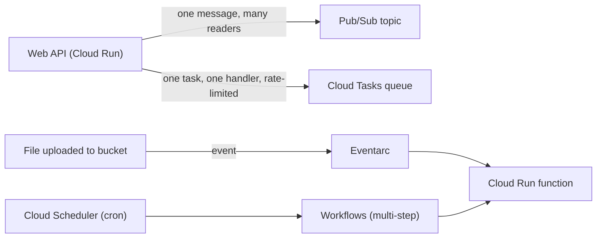

#### Pub/Sub (messaging)
Global publish-subscribe messaging. Publishers send messages to a **topic**, and each **subscription** gets a copy (pull or push). Messages can go straight into BigQuery or Cloud Storage.
- **Use it when:** you decouple services, fan events out to many consumers, or stream data. **Skip it when:** you need one rate-limited call to one HTTP handler. Use Cloud Tasks.
- **AWS / Azure:** Amazon SNS + SQS, Kinesis / Azure Service Bus, Event Hubs.
- **Docs:** https://docs.cloud.google.com/pubsub/docs/overview

#### Cloud Tasks
A queue of HTTP tasks. Each task is delivered to one handler, with rate limits, retries and scheduled delivery.
- **Use it when:** background jobs from a web app, such as "summarise this document", where you limit calls to an LLM API to N per second. **Skip it when:** many consumers need the same message. Use Pub/Sub.
- **AWS / Azure:** Amazon SQS / Azure Queue Storage, Service Bus queues.
- **Docs:** https://docs.cloud.google.com/tasks/docs

#### Eventarc (Standard and Advanced)
Routes events from Google Cloud services, SaaS apps and your own apps to Cloud Run, functions, Workflows or GKE. **Advanced** adds filtering, transformation and a central message bus.
- **Use it when:** "when X happens anywhere in my project, run Y". **Skip it when:** you only publish your own app messages. Pub/Sub directly is enough.
- **AWS / Azure:** Amazon EventBridge / Azure Event Grid.
- **Docs:** https://docs.cloud.google.com/eventarc/docs

#### Workflows
Serverless orchestration. You write steps in YAML or JSON that call APIs and services in order, with retries, waits, branches and parallel steps. You pay per step.
- **Use it when:** a document pipeline (upload, OCR, Gemini, save, notify), or calling several APIs in sequence. **Skip it when:** heavy data jobs with many dependencies. Use Managed Airflow.
- **AWS / Azure:** AWS Step Functions / Azure Logic Apps, Durable Functions.
- **Docs:** https://docs.cloud.google.com/workflows/docs

#### Cloud Scheduler
A managed cron. It calls an HTTP endpoint, publishes to Pub/Sub or starts a workflow on a schedule.
- **Use it when:** nightly re-indexing, hourly reports, a weekly cleanup. **Skip it when:** a task must happen right after an event. Use Eventarc or Pub/Sub.
- **AWS / Azure:** Amazon EventBridge Scheduler / Logic Apps recurrence, Functions timer trigger.
- **Docs:** https://docs.cloud.google.com/scheduler/docs

#### Application Integration
A low-code, drag-and-drop tool to connect business apps (Salesforce, SAP, databases) and automate processes.
- **Use it when:** business teams automate processes across SaaS apps. **Skip it when:** developers who prefer code can use Workflows or Cloud Run.
- **AWS / Azure:** Amazon AppFlow, Step Functions / Azure Logic Apps.
- **Docs:** https://docs.cloud.google.com/application-integration/docs

#### Integration Connectors
Ready-made, managed connectors to 100+ apps and databases. They are used by Application Integration, Apigee and agents.
- **Use it when:** you need a reliable connection to an enterprise system without writing the client yourself. **Skip it when:** you need one simple REST call.
- **AWS / Azure:** AppFlow connectors / Logic Apps connectors.
- **Docs:** https://docs.cloud.google.com/integration-connectors/docs

#### Apigee (and Apigee hybrid)
Full API management. It adds keys, OAuth, quotas, monetisation, analytics, a developer portal, and security for AI and MCP traffic. **Apigee hybrid** runs the runtime in your own data center or another cloud.
- **Use it when:** a company publishes many APIs to partners or the public, or needs to govern LLM and API traffic. **Skip it when:** one simple API. Use API Gateway, or plain Cloud Run with auth.
- **AWS / Azure:** Amazon API Gateway (with usage plans) / Azure API Management.
- **Docs:** https://docs.cloud.google.com/apigee/docs (hybrid: https://docs.cloud.google.com/apigee/docs/hybrid/latest/what-is-hybrid)

#### API Gateway
A lightweight, serverless gateway with API keys, auth and quotas in front of Cloud Run, functions or App Engine, defined by an OpenAPI spec.
- **Use it when:** a small public API needs keys and quotas. **Skip it when:** you need enterprise analytics or monetisation. Use Apigee.
- **AWS / Azure:** Amazon API Gateway / Azure API Management (Consumption tier).
- **Docs:** https://docs.cloud.google.com/api-gateway/docs

**Brief:** [**Cloud Endpoints**](https://docs.cloud.google.com/endpoints/docs) is the older API management option based on a proxy (ESPv2). Prefer API Gateway or Apigee for new work. [**API keys**](https://docs.cloud.google.com/docs/authentication/api-keys) are simple keys for public APIs. Restrict each key to specific APIs and apps.

### Which integration tool should I use?

| Need | Use |
|---|---|
| Fan out one event to many services, or stream data | **Pub/Sub** |
| Run one background HTTP job per item, with a rate limit | **Cloud Tasks** |
| React to "something happened" in Google Cloud or SaaS | **Eventarc** |
| A few steps in order with retries and waits | **Workflows** |
| Large data jobs with many dependencies | **Managed Service for Apache Airflow** ([section 8](#8-data-integration-and-pipelines)) |
| Run something on a timer | **Cloud Scheduler** |
| Low-code business automation | **Application Integration + Integration Connectors** |
| Front door for one API | **API Gateway** |
| Many APIs, partners, monetisation, AI traffic policies | **Apigee** |

---

## 11. Networking and content delivery

**In plain words:** Networking connects your resources to each other, to the internet and to your office. A **VPC** is your private network in Google Cloud. **Load balancers** spread users across copies of your app. A **CDN** keeps copies of files close to users. **DNS** turns names like `app.example.com` into addresses. **VPN and Interconnect** link your office or other clouds. Google's VPC is **global**: one network can have subnets in every region.

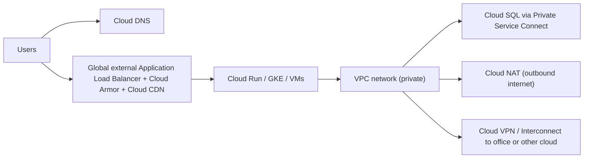

#### Virtual Private Cloud (VPC)
Your private, global network in Google Cloud, with regional subnets, firewall rules and routes. Shared VPC lets one network serve many projects.
- **Use it when:** you have VMs, GKE or private databases. You always have one. **Skip it when:** never fully, but simple Cloud Run apps can mostly ignore it.
- **AWS / Azure:** Amazon VPC (regional) / Azure Virtual Network (regional).
- **Docs:** https://docs.cloud.google.com/vpc/docs

#### Cloud Load Balancing
Managed load balancers that spread traffic across healthy backends. They range from global HTTP(S) (one IP address for the whole world) to regional and internal ones, for HTTP, TCP and UDP.
- **Use it when:** you need custom domains with Cloud Armor and CDN, multi-region apps, or many VMs or GKE services. **Skip it when:** a single Cloud Run service. It already has an HTTPS URL, and Cloud Run can map a domain directly.
- **AWS / Azure:** Elastic Load Balancing (ALB/NLB) + Global Accelerator / Azure Front Door, Application Gateway, Azure Load Balancer.
- **Docs:** https://docs.cloud.google.com/load-balancing/docs

#### Cloud CDN
Caches your static and cacheable content at Google's edge locations near users, through the external load balancer.
- **Use it when:** a global audience, images, JavaScript bundles, downloads. **Skip it when:** every response is unique and personal (like most LLM answers).
- **AWS / Azure:** Amazon CloudFront / Azure Front Door.
- **Docs:** https://docs.cloud.google.com/cdn/docs

#### Cloud DNS
Managed, fast DNS (public and private zones).
- **Use it when:** you host your domain's records on Google Cloud, or need private names inside a VPC. **Skip it when:** your registrar's DNS is fine for a hobby site.
- **AWS / Azure:** Amazon Route 53 / Azure DNS.
- **Docs:** https://docs.cloud.google.com/dns/docs

#### Cloud NAT
Lets private VMs and services reach the internet (outbound only) without public IP addresses.
- **Use it when:** private GKE nodes or VMs must download packages or call external APIs. **Skip it when:** you have no private resources.
- **AWS / Azure:** NAT Gateway / Azure NAT Gateway.
- **Docs:** https://docs.cloud.google.com/nat/docs

#### Cloud Router
Exchanges routes automatically (BGP) between your VPC and your other networks. It is used with VPN, Interconnect and NAT.
- **Use it when:** hybrid connections. **Skip it when:** you are cloud-only.
- **AWS / Azure:** BGP on Virtual Private Gateway or Transit Gateway / Azure Route Server.
- **Docs:** https://docs.cloud.google.com/network-connectivity/docs/router

#### Cloud VPN
Encrypted IPsec tunnels over the internet between your VPC and your office or another cloud. HA VPN offers a 99.99% SLA.
- **Use it when:** secure hybrid connectivity at moderate speed. **Skip it when:** you need very high bandwidth or steady low latency. Use Interconnect.
- **AWS / Azure:** AWS Site-to-Site VPN / Azure VPN Gateway.
- **Docs:** https://docs.cloud.google.com/network-connectivity/docs/vpn

#### Cloud Interconnect
Private, high-bandwidth physical links to Google: **Dedicated**, **Partner**, and **Cross-Cloud Interconnect** to other clouds.
- **Use it when:** large, steady hybrid or multicloud traffic. **Skip it when:** the traffic is small. VPN is cheaper.
- **AWS / Azure:** AWS Direct Connect / Azure ExpressRoute.
- **Docs:** https://docs.cloud.google.com/network-connectivity/docs/interconnect

#### Network Connectivity Center
A hub-and-spoke manager that connects many VPCs, VPNs, Interconnects and sites in one place.
- **Use it when:** large companies with many networks. **Skip it when:** you have one or two VPCs.
- **AWS / Azure:** AWS Transit Gateway, Cloud WAN / Azure Virtual WAN.
- **Docs:** https://docs.cloud.google.com/network-connectivity/docs/network-connectivity-center

#### Private Service Connect
Reach Google APIs, managed services (Cloud SQL, AlloyDB, Agent Platform endpoints) or partner services through a private IP address inside your VPC.
- **Use it when:** traffic must never cross the public internet. **Skip it when:** a hobby app with public endpoints and IAM.
- **AWS / Azure:** AWS PrivateLink / Azure Private Link.
- **Docs:** https://docs.cloud.google.com/vpc/docs/private-service-connect

#### Cloud Armor
A web application firewall (WAF) plus DDoS protection at the load balancer. It has OWASP rules, rate limiting, bot management and adaptive protection.
- **Use it when:** any public app behind a load balancer, especially an LLM app that attackers may flood. **Skip it when:** you have no external load balancer.
- **AWS / Azure:** AWS WAF + Shield / Azure WAF + DDoS Protection.
- **Docs:** https://docs.cloud.google.com/armor/docs

#### Service Directory
A registry where services publish their names and addresses so other services can find them, across VMs, GKE and on-premises.
- **Use it when:** service discovery across mixed environments. **Skip it when:** Kubernetes DNS or Cloud Run URLs already solve it.
- **AWS / Azure:** AWS Cloud Map / no direct match (Azure DNS private zones).
- **Docs:** https://docs.cloud.google.com/service-directory/docs

#### Traffic Director (now part of Cloud Service Mesh)
It was the managed control plane for Envoy-based service meshes. Former users are now on Cloud Service Mesh's managed control plane. See [Cloud Service Mesh](#cloud-service-mesh-includes-the-former-traffic-director).
- **Docs:** https://docs.cloud.google.com/service-mesh/docs

**Brief networking items**

| Product | What it is | AWS / Azure |
|---|---|---|
| [**Media CDN**](https://docs.cloud.google.com/media-cdn/docs) | CDN built for streaming video and very large downloads. | CloudFront / Azure Front Door |
| [**Cloud Domains**](https://docs.cloud.google.com/domains/docs) | Register and manage domain names. | Route 53 Domains / App Service domains |
| [**Network Service Tiers**](https://docs.cloud.google.com/network-tiers/docs) | Premium (Google's global network) or Standard (cheaper, public internet) routing. | none exact / Azure routing preference |
| [**Service Extensions**](https://docs.cloud.google.com/service-extensions/docs) | Run your own code (plugins or callouts) inside load balancer traffic. | CloudFront Functions, Lambda@Edge / Front Door rules engine |
| [**Network Intelligence Center**](https://docs.cloud.google.com/network-intelligence-center/docs) | Network topology, connectivity tests and performance views. | VPC Reachability Analyzer / Azure Network Watcher |
| [**VPC Flow Logs, Firewall Rules Logging, Packet Mirroring**](https://docs.cloud.google.com/vpc/docs/flow-logs) | Records of network flows, firewall decisions and copied packets for troubleshooting and security. | VPC Flow Logs, Traffic Mirroring / NSG and VNet flow logs |
| [**CDN Interconnect**](https://docs.cloud.google.com/network-connectivity/docs/interconnect) | Cheaper egress to partner CDNs over direct links. | none exact |
| [**Cloud Number Registry**](https://docs.cloud.google.com/number-registry) | Plans and tracks IP address ranges. | Amazon VPC IPAM / Azure Virtual Network Manager IPAM |
| [**Data Transfer Essentials**](https://docs.cloud.google.com/data-transfer-essentials/docs) | A low-cost option for data moved between Google Cloud and other clouds, for multicloud setups. | none exact |
| [**Cloud Location Finder**](https://docs.cloud.google.com/location-finder/docs) | Finds cloud regions and zones (Google and others) near a place. | none exact |

### Which networking product should I use?

| Need | Use |
|---|---|
| Put one Cloud Run app online with HTTPS | Nothing extra (built-in URL, or Cloud Run domain mapping) |
| Custom domain + WAF + CDN for a production app | External Application Load Balancer + Cloud Armor + Cloud CDN + Certificate Manager |
| Private database access from Cloud Run | Private Service Connect or Direct VPC egress + private IP |
| Private servers calling the internet | Cloud NAT |
| Link office to cloud | Cloud VPN (start) then Cloud Interconnect (scale) |
| Many networks and sites | Network Connectivity Center |
| Service-to-service security across many microservices | Cloud Service Mesh |

---

## 12. Security, identity and compliance

**In plain words:** Security answers three questions. **Who are you?** (identity). **What may you do?** (IAM permissions). **Is the data and traffic protected?** (keys, secrets, firewalls, scanning). The golden rules for beginners: give every app its own **service account** with the **fewest permissions** it needs. Keep **API keys and passwords in Secret Manager**, not in code. Never download service account key files when you can avoid it. Use **Workload Identity Federation** for CI and other clouds instead.

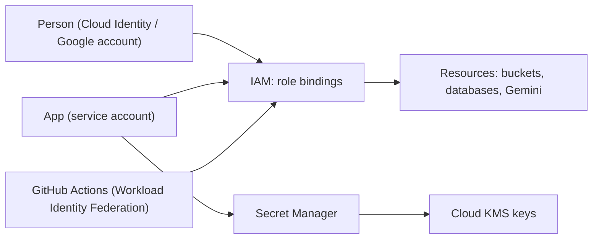

#### Identity and Access Management (IAM)
Controls who (users, groups, service accounts, agents) can do what on which resource, through **roles** granted in **policies**. It includes **service accounts**, **Workload Identity Federation** (key-free access from GitHub, AWS, Azure or Kubernetes), deny policies and conditions.
- **Use it when:** always. Every request is checked by IAM. Grant predefined roles to groups, not individuals, and avoid broad roles like Owner and Editor.
- **AWS / Azure:** AWS IAM / Microsoft Entra ID + Azure RBAC.
- **Docs:** https://docs.cloud.google.com/iam/docs

#### Cloud Identity
Manages the people in your company: user accounts, groups, single sign-on, 2-step verification and device management. Workspace customers already have it.
- **Use it when:** a company needs managed accounts for Google Cloud without Gmail. **Skip it when:** you are a solo learner with a personal Google account.
- **AWS / Azure:** AWS IAM Identity Center / Microsoft Entra ID.
- **Docs:** https://docs.cloud.google.com/identity/docs

#### Identity Platform
Adds sign-up and login to **your app** for your customers: email and password, Google and social logins, SAML/OIDC, multi-factor. It is the enterprise version of Firebase Authentication.
- **Use it when:** your app has user accounts. **Skip it when:** the app is internal only. Use IAP.
- **AWS / Azure:** Amazon Cognito / Microsoft Entra External ID.
- **Docs:** https://docs.cloud.google.com/identity-platform/docs

#### Cloud Key Management Service (Cloud KMS)
Create and control encryption keys (customer-managed encryption keys, CMEK) for storage, databases and AI services, with **Cloud HSM** (hardware-protected keys) and **Cloud EKM** (keys held outside Google).
- **Use it when:** compliance requires you to control or rotate keys. **Skip it when:** you have no such rule. Google encrypts all data at rest by default.
- **AWS / Azure:** AWS KMS, CloudHSM / Azure Key Vault, Managed HSM.
- **Docs:** https://docs.cloud.google.com/kms/docs

#### Secret Manager
Stores API keys, passwords and certificates safely, with versions, IAM access and audit logs. Cloud Run can mount secrets as environment variables or files.
- **Use it when:** always, for your LLM API keys, database passwords and webhook secrets. **Skip it when:** never put secrets in code, images or plain environment files.
- **AWS / Azure:** AWS Secrets Manager / Azure Key Vault.
- **Docs:** https://docs.cloud.google.com/secret-manager/docs

#### Security Command Center
A central security dashboard. It finds misconfigurations, vulnerabilities, threats and risky exposed resources (including AI workloads) and ranks them by risk.
- **Use it when:** any organization with real workloads. The Standard tier is a free starting point. **Skip it when:** a single throwaway learning project.
- **AWS / Azure:** AWS Security Hub + GuardDuty / Microsoft Defender for Cloud.
- **Docs:** https://docs.cloud.google.com/security-command-center/docs

#### Google Security Operations (formerly Chronicle)
A cloud SIEM and SOAR. It collects security logs from everywhere, detects threats and automates responses for a security team.
- **Use it when:** a company has a security operations team. **Skip it when:** a small project. Cloud Logging and Security Command Center are enough.
- **AWS / Azure:** Amazon Security Lake + partner SIEM / Microsoft Sentinel.
- **Docs:** https://docs.cloud.google.com/chronicle/docs

#### Chrome Enterprise Premium (formerly BeyondCorp Enterprise)
Zero-trust access. Employees reach internal apps based on who they are and the state of their device, not on being "inside the network". It adds data loss prevention and threat protection in Chrome.
- **Use it when:** you replace a corporate VPN for staff access to internal apps. **Skip it when:** you have one internal tool. **Identity-Aware Proxy (IAP)** alone may be enough.
- **AWS / Azure:** AWS Verified Access / Microsoft Entra Private Access, Conditional Access.
- **Docs:** https://docs.cloud.google.com/chrome-enterprise-premium/docs/overview

#### Identity-Aware Proxy (IAP)
Puts a Google login in front of an app or VM, so only allowed users or groups can open it. You do not need a VPN.
- **Use it when:** internal admin dashboards, a Streamlit demo for your team only, SSH to VMs without public IPs. **Skip it when:** the app is public.
- **AWS / Azure:** AWS Verified Access / Entra application proxy.
- **Docs:** https://docs.cloud.google.com/iap/docs

#### Sensitive Data Protection (formerly Cloud DLP)
Finds and masks sensitive data (names, card numbers, IDs) in storage, BigQuery, text and images. It can also de-identify data before it goes to an LLM.
- **Use it when:** you clean training data or logs, or redact personal data in prompts. **Skip it when:** you hold no personal data at all.
- **AWS / Azure:** Amazon Macie / Microsoft Purview.
- **Docs:** https://docs.cloud.google.com/sensitive-data-protection/docs

#### Web Risk
Checks URLs against Google's lists of unsafe (phishing, malware) sites.
- **Use it when:** your app shows user-submitted or LLM-generated links. **Skip it when:** you show no external links.
- **AWS / Azure:** none exact / none exact (Microsoft Defender SmartScreen).
- **Docs:** https://docs.cloud.google.com/web-risk/docs

#### Certificate Authority Service
Runs your own **private** certificate authority to issue TLS certificates for internal services and devices.
- **Use it when:** mTLS between internal services, or device certificates. **Skip it when:** you only need public HTTPS certificates. Use Certificate Manager.
- **AWS / Azure:** AWS Private CA / Key Vault certificates with partner CAs.
- **Docs:** https://docs.cloud.google.com/certificate-authority-service/docs

#### Binary Authorization
Only lets **trusted, signed container images** run on GKE or Cloud Run.
- **Use it when:** supply-chain security rules ("only images built by our CI may run"). **Skip it when:** early learning projects.
- **AWS / Azure:** ECR image signing + admission policies / Azure Policy image integrity for AKS.
- **Docs:** https://docs.cloud.google.com/binary-authorization/docs

#### Assured Workloads
Sets up folders with controls for regulated work: data location, personnel and encryption rules for standards such as FedRAMP, IL4 or EU sovereignty.
- **Use it when:** government, healthcare or finance compliance. **Skip it when:** you have no regulatory need.
- **AWS / Azure:** AWS GovCloud, European Sovereign Cloud / Azure Government, sovereign landing zones.
- **Docs:** https://docs.cloud.google.com/assured-workloads/docs

#### Access Transparency (and Access Approval)
**Access Transparency** logs when Google staff access your content and why. **Access Approval** requires your approval before they can.
- **Use it when:** strict compliance or audit needs. **Skip it when:** you have no such requirement.
- **AWS / Azure:** none exact / Customer Lockbox.
- **Docs:** https://docs.cloud.google.com/assured-workloads/access-transparency/docs (Access Approval: https://docs.cloud.google.com/assured-workloads/access-approval/docs)

#### Cloud Audit Logs
Automatic records of who did what and when on your resources: admin actions, data access and policy changes.
- **Use it when:** always on. Use it for investigations and compliance. Data-access logs are optional and can be costly at volume.
- **AWS / Azure:** AWS CloudTrail / Azure Activity Log.
- **Docs:** https://docs.cloud.google.com/logging/docs/audit

#### Cloud Asset Inventory
A searchable list and history of every resource and IAM policy in your organization.
- **Use it when:** "which buckets are public?", "who has Owner?", or exports for audits. **Skip it when:** you have one small project.
- **AWS / Azure:** AWS Config / Azure Resource Graph.
- **Docs:** https://docs.cloud.google.com/asset-inventory/docs

**Brief security items**

| Product | What it is | AWS / Azure |
|---|---|---|
| [**Model Armor**](https://docs.cloud.google.com/model-armor/overview) | Prompt and response screening for LLM apps (see [section 9](#model-armor)). | Bedrock Guardrails / Azure AI Content Safety |
| [**Google Cloud Fraud Defense**](https://docs.cloud.google.com/recaptcha/docs) (includes reCAPTCHA, formerly reCAPTCHA Enterprise) | Stops bots, fake sign-ups, spam and fraud on websites and apps. | AWS WAF Bot and Fraud Control / Front Door WAF bot protection |
| [**Cloud Next Generation Firewall (Cloud NGFW)**](https://docs.cloud.google.com/firewall/docs) | VPC firewall rules and policies, with optional threat inspection. | Security groups, AWS Network Firewall / NSGs, Azure Firewall |
| [**Cloud IDS**](https://docs.cloud.google.com/intrusion-detection-system/docs) | Network intrusion detection (malware, exploits). | Network Firewall IPS / Azure Firewall Premium IDPS |
| [**Secure Web Proxy**](https://docs.cloud.google.com/secure-web-proxy/docs) | Controls and logs outbound web traffic from your workloads. | Network Firewall / Azure Firewall |
| [**VPC Service Controls**](https://docs.cloud.google.com/vpc-service-controls/docs) | A security perimeter that stops data being copied out of chosen services (BigQuery, Storage, Agent Platform) even with stolen credentials. | VPC endpoint policies + RCPs / Azure network security perimeter |
| [**Access Context Manager**](https://docs.cloud.google.com/access-context-manager/docs) | Defines access levels (IP, device, location) used by VPC-SC and IAP. | IAM conditions / Entra Conditional Access |
| [**Certificate Manager**](https://docs.cloud.google.com/certificate-manager/docs) | Gets and renews public TLS certificates for load balancers. | AWS Certificate Manager / Key Vault, App Service certificates |
| [**Artifact Analysis**](https://docs.cloud.google.com/artifact-analysis/docs) | Scans container images and packages for known vulnerabilities. | Amazon Inspector / Defender for Containers |
| [**Software supply chain security**](https://docs.cloud.google.com/software-supply-chain-security/docs), [**Assured OSS**](https://docs.cloud.google.com/assured-open-source-software/docs) | Tools for secure builds (provenance, SLSA) and Google-vetted open-source packages. | AWS Signer, CodeArtifact / Azure Artifacts, Defender DevOps |
| [**Confidential Computing**](https://docs.cloud.google.com/confidential-computing/docs) (Confidential VM, GKE, Space) | Keeps data encrypted even while it is being processed in memory. | Nitro Enclaves / Azure confidential computing |
| [**Shielded VM**](https://docs.cloud.google.com/compute/shielded-vm/docs) | Verified boot that protects against rootkits. | Nitro / Trusted Launch |
| [**Organization Policy Service**](https://docs.cloud.google.com/resource-manager/docs/organization-policy/overview) | Org-wide guardrails, such as "no public buckets" or "only EU regions". | Service Control Policies / Azure Policy |
| [**Policy Intelligence**](https://docs.cloud.google.com/policy-intelligence/docs) (IAM Recommender, Policy Analyzer, Policy Troubleshooter) | Finds excess permissions and explains why access is allowed or denied. | IAM Access Analyzer / Entra access reviews |
| [**Managed Service for Microsoft Active Directory**](https://docs.cloud.google.com/managed-microsoft-ad/docs) | A managed Windows Active Directory. | AWS Directory Service / Entra Domain Services |
| [**Google Threat Intelligence**](https://gtidocs.virustotal.com/) | Mandiant and VirusTotal threat data about who targets you. | none exact / Defender Threat Intelligence |
| [**Audit Manager**](https://docs.cloud.google.com/audit-manager/docs) | Checks and reports compliance with frameworks. | AWS Audit Manager / Defender regulatory compliance |
| [**Advisory Notifications**](https://docs.cloud.google.com/advisory-notifications/docs) | Security and privacy notices from Google about your environment. | AWS Health / Azure Service Health |
| [**Titan Security Keys**](https://cloud.google.com/security/products/titan-security-key) | Phishing-resistant hardware keys for 2-step login. | Any FIDO2 key |
| [**Endpoint Verification**](https://docs.cloud.google.com/endpoint-verification/docs) | Checks the devices that access company data. | Intune / Intune |
| [**Risk Protection Program**](https://cloud.google.com/security/products/risk-protection-program), **Cyber Insurance Hub** | Security posture reports shared with cyber-insurance partners. | none exact |
| [**Sovereign Controls by Partners**](https://docs.cloud.google.com/sovereign-controls-by-partners/docs) | Sovereignty controls operated with local partners. | AWS European Sovereign Cloud / Microsoft Cloud for Sovereignty |
| [**Secure Access Connect**](https://docs.cloud.google.com/secure-access-connect/docs), [**Network Security Integration**](https://docs.cloud.google.com/network-security-integration/docs) | Connect partner security services and appliances to your Google Cloud networks. | Gateway Load Balancer / Azure Firewall integrations |

### Which security tool should I use?

| Need | Use |
|---|---|
| Give my app permission to read a bucket | IAM role on a **service account** |
| GitHub Actions deploys without key files | **Workload Identity Federation** |
| Store an LLM API key | **Secret Manager** |
| Login for my app's users | **Identity Platform** (or Firebase Authentication) |
| Login for my team only, in front of a demo | **IAP** |
| Block attacks and floods on my public app | **Cloud Armor** + **Fraud Defense** |
| Screen prompts for injection and data leaks | **Model Armor** (+ Sensitive Data Protection) |
| Find risky settings across projects | **Security Command Center** |
| Stop data being copied out | **VPC Service Controls** |
| Org-wide rules (regions, no public IPs) | **Organization Policy Service** |
| Prove who did what | **Cloud Audit Logs** |

---

## 13. Management, operations and observability

**In plain words:** Once your app is live, you need to know whether it is healthy. Observability has three pillars. **Metrics** are numbers over time ("p95 latency is 2 s"), handled by Cloud Monitoring. **Logs** are text records of events ("request failed: timeout"), handled by Cloud Logging. **Traces** follow one request through every service ("the slow part was the vector search call"), handled by Cloud Trace. Together they are called **Google Cloud Observability** (formerly Stackdriver, then Operations Suite). Management tools organise projects, create infrastructure from code and suggest savings.

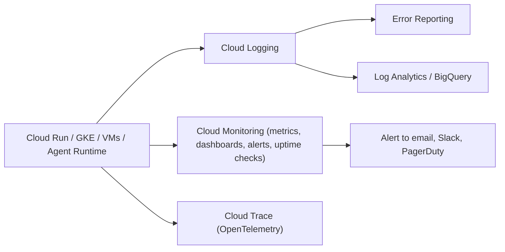

#### Cloud Monitoring
Collects metrics from Google Cloud services and your apps. It offers dashboards, uptime checks, SLOs and **alerting**, and includes **Managed Service for Prometheus**.
- **Use it when:** always for production. Alert on error rate, latency, GPU use and LLM token spend. **Skip it when:** never fully. At least set an uptime check and an error alert.
- **AWS / Azure:** Amazon CloudWatch / Azure Monitor.
- **Docs:** https://docs.cloud.google.com/monitoring/docs

#### Cloud Logging
Stores, searches and analyses logs from every service, routes them with "sinks", and runs SQL over them with **Log Analytics**.
- **Use it when:** always. Print structured JSON logs from your app (request id, model, tokens, latency). **Skip it when:** never fully, but watch the volume. Very chatty logs cost money, so use exclusion filters.
- **AWS / Azure:** CloudWatch Logs / Azure Monitor Logs (Log Analytics).
- **Docs:** https://docs.cloud.google.com/logging/docs

#### Cloud Trace
Distributed tracing: it shows how long each step of a request took across services. It accepts OpenTelemetry data, and agent frameworks (ADK, Agent Runtime) can send traces to it.
- **Use it when:** you debug slow requests in a multi-step RAG or agent pipeline. **Skip it when:** a single small service whose logs already tell you enough.
- **AWS / Azure:** AWS X-Ray (CloudWatch Application Signals) / Application Insights.
- **Docs:** https://docs.cloud.google.com/trace/docs

#### Error Reporting
Groups similar crashes and exceptions from your logs and notifies you about new ones.
- **Use it when:** any app. It works automatically from logged stack traces. **Skip it when:** you already use Sentry or a similar tool.
- **AWS / Azure:** CloudWatch Application Signals / Application Insights failures.
- **Docs:** https://docs.cloud.google.com/error-reporting/docs

#### Cloud Profiler
Low-overhead, always-on CPU and memory profiling of production code, showing which functions use the most resources.
- **Use it when:** you need to cut CPU cost or fix memory leaks. **Skip it when:** the app is small and cheap.
- **AWS / Azure:** CodeGuru Profiler / Application Insights Profiler.
- **Docs:** https://docs.cloud.google.com/profiler/docs

#### Resource Manager
Manages the organization, folders and projects hierarchy, plus tags and labels used for policy and cost reporting.
- **Use it when:** you split work into dev and prod projects and label everything (`team`, `env`, `app`) for cost reports. **Skip it when:** never. Every project uses it.
- **AWS / Azure:** AWS Organizations / Management groups, subscriptions and resource groups.
- **Docs:** https://docs.cloud.google.com/resource-manager/docs

#### Recommender and Active Assist
**Recommender** generates recommendations, such as resizing an idle VM, deleting an unused IP or removing excess IAM roles. **Active Assist** is the family of tools that shows them (cost, security, performance, sustainability).
- **Use it when:** you review recommendations monthly. It is free money and better security. **Skip it when:** never. Just read them.
- **AWS / Azure:** AWS Trusted Advisor, Compute Optimizer / Azure Advisor.
- **Docs:** https://docs.cloud.google.com/recommender/docs/overview

#### Infrastructure Manager (replaces Cloud Deployment Manager)
Google's managed way to run **Terraform**. You keep infrastructure as code in Git, and Infra Manager runs previews and applies, and stores state and revisions.
- **Use it when:** you want repeatable infrastructure with Terraform but no state bucket or CI runner to manage. **Skip it when:** your team already runs Terraform in CI or HCP Terraform. Plain Terraform works the same.
- **AWS / Azure:** AWS CloudFormation (or Terraform) / Bicep and ARM deployment stacks.
- **Docs:** https://docs.cloud.google.com/infrastructure-manager/docs/overview (Terraform on Google Cloud: https://docs.cloud.google.com/docs/terraform)

#### Cloud Deployment Manager (DISCONTINUED)
Google's older YAML/Jinja/Python infrastructure-as-code tool. Support ended around 31 Mar / 1 Apr 2026, new users were blocked from 30 Jun 2026, and it is turned off on 30 Jun 2027. Use **Infrastructure Manager** or Terraform. The **DM Convert** tool converts templates to Terraform.
- **Docs:** https://docs.cloud.google.com/deployment-manager/docs/deprecations

#### Cloud Billing
Billing accounts, invoices, reports, budgets, and billing export to BigQuery. See [section 19](#19-cost-management).
- **Docs:** https://docs.cloud.google.com/billing/docs

**Brief management items**

| Product | What it is | AWS / Azure |
|---|---|---|
| [**Google Cloud Observability**](https://docs.cloud.google.com/stackdriver/docs) | The umbrella name for Monitoring, Logging, Trace, Profiler and Error Reporting. | CloudWatch family / Azure Monitor |
| [**Managed Service for Prometheus**](https://docs.cloud.google.com/stackdriver/docs/managed-prometheus) | Prometheus metrics without running Prometheus storage (common on GKE). | Amazon Managed Prometheus / Azure Monitor managed Prometheus |
| [**Personalized Service Health**](https://docs.cloud.google.com/service-health/docs) | Tells you about Google Cloud incidents that affect your projects. | AWS Health / Azure Service Health |
| [**Cloud Hub**](https://docs.cloud.google.com/hub/docs/overview) | One console page for incidents, alerts, security posture, quotas, deployments and support cases, per project or per App Hub application. | AWS Console home and Health / Azure portal home |
| [**App Hub**](https://docs.cloud.google.com/app-hub/docs) | Groups resources from many projects into "applications" so you can manage by app, not by resource. | AWS myApplications / Azure resource groups and Service Groups |
| [**Application Design Center**](https://docs.cloud.google.com/application-design-center/docs) | Design and share deployable app architectures from templates (it generates Terraform). | AWS Application Composer / Azure Deployment Environments |
| [**Gemini Cloud Assist**](https://docs.cloud.google.com/gemini/docs/cloud-assist/overview) | An AI assistant in the console that helps design, troubleshoot, optimise and secure resources. | Amazon Q Developer in the console / Copilot in Azure |
| [**Cloud Quotas**](https://docs.cloud.google.com/docs/quotas) | View and request increases for usage limits (for example GPUs per region, Gemini tokens per minute). | Service Quotas / Azure quotas |
| [**Service Usage**](https://docs.cloud.google.com/service-usage/docs) | Turns APIs on and off per project. | none needed / resource providers |
| [**Config Connector**](https://docs.cloud.google.com/config-connector/docs/overview) | Manage Google Cloud resources as Kubernetes objects. | AWS Controllers for Kubernetes / Azure Service Operator |
| [**Cloud Marketplace**](https://docs.cloud.google.com/marketplace/docs), [**Service Catalog**](https://docs.cloud.google.com/service-catalog/docs) | Buy third-party software through your Google bill, or share approved solutions inside your company. | AWS Marketplace, Service Catalog / Azure Marketplace, Managed Applications |
| [**Unified Maintenance**](https://docs.cloud.google.com/unified-maintenance/docs) | One view of planned maintenance across services. | AWS Health scheduled events / Azure maintenance configurations |
| [**Carbon Footprint**](https://docs.cloud.google.com/carbon-footprint/docs) | Reports the carbon emissions of your cloud use. | Customer Carbon Footprint Tool / Emissions Impact Dashboard |

### Monitoring vs Logging vs Trace: which one?

| Question you are asking | Tool |
|---|---|
| "Is it up? Is it getting slower? Wake me if errors go above 1%." | **Cloud Monitoring** (metrics, alerts, uptime checks) |
| "What exactly happened in request 123? What did the model return?" | **Cloud Logging** |
| "Which step of this request was slow: retrieval, LLM call or database?" | **Cloud Trace** |
| "Which new exceptions appeared since the last deploy?" | **Error Reporting** |
| "Which function burns the most CPU?" | **Cloud Profiler** |
| "Who deleted that bucket?" | **Cloud Audit Logs** |
| "How do I create the same setup in prod?" | **Infrastructure Manager / Terraform** |

---

## 14. Developer tools and CI/CD

**In plain words:** **CI/CD** (continuous integration and continuous delivery) means every code change is built, tested and deployed automatically. On Google Cloud the usual chain is: code in GitHub (or Secure Source Manager), build with **Cloud Build**, store the image in **Artifact Registry**, deploy to Cloud Run or GKE (directly, or through **Cloud Deploy** for staged rollouts).

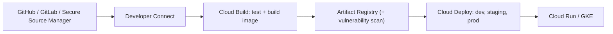

#### Cloud Build
A serverless build service that runs your build steps in containers (test, build image, push, deploy), triggered by Git pushes or pull requests.
- **Use it when:** you want CI/CD inside Google Cloud with no build servers. **Skip it when:** your team already uses GitHub Actions. It works well with Workload Identity Federation.
- **AWS / Azure:** AWS CodeBuild / Azure Pipelines.
- **Docs:** https://docs.cloud.google.com/build/docs

#### Artifact Registry (replaces the RETIRED Container Registry)
Stores container images and language packages (Python, npm, Maven, Go, apt), with IAM and vulnerability scanning. **Container Registry** was **shut down on 18 Mar 2025**. `gcr.io` addresses can now be served by Artifact Registry.
- **Use it when:** always, for your Docker images. **Skip it when:** you have public images only. Docker Hub also works, but it has pull limits.
- **AWS / Azure:** Amazon ECR + CodeArtifact / Azure Container Registry + Azure Artifacts.
- **Docs:** https://docs.cloud.google.com/artifact-registry/docs (migration: https://docs.cloud.google.com/artifact-registry/docs/transition/transition-from-gcr)

#### Cloud Deploy
Managed continuous delivery. It promotes a release through stages (dev, staging, prod) with approvals, canary rollouts and one-click rollback, for GKE and Cloud Run.
- **Use it when:** you have several environments and need safe, audited releases. **Skip it when:** you have one environment. `gcloud run deploy` in CI is enough.
- **AWS / Azure:** AWS CodeDeploy, CodePipeline / Azure Pipelines release stages.
- **Docs:** https://docs.cloud.google.com/deploy/docs

#### Cloud Source Repositories (CLOSED TO NEW CUSTOMERS)
Google-hosted Git repositories. They have been closed to new customers since **17 Jun 2024**. Organizations that used them before that date keep access. Use **Secure Source Manager**, GitHub or GitLab.
- **Docs:** https://docs.cloud.google.com/source-repositories/docs/release-notes

#### Secure Source Manager
A private, single-tenant, regional Git hosting service managed by Google, with IAM and private networking.
- **Use it when:** regulated companies that must keep source code inside Google Cloud. **Skip it when:** GitHub or GitLab is allowed. They have bigger ecosystems.
- **AWS / Azure:** AWS CodeCommit / Azure Repos.
- **Docs:** https://docs.cloud.google.com/secure-source-manager/docs

#### Cloud Workstations
Managed development environments (VS Code or JetBrains in the browser, or connected from your IDE) running in your VPC, with standard images.
- **Use it when:** teams that need secure, identical dev machines, or GPU dev boxes. **Skip it when:** you are a solo learner. Your laptop or Cloud Shell is fine.
- **AWS / Azure:** Amazon WorkSpaces, SageMaker Studio code editor / Microsoft Dev Box, GitHub Codespaces.
- **Docs:** https://docs.cloud.google.com/workstations/docs

#### Cloud Code
IDE extensions for VS Code and JetBrains (and built into Cloud Shell Editor) that help you write, run and debug Kubernetes and Cloud Run apps.
- **Use it when:** you develop for GKE or Cloud Run from your editor. **Skip it when:** you prefer the CLI.
- **AWS / Azure:** AWS Toolkit / Azure Tools for VS Code.
- **Docs:** https://docs.cloud.google.com/code/docs

#### Cloud Shell
A free browser terminal with all Google Cloud tools installed. See [section 0](#0-how-google-cloud-is-organised-read-this-first).
- **Use it when:** learning, quick fixes. **Skip it when:** you need long jobs. Cloud Shell sessions time out.
- **AWS / Azure:** AWS CloudShell / Azure Cloud Shell.
- **Docs:** https://docs.cloud.google.com/shell/docs

#### Google Cloud SDK (gcloud CLI, client libraries)
The command line tools (`gcloud`, `bq`, `gcloud storage`) and the language client libraries used to control every service.
- **Use it when:** always, on your laptop and in CI. **Skip it when:** never.
- **AWS / Azure:** AWS CLI and SDKs / Azure CLI and SDKs.
- **Docs:** https://docs.cloud.google.com/sdk/docs (Cloud APIs: https://docs.cloud.google.com/apis/docs/overview)

#### Firebase
Google's app-development platform for mobile and web. It offers hosting, authentication, Firestore, functions, storage, analytics, crash reports and AI Logic, with generous free tiers. See [section 18](#18-firebase-maps-media-and-specialised-products).
- **Use it when:** you build a mobile or web front end fast. **Skip it when:** a pure backend or data project.
- **AWS / Azure:** AWS Amplify / Azure Static Web Apps + App Service (no single match).
- **Docs:** https://firebase.google.com/docs

**Brief developer items**

| Product | What it is | AWS / Azure |
|---|---|---|
| [**Developer Connect**](https://docs.cloud.google.com/developer-connect/docs) | Connects GitHub, GitLab and Bitbucket to Google Cloud services in one standard way. | CodeConnections / Azure Pipelines service connections |
| [**GitLab on Google Cloud**](https://docs.cloud.google.com/docs/gitlab) | GitLab integration for deploying to Google Cloud. | GitLab on AWS / GitLab on Azure |
| [**Developer Device Platform**](https://docs.cloud.google.com/developer-device-platform) | Run app tests on real devices, manually or with AI agents. | AWS Device Farm / none exact |
| [**Gemini Code Assist**](https://docs.cloud.google.com/gemini/docs/codeassist/sunset) (**SUNSETTING**) | AI coding assistant in IDEs. No new subscriptions from 9 Oct 2026. Annual renewals end 31 Jan 2027, monthly ones 31 Dec 2027. Agentic coding moves to **Antigravity** inside Gemini Enterprise editions. | Kiro (replacing Amazon Q Developer IDE plugins) / GitHub Copilot |
| [**Antigravity**](https://antigravity.google/docs) | Google's agent-first coding environment and CLI, the successor for agentic coding. | Kiro / GitHub Copilot agent mode |
| [**Gemini CLI**](https://docs.cloud.google.com/gemini/docs/codeassist/gemini-cli) | Open-source terminal coding agent. Google's docs now point to the Antigravity CLI for the latest models. | Kiro CLI / GitHub Copilot CLI |

### Which developer tools should I use?

| Need | Simple choice |
|---|---|
| Where to keep code | GitHub or GitLab (Secure Source Manager if code must stay in Google Cloud) |
| Build and test on every push | GitHub Actions + Workload Identity Federation, or Cloud Build |
| Store Docker images | Artifact Registry |
| Deploy one service | `gcloud run deploy` from CI |
| Staged releases with approvals | Cloud Deploy |
| Infrastructure as code | Terraform, run in CI or through Infrastructure Manager |
| Secure team dev machines | Cloud Workstations |

---

## 15. Migration

**In plain words:** Migration means moving existing servers, databases and data from your own data center or another cloud to Google Cloud. The usual path is **assess** (what do we have, what will it cost?), **plan**, **move**, then **modernise**.

#### Migration Center
Discovers your current servers and apps, estimates Google Cloud cost and recommends where each workload should go.
- **Use it when:** you plan any large move. **Skip it when:** you move one small app by hand.
- **AWS / Azure:** AWS Transform, Migration Hub / Azure Migrate.
- **Docs:** https://docs.cloud.google.com/migration-center/docs

#### Migrate to Virtual Machines
Copies running VMs (VMware, AWS, Azure, physical) into Compute Engine with little downtime.
- **Use it when:** you "lift and shift" servers. **Skip it when:** you are rewriting the app anyway.
- **AWS / Azure:** AWS Application Migration Service / Azure Migrate.
- **Docs:** https://docs.cloud.google.com/migrate/virtual-machines/docs

#### Migrate to Containers
Converts apps running in VMs into containers for GKE or Cloud Run.
- **Use it when:** you modernise old VM apps step by step. **Skip it when:** the app is easy to containerise by hand with a Dockerfile.
- **AWS / Azure:** AWS App2Container / Azure Migrate app containerization.
- **Docs:** https://docs.cloud.google.com/migrate/containers/docs

**Brief migration items**

| Product | What it is | AWS / Azure |
|---|---|---|
| [**Database Migration Service**](https://docs.cloud.google.com/database-migration/docs) | Moves databases to Cloud SQL or AlloyDB (see [section 6](#6-databases)). | AWS DMS / Azure DMS |
| [**BigQuery Migration Service**](https://docs.cloud.google.com/bigquery/docs/migration-intro) | Moves data warehouses to BigQuery. | AWS SCT / Azure Synapse migration tools |
| [**Storage Transfer Service**](https://docs.cloud.google.com/storage-transfer/docs/overview), [**Transfer Appliance**](https://docs.cloud.google.com/transfer-appliance/docs/4.0/overview) | Move files online or by shipped device (see [section 5](#5-storage)). | DataSync, Snowball / Storage Mover, Data Box |
| [**Google Cloud VMware Engine**](https://docs.cloud.google.com/vmware-engine/docs) | Run VMware as-is (see [section 2](#2-compute)). | VMware Cloud on AWS / Azure VMware Solution |
| [**Modernization Hub**](https://docs.cloud.google.com/modernize/hub) | Guides and tools for modernising apps after migration. | AWS Transform / Azure Migrate app assessment |
| [**Mainframe Assessment Tool**](https://docs.cloud.google.com/mainframe-assessment-tool/docs) | Analyses mainframe code and documents it with generative AI. | AWS Transform for mainframe / Azure mainframe migration partners |
| [**Mainframe Connector**](https://docs.cloud.google.com/mainframe-connector/docs) | Moves mainframe data to BigQuery and Cloud Storage. | AWS Mainframe Modernization data replication / partners |
| [**Dual Run**](https://docs.cloud.google.com/mainframe-dual-run/docs) | Runs the mainframe and the new cloud version side by side and compares their outputs. | none exact |

---

## 16. Hybrid and multicloud

**In plain words:** **Hybrid** means some workloads stay in your own data center or at the edge (shops, factories, ships) while others run in Google Cloud. **Multicloud** means you also use AWS or Azure. Google's tools here let you run Google-managed software outside Google's regions, and manage Kubernetes clusters everywhere from one place.

#### Google Distributed Cloud
Google Cloud hardware and software that runs in **your** location. **Connected** runs at the edge or in your data center, managed from Google Cloud. **Air-gapped** has no internet connection at all, for defence and governments. **Software only** runs on your own bare metal or VMware. Agent Platform and Gemini models can run on some versions.
- **Use it when:** you have data-sovereignty or no-internet rules, need low latency at the edge, or factory or retail sites. **Skip it when:** a normal cloud region meets your rules.
- **AWS / Azure:** AWS Outposts / Azure Local (formerly Azure Stack HCI).
- **Docs:** https://docs.cloud.google.com/distributed-cloud/docs (air-gapped: https://docs.cloud.google.com/distributed-cloud/hosted/docs/latest/gdcag ; connected: https://docs.cloud.google.com/distributed-cloud/connected/latest/docs)

#### GKE Multi-Cloud and attached clusters
Run GKE-managed clusters on AWS or Azure, or attach any conformant Kubernetes cluster (EKS, AKS, on-premises). You manage them all in one **fleet** with the same policies, config and mesh.
- **Use it when:** you have Kubernetes on several clouds and want one way to manage it. **Skip it when:** everything runs in Google Cloud.
- **AWS / Azure:** EKS Anywhere, EKS Hybrid Nodes / Azure Arc-enabled Kubernetes.
- **Docs:** https://docs.cloud.google.com/kubernetes-engine/multi-cloud/docs

**Brief hybrid items:** **GDC software only for bare metal / VMware** ([docs](https://docs.cloud.google.com/kubernetes-engine/distributed-cloud/bare-metal/docs)). **Gemini on GDC connected** ([docs](https://docs.cloud.google.com/distributed-cloud/gemini-on-gdcc/latest/docs)). **AlloyDB Omni** and **Spanner Omni** ([section 6](#6-databases)) run Google databases anywhere. **BigQuery Omni** and **borderless Lakehouse** query data in other clouds. **Cross-Cloud Interconnect** and **Data Transfer Essentials** ([section 11](#11-networking-and-content-delivery)) cover networking. **Config Sync, Policy Controller** and **Cloud Service Mesh** ([section 3](#3-containers-and-kubernetes)) work across the fleet. **Apigee hybrid** ([section 10](#10-application-integration-messaging-and-apis)) runs API management anywhere.

---

## 17. Gemini Enterprise and Workspace-adjacent products

**In plain words:** These are **finished AI products for employees**, not building blocks for developers. They are bought per user, like office software.

#### Gemini Enterprise (formerly Google Agentspace)
An AI assistant and agent platform for employees. It searches across company apps through connectors (Drive, SharePoint, Jira, Confluence, ServiceNow and others), chats with Gemini and runs prebuilt and custom agents (including ADK agents hosted on Agent Runtime). It includes no-code agent and workflow building, and research and notebook-style tools. **Antigravity** for agentic coding is included in Gemini Enterprise editions.
- **Use it when:** a company wants one AI assistant for all staff, connected to its documents and apps. **Skip it when:** you are building an AI feature into **your own product**. Use the Agent Platform.
- **AWS / Azure:** Amazon Quick (Amazon Q Business successor) / Microsoft 365 Copilot.
- **Docs:** https://docs.cloud.google.com/gemini/enterprise/docs/overview

#### Google Workspace with Gemini
Gmail, Docs, Sheets, Meet, Drive and other Workspace apps with Gemini built in. It is a separate subscription from Google Cloud, but often bought together.
- **Use it when:** you want AI help inside daily office apps. **Skip it when:** you need custom AI apps or APIs.
- **AWS / Azure:** none / Microsoft 365 Copilot.
- **Docs:** https://workspace.google.com/

**Brief:** **Gemini for Google Cloud** ([docs](https://docs.cloud.google.com/gemini/docs/overview)) is the name for the Gemini helpers inside Cloud products: Gemini Cloud Assist, Gemini in BigQuery, Colab Enterprise, Looker and Data Studio. **Gemini Enterprise for CX** is the customer-service version ([section 9.7](#97-conversational-ai-and-customer-experience-formerly-contact-center-ai)).

### Gemini Enterprise vs Agent Platform vs Gemini Developer API

| You are... | Use |
|---|---|
| A company giving all staff an AI assistant over internal data | **Gemini Enterprise** |
| A developer adding AI to your own app, in production on Google Cloud | **Gemini Enterprise Agent Platform** |
| A learner or hacker prototyping | **Gemini Developer API + Google AI Studio** |
| A support team that wants AI in the contact center | **Gemini Enterprise for CX** |

---

## 18. Firebase, Maps, media and specialised products

### Firebase (brief)

**In plain words:** Firebase is a set of ready-made backend services for mobile and web apps. Each Firebase project is also a Google Cloud project, so you can grow into the full cloud later.

| Firebase product | What it is | Docs |
|---|---|---|
| **Firebase Hosting** | Fast static site hosting on a global CDN. | https://firebase.google.com/docs/hosting |
| **Firebase App Hosting** | Deploys full-stack web apps (Next.js, Angular) from GitHub. Runs on Cloud Run. | https://firebase.google.com/docs/app-hosting |
| **Firebase Authentication** | Sign-in for your app users (built on Identity Platform). | https://firebase.google.com/docs/auth |
| **Cloud Firestore / Realtime Database** | Document database / older JSON database with live sync. | https://firebase.google.com/docs/database |
| **Firebase SQL Connect** | A relational backend on Cloud SQL for PostgreSQL with generated, type-safe SDKs. | https://firebase.google.com/docs/sql-connect |
| **Cloud Functions for Firebase** | Backend functions triggered by Firebase events. | https://firebase.google.com/docs/functions |
| **Cloud Storage for Firebase** | User file uploads ([section 5](#5-storage)). | https://firebase.google.com/docs/storage |
| **Firebase AI Logic** | Call Gemini from the client app safely. | https://firebase.google.com/docs/ai-logic |
| **App Check** | Proves requests come from your real app, which blocks abuse of your backends and LLM quota. | https://firebase.google.com/docs/app-check |
| **Crashlytics, Performance Monitoring, Analytics** | Crash reports, speed and usage analytics for apps. | https://firebase.google.com/docs/crashlytics |
| **Cloud Messaging (FCM)** | Push notifications. | https://firebase.google.com/docs/cloud-messaging |
| **Remote Config, A/B Testing** | Change app behaviour or test variants without a new release. | https://firebase.google.com/docs/remote-config |
| **Test Lab, App Distribution** | Test on real devices; send beta builds to testers. | https://firebase.google.com/docs/test-lab |

**AWS / Azure:** AWS Amplify / Azure has no single match (Static Web Apps, App Service, Notification Hubs, Entra External ID).

### Google Maps Platform
APIs and SDKs for maps, places search, routes and directions, geocoding (address to coordinates), Street View, and environment data (air quality, solar, weather). It is billed separately from Google Cloud services, through a Cloud billing account.
- **Use it when:** your app shows maps, finds nearby places, plans routes, or grounds an AI answer in location data. **Skip it when:** you only need a static image of a map once.
- **AWS / Azure:** Amazon Location Service / Azure Maps.
- **Docs:** https://developers.google.com/maps/documentation

### Specialised, media and industry products

#### Earth Engine
A planet-scale catalog of satellite imagery and geospatial data, plus the compute to analyse it (land use, deforestation, crops, floods).
- **Use it when:** you need environmental or geospatial analysis over large areas and time spans. **Skip it when:** you work with a few map points. Use BigQuery GIS or Maps.
- **AWS / Azure:** Registry of Open Data on AWS + SageMaker geospatial / Microsoft Planetary Computer.
- **Docs:** https://developers.google.com/earth-engine

#### Cloud Healthcare API
Stores and exchanges healthcare data in standard formats (FHIR, HL7v2, DICOM medical images), with de-identification and links to BigQuery and AI.
- **Use it when:** you build health apps that must speak medical data standards. **Skip it when:** you do not handle healthcare records.
- **AWS / Azure:** AWS HealthLake, HealthImaging / Azure Health Data Services.
- **Docs:** https://docs.cloud.google.com/healthcare-api/docs

#### Cloud Life Sciences (RETIRED)
It ran genomics pipelines on Google Cloud. It was deprecated in 2023 and shut down on **8 Jul 2025**. Its docs now redirect to **Batch**, which is the replacement (often used with Nextflow or Cromwell).
- **Docs:** https://docs.cloud.google.com/batch/docs

#### Live Stream API
Turns a live video feed into streaming formats (HLS, DASH) for viewers on any device.
- **Use it when:** you live-stream events or channels. **Skip it when:** a third-party streaming platform is enough.
- **AWS / Azure:** AWS Elemental MediaLive / none (Azure Media Services was retired).
- **Docs:** https://docs.cloud.google.com/livestream/docs

#### Transcoder API
Converts stored video files into formats and sizes for web, mobile and TV.
- **Use it when:** you run a video library or user uploads that must play everywhere. **Skip it when:** you have a few videos. `ffmpeg` in a Cloud Run job may be enough.
- **AWS / Azure:** AWS Elemental MediaConvert / none (Azure Media Services retired).
- **Docs:** https://docs.cloud.google.com/transcoder/docs

#### Video Stitcher API
Inserts ads into on-demand and live video streams on the server side.
- **Use it when:** ad-supported video services. **Skip it when:** you have no video ads.
- **AWS / Azure:** AWS Elemental MediaTailor / none.
- **Docs:** https://docs.cloud.google.com/video-stitcher/docs

#### Game Servers (RETIRED)
It was a managed service for game servers, built on open-source Agones. It was retired on **30 Jun 2023**. Today you run **Agones on GKE** yourself.
- **AWS / Azure:** Amazon GameLift / Azure PlayFab Multiplayer Servers.
- **Docs:** https://agones.dev/site/docs/

#### Blockchain Node Engine (and Blockchain RPC)
Fully managed blockchain nodes (for example Ethereum) and RPC endpoints, so you do not run nodes yourself.
- **Use it when:** web3 apps that need reliable node access. **Skip it when:** you do not build blockchain apps.
- **AWS / Azure:** Amazon Managed Blockchain / none (Azure Blockchain Service was retired).
- **Docs:** https://docs.cloud.google.com/blockchain-node-engine/docs (RPC: https://docs.cloud.google.com/blockchain-rpc/docs)

**Brief industry items**

| Product | What it is | AWS / Azure |
|---|---|---|
| [**Anti Money Laundering AI**](https://docs.cloud.google.com/financial-services/anti-money-laundering/docs) | ML risk scores for suspicious transactions at banks. | partner solutions / partner solutions |
| [**Cloud Talent Solution**](https://docs.cloud.google.com/talent-solution/job-search/docs) | Job search and matching for job boards and HR apps. | none exact |
| [**Vision API Product Search**](https://docs.cloud.google.com/vision/product-search/docs) | Find similar products from a photo. | Rekognition custom labels / Azure AI Vision |
| **Telecom Subscriber Insights, Telecom Network Automation** | Analytics and automation for telecom operators. | AWS telco services / Azure Operator Nexus |

---

## 19. Cost management

**In plain words:** In the cloud, cost is a design decision. You pay for **what runs** (VMs, GPUs, databases that are always on), **what you store**, **what you move out** (egress) and **what you call** (Gemini tokens, API requests). The tools below help you see, predict and reduce the bill. **Important: budgets do not stop spending. They only send alerts.**

#### Cloud Billing (reports, cost table, billing export)
Shows what you spend, by project, service, label and SKU. **Billing export to BigQuery** gives you the detailed rows to analyse or chart in Data Studio.
- **Use it when:** day one. Turn on billing export to BigQuery right away, because it only exports data from the moment you enable it.
- **AWS / Azure:** AWS Billing and Cost Explorer, Cost and Usage Report / Microsoft Cost Management + exports.
- **Docs:** https://docs.cloud.google.com/billing/docs (export: https://docs.cloud.google.com/billing/docs/how-to/export-data-bigquery)

#### Budgets and budget alerts
Set a monthly amount and get email or Pub/Sub alerts at chosen percentages (for example 50%, 90%, 100%, and forecasted 100%).
- **Use it when:** day one, on every billing account and project. **Important:** a budget **does not cap** spend. To actually stop spending, you can connect the Pub/Sub alert to a function that disables billing on a project. That is a drastic step: it shuts the project's resources down.
- **AWS / Azure:** AWS Budgets / Azure budgets.
- **Docs:** https://docs.cloud.google.com/billing/docs/how-to/budgets (automatic shutdown: https://docs.cloud.google.com/billing/docs/how-to/disable-billing-with-notifications)

#### Committed use discounts (CUDs) and sustained use discounts
**CUDs** give a lower price for committing to 1 or 3 years of spend or resources (compute, databases, some AI services). **Sustained use discounts** apply automatically to some VMs that run most of the month.
- **Use it when:** steady, always-on workloads you understand well. **Skip it when:** a new project whose usage is still changing. You pay the commitment even if you stop using it.
- **AWS / Azure:** Savings Plans, Reserved Instances / Azure Reservations, Savings Plan.
- **Docs:** https://docs.cloud.google.com/docs/cuds (sustained use: https://docs.cloud.google.com/compute/docs/sustained-use-discounts)

#### Google Cloud Free Program
**New customers** usually get **trial credits** (for many years $300 for 90 days; check the page). There is also an **Always Free** tier with monthly limits on some products, such as a small VM in some US regions, a few GB of Cloud Storage, and free monthly amounts of BigQuery queries, Cloud Run requests and Firestore operations.
- **Use it when:** learning. Stay inside the limits and pick the listed regions. **Note:** Always Free limits are per billing account and can change. The Gemini Developer API has its own separate free tier.
- **AWS / Azure:** AWS Free Tier / Azure free account.
- **Docs:** https://docs.cloud.google.com/free/docs/free-cloud-features

**Brief cost items**

| Item | What it is | AWS / Azure |
|---|---|---|
| [**Pricing Calculator**](https://cloud.google.com/products/calculator) | Estimate a monthly bill before you build. | AWS Pricing Calculator / Azure Pricing Calculator |
| [**FinOps hub**](https://docs.cloud.google.com/billing/docs/how-to/finops-hub) | Savings opportunities and commitment use in one billing page. | Cost Optimization Hub / Azure Advisor cost |
| [**Recommender / Active Assist**](https://docs.cloud.google.com/recommender/docs/overview) | Idle and oversized resource recommendations ([section 13](#13-management-operations-and-observability)). | Compute Optimizer / Azure Advisor |
| [**Spot VMs**](https://docs.cloud.google.com/compute/docs/instances/spot) | Big discounts for interruptible work ([section 2](#2-compute)). | Spot Instances / Spot VMs |
| [**Cloud Quotas**](https://docs.cloud.google.com/docs/quotas) | Lower your own quotas (for example GPUs = 0) as a hard safety limit. | Service Quotas / Azure quotas |
| [**App Optimize API**](https://docs.cloud.google.com/app-optimize/overview) (Preview) | Programmatic cost and utilisation data for projects and App Hub applications. | Cost Explorer API / Cost Management APIs |
| **Labels and tags** | Key-value tags on resources so costs can be split by team, app or environment. | Cost allocation tags / Azure tags |
| [**Well-Architected Framework: cost optimization**](https://docs.cloud.google.com/architecture/framework) | Google's official best-practice guide (six pillars plus an AI/ML perspective). | AWS Well-Architected / Azure Well-Architected |

### Which cost tool should I use?

| Goal | Tool |
|---|---|
| Get warned before a surprise bill | Budgets and alerts (on every project) |
| Make spending physically impossible for a resource type | Lower **quotas** (for example GPU quota to 0) or disable billing via a Pub/Sub-triggered function |
| See exactly what costs money | Billing reports + billing export to BigQuery |
| Estimate before building | Pricing Calculator |
| Cut waste | Recommender / FinOps hub, delete idle resources |
| Pay less for steady workloads | Committed use discounts |
| Pay less for interruptible jobs | Spot VMs, Flex-start |

---

## 20. Starter kit for an AI web app on Google Cloud

Most AI web apps (a chat or RAG assistant, a document summariser, an agent with tools) use the same 15-20 products. Here they are **in the order you would set them up**.

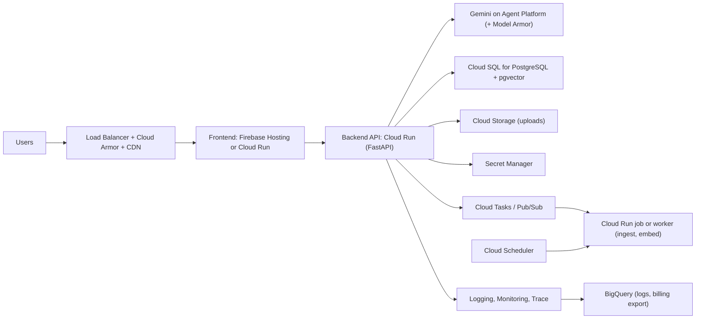

| Step | Product | What you do with it |
|---|---|---|
| 1 | **Projects + Cloud Billing + budgets** | Create `myapp-dev` and `myapp-prod`, link billing, set budget alerts and billing export to BigQuery. |
| 2 | **IAM + service accounts** | One service account per service, least-privilege roles. No key files. |
| 3 | **Workload Identity Federation** | Let GitHub Actions deploy without keys. |
| 4 | **Artifact Registry** | Store your Docker images. |
| 5 | **Cloud Build** (or GitHub Actions) | Build and test on every push. |
| 6 | **Cloud Run** | Deploy the FastAPI backend (and the frontend, if it is not static). |
| 7 | **Secret Manager** | Database password, third-party API keys. |
| 8 | **Gemini on Agent Platform** (via `google-genai`) | The LLM calls. No API key needed: it uses the service account. |
| 9 | **Model Armor** | Screen prompts and answers. |
| 10 | **Cloud SQL for PostgreSQL (+ pgvector)** | Users, chats and embeddings. Move to AlloyDB or Vector Search only when needed. Or use **Firestore** for a serverless document store. |
| 11 | **Cloud Storage** | Uploaded files and RAG source documents. |
| 12 | **Cloud Tasks or Pub/Sub + Cloud Run jobs / worker pools** | Slow work (parsing, embedding) off the request path. |
| 13 | **Cloud Scheduler** | Nightly re-index or cleanup. |
| 14 | **Identity Platform / Firebase Authentication** (or **IAP** for internal apps) | User login. |
| 15 | **Cloud Logging + Cloud Monitoring + Cloud Trace + Error Reporting** | Structured logs, alerts on errors, latency and token spend, traces of RAG steps. |
| 16 | **Cloud Load Balancing + Cloud Armor + Certificate Manager + Cloud DNS** | Custom domain, WAF and rate limits for production. |
| 17 | **Memorystore for Valkey** (optional) | Cache answers and sessions, rate limits. |
| 18 | **BigQuery** | Analyse usage logs, LLM costs and feedback. |
| 19 | **Infrastructure Manager / Terraform** | Recreate everything for prod from code. |
| 20 | Later: **Agent Runtime, RAG Engine, Vector Search, Gen AI evals** | When you need managed agent memory, large-scale retrieval or systematic evaluation. |

---

## 21. Common beginner mistakes and cost safety

### Common mistakes

| Mistake | Why it hurts | Do this instead |
|---|---|---|
| Starting with VMs or GKE for a simple API | More work, always-on cost | Cloud Run first |
| Giving a service account Owner or Editor | One leaked credential controls everything | Narrow predefined roles per service |
| Downloading service account JSON keys and committing them | Leaked keys are found and abused within minutes | Workload Identity Federation, attached service accounts |
| API keys in code or Docker images | Anyone with the image has your key | Secret Manager |
| One project for everything | Cannot separate cost, access or blast radius | Separate dev and prod projects, use labels |
| Following tutorials with old names (Vertex AI SDK modules, Container Registry, Deployment Manager, Cloud Functions 1st gen) | Commands fail, or the services are retired | Check the table in [section 1](#1-renames-and-retirements-at-a-glance) |
| Putting resources in random regions | Extra latency and cross-region egress charges, model availability differs by region | Keep the app, database and model endpoint in the same region |
| Using a database as a queue, or a queue as a database | Bugs and cost | Pub/Sub / Cloud Tasks for work, SQL / Firestore for state |
| No logs, metrics or alerts | You learn about outages from users | Structured logging + one alert on day one |
| Calling the LLM inside the web request for long jobs | Timeouts and bad user experience | Cloud Tasks + background worker, and stream answers |

### Cost safety checklist

- **Free tier and credits:** The trial credits expire (traditionally after 90 days). After that you pay normal prices unless you stay inside the Always Free limits. Check the [Free Program page](https://docs.cloud.google.com/free/docs/free-cloud-features) for current amounts and regions.
- **Budgets do not cap spend.** They only alert you. Set alerts at low amounts (for example 5 or 10 units of your currency for a learning project). For a hard stop, use quotas or the "disable billing on budget alert" pattern.
- **Idle GPUs and TPUs are the biggest risk.** A GPU VM, a GKE GPU node pool, a deployed model endpoint, a Workbench instance or a TPU left running overnight bills every hour, even with zero traffic. Stop or delete them, set GPU quota to 0 when you are not using them, and prefer Cloud Run with GPUs (which scales to zero) or Spot VMs for experiments.
- **Always-on things cost even when unused:** Cloud SQL and AlloyDB instances, Memorystore, load balancers, NAT gateways, static IP addresses, Vector Search index endpoints, Filestore, VMware Engine and Bare Metal nodes. Delete learning resources when you finish.
- **Egress (data leaving Google) costs money.** Downloading big datasets or model files to your laptop, serving large files without a CDN, and cross-region or cross-cloud traffic are all charged. Keep compute and data in the same region.
- **Logs can cost money at volume.** Avoid logging every token of every prompt in production. Sample, or exclude debug logs.
- **BigQuery on-demand charges per byte scanned.** Use `SELECT` with only the columns you need, partitioned tables, previews and the maximum-bytes-billed setting.
- **LLM token spend grows with traffic and context length.** Cache repeated prompts (context caching), cap `max_output_tokens`, choose smaller or "flash"-style models for simple steps, and track tokens in your logs.
- **Clean up:** the safest cleanup for a learning project is to **delete the whole project** when you are done.

---

## 22. Where to go next in this course

| Topic | Notebook |
|---|---|
| Hands-on core Google Cloud services for AI engineers (projects, IAM, Cloud Run, storage, databases, networking, cost) | [18_Cloud/10_gcp_core_services_for_ai_engineers.ipynb](../10_gcp_core_services_for_ai_engineers.ipynb) |
| Gemini Enterprise Agent Platform in depth (Gemini API, ADK, Agent Runtime, RAG Engine, Vector Search, Model Armor, evals, TPUs) | [18_Cloud/11_gcp_ai_gemini_enterprise_agent_platform.ipynb](../11_gcp_ai_gemini_enterprise_agent_platform.ipynb) |
| The same building blocks compared on AWS, Google Cloud and Azure | [18_Cloud/12_cloud_building_blocks_compared_aws_gcp_azure.ipynb](../12_cloud_building_blocks_compared_aws_gcp_azure.ipynb) |
| Earlier overview of GCP for AI | [18_Cloud/02_gcp_for_ai.ipynb](../02_gcp_for_ai.ipynb) |
| Cloud cost optimization | [18_Cloud/04_cloud_cost_optimization.ipynb](../04_cloud_cost_optimization.ipynb) |
| Deploying a paid AI SaaS application end to end | [16_Deployment/06_deploying_an_ai_saas_application_end_to_end.ipynb](../../16_Deployment/06_deploying_an_ai_saas_application_end_to_end.ipynb) |
| Deploying an AI app for free (frontend, backend, database, free tiers) | [16_Deployment/07_free_tier_deployment_frontend_backend_and_database.ipynb](../../16_Deployment/07_free_tier_deployment_frontend_backend_and_database.ipynb) |
| Serverless deployment basics (cold starts, Cloud Run code) | [16_Deployment/03_serverless_deployment.ipynb](../../16_Deployment/03_serverless_deployment.ipynb) |
| Cloud overview notes for this module | [18_Cloud.md](18_Cloud.md) |

---

## Official sources

All pages were opened on **13 Nov 2026**. Product pages change often, so check them again before you rely on a date or a limit.

**Product catalogs and category indexes**
- Google Cloud documentation index (full product list by category): https://docs.cloud.google.com/docs
- Category pages: https://docs.cloud.google.com/docs/ai-ml , https://docs.cloud.google.com/docs/application-development , https://docs.cloud.google.com/docs/compute-area , https://docs.cloud.google.com/docs/storage , https://docs.cloud.google.com/docs/databases , https://docs.cloud.google.com/docs/data , https://docs.cloud.google.com/docs/networking , https://docs.cloud.google.com/docs/security
- Google Cloud products page: https://cloud.google.com/products
- Google Cloud release notes (all products): https://docs.cloud.google.com/release-notes

**Renames, deprecations and retirements**
- Vertex AI to Gemini Enterprise Agent Platform naming table (22 Apr 2026): https://docs.cloud.google.com/gemini-enterprise-agent-platform/release-notes
- Agent Platform overview: https://docs.cloud.google.com/gemini-enterprise-agent-platform/overview
- Cloud Composer to Managed Service for Apache Airflow (15 Apr 2026): https://docs.cloud.google.com/composer/docs/release-notes
- Dataproc to Managed Service for Apache Spark (3 Apr 2026): https://docs.cloud.google.com/dataproc/docs/release-notes
- BigLake to Lakehouse (20 Apr 2026): https://docs.cloud.google.com/biglake/docs/release-notes
- Looker Studio to Data Studio (16 Apr 2026): https://docs.cloud.google.com/looker/docs/studio/release-notes
- Dataplex Universal Catalog to Knowledge Catalog: https://docs.cloud.google.com/dataplex/docs/introduction
- Data Catalog discontinued 30 Jan 2026: https://docs.cloud.google.com/data-catalog/docs/release-notes
- BigQuery sharing (formerly Analytics Hub): https://docs.cloud.google.com/bigquery/docs/analytics-hub-introduction
- Anywhere Cache renamed Rapid Cache: https://docs.cloud.google.com/storage/docs/anywhere-cache
- Fraud Defense (reCAPTCHA): https://docs.cloud.google.com/recaptcha/docs/overview
- Pub/Sub Lite deprecation: https://docs.cloud.google.com/pubsub/lite/docs
- Memorystore for Memcached deprecation: https://docs.cloud.google.com/memorystore/docs/memcached/release-notes
- Cloud Source Repositories end of sale: https://docs.cloud.google.com/source-repositories/docs/release-notes
- Container Registry shutdown: https://docs.cloud.google.com/artifact-registry/docs/transition/transition-from-gcr
- Deployment Manager deprecation: https://docs.cloud.google.com/deployment-manager/docs/deprecations
- Gemini Code Assist sunset: https://docs.cloud.google.com/gemini/docs/codeassist/sunset
- GKE single offering: https://docs.cloud.google.com/kubernetes-engine/docs/concepts/gke-editions
- App Engine overview (recommends Cloud Run for new users): https://docs.cloud.google.com/appengine/docs/an-overview-of-app-engine
- Firestore as successor of Datastore: https://docs.cloud.google.com/datastore/docs/firestore-or-datastore
- Cloud Service Mesh (Traffic Director users): https://docs.cloud.google.com/service-mesh/docs/overview
- Gemini Enterprise for CX: https://docs.cloud.google.com/gemini-enterprise-cx
- Cloud Life Sciences docs now redirect to Batch: https://cloud.google.com/life-sciences/docs

**Other official pages used**
- Cloud Run overview: https://docs.cloud.google.com/run/docs/overview/what-is-cloud-run
- Agent Runtime, Memory Bank, Agent Gateway, Agent Identity, Agent Registry, Model Armor, RAG Engine, Vector Search, evaluation: the links in [section 9](#9-ai-ml-and-generative-ai)
- Cloud Hub: https://docs.cloud.google.com/hub/docs/overview
- Active Assist / Recommender: https://docs.cloud.google.com/recommender/docs/overview
- Gemini for Google Cloud: https://docs.cloud.google.com/gemini/docs/overview
- Firebase products: https://firebase.google.com/products-build
- Infrastructure Manager: https://docs.cloud.google.com/infrastructure-manager/docs/overview
- Well-Architected Framework: https://docs.cloud.google.com/architecture/framework
- Free Program: https://docs.cloud.google.com/free/docs/free-cloud-features

**Notes on sources:** The Cloud Life Sciences shutdown date (8 Jul 2025), the Game Servers retirement (30 Jun 2023), the IoT Core and Debugger retirements (2023), and the 2024 renames Traffic Director to Cloud Service Mesh, BeyondCorp Enterprise to Chrome Enterprise Premium and Chronicle to Google Security Operations come from earlier Google announcements. Their old docs pages have been removed or now redirect to the replacement products. The AWS and Azure equivalents are approximate. Check each provider's own docs before you design across clouds.
