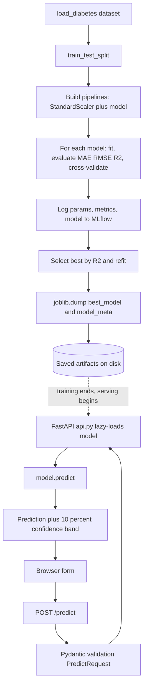

# 01 ML Pipeline: End-to-End Regression

This project is the foundational capstone: a complete **machine learning pipeline** that takes a tabular dataset, trains and compares several models, automatically selects the best one, and serves its predictions through a web API. The task is **regression** predicting a continuous numeric value using the well-known diabetes dataset, where the goal is to predict a measure of disease progression one year out from ten baseline medical measurements (age, sex, body-mass index, blood pressure, and six blood-serum readings).

It establishes the *train → evaluate → select → serve* template that every other project in the folder reuses. If you understand this project thoroughly, the rest become variations on a theme.

## What It Does

At the highest level, the project answers two questions. First, offline: *which model best predicts disease progression on this data?* Second, online: *given a new patient's measurements, what is the predicted value?* The first question is settled once, during training; the second is answered continuously, at serving time, by whichever model won.

## Architecture and Components

The codebase separates concerns into distinct files, each with a single job.

### The training pipeline (`main.py`)

This is the heart of the offline phase. It loads the dataset, then builds several candidate models Linear Regression, Ridge Regression, a Random Forest, and (when available) XGBoost. Crucially, each model is wrapped in a **scikit-learn Pipeline**: a single object that chains a preprocessing step (here, **feature scaling** with `StandardScaler`, which puts every feature on a comparable numeric range) directly to the model. Bundling preprocessing and model together is a best practice it guarantees that the exact same transformation applied during training is applied again at prediction time, eliminating a common class of bugs.

Each candidate is trained and then evaluated on a held-out **test set** using three standard regression metrics:

- **MAE** (Mean Absolute Error) the average size of the prediction error, in the target's units.
- **RMSE** (Root Mean Squared Error) similar, but penalizes large errors more heavily.
- **R²** (the coefficient of determination) the fraction of the target's variance the model explains, where 1.0 is perfect and 0 is no better than guessing the mean.

It also runs **cross-validation**: rather than trusting a single train/test split, the data is divided into five folds and the model is scored five times on different partitions, giving a more reliable estimate of how it generalizes.

Every one of these training runs is recorded with **MLflow**, an experiment-tracking tool. For each model, MLflow logs the parameters used, the resulting metrics, and a serialized copy of the model itself. This creates an auditable history you can later open the MLflow interface and see exactly which configurations were tried and how they compared, which is essential when experiments multiply.

Finally, the pipeline selects the **best model by R²**, refits it, and persists it to disk with `joblib` (a library for efficiently saving Python objects, especially those containing large numeric arrays). Alongside the model it saves a metadata file recording the winner's name, its metrics, the feature names, and the full comparison everything the API needs to describe itself.

### The command-line trainer (`train.py`)

A lighter, scriptable alternative to `main.py`. Instead of training every model and picking a winner, it trains *one* model chosen via command-line arguments (`--model-type`, `--test-size`, `--random-state`). This demonstrates how training is parameterized and made reproducible the same script, run with different flags, produces different experiments, and a fixed random seed makes any run repeatable.

### The serving API (`api.py`)

This is the online phase, built with **FastAPI**. On first use it lazily loads the saved model and metadata into memory (a *singleton* pattern, so the file is read from disk only once). It exposes three endpoints:

- **`POST /predict`** accepts a patient's ten measurements, validated against a **Pydantic** schema (`PredictRequest`) that enforces the correct field names and types. It returns the predicted value plus a simple ±10% band as a rough confidence range, and echoes back which model produced the result.
- **`GET /model-info`** reports the winning model's name, metrics, feature list, and the full comparison making the service self-documenting.
- **`GET /health`** is a *health check*: a lightweight endpoint that simply confirms the service is up and the model is loaded. Health checks are how orchestration systems and load balancers decide whether an instance is ready for traffic.

The API also serves the browser front end at its root and enables **CORS** (Cross-Origin Resource Sharing), the browser permission mechanism that lets a web page call the API from a different origin.

### The web interface (`templates/index.html`)

A single page where a person enters the ten feature values and sees the prediction, without touching any code.

## Data Flow, End to End

```
load_diabetes dataset
        │
        ▼
train_test_split  →  build pipelines (scaler + model)
        │
        ▼
for each model:  fit  →  evaluate (MAE/RMSE/R²)  →  cross-validate  →  log to MLflow
        │
        ▼
select best by R²  →  refit  →  joblib.dump(best_model.joblib + model_meta.joblib)
        │
        ▼  ════════════════ training ends, serving begins ════════════════
        ▼
browser form  →  POST /predict  →  Pydantic validation  →  model.predict()
        │                                                          │
        └──────────────  prediction + confidence band  ◄──────────┘
```

The end-to-end architecture, from dataset through training and selection to the served API and client:



The two halves are deliberately decoupled by the saved model files. Training can be re-run at any time to produce new artifacts; the API simply loads whatever is currently on disk.

## Concepts Demonstrated

- **The supervised learning workflow** splitting data, fitting models, and evaluating on unseen examples to estimate real-world performance.
- **Regression and its metrics** MAE, RMSE, and R², and why more than one metric matters.
- **Pipelines** binding preprocessing to the model so the same steps apply in training and inference.
- **Model selection and cross-validation** comparing candidates fairly and trusting averaged, not single-split, results.
- **Experiment tracking with MLflow** making the experimentation phase reproducible and auditable.
- **Model persistence** serializing a trained model and its metadata so it can be reloaded by a separate process.
- **Model serving with FastAPI** turning a saved model into a validated, documented HTTP service.
- **Operational basics** health checks, lazy loading, and a self-describing model-info endpoint.

This project is the blueprint. Every later capstone replaces the model in the middle with a language model, a vision network, a forecaster, or a team of agents but keeps this same surrounding structure of train, persist, serve, and expose.
