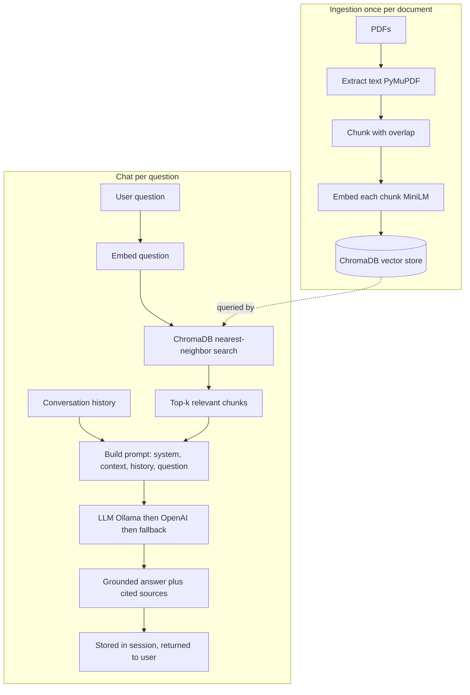

# 02 RAG Chatbot: Question-Answering Over Documents

This project is a chatbot that answers questions using a private collection of PDF documents as its source of truth. It is built on **RAG** *Retrieval-Augmented Generation* a technique that has become the standard way to make large language models answer reliably about specific, up-to-date, or proprietary information they were never trained on.

The core idea of RAG is simple and powerful. A **large language model** (LLM) is fluent but its knowledge is frozen at training time and it has a tendency to *hallucinate* to produce confident but fabricated answers. RAG fixes this by separating *knowing* from *finding*. Instead of asking the model to recall an answer from memory, the system first **retrieves** the most relevant passages from a trusted document store, then asks the model to **generate** an answer using only those passages as context. The model becomes a reasoning-and-phrasing engine operating over evidence you control.

## What It Does

Point the system at a folder of PDFs. It reads them, breaks them into searchable pieces, and stores those pieces in a way that allows fast *meaning-based* search. When a user asks a question, the chatbot finds the passages most relevant to that question, hands them to a language model along with the conversation so far, and returns an answer that cites where it came from. It also accepts new PDF uploads at runtime and maintains separate conversation histories per user session.

## Architecture and Components

The project has two phases *ingestion* (preparing the knowledge base, done once per document) and *chat* (answering questions, done repeatedly) plus the API and front end.

### Ingestion: building the knowledge base (`main.py`, `ingest.py`)

Before any question can be answered, the documents must be turned into a searchable form. This happens in several steps:

- **Text extraction.** Each PDF is opened with PyMuPDF and its raw text is pulled out.
- **Chunking.** A full document is too large to feed to a model and too coarse to search precisely, so it is split into overlapping **chunks** of roughly a few hundred characters. The *overlap* repeating a small tail of one chunk at the start of the next ensures that a sentence spanning a chunk boundary isn't lost to whichever side cut it off.
- **Embedding.** Each chunk is converted into an **embedding**: a vector (a list of numbers) that captures the chunk's *meaning*. This is done with a **sentence-transformer** model (`all-MiniLM-L6-v2`), which maps semantically similar text to nearby points in vector space. Two passages about the same idea end up close together even if they share no exact words.
- **Storage.** The chunks and their embeddings are stored in **ChromaDB**, a **vector database** a specialized store designed to find the vectors nearest to a query vector quickly. It is configured here to measure similarity by **cosine distance**, the standard geometric measure of how aligned two embedding vectors are. The store is *persistent*, written to disk, so ingestion need only happen once.

`ingest.py` is a thin command-line wrapper that runs this whole process over a documents folder, separating the one-time setup from the live service.

### Chat: retrieval and generation (`main.py`)

When a question arrives, two things happen in sequence:

- **Retrieval.** The question itself is embedded with the same model, and ChromaDB returns the top handful of chunks whose embeddings are closest to it. These are, by construction, the passages most likely to contain the answer.
- **Generation.** The retrieved chunks are assembled into a context block and combined with a *system prompt* instructing the model to answer **only** from the provided context and to admit when the answer isn't there. This constraint is what keeps RAG honest. The prompt, the recent conversation history, and the new question are sent to a language model.

The system tries language-model backends in order and degrades gracefully: first a locally-run **Ollama** model, then the **OpenAI** API, and if neither is available, it falls back to simply returning the retrieved passages. This means the retrieval machinery the genuinely novel part works on any machine even without an LLM configured.

**Conversational memory** is handled with a simple in-memory session store keyed by a session ID. Each user's turns accumulate so the model can resolve follow-up questions ("what about *its* side effects?") that depend on earlier context. The last few turns are included with each request.

### The API (`api.py`)

A FastAPI server exposes the chatbot. It offers a `POST /chat` endpoint for question-answering (returning the answer plus the source chunks that informed it), a `POST /upload-doc` endpoint that accepts a new PDF and re-ingests it on the fly, and session-management endpoints to list and delete conversations. Notably it also provides a **WebSocket** endpoint a persistent two-way connection that allows a continuous back-and-forth chat without the overhead of opening a new request for every message, which is well suited to the conversational interaction pattern.

### The web interface (`templates/index.html`)

A chat UI in the browser where a user types questions, sees streamed answers, views which source passages were used, and uploads documents.

## Data Flow, End to End

```
INGESTION (once per document)
  PDFs  →  extract text  →  chunk (with overlap)  →  embed each chunk  →  store in ChromaDB

CHAT (per question)
  user question
        │
        ▼
  embed question  →  ChromaDB nearest-neighbor search  →  top-k relevant chunks
        │                                                          │
        ▼                                                          ▼
  conversation history  ─────────────────────────────►  build prompt (system + context + history + question)
                                                                   │
                                                                   ▼
                                            LLM (Ollama → OpenAI → fallback)  →  grounded answer + cited sources
                                                                   │
                                                                   ▼
                                                          stored in session, returned to user
```

The RAG architecture, with one-time ingestion feeding the vector store and the per-question retrieve-then-generate path:



## Concepts Demonstrated

- **Retrieval-Augmented Generation** grounding a language model in retrieved evidence to reduce hallucination and answer over private data.
- **Embeddings and semantic search** representing meaning as vectors so that relevance is judged by similarity, not keyword matching.
- **Vector databases** storing and querying embeddings efficiently with ChromaDB and cosine similarity.
- **Document chunking** the practical art of splitting text into retrievable, overlapping units.
- **Prompt design for grounding** instructing the model to rely only on supplied context and to abstain when evidence is missing.
- **Conversational memory** maintaining per-session history so multi-turn dialogue works.
- **Streaming over WebSockets** serving an interactive chat experience with a persistent connection.
- **Graceful fallback across LLM providers** designing a system that runs whether or not a particular model backend is present.

Where project 01 served a model that *computed* an answer, this project serves a model that *reasons over retrieved evidence* the same train/serve skeleton, but with a knowledge base and a language model swapped into the center.
