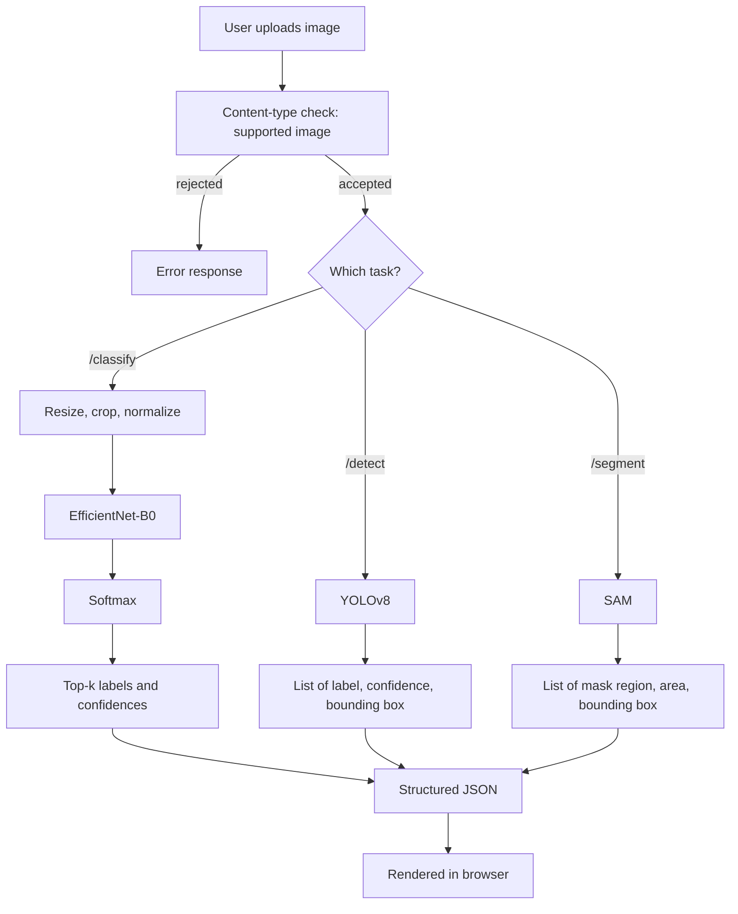

# 03 Computer Vision App: Classify, Detect, Segment

This project is an image-understanding service. A user uploads a picture and the system analyzes it three different ways, each answering a progressively richer question about the visual content. It is a tour of the three classic **computer vision** tasks, all served from one API.

The three tasks form a natural hierarchy of detail:

- **Classification** *What is this an image of?* The model assigns the whole image to one or more categories ("golden retriever", "espresso machine").
- **Object detection** *What objects are present, and where?* The model finds individual objects and draws a **bounding box** (a rectangle) around each, labeling it and reporting a confidence.
- **Segmentation** *Which exact pixels belong to which object?* Instead of a rectangle, the model produces a **mask** outlining an object's precise shape, separating it from the background pixel by pixel.

## What It Does

Given an uploaded image, the app can run any of the three analyses on demand. Classification names the dominant subject and its top alternatives with confidence scores. Detection enumerates the objects it finds with their locations. Segmentation reports the distinct regions it can isolate. Each task is exposed as its own endpoint, so the front end can offer them as separate buttons.

## Architecture and Components

The intelligence lives in `main.py`; the API and front end wrap it. A defining characteristic of this project is that it uses **pre-trained models** networks already trained by others on enormous datasets rather than training anything itself. This reflects how most applied computer vision works in practice: standing on the shoulders of large, publicly available models.

### Classification with EfficientNet (`main.py`)

Classification uses **EfficientNet-B0**, a convolutional neural network pre-trained on **ImageNet** (a benchmark dataset of roughly a thousand everyday object categories). Before the image reaches the network it must be **preprocessed** into the exact form the model expects: resized, center-cropped to 224×224 pixels, converted to a numeric **tensor** (a multi-dimensional array), and **normalized** using the channel means and standard deviations the model was trained with. Skipping or mismatching this preprocessing is one of the most common sources of bad predictions, which is why it mirrors the training-time recipe precisely.

The preprocessed image is passed through the network to produce **logits** (raw scores for each class), which are converted to probabilities with a **softmax** function. The top-k highest-probability classes are returned, each mapped from its numeric index to a human-readable label using the ImageNet class list. The model is run in evaluation mode with gradient tracking disabled, since no learning is happening only inference.

### Detection with YOLO (`main.py`)

Object detection uses **YOLOv8** ("You Only Look Once," version 8), a popular real-time detection model accessed through the `ultralytics` library. For each object it finds, it returns a label, a confidence score, and the four coordinates of its bounding box. If the detection library isn't installed, the function returns a mock result so the endpoint still responds the same graceful-degradation pattern seen throughout the projects.

### Segmentation with SAM (`main.py`)

Segmentation uses a lightweight variant of **SAM** (the Segment Anything Model), again via `ultralytics`. It produces masks for the distinct regions it identifies, reporting each region's pixel area and bounding box. When the model is unavailable it falls back to a synthetic mock that divides the image into illustrative regions, so the feature is always demonstrable.

### The API (`api.py`)

A FastAPI server exposes one endpoint per task `POST /classify`, `POST /detect`, `POST /segment` each accepting an uploaded file. Before processing, every upload is checked against an allowlist of image content types (JPEG, PNG, WebP, GIF), rejecting anything that isn't a supported image. This **input validation** is an important habit when accepting arbitrary user files. A health check and the web interface round out the routes.

### The web interface (`templates/index.html`)

A page where a user uploads an image and triggers any of the three analyses, viewing labels, boxes, and region information in the browser.

## Data Flow, End to End

```
user uploads image
        │
        ▼
content-type check (must be a supported image)
        │
        ├──►  /classify  →  resize/crop/normalize  →  EfficientNet  →  softmax  →  top-k labels + confidences
        │
        ├──►  /detect    →  YOLOv8  →  list of {label, confidence, bounding box}
        │
        └──►  /segment   →  SAM    →  list of {mask region, area, bounding box}
                                              │
                                              ▼
                                   structured JSON  →  rendered in browser
```

The architecture, with one upload validated then routed to any of the three pre-trained vision models:



## Concepts Demonstrated

- **The three core vision tasks** classification, detection, and segmentation, and how they differ in granularity.
- **Using pre-trained deep networks** leveraging ImageNet-trained EfficientNet, YOLO, and SAM instead of training from scratch.
- **Convolutional neural networks** as the workhorse architecture for images.
- **Image preprocessing** resizing, cropping, tensor conversion, and normalization to match a model's training distribution.
- **Logits, softmax, and confidence** turning raw network outputs into interpretable probabilities.
- **Inference mode** running a network for prediction with learning disabled.
- **Serving heavy models behind a clean API** file upload, content-type validation, and per-task endpoints.
- **Graceful degradation** falling back to mock results when optional model libraries are absent.

Conceptually this is the same serve-a-model pattern as project 01, but the "model" is now three pre-trained neural networks operating on images instead of a single trained regressor operating on numbers.
