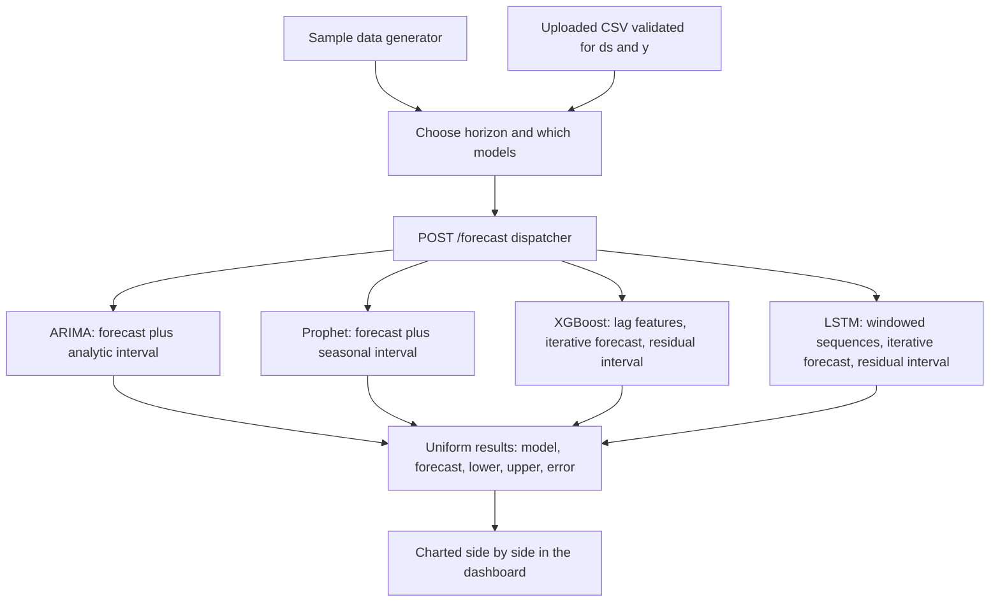

# 04 Forecasting Dashboard: Predicting the Future of a Time Series

This project predicts where a **time series** is heading. A time series is simply a sequence of values measured over time daily sales, hourly temperature, monthly demand and **forecasting** is the task of extending that sequence into the future. What makes this capstone distinctive is that it does not rely on a single method: it runs *four fundamentally different* forecasting techniques on the same data and presents their predictions side by side, so their strengths, weaknesses, and disagreements become visible.

A second theme runs through the whole project: every forecast comes with a **confidence interval** an upper and lower band around the prediction. A forecast without a sense of its own uncertainty is dangerously incomplete, and a recurring lesson here is that *quantifying uncertainty is as important as the point estimate itself.*

## What It Does

The dashboard generates (or accepts an upload of) a time series, then asks each of four models to forecast a chosen number of steps into the future a *horizon* returning both the predicted values and a band of uncertainty around them. Because the four models embody different assumptions about how the future relates to the past, comparing them is itself the analysis.

## The Four Forecasting Approaches

The four methods deliberately span the major families of forecasting, from classical statistics to modern deep learning. Each is implemented in `main.py` with the same graceful-fallback design: if the specialized library isn't installed, a mock forecast keeps the endpoint working.

- **ARIMA** (AutoRegressive Integrated Moving Average) is the classical *statistical* approach. It models the future as a linear combination of recent past values and recent past errors, with a differencing step to remove trend. It is the textbook baseline for stationary series.
- **Prophet** is a model designed specifically for business time series with strong **seasonality** repeating patterns such as weekly and yearly cycles. It decomposes a series into trend plus seasonal components and is known for being robust and easy to use on messy real-world data.
- **XGBoost** reframes forecasting as a *supervised learning* problem. It builds **lag features** using the previous several values as inputs to predict the next and trains a gradient-boosted tree ensemble on them. To forecast multiple steps ahead it predicts *iteratively*, feeding each new prediction back in as input for the following step.
- **LSTM** (Long Short-Term Memory) is a *deep learning* approach: a recurrent neural network designed to learn patterns in sequences. The data is normalized, framed into windows of recent values, and the network is trained to predict the next value; like XGBoost it then forecasts forward iteratively. It represents the neural-network end of the spectrum.

Seeing these four together teaches the central truth of forecasting: there is no universally best model. A statistical model, a seasonality-aware model, a tree ensemble, and a neural network each capture different structure, and the right choice depends on the data.

## How Confidence Intervals Are Built

Each method produces its uncertainty band in a way idiomatic to that method. ARIMA and Prophet derive intervals analytically from their statistical assumptions. XGBoost and LSTM estimate the **standard deviation of their residuals** (the errors they made on held-out data) and place a band roughly two standard deviations wide around each prediction a practical, empirical way to express "we expect the true value to fall in this range most of the time." The synthetic data generator even builds in known trend, weekly and yearly seasonality, and random noise, so the models have realistic structure to find and their interval estimates have something meaningful to capture.

## Architecture and Components

### The forecasting engine (`main.py`)

Holds the four model functions, a synthetic data generator (trend + multi-scale seasonality + noise), an error metric (**sMAPE**, a symmetric percentage error useful for comparing across series of different scales), and a dispatcher that runs whichever subset of models the caller requests and collects their results into a uniform structure.

### The API (`api.py`)

A FastAPI server exposes the engine. `GET /sample-data` returns a generated series to populate the dashboard. `POST /forecast` runs the selected models for a given horizon and returns each one's forecast and confidence band. `POST /upload-data` accepts a user's own CSV validated to contain a date column (`ds`) and a value column (`y`) so the dashboard works on real data, not just the demo series. `GET /models` lists the available methods.

### The web interface (`templates/index.html`)

A dashboard that charts the historical series alongside each model's forecast and shaded uncertainty band, making the comparison visual and immediate.

## Data Flow, End to End

```
sample data generator  OR  uploaded CSV (validated for ds/y columns)
        │
        ▼
choose horizon + which models to run
        │
        ▼
POST /forecast  →  dispatcher
        │
        ├──►  ARIMA    →  forecast + analytic interval
        ├──►  Prophet  →  forecast + seasonal interval
        ├──►  XGBoost  →  lag features → iterative forecast + residual-based interval
        └──►  LSTM     →  windowed sequences → iterative forecast + residual-based interval
                                  │
                                  ▼
                  uniform results {model, forecast, lower, upper, error}
                                  │
                                  ▼
                   charted side by side in the dashboard
```

The architecture, with data fanning out to four forecasters and their results charted together on the dashboard:



## Concepts Demonstrated

- **Time-series forecasting** extending a temporal sequence into the future across a chosen horizon.
- **The major model families** statistical (ARIMA), decomposition/seasonality (Prophet), gradient-boosted trees (XGBoost), and recurrent neural networks (LSTM).
- **Feature engineering for time series** turning a sequence into a supervised problem with lag features and windows.
- **Iterative multi-step forecasting** feeding predictions back in to forecast further ahead.
- **Uncertainty quantification** confidence intervals, derived analytically or from residual spread.
- **Seasonality and trend** the structural components that make time series predictable.
- **Model comparison** running multiple approaches on identical data to judge them fairly, supported by scale-independent error metrics like sMAPE.
- **Working with user data** validating an uploaded CSV's schema before forecasting on it.

As with the other projects, the serving skeleton is familiar; here the center of the system is an *ensemble of forecasters* whose disagreement is part of the value.
