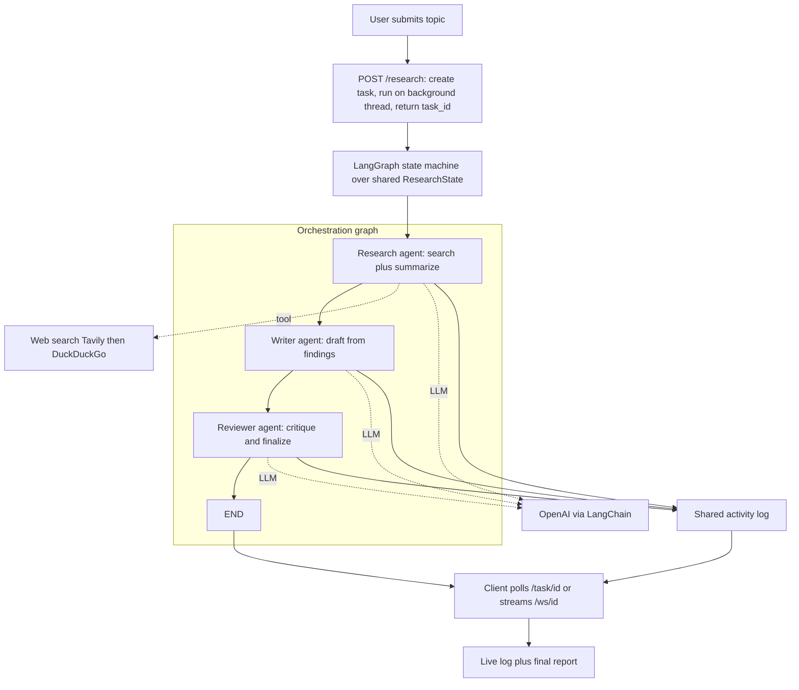

# 05 Multi-Agent System: Collaborating AI Agents

This project is an autonomous research assistant built from a *team* of AI **agents** that collaborate to produce a polished report on any topic. It demonstrates **agentic AI** the design pattern where a large language model is given a role, tools, and the autonomy to take actions, and where several such agents are chained so each handles one part of a larger job.

A single language-model call is a one-shot transaction: prompt in, text out. An *agent* is more than that it is a language model placed inside a loop with a specific responsibility, optionally able to call **tools** (functions that reach the outside world, such as a web search). A **multi-agent system** composes several specialized agents into a workflow, much as a human team divides research, drafting, and editing among different people. The central insight is that *decomposing a complex task across focused, specialized agents produces better results than asking one model to do everything at once.*

## What It Does

Given a topic, the system runs it through a three-stage assembly line of agents and returns a finished, reviewed report. The three roles mirror a real editorial workflow:

- A **Research Agent** searches the web for information on the topic and distills it into structured findings with facts and sources.
- A **Writer Agent** takes those findings and drafts a well-structured report executive summary, key findings, analysis, conclusions.
- A **Reviewer Agent** critiques the draft for accuracy and gaps and returns an improved final version.

Each agent has its own **system prompt** defining its persona and instructions, which is what specializes a general-purpose model into a focused contributor.

## Architecture and Components

The project cleanly separates *what each agent does* from *how the agents are wired together*.

### The agents (`agents.py`)

This file defines the three roles. Each is implemented as a **node function** a function that receives the shared workflow state, does its work, and returns an updated state. The Research node optionally invokes a search tool (preferring **Tavily**, a search API built for AI, and falling back to **DuckDuckGo**) and then uses a language model to summarize the raw results. The Writer and Reviewer nodes each invoke the language model with their specialized system prompt and the relevant prior output. Every node also appends a human-readable line to an activity **log**, so the workflow's progress can be observed step by step.

The language model used is OpenAI's, accessed through **LangChain** (a framework that provides a uniform interface to many LLMs and tools). True to the projects' design philosophy, if no model or search tool is configured, each node falls back to a sensible placeholder so the pipeline still completes end to end.

### The orchestration graph (`graph.py`)

This is where the agents become a system. The workflow is modeled with **LangGraph**, a library for building stateful, multi-step LLM applications as a **graph**. The graph is defined over a shared, typed **state** (`ResearchState`) a structured record holding the topic, the research findings, the draft, the final report, a status flag, and the activity log. Each agent node reads from and writes to this state, and the state is what flows from one node to the next.

The graph's structure is a simple linear chain: it enters at `research`, then edges lead `research → writer → writer → reviewer → reviewer → END`. Compiling this graph yields a runnable pipeline that, given an initial state with a topic, threads it through all three agents and returns the final state. A fallback path runs the same three nodes sequentially in plain Python if LangGraph isn't installed again ensuring the system always runs. Representing the workflow as an explicit graph is what makes it extensible: more agents, branching, or loops could be added by editing the graph rather than rewriting control flow.

### The entry point (`main.py`)

A command-line launcher: pass a topic as an argument and it runs the full pipeline, printing the activity log and the final report.

### The API (`api.py`)

Because a multi-agent research run can take a while, the API treats it as an **asynchronous task** rather than a blocking request. `POST /research` kicks off a run in the background and immediately returns a `task_id`. The work proceeds on a separate thread so the server stays responsive. The client then tracks progress in one of two ways: by **polling** `GET /task/{id}` for status and partial results, or by opening a **WebSocket** to `/ws/{id}` that streams each new log entry live as the agents complete their stages and pushes the final report when done. `GET /report/{id}` fetches the completed report. This long-running-job pattern start, track, retrieve is the standard way to expose workflows that don't finish instantly.

### The web interface (`templates/index.html`)

A page where a user enters a topic, watches the agents' progress stream in real time, and reads the finished report.

## Data Flow, End to End

```
user submits topic
        │
        ▼
POST /research  →  create task, run pipeline on a background thread, return task_id
        │
        ▼
LangGraph state machine over shared ResearchState:
        │
   ┌────────────┐     ┌──────────────┐     ┌────────────────┐
   │  Research  │ ──► │    Writer    │ ──► │    Reviewer    │ ──► END
   │ (search +  │     │ (draft from  │     │ (critique &    │
   │  summarize)│     │  findings)   │     │  finalize)     │
   └────────────┘     └──────────────┘     └────────────────┘
        │  each node appends to the shared activity log  │
        ▼                                                ▼
   client polls /task/{id}  OR  streams /ws/{id}  →  live log + final report
```

The architecture, with the API launching a background run that the LangGraph orchestrator threads through three specialized agents and their tools:



## Concepts Demonstrated

- **Agentic AI** giving a language model a role, tools, and autonomy to act, not just respond.
- **Multi-agent collaboration** decomposing a task across specialized agents (researcher, writer, reviewer) in a pipeline.
- **System prompts as specialization** shaping a general model into a focused contributor.
- **Tool use** equipping an agent with web search (Tavily / DuckDuckGo) to gather external information.
- **Stateful orchestration with LangGraph** modeling a workflow as a graph over a shared, typed state.
- **The LangChain ecosystem** a uniform interface to language models and tools.
- **Asynchronous, long-running jobs** start-track-retrieve with background tasks, polling, and WebSocket streaming.
- **Observability of an AI workflow** an activity log that exposes what each agent did and when.

Where earlier projects served a single model, this one serves an *orchestrated team* of model-powered agents the most complex form of "the model in the middle" in the collection.
