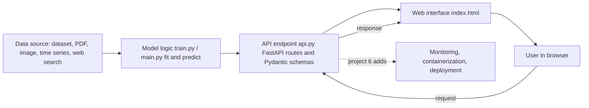
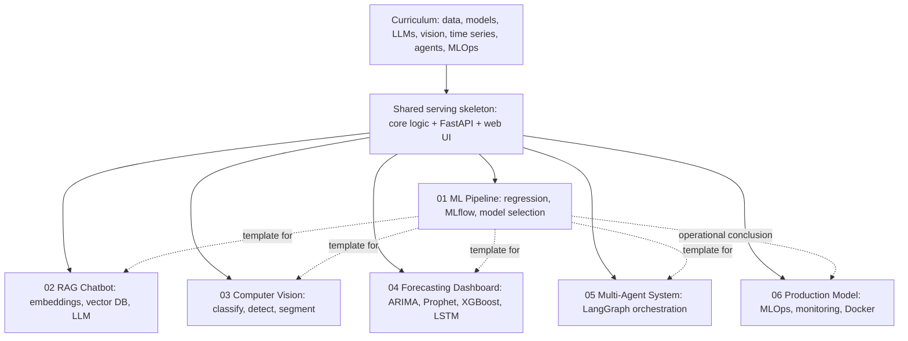

# Capstone Projects

The `21_Projects/` folder holds the culmination of the curriculum: six end-to-end applications that take an idea all the way from raw data to a running, observable web service. Unlike the earlier notebook-driven lessons, these are structured Python *projects* each one a small codebase with its own training logic, an API server, a browser front end, and the dependency list needed to run it. They are designed to be assembled, launched, and interacted with, not just read.

Each project is a *capstone* in the literal sense: a final stone that ties together every layer learned along the way. A typical machine learning or AI system is not a single model but a chain of responsibilities acquiring and shaping data, training or loading a model, wrapping that model behind a clean interface, serving it over the network, and watching how it behaves once real requests arrive. These projects make that full chain concrete, each one emphasizing a different slice of the discipline.

## What These Projects Have in Common

Despite covering very different problem domains tabular regression, document question-answering, image understanding, time-series forecasting, autonomous agents, and production deployment the six projects share a common skeleton. Recognizing this shared shape is itself one of the central lessons: most AI systems, regardless of the model inside, look structurally alike from the outside.

- **A core logic module.** Usually `main.py` (and sometimes a dedicated `train.py`), this file contains the actual intelligence: loading data, training models, running inference, or orchestrating reasoning. It is deliberately kept independent of the web layer so it can be imported, tested, or run from the command line on its own.
- **An API layer.** Every project exposes its capabilities through `api.py`, built on **FastAPI** a modern Python framework for building web APIs. An *API* (Application Programming Interface) is the contract through which other programs talk to the system: send a request, get a structured response. FastAPI uses **Pydantic** models to validate incoming and outgoing data, so malformed requests are rejected before they ever reach the model.
- **A web front end.** A `templates/index.html` file gives each project a browser-based interface, so a person can interact with the model directly upload an image, type a question, request a forecast without writing any code.
- **A dependency manifest.** Each `requirements.txt` pins the exact library versions the project needs, making the environment reproducible.
- **Graceful degradation.** A recurring engineering theme: every project tries to use the most capable backend available (a real large language model, a GPU-trained network, a specialized forecasting library) but *falls back* to a simpler mock or alternative when that backend is missing. This keeps the projects runnable on any machine while still demonstrating the full-strength design.

## How the Pieces Fit Together The Universal Data Flow

Across all six projects, data moves through the same conceptual pipeline:

```
Data source  →  Model logic  →  API endpoint  →  Web interface  →  User
(dataset,        (train.py /     (api.py,          (index.html)      (browser)
 PDF, image,      main.py:        FastAPI routes,
 time series,     fit / predict)  Pydantic schemas)
 web search)            ↑                                    ↓
                        └──────────  request / response  ─────┘
                                          │
                              (project 6 adds: monitoring,
                               containerization, deployment)
```

The shared skeleton, with data flowing from source through the model logic and API out to the user and back:



A request originates in the browser, travels to a FastAPI endpoint, is validated against a schema, is handed to the core logic for inference, and the structured result travels back to be rendered for the user. The final project closes the loop by adding the operational concerns logging, metrics, drift detection, and containerized deployment that turn a working prototype into a *production* system.

## The Six Projects at a Glance

### 01 ML Pipeline
A classic supervised-learning pipeline for **regression** (predicting a continuous number). It trains several candidate models on a medical dataset, compares them on standard metrics, automatically selects the best performer, and serves predictions through an API. It demonstrates the full *experimentation-to-serving* loop, including **MLflow** for tracking experiments and **cross-validation** for robust evaluation. This is the canonical template every other project builds upon.

### 02 RAG Chatbot
A **retrieval-augmented generation** chatbot that answers questions grounded in a collection of PDF documents. *RAG* combines a search step with a language-model generation step: the system finds the most relevant passages in its knowledge base and feeds them to the model as context, so answers stay faithful to source material rather than being invented. It demonstrates document chunking, **embeddings**, a **vector database** (ChromaDB), semantic retrieval, conversational memory, and real-time streaming over WebSockets.

### 03 Computer Vision App
A multi-task **computer vision** service that performs three distinct visual tasks on an uploaded image: **classification** (what is this a picture of?), **object detection** (what objects are present and where?), and **segmentation** (which pixels belong to which object?). It demonstrates working with pre-trained deep neural networks, image preprocessing, and serving heavy vision models behind a clean upload-and-analyze interface.

### 04 Forecasting Dashboard
A **time-series forecasting** system that predicts future values of a sequence and shows its uncertainty. It runs four very different forecasting approaches side by side a statistical model, a specialized seasonality model, a gradient-boosted tree model, and a recurrent neural network so their predictions and **confidence intervals** can be compared on the same data. It demonstrates the breadth of forecasting techniques and the importance of model comparison.

### 05 Multi-Agent System
An **autonomous multi-agent** research assistant. Several specialized AI *agents* a Researcher, a Writer, and a Reviewer collaborate in sequence to produce a polished report on any topic. The workflow is coordinated by **LangGraph**, which models the collaboration as a graph of steps passing a shared state between them. It demonstrates agentic design, tool use (web search), prompt specialization, and orchestrating a stateful pipeline of language-model calls.

### 06 Production Model
A **production-grade** sentiment classifier that takes the lessons of project 01 to their operational conclusion. Beyond training and serving, it adds the concerns that matter when a model faces real traffic: **rate limiting**, request logging, **Prometheus** metrics, **drift detection**, health checks, and full **containerization** with Docker and Docker Compose (including Redis, Prometheus, and Grafana). It demonstrates **MLOps** the engineering discipline of running models reliably in production.

## The Through-Line

How the six capstones tie back to the curriculum, each swapping a different model into the shared serving skeleton:



Read in order, the projects trace a deliberate arc. Project 01 establishes the train-evaluate-serve template. Projects 02 through 05 swap the model at the center for progressively more modern and varied AI language models with retrieval, deep vision networks, forecasting ensembles, and collaborating agents while keeping the same serving skeleton. Project 06 then circles back to the production realities that every one of them would face in the real world. Together they form a complete portrait of what an AI engineer actually builds: not models in isolation, but systems.
