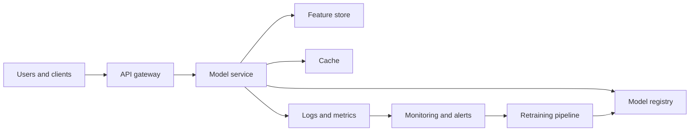
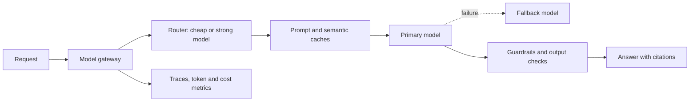

# ML System Design

A trained model is a small part of a working ML product. **System design** is the work of deciding everything around it: how requests arrive, where data and features live, how the model is served, how the system stays fast, cheap and reliable when traffic grows, and how you notice when something breaks. Interviews for ML and AI engineering roles almost always include a design question, and the same thinking is needed on the job.

This guide explains the ideas behind the ten notebooks in `22_ML_System_Design/`, from first principles. Read it first for the big picture, then run the matching notebook.

---

## 1. High-Level and Low-Level Design

**High-level design (HLD)** is the whiteboard picture: the main boxes (clients, gateway, services, databases, queues, caches) and the arrows between them. It answers "what are the parts, and how does data flow?" Key ideas are **scalability** (handling more load by adding machines, called horizontal scaling, or bigger machines, called vertical scaling), **load balancing**, **caching** and the **CAP theorem**: when the network splits, a distributed store must choose between staying consistent and staying available. See `01_hld_ml_systems.ipynb`.

**Low-level design (LLD)** zooms into one box and turns it into code: the API contract (request and response schemas, versioning, error codes), the data model (entities such as users, features, predictions and models), and design patterns (strategy for swappable models, factory for loading them, adapter for different backends). See `02_lld_ml_components.ipynb`.

## 2. Choosing Where Data Lives

Different data needs different stores.

| Store | Good for | Example use in ML |
|---|---|---|
| Relational database (SQL) | Structured records, transactions, joins | Users, labels, prediction logs |
| Key-value store | Very fast lookups by key | Online features, sessions, caches |
| Document store | Flexible JSON-like records | Experiment metadata, configs |
| Column-family store | Huge write volumes, time-ordered data | Event and click streams |
| Data lake / warehouse / lakehouse | Large-scale analytics and training data | Training sets, offline features |
| Vector database | Similarity search over embeddings | Semantic search, RAG, recommendations |

Relational design relies on **normalization** (store each fact once to avoid contradictions) and **indexes** (a sorted lookup structure that turns a full table scan into a quick jump). Vector databases rely on **approximate nearest neighbour** search: structures such as **IVF** (search only the closest clusters), **HNSW** (a layered graph you hop through) and **product quantization** (compressing vectors) trade a little accuracy for a lot of speed. See `03_relational_db_design.ipynb`, `04_nosql_and_data_stores.ipynb` and `05_vector_databases.ipynb`.

## 3. The Production ML Stack

A **feature store** keeps one definition of each feature and serves it both offline (for training) and online (for prediction), which prevents **training-serving skew**. A **model registry** is "git for models": versions, metrics, lineage and stages such as staging and production. **Serving patterns** include real-time APIs, batch scoring and streaming. New models are introduced safely with **shadow mode** (run silently beside the old one) and **A/B tests**. **Monitoring** watches inputs (data drift), outputs (prediction drift), quality once labels arrive, and the usual service health signals. See `06_ml_system_components.ipynb`.

Good **software engineering** keeps all of this maintainable: code moved out of notebooks into tested modules, a clear project structure, unit, integration and model tests, CI/CD pipelines, containers and structured logs. See `07_software_engineering_for_ml.ipynb`.

## 4. A Full Design, Step by Step

`08_industry_system_design_case_study.ipynb` designs a real-time payment fraud detector the way an interview or design review expects:

1. **Requirements:** what it must do (functional) and how well (latency, availability, throughput: non-functional).
2. **Back-of-the-envelope estimation:** requests per second at peak, data size, number of servers.
3. **API and data model.**
4. **High-level architecture.**
5. **Latency budget:** how many milliseconds each component may use.
6. **Failure handling:** timeouts, fallbacks, caches.
7. **Capacity:** utilisation and queueing (a server that is 90% busy builds long queues).
8. **Trade-offs:** for example batch vs streaming features.
9. **Checking the design against the requirements.**

## 5. System Design for LLM Applications

LLM apps are still system design, but the bottlenecks move. Instead of only CPU, memory and database load, you now budget **tokens** (which are money and latency), **context windows**, **retrieval quality**, **inference cost** and **user trust**.

Key building blocks: a **model gateway** that routes easy requests to cheaper models and fails over to backups; **circuit breakers**, timeouts and retries; **token budgets** per request and per user; prompt and semantic **caching**; **streaming** to cut perceived latency; **evaluations** offline (golden datasets) and online (A/B tests, user feedback), with LLM judges checked against human labels; and **security** (PII redaction, least-privilege tools, prompt-injection defences, avoiding the "lethal trifecta" of private data, untrusted input and an outbound channel). Hidden token leaks, such as long system prompts re-sent every turn, retries, agent loops and pasted tool outputs, are a common reason bills grow. See `09_ai_system_design_for_llm_applications.ipynb`.

## 6. Distributed Systems Patterns

Once a system runs on many machines, new problems appear: machines fail independently, messages are delayed, and clocks disagree. The main patterns:

- **Logical clocks** (Lamport, vector clocks) order events without trusting wall clocks.
- **Consensus and leader election** (Raft) let a group agree on one leader and one history even when some machines crash.
- **Distributed locks** need **leases** that expire and **fencing tokens** so a paused client cannot overwrite newer work.
- **Sagas** break a multi-step job into steps with compensating "undo" actions; the **outbox pattern** makes "save to the database and publish an event" reliable.
- **CQRS and event sourcing** separate writes from reads and keep a full history of changes.
- **Service discovery, sidecars and service meshes** help services find and talk to each other securely.
- **API gateway vs backend-for-frontend (BFF):** one shared front door, or a tailored backend per client type.
- **Strangler fig migration** replaces an old system gradually, one route or traffic share at a time.
- **Consistent hashing** spreads data across nodes so adding a node moves only a small share of keys.
- **Multi-region** setups trade cost and complexity for lower latency and survival of a regional outage.
- **Infrastructure as Code** (Terraform, Pulumi) describes infrastructure in reviewed code with plan, apply and drift detection.

See `10_distributed_systems_and_architecture_patterns.ipynb`.

## 7. Designing at Very Large Scale

**From 1 to 100 million users.** Systems grow in steps, and each step fixes what broke in the last one: one server, then a separate database, then several stateless app servers behind a load balancer, then database read replicas, then caches and a CDN, then queues and background workers, then sharded databases, then several regions. At every step you first estimate the load (daily users, requests per second at peak, storage growth) and only add complexity when the numbers demand it. Latency grows sharply as servers approach full utilisation, so capacity is planned to keep them well below 100% busy, with autoscaling and spare capacity for spikes. See `12_designing_for_100_million_users.ipynb`.

**RAG over 100 million PDFs.** At this size the corpus becomes billions of chunks, so the design is driven by arithmetic: how many terabytes the vectors take (and how much quantization and SSD-based indexes save), how long embedding takes, and how many shards and replicas are needed. Ingestion becomes a fault-tolerant pipeline (parse, OCR, dedupe, chunk, embed, index) with incremental updates. Queries fan out to many shards in parallel and merge the results, so the slowest shard sets the latency; hedged requests, replicas, caching and a strict per-step latency budget keep the tail (p99) low. See `11_rag_at_scale_100_million_pdfs_low_latency.ipynb`.

---

## How to Answer a Design Question

| Step | What to say |
|---|---|
| 1. Clarify | Users, scale, latency and accuracy targets, what is out of scope |
| 2. Estimate | Requests per second at peak, data volume, storage, number of machines or GPUs |
| 3. Sketch | The high-level boxes and data flow |
| 4. Deep dive | The hardest component (model serving, retrieval, features, the queue) |
| 5. Failure modes | What breaks, how you detect it, how you degrade gracefully |
| 6. Trade-offs | Cost vs latency vs quality, and why you chose this balance |
| 7. Evolve | Monitoring, evaluation, retraining and what you would build next |

Related reading in this repo: `23_Software_Engineering/09_system_design_fundamentals.ipynb` (load balancing, caching, queues, rate limiting, SLOs), `13_Databases/` (databases in depth) and `15_MLOps/` (running models in production).
