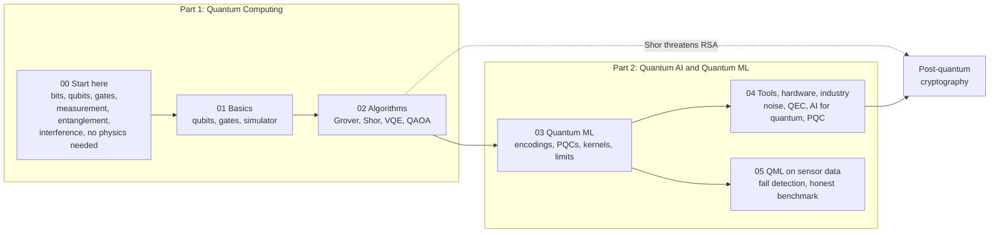
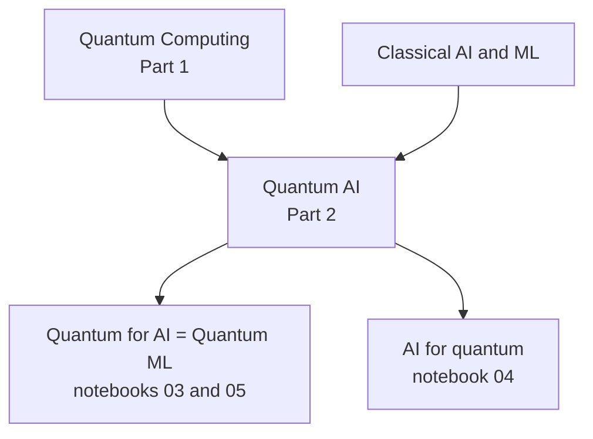
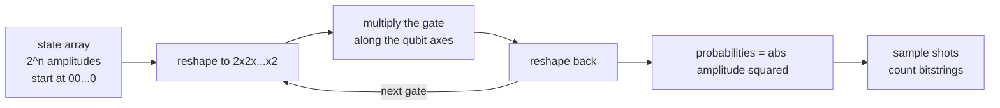
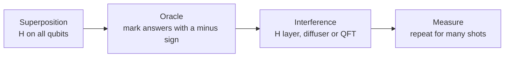
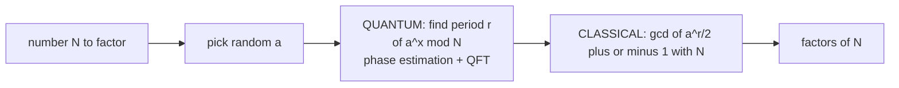
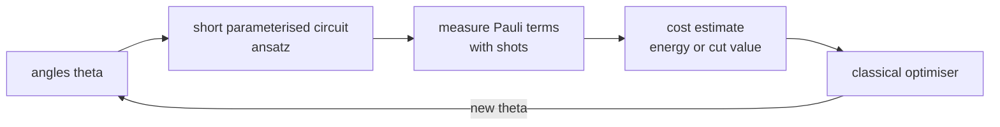
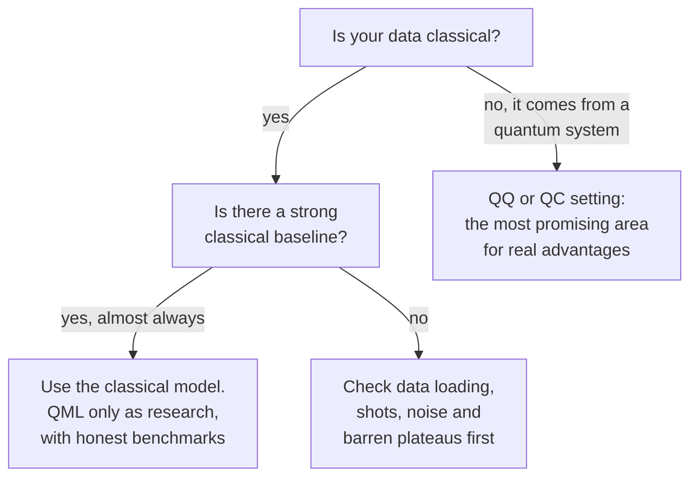
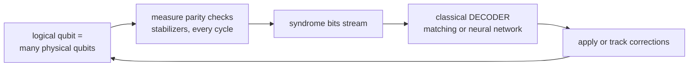
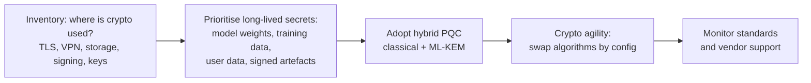
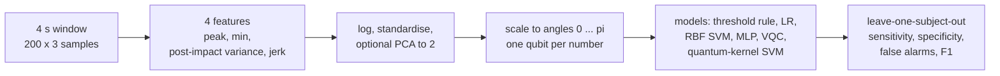

# Quantum AI: Quantum Computing and Quantum Machine Learning

A **quantum computer** is a machine that processes information using the rules of quantum physics. Its basic unit, the **qubit**, is not limited to 0 or 1 while a computation runs: it carries two numbers called **amplitudes**, and gates change those amplitudes in ways that can make wrong answers **cancel out**. For a few problems with special structure (factoring, simulating molecules, some kinds of search) this gives speedups that no classical computer can match. For most problems, including training today's neural networks, it gives nothing.

**Quantum AI** covers two different things that are easy to confuse:
- **Quantum for AI**: using quantum computers for machine learning (quantum machine learning, QML). Mostly research today.
- **AI for quantum**: using classical machine learning to build, calibrate, control and error-correct quantum computers. Already useful today.

The track has **two parts**, and Part 2 is built on Part 1:

| Part | Notebooks | Question it answers |
|---|---|---|
| **Part 1: Quantum Computing (00, 01, 02)** | `00_start_here_quantum_computing_explained_simply` (start here), `01_quantum_computing_basics`, `02_quantum_algorithms` | What is a quantum computer, how does it work, and what is it good for? |
| **Part 2: Quantum AI and Quantum ML (03, 04, 05)** | `03_quantum_machine_learning`, `04_quantum_ai_tools_hardware_and_industry`, `05_quantum_ml_on_sensor_data_fall_detection` | Can quantum computers help machine learning, how does AI help quantum computers, and what happens on a realistic task? |

Diagram: how the six notebooks of `25_Quantum_AI/` fit together.

This guide explains the ideas in the same order as the notebooks: `00_start_here_quantum_computing_explained_simply.ipynb` (the gentlest entry, with everyday pictures and maths from zero), `01_quantum_computing_basics.ipynb` (from bits to qubits, with a numpy simulator), `02_quantum_algorithms.ipynb` (what quantum computers are for), `03_quantum_machine_learning.ipynb` (QML and its limits), `04_quantum_ai_tools_hardware_and_industry.ipynb` (the practical picture) and `05_quantum_ml_on_sensor_data_fall_detection.ipynb` (QML tested on a realistic sensor task). Every term is defined when it first appears. Statements about fast-moving progress are kept general and dated "as of late 2026".

---

# Part 1: Quantum Computing (notebooks 00, 01, 02)

## 0 · Quantum computing explained simply (notebook 00)

This is the start point. It needs no physics and almost no maths.

**Bits vs qubits.** A **bit** is a switch: 0 or 1, one pattern at a time, and reading it changes nothing. A **qubit** is described by a list of two numbers (**amplitudes**); measuring it gives a plain 0 or 1 at random, and the chance of each is the **square** of its number.

**Three everyday pictures, and where they break.**

| Picture | What it gets right | Where it breaks |
|---|---|---|
| Spinning coin | a qubit gives a plain 0 or 1 when caught (measured) | a coin is secretly heads or tails; a qubit is not, and its numbers can be negative |
| Ripples on water | amplitudes can add up or cancel (interference) | you never see amplitudes, only random 0/1 results |
| Maze where wrong paths cancel | algorithms arrange cancellation of wrong answers | it does **not** mean "try every answer at once and pick the best" |

**The tiny bit of maths, from zero.**
- A **vector** is a list of numbers, drawn as an arrow; `[3, 4]` has length 5 (Pythagoras).
- A **matrix** is a "machine" that turns one vector into another; `[[0,1],[1,0]]` swaps the two numbers. Quantum gates are the **length-keeping** (unitary) machines.
- **Probabilities are squared lengths**: for `[0.6, 0.8]`, $0.36 + 0.64 = 1$. Squares are never negative, so amplitudes may be negative while probabilities stay positive.
- A **complex number** $a + bi$ ($i^2 = -1$) is a point on a flat map; its size is $\sqrt{a^2 + b^2}$. Its direction is the **phase**.

**Measurement is sampling.** A fair coin and the qubit $\lvert+\rangle$ = `[0.707, 0.707]` give identical-looking 50/50 results. Estimates improve like $1/\sqrt{\text{shots}}$.

**The list doubles with every qubit**: 2, 4, 8, ..., $2^n$ amplitudes; 30 qubits need about 17 GB. But one measurement still gives only n bits.

**Entanglement in plain words.** H then CNOT makes a **Bell pair**: only 00 or 11 ever appear, each qubit alone is 50/50, and the joint list cannot be split into two separate lists. The "pair of gloves" picture captures the linked results but breaks because gloves are decided from the start (Bell's theorem); no messages can be sent.

**Interference.** A coin flipped twice stays 50/50. A qubit sent through H twice returns to 0 for sure, because the two paths to 1 have amplitudes +0.5 and −0.5 and cancel.

**Myths to drop.** Quantum computers do **not** try all answers and pick the best; they are **not** faster at everything; they will **not** replace your laptop.

**The map of words.** **Quantum Computing** is the foundation (Part 1). **Quantum AI** is where quantum computing and AI meet, in two directions: **quantum for AI** (= **Quantum ML**, research) and **AI for quantum** (ML that builds and runs quantum computers, useful today). Quantum ML is one part of Quantum AI.

---

## 1 · The building blocks (notebook 01)

### Bits, qubits and amplitudes

A **bit** is 0 or 1. A **qubit** is described by two **amplitudes** $\alpha$ and $\beta$, written in **Dirac (ket) notation** as

$$\lvert\psi\rangle = \alpha\lvert0\rangle + \beta\lvert1\rangle = \begin{pmatrix}\alpha\\ \beta\end{pmatrix}.$$

Amplitudes are **complex numbers** (numbers $a + bi$ with $i^2 = -1$). The state is **normalised**: $\lvert\alpha\rvert^2 + \lvert\beta\rvert^2 = 1$. A state with non-zero amplitude on both 0 and 1 is in **superposition**.

**Analogy.** A bit is a coin lying on a table. A qubit is a spinning coin whose "spin direction" sets the odds. Unlike odds, amplitudes can be negative, so two ways of reaching the same result can cancel. That is the part coins cannot copy.

### Measurement, the Born rule and shots

**Measurement** reads a qubit and gives a classical 0 or 1. The **Born rule**: you get 0 with probability $\lvert\alpha\rvert^2$ and 1 with probability $\lvert\beta\rvert^2$. Measurement **collapses** the state: after reading 1, the qubit is $\lvert1\rangle$.

Because one measurement gives one random bit, a program is run many times. Each run is a **shot**. Probabilities and averages are estimated from counts, with an error of about $1/\sqrt{\text{shots}}$. With 1000 shots, a probability is known only to about ±3%. Every number read from real hardware is such an estimate.

### Phase and the Bloch sphere

$\lvert+\rangle = (\lvert0\rangle + \lvert1\rangle)/\sqrt2$ and $\lvert-\rangle = (\lvert0\rangle - \lvert1\rangle)/\sqrt2$ give the same 50/50 statistics but are different states. The sign (more generally, the complex angle) between the amplitudes is the **relative phase**. A **global phase** (one common factor for all amplitudes) changes nothing measurable.

Ignoring global phase, one qubit is a point on the **Bloch sphere**: $\lvert\psi\rangle = \cos\frac{\theta}{2}\lvert0\rangle + e^{i\varphi}\sin\frac{\theta}{2}\lvert1\rangle$. North pole = $\lvert0\rangle$, south pole = $\lvert1\rangle$, equator = 50/50 states. Single-qubit gates are rotations of this sphere. The picture does not extend to several entangled qubits.

### Gates

A **gate** is a **unitary** matrix $U$ ($U^\dagger U = I$): it keeps total probability at 1 and can be undone.

| Gate | Effect | Notes |
|---|---|---|
| X | swaps $\lvert0\rangle$ and $\lvert1\rangle$ | quantum NOT |
| Z | flips the sign of $\lvert1\rangle$ | changes only the phase |
| H (Hadamard) | $\lvert0\rangle\to\lvert+\rangle$, $\lvert1\rangle\to\lvert-\rangle$ | creates and undoes superpositions; $H H = I$ |
| S, T | quarter and eighth turns of phase | T is important for fault-tolerant computing |
| RX($\theta$), RY($\theta$), RZ($\theta$) | rotation by any angle $\theta$ | the trainable "weights" of variational circuits |
| CNOT | flips the target if the control is 1 | creates entanglement |

### Many qubits: tensor products

n qubits have $2^n$ amplitudes, one per bitstring. Independent qubits combine by the **tensor (Kronecker) product** $\otimes$ (`np.kron`). Memory for a full state is $16 \times 2^n$ bytes: about 17 GB for 30 qubits and about 18 PB for 50. This exponential growth is why quantum systems are hard to simulate classically, and why Feynman (1982) proposed quantum computers.

### Entanglement

H on qubit 0, then CNOT from 0 to 1, gives the **Bell state** $(\lvert00\rangle + \lvert11\rangle)/\sqrt2$. It is **entangled**: it cannot be written as (state of qubit 0) ⊗ (state of qubit 1). Each qubit alone is random, but the results always agree. Entanglement cannot send messages faster than light. A circuit that never creates much entanglement can usually be simulated efficiently, so entanglement is a necessary (not sufficient) ingredient of quantum speedups.

### Interference

Amplitudes from different "paths" add up (**constructive interference**) or cancel (**destructive interference**). H, then H again, returns $\lvert0\rangle$ with certainty, because the two paths to $\lvert1\rangle$ have amplitudes $+\frac12$ and $-\frac12$. Insert a Z between the two H gates and the paths to $\lvert0\rangle$ cancel instead. "Hide information in a phase, then interfere" is the core trick of every quantum algorithm.

### No-cloning

No unitary can copy an *unknown* quantum state. A CNOT "copies" $\lvert0\rangle$ and $\lvert1\rangle$, but turns $\lvert+\rangle\lvert0\rangle$ into a Bell state instead of $\lvert+\rangle\lvert+\rangle$. Consequences: quantum data cannot be backed up or read repeatedly for free, error correction cannot simply keep copies, and quantum key distribution is secure against copying.

### What a statevector simulator does

Diagram: the simulator built in notebook 01.

Qiskit's `Statevector` and PennyLane's `default.qubit` do the same, with many optimisations. Exact, but exponential in memory and time.

---

## 2 · Quantum algorithms (notebook 02)

### The common shape

An **oracle** is a black-box gate for a function $f(x)$. A **phase oracle** multiplies the amplitude of $\lvert x\rangle$ by $(-1)^{f(x)}$ (**phase kickback**). Speedups are usually counted in **queries** (oracle calls).

### Deutsch-Jozsa and Bernstein-Vazirani

- **Deutsch-Jozsa**: decide whether $f$ is constant or balanced with one query (H, oracle, H, measure: all zeros means constant). Deterministic classical algorithms need $2^{n-1}+1$ queries, but randomised ones succeed with high probability after a few, so this is a teaching example.
- **Bernstein-Vazirani**: recover a hidden string $s$ from $f(x) = s\cdot x \bmod 2$ with one query instead of n.

### Grover search and amplitude amplification

Finds a marked item among $N$ with about $\frac{\pi}{4}\sqrt N$ queries instead of about $N/2$: a **quadratic** speedup. Each round = oracle (flip the marked sign) + **diffuser** (reflect every amplitude about the mean). For $N = 8$ the success probability goes 0.125 → 0.78 → 0.95, then falls if you keep going (it is a rotation). Limits: the oracle must be a circuit, loading a classical database already costs $N$, and quadratic speedups need very large problems to pay off on slow, error-corrected hardware. The general technique (**amplitude amplification**, and **amplitude estimation** for Monte Carlo) is used inside many other algorithms.

### QFT and phase estimation

The **quantum Fourier transform** applies the discrete Fourier transform to the $2^n$ amplitudes using about $n^2/2$ gates. You cannot read the output amplitudes, only sample them, so it is useful only inside algorithms that need a sample of a frequency.

**Phase estimation (QPE)**: if $U\lvert u\rangle = e^{2\pi i\varphi}\lvert u\rangle$, controlled powers $U^{2^k}$ write $\varphi$ as a "wave" on a counting register, and the inverse QFT turns the wave into the binary digits of $\varphi$. QPE is the engine of Shor's algorithm and of exact quantum chemistry.

### Shor's algorithm and the cryptography consequence

Shor factors in polynomial time, which breaks **RSA** and (with a variant for discrete logarithms) **elliptic-curve cryptography**. Published resource estimates for RSA-2048 dropped from about 20 million noisy physical qubits (Gidney and Ekerå, 2019) to under one million (Gidney, 2025), running for hours to days on error-corrected hardware that does not exist yet. Symmetric ciphers (AES) and hashes are only affected by Grover (quadratic), so longer keys suffice. The response is **post-quantum cryptography** (section 5).

### Variational algorithms: VQE and QAOA

- **VQE** (variational quantum eigensolver) minimises $\langle\psi(\theta)\vert H\vert\psi(\theta)\rangle$; the **variational principle** guarantees the result is never below the true ground energy. The **Hamiltonian** $H$ is written as a sum of **Pauli strings**, each measured separately (rotate into the Z basis, then count). The number of terms and shots is a major practical cost.
- **QAOA** alternates a **cost layer** $e^{-i\gamma C}$ and a **mixer layer** $e^{-i\beta\sum X}$, p times, for combinatorial problems such as **MaxCut**.
- Both were designed for **NISQ** (noisy intermediate-scale quantum) machines. Neither has a demonstrated advantage over strong classical methods.

### Speedup types

| Speedup | Examples | Caveat |
|---|---|---|
| Exponential | Shor; quantum simulation of physics and chemistry | needs fault tolerance |
| Exponential with strong conditions | HHL linear systems | needs qRAM, sparse well-conditioned matrices, outputs a state; several follow-ups were dequantized |
| Quadratic | Grover, amplitude estimation | large overheads eat the gain at practical sizes |
| None known | VQE, QAOA, most QML, annealing for general optimisation | heuristics; may help on some instances |

---

# Part 2: Quantum AI and Quantum ML (notebooks 03, 04, 05)

## 3 · Quantum machine learning (notebook 03)

### The four combinations

| | Classical algorithm | Quantum algorithm |
|---|---|---|
| **Classical data** | CC: normal ML, quantum-inspired algorithms | CQ: variational classifiers, quantum kernels (most papers) |
| **Quantum data** | QC: ML for quantum devices (decoders, calibration) | QQ: quantum processing of quantum states (strongest theory) |

### Data encoding

| Encoding | Qubits for d features | Cost | Comment |
|---|---|---|---|
| Basis | d | a few X gates | binary data only |
| Angle | d | d rotations | cheap; model sees sines and cosines |
| Amplitude | $\log_2 d$ | about d gates in general | compact, but loading is the bottleneck |
| Re-uploading | d or fewer | grows with repeats | each repeat adds higher Fourier frequencies |

A model with L encodings of $x$ computes a Fourier series in $x$ with frequencies up to L (Schuld, Sweke and Meyer, 2021). That is why re-uploading makes small circuits expressive.

### Variational circuits ("quantum neural networks")

Encoding → trainable rotations and entangling gates → measured **expectation value** (for example $\langle Z\rangle \in [-1, 1]$). A classifier maps it to a probability, $p = (1 + \langle Z\rangle)/2$, and is trained with cross-entropy. There are no activation functions; non-linearity in $x$ comes from the encoding.

### The parameter-shift rule

For gates $e^{-i\theta P/2}$ with a Pauli matrix P:

$$\frac{\partial\langle O\rangle}{\partial\theta} = \frac{\langle O\rangle(\theta + \tfrac{\pi}{2}) - \langle O\rangle(\theta - \tfrac{\pi}{2})}{2}.$$

Exact (not an approximation), and robust to shot noise because the shifts are large. Cost: 2 circuit runs per parameter per data point. Simulators use backpropagation instead, which is far cheaper.

### Quantum kernels

A feature-map circuit $U(x)$ gives $\lvert\phi(x)\rangle$. The **fidelity kernel** $k(x,x') = \lvert\langle\phi(x)\vert\phi(x')\rangle\rvert^2$ is estimated on hardware as the all-zeros probability of $U(x')^\dagger U(x)$ and given to a classical SVM (`SVC(kernel="precomputed")`). Costs about $N^2/2$ circuits. Advantages are proven only for specially built problems (e.g. based on discrete logarithms). With many qubits, most such kernels **concentrate** (all off-diagonal entries near 0) and stop generalising.

### Hybrid models, QRL and QGANs

- **Hybrid model**: a quantum circuit as one layer inside a classical network (PennyLane + PyTorch/JAX, Qiskit Machine Learning). Always ablate the quantum layer.
- **Quantum RL**: PQCs as policies or Q-functions; works on toy environments, no advantage shown.
- **QGANs / quantum Born machines**: PQCs as generators (measurement outcomes are natural samples); small demonstrations.

### The limits, and when to (not) use QML

| Limit | What it means |
|---|---|
| **Barren plateaus** (McClean et al. 2018) | for random, deep enough circuits the gradient variance shrinks exponentially with qubit count (about halving per qubit in notebook 03), so training needs exponentially many shots. Shallow circuits with local costs avoid it, but are often classically simulable |
| **Noise / NISQ** | noise shrinks expectation values toward 0 and causes noise-induced plateaus |
| **Data-loading bottleneck** | loading N numbers costs about N operations; reading out costs about $1/\epsilon^2$ shots |
| **Dequantization** | Tang (2018) and follow-ups gave classical algorithms matching several claimed exponential QML speedups when given the same data access |
| **Benchmarks** | careful studies find simple classical baselines usually match or beat QML models on small classical datasets |

---

## 4 · Tools, hardware, noise and error correction (notebook 04)

### Software

Qiskit (IBM; circuits, primitives, transpiler, IBM hardware), PennyLane (Xanadu; differentiable circuits, QML), Cirq (Google), Amazon Braket SDK, Azure Quantum / Q#, NVIDIA CUDA-Q, Quantinuum pytket, Stim (error-correction simulation), OpenQASM 3 (exchange format). **Bit order:** Qiskit prints qubit 0 as the right-most bit; this track and PennyLane put it on the left.

### Hardware modalities

| Modality | Strength | Weakness |
|---|---|---|
| Superconducting | fast gates, chip fabrication | short coherence, cryogenics, wiring |
| Trapped ion | highest fidelities, all-to-all connectivity | slow gates, scaling traps |
| Neutral atom | large reconfigurable arrays | slower cycles, atom loss |
| Photonic | room-temperature parts, networking | photon loss, probabilistic gates |
| Spin (silicon) | tiny, CMOS-compatible | early stage, uniformity |
| Topological | built-in protection (promised) | early research; claims debated |

Ask for 2-qubit error rates, coherence times, connectivity, readout error, and physical vs logical counts, not just "number of qubits".

### Noise

- **Decoherence**: **T1** (energy relaxation, $\lvert1\rangle\to\lvert0\rangle$) and **T2** (loss of phase).
- **Gate errors** and **readout errors**.
- **Depolarizing noise** (a simple model): after a gate, with probability p a random X, Y or Z error. Simulated by **noise trajectories** in notebook 04: Bell-state correlations fall from 1.0 toward 0 as p grows.

### Error mitigation vs error correction

| | Mitigation | Correction |
|---|---|---|
| Idea | post-process noisy runs | encode logical qubits, detect and fix errors live |
| Example | zero-noise extrapolation (ZNE), readout correction | repetition code, surface code, qLDPC codes |
| Cost | more shots (exponential in circuit size) | many physical qubits per logical qubit + fast decoding |
| Scales to big algorithms? | no | yes, below threshold |

### The QEC cycle

- **Syndrome** measurements reveal *where* errors happened without revealing the stored value (so no-cloning is not violated).
- **Threshold**: below a physical error rate (about 1% for the surface code under realistic noise), larger **code distance** d makes logical errors drop exponentially; above it, larger codes make things worse.
- **Surface code**: a 2-D grid with nearest-neighbour checks, about $2d^2 - 1$ physical qubits per logical qubit.
- **Reported milestones**: in 2024 Google reported surface-code memories whose logical error rate fell as the distance grew from 3 to 5 to 7 ("below threshold"). Other groups have reported logical qubits beating physical ones on other platforms. As of late 2026, progress continues toward logical gates and larger codes, but useful fault-tolerant machines are still ahead.

### AI for quantum

| Task | ML technique |
|---|---|
| Decoding syndromes | neural decoders (e.g. AlphaQubit, reported in Nature 2024) that learn real, correlated device noise |
| Calibration and control | reinforcement learning, Bayesian optimisation |
| Readout | classifiers on raw signals |
| Compilation / ansatz design | RL, search, learned cost models |
| Code generation | LLM assistants for Qiskit/PennyLane (verify by simulation) |
| Classical simulation | neural-network quantum states, tensor networks |

Notebook 04 shows the core idea: with correlated "burst" errors a small MLP decoder beats the textbook minimum-weight decoder, because it learns the actual noise statistics.

---

## 5 · Industry and post-quantum cryptography (notebook 04)

### Realistic use cases

| Area | Honest status |
|---|---|
| Chemistry and materials | strongest long-term case; needs fault tolerance; classical methods keep improving |
| Physics simulation | earliest scientific value likely here |
| Optimisation | no proven advantage; classical solvers are very strong |
| Finance | quadratic Monte Carlo speedup needs fault-tolerant, fast machines |
| Machine learning | research stage (sections 3 and 6) |
| Sensing and networking | separate fields, some already commercial |

How to read an advantage claim: is the task useful, is the classical baseline the best and tuned, physical or logical qubits, error rates, independent reproduction.

### Post-quantum cryptography

**PQC** = classical algorithms believed to resist quantum attacks. NIST standards (August 2024): **ML-KEM** (FIPS 203, key encapsulation), **ML-DSA** (FIPS 204, signatures), **SLH-DSA** (FIPS 205, hash-based signatures); further selections include FN-DSA (Falcon) and HQC. ML-KEM and ML-DSA rest on (module) **learning with errors**: noisy linear equations $b = As + e \bmod q$ are easy without the noise and believed hard with it.

**Harvest now, decrypt later**: traffic and backups stolen today can be decrypted once a large quantum computer exists. For AI teams this covers model weights (IP), training data (often regulated), prompts and responses in API traffic, and signatures on model files and containers (supply-chain security). AES-256 and SHA-2 remain fine.

### Trying real hardware

IBM Quantum (Qiskit Runtime), Amazon Braket (several vendors), Azure Quantum (several vendors). Simulate first, transpile and check the depth on the real chip, compare with an ideal and a noisy simulation, and watch costs and queues.

---

## 6 · Quantum ML on sensor data: fall detection (notebook 05)

**The task in plain words.** A wearable **accelerometer** (in a watch or pendant) measures acceleration in **g** (1 g = gravity). A fall looks like: a **free-fall dip** below 1 g, an **impact spike**, then **stillness** while lying. Falls are **rare**, and some normal activities look similar (jumping, dropping hard onto a sofa). People differ, so the model must work on **new people**. The notebook uses synthetic windows for 8 simulated people (about 9% falls).

**Pipeline.**

**How to evaluate fairly.**
- **Leave-one-subject-out**: train on 7 people, test on the 8th, repeat. A random split leaks each person into training.
- **Metrics**: sensitivity (falls caught), specificity (normal windows left alone), false alarms, F1. Accuracy misleads: "never alarm" scores about 91%.
- Fit scalers and PCA on the training people only. Tune the classical RBF width and the quantum-kernel scale the same way (inner cross-validation).
- Compare on the **same inputs** (a 2-qubit model against a classical model given the same 2 numbers), and **repeat on several random datasets**: dataset-to-dataset spread was larger than most gaps between models.

**What the comparison shows (synthetic data, exact simulation).**
- The learned models, classical and quantum, all catch most falls; they differ mainly in false alarms. A tuned threshold rule is a strong, simple baseline but misses soft falls.
- The **variational quantum classifier** (4 qubits, 2 re-uploading layers, parameter-shift training) and the **quantum-kernel SVM** reach roughly the same F1 as the classical models: a tie at best. Over several datasets the classical RBF SVM on 4 features had the best average F1.
- **Encodings in disguise**: angle encoding without entanglement gives the kernel $\prod_i \cos^2((x_i - x_i')/2)$, and amplitude encoding gives the squared cosine similarity. Both are classical formulas.
- **Qubits vs features**: angle encoding needs one qubit per number, so quantum models see only a few hand-made features. With 2 qubits the VQC needed an extra layer (more depth, so more noise on hardware).
- **Shot noise**: tens of shots per window make predictions unreliable; hundreds to thousands are needed for every single prediction.
- **Hardware noise** (depolarizing + readout, simulated with a density matrix) squeezes outputs toward 0; at a few percent error per gate the model flags almost everything as a fall.
- **Cost**: parameter-shift training needs about 33 circuits per window per step; on hardware that is hundreds of millions of shots per fold.

**Verdict.** For wearable fall detection, use a classical model: it ties or wins on accuracy, trains in seconds, runs on the device in microseconds, works offline and has no shot or hardware noise. QML research matters most for **quantum data** (for example from future quantum sensors), for problems with proven quantum structure, and for learning how to benchmark claims honestly. The classical deep dive on this task is in [26_Sensor_AI/02_imu_activity_recognition_and_fall_detection.ipynb](../../26_Sensor_AI/02_imu_activity_recognition_and_fall_detection.ipynb).

---

# Summary and reference

## Common misconceptions

| Misconception | Reality |
|---|---|
| "Qubits try all answers in parallel" | one measurement gives n bits; algorithms rely on interference |
| "More qubits = more powerful" | error rates, connectivity and logical qubits matter more |
| "Quantum computers will replace GPUs" | they are special-purpose accelerators for a few problem types |
| "QML trains neural networks exponentially faster" | no evidence; data loading, readout and gradients cost too much |
| "Entanglement allows faster-than-light messages" | no; each side alone sees random results |
| "RSA is broken" | not yet; but harvest-now-decrypt-later makes migration urgent |
| "Quantum advantage has been shown, so it is useful" | demonstrations so far are on chosen, mostly non-practical tasks |
| "Quantum ML will make wearables and sensors smarter soon" | on a realistic fall-detection task (notebook 05) QML only ties classical models, while needing shots, noise-free hardware and far more compute |

---

## Quick reference

| Term | Meaning |
|---|---|
| Qubit | two complex amplitudes, normalised |
| Born rule | probability = $\lvert\text{amplitude}\rvert^2$ |
| Shot | one run + measurement |
| Unitary | reversible, probability-preserving matrix (a gate) |
| Tensor product | combining qubits; $2^n$ amplitudes for n qubits |
| Entanglement | joint state not a product of single-qubit states |
| Interference | amplitudes adding or cancelling |
| Oracle / phase kickback | black-box function written into a phase |
| Amplitude amplification | Grover's repeated oracle + diffuser |
| QFT / QPE | Fourier transform of amplitudes / reading an eigenvalue phase |
| Ansatz | the parameterised circuit of a variational algorithm |
| NISQ | noisy intermediate-scale quantum (today's machines) |
| Parameter-shift rule | exact gradient from two shifted runs |
| Fidelity kernel | squared overlap of two encoded states |
| Barren plateau | exponentially vanishing gradients |
| Dequantization | classical algorithm matching a claimed quantum speedup |
| T1 / T2 | relaxation / dephasing times |
| Logical qubit | error-protected qubit made of many physical qubits |
| Threshold | error rate below which bigger codes help |
| ML-KEM / ML-DSA / SLH-DSA | NIST post-quantum standards (FIPS 203 / 204 / 205) |
| Sensitivity / specificity | share of real falls caught / share of normal windows left alone |
| Leave-one-subject-out | test on a person the model has never seen; repeat for every person |
| Density matrix | a $2^n \times 2^n$ table that can describe noisy mixtures of states |

---

## Further reading

- M. A. Nielsen and I. L. Chuang, *Quantum Computation and Quantum Information*, Cambridge University Press, 2010.
- M. Schuld and F. Petruccione, *Machine Learning with Quantum Computers*, Springer, 2nd ed. 2021.
- Qiskit documentation and IBM Quantum Learning (successor of the Qiskit textbook); PennyLane documentation and QML demos.
- J. Preskill, "Quantum Computing in the NISQ era and beyond", *Quantum* 2, 79 (2018), arXiv:1801.00862.
- J. R. McClean et al., "Barren plateaus in quantum neural network training landscapes", *Nature Communications* (2018), arXiv:1803.11173.
- V. Havlíček et al., "Supervised learning with quantum-enhanced feature spaces", *Nature* (2019), arXiv:1804.11326.
- E. Tang, "A quantum-inspired classical algorithm for recommendation systems", STOC 2019, arXiv:1807.04271.
- A. G. Fowler et al., "Surface codes: Towards practical large-scale quantum computation", *Physical Review A* (2012).
- NIST FIPS 203, 204 and 205 (2024).
