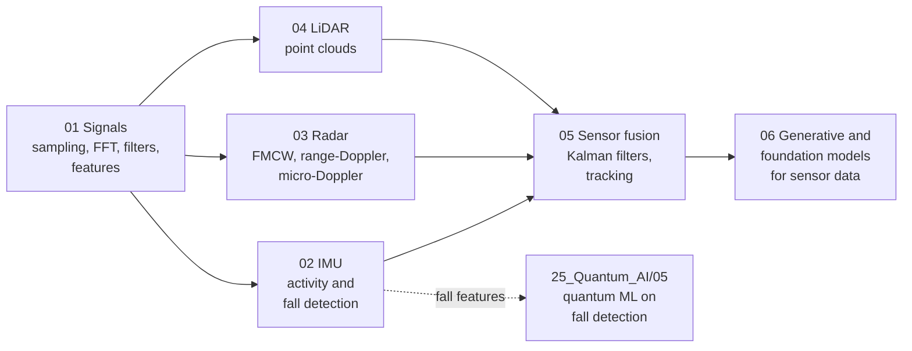
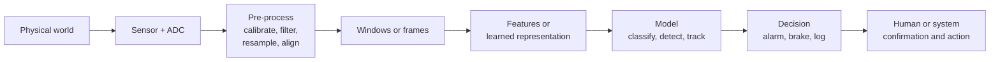
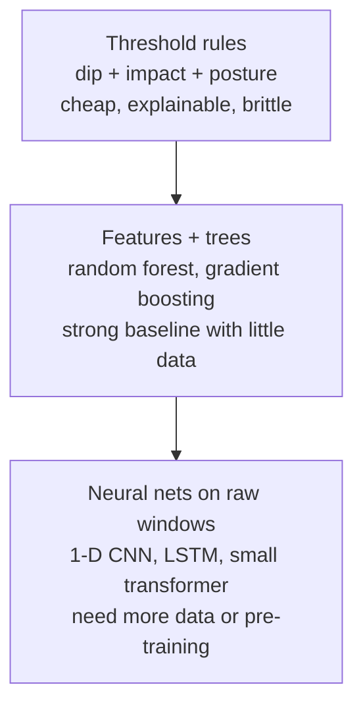
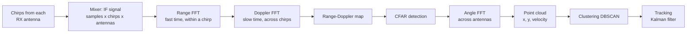
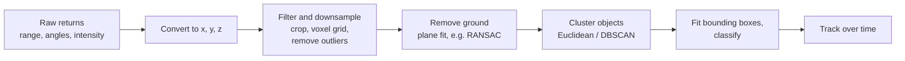
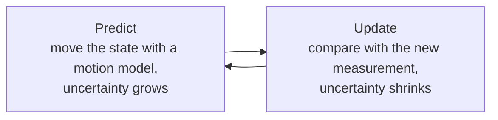
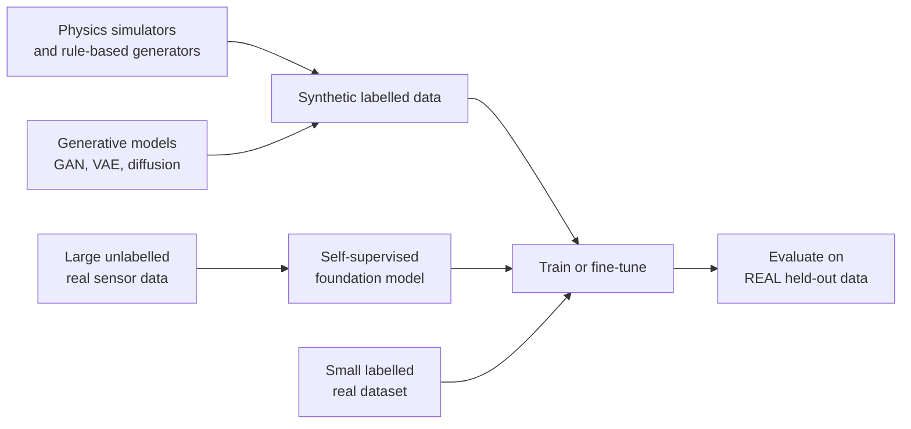

# AI with Sensors: Signals, IMU, Radar, LiDAR and Sensor Fusion

A **sensor** is a device that measures something in the physical world (motion, distance, sound, light, radio echoes) and turns it into an electrical value. A **signal** is how that value changes over time or space; in code it is an array of numbers plus timestamps. **Sensor AI** is the craft of turning these noisy, fast, physical streams into reliable decisions: "this person fell", "that object is a car moving towards us at 8 m/s", "this bearing is about to fail".

Sensor data differs from the clean tables and images of most ML courses in three ways. It is **sampled** (the device only sees snapshots, so timing and sampling rate matter), it is **physical** (gravity, wavelengths, noise and drift follow known laws you can exploit), and it is **continuous** (a device must decide in real time, on a small battery, with rare but important events). This guide explains the ideas behind the six notebooks of `26_Sensor_AI/` in the same order.

Diagram: how the six notebooks fit together.

Diagram: the generic sensor-to-decision pipeline that every notebook follows.

---

## Part 1 · Signals, frequency and sensor basics (notebook 01)

### From the physical world to numbers

A **transducer** converts one kind of energy into another (a tiny moving mass into a voltage, sound pressure into a voltage). An **ADC (analog-to-digital converter)** measures that voltage at regular moments and rounds it to whole numbers. The result is a **digital signal**.

- The **sampling rate** `fs` (in hertz, Hz) is the number of samples per second; the time between samples is `1 / fs`.
- An **N-bit ADC** has `2^N` levels. Rounding to those levels is **quantization**, and the rounding error is **quantization noise**. A useful rule of thumb for a full-scale sine is SNR ≈ 6.02 N + 1.76 dB, so each extra bit adds about 6 dB.

### Nyquist and aliasing

To capture a frequency `f`, you must sample faster than `2f`. Half the sampling rate, `fs / 2`, is the **Nyquist frequency**. Anything above it does not disappear; it **aliases**, folding back and pretending to be a lower frequency (`f_alias = |f - fs * round(f / fs)|`). The film effect of a car wheel spinning backwards is aliasing. Devices prevent it with an analog **anti-aliasing low-pass filter** before the ADC, and software must low-pass filter before **downsampling** (`scipy.signal.decimate` does both).

### Noise, bias, drift and calibration

| Noise type | What it is | Averaging helps? | Fix |
|---|---|---|---|
| **White noise** | random jitter, equal power at all frequencies | yes (shrinks like `1/sqrt(n)`) | averaging, low-pass filtering |
| **Bias (offset)** | constant error | no | calibration |
| **Drift / random walk** | bias that wanders over time or temperature | no | re-calibration, sensor fusion |
| **Spikes, interference** | outliers, 50/60 Hz mains hum | partly | median filters, notch filters |

**Integration amplifies bias**: a gyroscope with 0.2 deg/s bias, integrated to get an angle, is 12 degrees wrong after a minute. That is why IMU-only navigation drifts, and why Part 5 fuses sensors. **Calibration** maps raw readings to true values, usually `true = (raw - offset) / scale`; for an accelerometer, readings with an axis pointing up (+1 g) and down (-1 g) give both numbers. **Allan variance** is the standard plot engineers use to characterise IMU noise over different averaging times.

### Time domain vs frequency domain

The **Fourier transform** expresses a signal as a sum of sine waves; the **FFT (fast Fourier transform)** computes it efficiently. Many physical processes are periodic (engines, footsteps, heartbeats, breathing), so they become sharp, readable peaks in the frequency domain.

- `np.fft.rfft` gives `N/2 + 1` complex bins from 0 to `fs/2`; amplitude of a sine ≈ `2 |X| / N`.
- **Frequency resolution** is `df = fs / N = 1 / T`: a longer window separates closer frequencies. **Zero padding** smooths the plot but adds no real resolution.
- **Spectral leakage**: if the window does not contain whole cycles, energy smears into neighbouring bins. A **Hann window** fades the ends to zero and greatly reduces leakage, at the cost of a slightly wider peak.
- The **spectrogram (STFT, short-time Fourier transform)**: FFTs of short overlapping windows stacked over time; it shows *which* frequencies are present *when*. Short windows give good time detail; long windows give good frequency detail (the **time-frequency trade-off**).

### Filtering and resampling

| Filter | Keeps | Example |
|---|---|---|
| Low-pass | slow parts | remove jitter; gravity and posture from an accelerometer |
| High-pass | fast parts | remove gravity and drift |
| Band-pass | a range | heart rate from PPG, breathing, a machine's resonance band |
| Notch | all except a narrow band | remove mains hum |

A **moving average** is the simplest low-pass filter. A **Butterworth** filter has a flat pass band; its **order** sets steepness. Use the SOS (second-order sections) form for numerical safety. `sosfiltfilt` is **zero-phase** (no delay) but needs the whole recording, so it is offline only; a device must use a **causal** filter (`sosfilt`) and accept some delay. To combine sensors with different rates, interpolate them onto a common timeline using their timestamps.

**Wavelets** use short, stretched or squeezed "wiggles" instead of endless sines, so they show *when* short events (clicks, impacts, ECG beats) happen. The **Haar** wavelet takes pairwise averages (smooth part) and differences (detail part) repeatedly.

### Features for machine learning

| Group | Examples | Captures |
|---|---|---|
| Time domain | mean, std, RMS, peak, **crest factor**, **kurtosis**, skewness, zero-crossing rate | level, energy, impulsiveness |
| Frequency domain | dominant frequency, band energies, spectral centroid, spectral entropy | rhythms, which bands are active |
| Audio-style | **MFCC** (mel-frequency cepstral coefficients): mel-spaced band energies -> log -> DCT | compact spectral shape |
| Physics-specific | 1x/2x/3x running-speed harmonics, envelope spectrum (bearings), tilt from gravity (IMU) | known failure or motion signatures |

**Vibration-based predictive maintenance** is the classic example: imbalance raises the 1x running-speed peak, misalignment raises 2x and 3x, and a bearing defect produces repeating impacts that ring a high-frequency resonance. **Envelope analysis** (band-pass around the resonance, take the envelope with the Hilbert transform, then FFT) reveals the bearing fault frequency.

**Evaluation rule** for every sensor model: split by **machine, person or device** (`GroupKFold`, leave-one-subject-out), never by random window. Windows from the same source are correlated, and random splits inflate scores.

---

## Part 2 · IMU activity recognition and fall detection (notebook 02)

### The IMU

An **IMU (inertial measurement unit)** combines an **accelerometer** (acceleration on 3 axes, in g; 1 g ≈ 9.81 m/s²), a **gyroscope** (rotation speed, deg/s) and often a **magnetometer** (compass). An accelerometer measures **specific force**: at rest it reads +1 g pointing "up" in its own frame; in **free fall** it reads about 0 g. The gravity direction gives **tilt**: `tilt = arccos(a_z / |a|)`. The magnitude `|a|` is independent of how the device is worn, which makes it a robust feature.

### Human activity recognition (HAR)

**HAR** classifies windows (for example 2.56 s, 50% overlap) into activities such as walk, stairs, sit, stand and lie. Typical confusions are walk vs stairs (similar rhythm; a barometer helps) and sit vs stand (a waist sensor sees only a small tilt difference). Performance varies a lot **between people**, so always look at per-subject results.

### Fall detection

A fall has a typical signature: **free-fall dip** (|a| well below 1 g, fast rotation), **impact spike** (several g within tens of milliseconds), then **stillness** in a new posture. The difficulty is **look-alikes**: jumping (real free fall + hard landing), dropping into a chair, flopping onto a bed; and **hard falls**: soft falls, falls that end sitting.

Diagram: three generations of fall detectors.

### Rare-event evaluation

Falls are rare, so **accuracy is meaningless** (always saying "no fall" scores about 99%). Use:

| Metric | Meaning |
|---|---|
| **Sensitivity / recall** | share of real falls caught |
| **Specificity** | share of normal windows left alone |
| **Precision** | share of alarms that are real falls |
| **PR curve, average precision** | trade-off over all thresholds; more informative than ROC for rare positives |
| **False alarms per day** | the number users actually experience; even 99.9% specificity on 1.28 s windows means dozens of false alarms per day |

**Class imbalance** is handled with class weights, oversampling, threshold moving and, above all, more positive and hard-negative data. Choose the alarm threshold on a validation set, not on the test set.

### Edge constraints and deployment

**Edge AI** runs the model on the device. Constraints: latency, battery, memory, compute and privacy. Tricks: small models, **int8 quantization** (8-bit integer weights plus a scale; 4x smaller), low sampling rates, and a **cascade** where a cheap rule (or the IMU chip's own motion interrupt) wakes the model only for interesting windows.

A fall detector is a **safety system**: add an "Are you OK?" countdown so users can cancel false alarms, escalate to family, a monitoring centre and emergency services when there is no answer, keep a manual help button, monitor real-world false-alarm rates after launch, test on the actual target population, and check whether medical-device regulation applies (it depends on the claims and the market).

**Other fall sensors:** cameras (rich but privacy-invasive), mmWave radar (micro-Doppler, no images), WiFi CSI (uses existing routers, still maturing), floor vibration and pressure mats, and microphones. Many products fuse several.

---

## Part 3 · Radar: FMCW, range-Doppler and micro-Doppler (notebook 03)

### Radar basics

**Radar** sends radio waves and measures echoes: **range** from delay (`R = c tau / 2`), **radial velocity** from the **Doppler effect**, and **angle** from phase differences across antennas. Echo power follows the **radar equation**, falling as `RCS / R^4`, where **RCS (radar cross section)** is how radar-bright an object is. **mmWave** radars (wavelength of a few millimetres) commonly use bands around 24 GHz, 60 GHz (indoor, in-cabin, gestures, vital signs) and 76-81 GHz (automotive); allocations differ by country.

### FMCW: from chirps to a radar cube

A **pulse radar** sends short bursts and times the echo. An **FMCW (frequency-modulated continuous wave)** radar sends **chirps** whose frequency rises linearly with slope `S`. Mixing the echo with the transmitted chirp gives an **IF signal** at the **beat frequency** `f_b = 2 S R / c`.

Diagram: the FMCW processing chain, one FFT per dimension.

| Quantity | Formula | Depends on |
|---|---|---|
| Range resolution | `c / (2B)` | bandwidth `B` |
| Maximum range (complex sampling) | `fs c / (2S)` | ADC rate and slope |
| Doppler phase step per chirp | `4 pi v T_c / lambda` | velocity and chirp period |
| Maximum velocity | `lambda / (4 T_c)` | chirp period |
| Velocity resolution | `lambda / (2 N_c T_c)` | frame duration |
| Angle phase step | `pi sin(theta)` for `lambda/2` spacing | angle |
| Angle resolution (approx.) | `2 / N_virtual` rad at boresight | number of (virtual) antennas |

A **MIMO** radar with N_tx transmitters and N_rx receivers forms a **virtual array** of N_tx x N_rx elements. **4D imaging radars** use large virtual arrays to add elevation and finer angle.

### Detection: CFAR

**CFAR (constant false alarm rate)** sets a local threshold for each cell from the average of surrounding **training cells**, skipping **guard cells**. For cell-averaging CFAR with N training cells, `alpha = N (Pfa^(-1/N) - 1)`. Weaknesses: **masking** when other targets or clutter fall in the training cells; **OS-CFAR** (ordered statistic) is more robust. Detections are converted to a **radar point cloud** and grouped with **DBSCAN**, which needs no preset number of clusters and labels isolated points as noise.

### Micro-Doppler and vital signs

**Micro-Doppler** is the extra Doppler from moving parts: limbs of a walking person, rotor blades of a drone. In a spectrogram of the slow-time signal, walking shows a torso line with periodic limb bands; a fall shows a fast, strong, short streak that stops abruptly. Features from the spectrogram (envelope, centroid, spread, periodicity, post-event stillness) or a CNN on the spectrogram image classify activities and falls.

**Vital signs:** chest movement `d` changes the echo phase by `4 pi d / lambda` (about 2.5 rad per mm at 60 GHz). Remove static clutter, **unwrap** the phase, band-pass (breathing about 0.1-0.6 Hz, heart about 0.8-2.5 Hz) and find the dominant frequency. Uses include **child presence detection** in cars, sleep monitoring and contact-free elder care. **Gesture sensing** (for example Google's Soli) classifies hand motions from range-Doppler sequences.

---

## Part 4 · LiDAR point clouds (notebook 04)

**LiDAR** (Light Detection And Ranging) fires laser pulses and measures the **time of flight** of each return (`R = c t / 2`), building a **point cloud**: a list of 3-D points (x, y, z), often with **intensity** (how strongly the surface reflected). A spinning or scanning unit produces many thousands of points per scan; the points are dense nearby and sparse far away.

Diagram: a typical classic LiDAR processing pipeline.

Key ideas:
- **Coordinates:** each return has a range plus horizontal (azimuth) and vertical (elevation) angles, converted to x, y, z with trigonometry; sensor pose transforms (rotation + translation, see [linear algebra](../../14_Mathematics/01_linear_algebra.ipynb)) place points in a common frame.
- **Voxel downsampling:** split space into small cubes (voxels) and keep one point per cube to make processing faster.
- **Ground removal:** fit a plane to the ground (RANSAC repeatedly fits a plane to random points and keeps the one most points agree with) and remove it, so objects stand apart.
- **Clustering and boxes:** group remaining points into objects and fit bounding boxes; **nearest-neighbour search** with k-d trees makes this efficient.
- **Registration:** aligning two scans (for example with **ICP, iterative closest point**) is the basis of mapping and localisation (**SLAM**, simultaneous localisation and mapping).
- **Deep learning on point clouds:** networks that take unordered points directly (the PointNet family), voxel or pillar grids, or a **bird's-eye-view (BEV)** image.
- **Strengths and weaknesses:** precise 3-D geometry in the dark; cost, no colour, degraded by heavy rain, fog and snow, and sparse at long range.

---

## Part 5 · Sensor fusion, Kalman filters and tracking (notebook 05)

**Sensor fusion** combines measurements from several sensors (or several moments in time) to get an estimate that is better than any single source. Example: a gyroscope is smooth but drifts; an accelerometer knows "down" but is noisy during motion; together they give stable orientation. GPS is absolute but slow and jumpy; an IMU is fast but drifts; together they give smooth, accurate position.

| Fusion level | What is combined | Example |
|---|---|---|
| **Early (low-level)** | raw data | projecting LiDAR points onto a camera image |
| **Mid (feature-level)** | features or embeddings | combining radar and camera features in one network |
| **Late (decision-level)** | object lists or decisions | merging radar tracks with camera detections |

### The Kalman filter

A **Kalman filter** estimates a hidden **state** (for example position and velocity) from noisy measurements by repeating two steps:

Diagram: the Kalman filter loop.

- **State** `x` and its **covariance** `P` (how unsure we are).
- **Predict:** `x = F x`, `P = F P F^T + Q` (`F` = motion model, `Q` = process noise).
- **Update:** the **Kalman gain** `K = P H^T (H P H^T + R)^-1` decides how much to trust the measurement (`R` = measurement noise) vs the prediction; then `x = x + K (z - H x)`.
- If the measurement is very noisy, `K` is small and the filter trusts its prediction; if the prediction is uncertain, `K` is large and it trusts the measurement.
- **Complementary filter:** a simple fusion that high-passes the gyroscope and low-passes the accelerometer; often used for orientation on small devices.
- Non-linear problems use the **extended Kalman filter (EKF)**, the **unscented Kalman filter (UKF)** or **particle filters**.

### Multi-object tracking

Tracking many objects adds **data association**: which detection belongs to which track? Simple systems use nearest neighbour with a **gating** distance; better ones solve an assignment problem (the **Hungarian algorithm**) or use probabilistic methods. A track also needs a **life cycle**: create tentative tracks, confirm them after a few hits, delete them after several misses. Radar helps tracking because it measures velocity directly (notebook 03).

---

## Part 6 · Sensor data for generative and foundation models (notebook 06)

Labelled sensor data is expensive, and the most important events (falls, crashes, machine failures) are rare and sometimes dangerous to record. Three ideas address this.

- **Synthetic data and simulation.** Generate data from physics or rule-based models (as the notebooks in this track do), from game-engine simulators for driving and robotics, or from motion-capture-driven body models for radar and IMU. Synthetic data is cheap, perfectly labelled and covers rare cases, but it is never exactly like reality.
- **Sim-to-real.** The **sim-to-real gap** is the difference between simulated and real data. Common remedies: **domain randomisation** (vary noise, mounting, materials and lighting widely so reality looks like one more variation), **domain adaptation** (align features of simulated and real data), and **fine-tuning** on a small set of real data. Always test on real data.
- **Generative models for sensor data.** Models that learn to produce new realistic samples: GANs, VAEs and diffusion models for time series, spectrograms, LiDAR scans and radar maps. Uses: data augmentation, rare-event synthesis, privacy-preserving data sharing, and filling gaps. Risks: models may copy training data or miss rare physical details.
- **Sensor foundation models and world models.** Large models pre-trained with **self-supervised learning** (for example masking parts of a signal and predicting them, or contrastive learning) on huge amounts of unlabelled sensor data, then fine-tuned for many tasks with few labels. **World models** learn to predict how a scene (for example a driving scene with camera and LiDAR) will evolve, and can be used for simulation and planning. As of late 2026 this is a fast-moving area; check current papers and model cards before relying on any specific model.

- **Augmentation and the data engine.** Cheap transformations of real recordings (adding noise, scaling, small rotations of IMU axes, time warping, mixing) multiply the training data. A **data engine** is the loop real teams run: deploy, collect hard and failure cases from the field, label them, retrain, redeploy.
- **Multimodal sensor-language models and digital twins.** Models that connect sensor streams with text (for example, answering questions about a recording) are an active research area. A **digital twin** is a live simulation of a real machine or place, kept in sync by its sensors, used for monitoring and what-if testing.

Diagram: where synthetic data and foundation models fit.

---

## Sensors at a glance

| Sensor | Measures | Best at | Weak at |
|---|---|---|---|
| Camera | light and colour | semantics: what is it? | darkness, glare, fog, distance, privacy |
| Accelerometer | acceleration incl. gravity | impacts, tilt, rhythm | position (drifts when integrated) |
| Gyroscope | rotation speed | fast orientation changes | long-term angle (drift) |
| Magnetometer | magnetic field | heading | indoors near metal |
| Radar | range, velocity, angle | speed, bad weather, privacy | angular resolution, semantics |
| LiDAR | 3-D points | precise geometry | cost, heavy weather, colour |
| Ultrasonic | short distance | cheap parking/obstacle sensing | range, wide beam |
| Thermal | heat | people at night | resolution, cost |
| Microphone | sound | events out of sight | noise, speech privacy |
| GPS | global position | outdoor position and time | indoors, urban canyons |
| WiFi CSI | channel changes from motion | device-free presence and activity | robustness to room changes |
| ECG / PPG | heart activity / blood volume | continuous health signals | motion artefacts, regulation |

---

## Summary

- Sample faster than twice the highest frequency you need, filter before sampling or downsampling, and keep units and timestamps explicit.
- The FFT, windowing and spectrograms turn periodic physical behaviour into clear features; filters and wavelets clean and localise it.
- IMUs feel gravity and motion; falls are "dip, spike, stillness"; evaluate on **new people** and report **false alarms per day**, not accuracy.
- FMCW radar turns delay into a beat frequency (range), chirp-to-chirp phase into velocity, and antenna phase into angle; CFAR, clustering and tracking turn maps into objects; micro-Doppler and phase reveal activities, falls and breathing without cameras.
- LiDAR gives precise 3-D point clouds; classic pipelines downsample, remove the ground, cluster and box objects.
- Sensor fusion and Kalman filters combine complementary sensors into estimates better than any single one, and trackers keep identities over time.
- Synthetic data, sim-to-real methods, generative models and sensor foundation models reduce the need for expensive labels, but final evaluation must always use real data.
- Sensor AI products are often safety-critical and privacy-sensitive: design for human confirmation, on-device processing, data minimisation and the regulations of your market.
