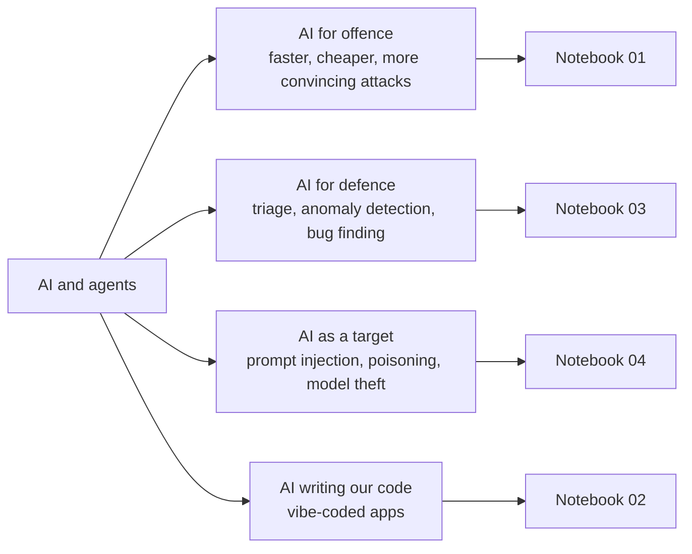
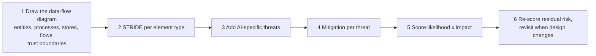
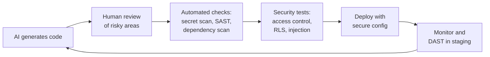
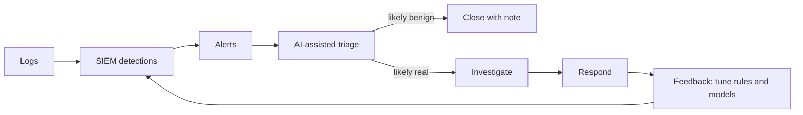
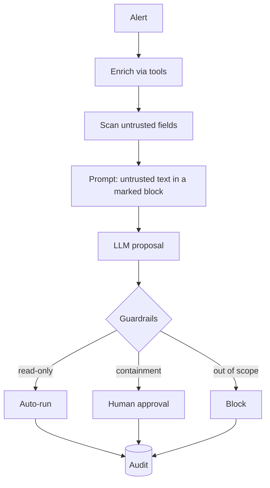
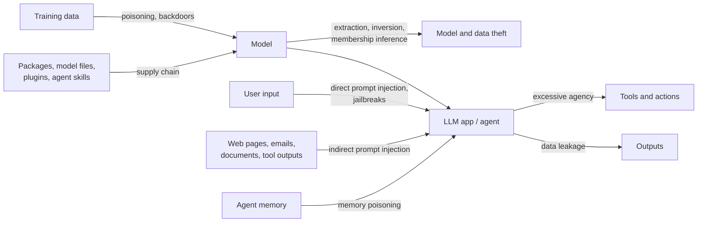

# AI and Cybersecurity: Study Notes

These are the study notes for the four notebooks of this track. They follow the notebook order: the threat landscape, securing AI-generated applications, AI for defence, and attacking and defending AI systems. Every term is defined the first time it appears. All the content is **defensive**: attacks are explained only at the level you need in order to recognise and stop them. Facts about the real world are marked as **verified** (described in a primary source: the organisation's own report, an official advisory, a CVE or a peer-reviewed paper) or **claimed** (stated by a vendor or lab, not yet checkable from outside). The picture is as of late 2026; this field moves quickly.

The three ways AI touches security, which organise the whole track:

---

## Part 1 · The AI-native threat landscape (notebook 01)

### Core vocabulary

| Term | Meaning | One-line example |
|---|---|---|
| **Confidentiality** | only authorised people can read data | a chatbot must not show one customer another's orders |
| **Integrity** | data and systems are not changed without permission | poisoned training data breaks integrity |
| **Availability** | systems work when needed | a flood of prompts that stalls an LLM API breaks availability |
| **Asset** | something of value | customer database, model weights |
| **Threat** | who or what could cause harm | a criminal group, a careless insider |
| **Vulnerability** | a weakness | a missing access check |
| **Exploit** | a method that uses a vulnerability | a crafted request that skips the check |
| **Risk** | likelihood x impact | likely and very damaging = top priority |
| **Zero-day** | a vulnerability without a fix, unknown to the defender | |
| **CVE** | public ID for a known vulnerability | CVE-2025-32711 (EchoLeak) |
| **Attack surface** | all the places an attacker can try | for AI apps: prompts, documents, tools, plugins, memory |

### Describing an attack

The **Cyber Kill Chain** (Lockheed Martin, 2011) splits an intrusion into seven steps: reconnaissance, weaponisation, delivery, exploitation, installation, command and control, actions on objectives. Break any link and the attack fails.

**MITRE ATT&CK** is a public catalogue of real attacker behaviour. **Tactics** are goals (14 in the Enterprise matrix: Reconnaissance, Resource Development, Initial Access, Execution, Persistence, Privilege Escalation, Defense Evasion, Credential Access, Discovery, Lateral Movement, Collection, Command and Control, Exfiltration, Impact). **Techniques** are the ways to reach them. Teams map incidents and detections onto it ("coverage mapping"). **MITRE ATLAS** does the same for attacks on AI systems.

### Defence in depth and zero trust

**Defence in depth**: several independent layers. If layers fail independently, the chance an attack passes all of them is the product of their miss rates; for example, illustrative miss rates of 10%, 50%, 5% and 30% give 0.075% overall. The catch is independence: one trick that beats several layers (fluent AI text beating both a filter and a human) makes the layers fail together.

**Zero trust** (NIST SP 800-207): never trust a request because it comes from "inside"; verify identity, device and context every time; grant least privilege for a short time; log everything. For AI: give each agent its own identity, minimal tools and short-lived credentials.

### How AI changes offence: what the evidence says

The consensus of independent sources (OpenAI's October 2025 report, Google's threat reports, the UK NCSC's 2025 assessment) is that **AI mostly speeds up existing attack playbooks**. The NCSC judged that AI will "highly likely" increase the volume and impact of intrusions through existing techniques up to 2027, and that fully automated end-to-end advanced attacks are "unlikely" before 2027. Several real firsts did appear in 2025-2026.

| Area | What changed | Verified evidence | Main defence |
|---|---|---|---|
| Reconnaissance | cheap target profiling from public data | listed in every major AI-lab misuse report | smaller public footprint, staff awareness |
| Phishing | fluent, personalised, any language, near-zero cost | Heiding et al. (arXiv:2412.00586): 54% clicks for fully AI-generated spear phishing, 54% for human experts, 12% for a generic control (101 participants) | phishing-resistant MFA (passkeys), link and login signals |
| Deepfake fraud / BEC | fake voices and faces of real people | Arup, Hong Kong 2024 (about US$25M, confirmed by the company); FBI IC3 PSA I-051525-PSA (May 2025); FinCEN FIN-2024-Alert004 | callback, code words, dual approval |
| Vulnerability discovery | faster bug finding for both sides | OSS-Fuzz AI fuzz targets (26 bugs incl. OpenSSL CVE-2024-9143, 2024); DARPA AIxCC final (54 of 63 planted bugs found, 43 patched, 18 real bugs, Aug 2025); Google GTIG's first AI-developed zero-day exploit seen in the wild (May 2026) | patch faster, use AI to find and fix first |
| Agentic attack tools | many intrusion steps with few human decisions | Anthropic (Nov 2025): espionage campaign using Claude Code against about 30 targets, AI did an estimated 80-90% of tactical work (single source); Google (May 2026): open-source agentic frameworks used by a suspected state actor | automated detection and response; basics remove easy paths |
| Malware | AI-assisted coding; some samples call an LLM while running | Google GTIG (Nov 2025): PROMPTSTEAL used in live operations; PROMPTFLUX judged experimental | behaviour-based detection, egress monitoring |
| Attacks on AI | new surface: prompts, tools, memory, plugins | EchoLeak CVE-2025-32711 (zero-click prompt injection, patched); Nx "s1ngularity" npm attack abused local AI CLIs to hunt for secrets (Aug 2025) | treat model inputs as untrusted, least privilege, human approval |
| Shadow AI / insiders | data leaves through unapproved AI tools; AI personas in hiring fraud | AI-assisted fraudulent remote IT-worker schemes in Anthropic (2025) and CrowdStrike (2026) reports | approved tools, DLP, clear policy |
| Supply chain | hallucinated and poisoned packages | Spracklen et al. (USENIX Security 2025): 19.7% average hallucinated packages across 16 models; Shai-Hulud npm worm (CISA alert, Sept 2025); LiteLLM AI-gateway compromise (GTIG, May 2026) | allowlists, pinning with hashes, scanning |

**Polymorphism claims vs reality.** "Self-rewriting AI malware" exists in early forms, but rewriting the code changes its hash, not its **behaviour**. Behaviour rules (what the program does on the machine) and network signals (an unusual process calling an AI API) still match.

**Hype vs reality on AI bug-hunting.** Verified results are real (AIxCC, OSS-Fuzz, Big Sleep), but unvalidated AI reports also flood maintainers: curl ended its bug bounty in January 2026, citing low-quality AI-generated reports. What counts is **validated** findings.

### The asymmetry debate

"The attacker needs one hole; the defender must close all." AI cuts both ways: attackers can try more, cheaper attacks; defenders own the code, logs and patch pipeline and can scan everything first. The NCSC warns of a **digital divide** between organisations that adopt AI for defence and those that do not. The window of exposure is roughly *days to patch minus days to exploit*; AI shrinks the second number, so defenders must shrink the first.

### Threat modelling an AI app: STRIDE + AI extension

**STRIDE**: Spoofing (authenticity), Tampering (integrity), Repudiation (accountability), Information disclosure (confidentiality), Denial of service (availability), Elevation of privilege (authorisation). Classic STRIDE-per-element: external entities get S and R; processes get all six; data stores get T, R, I, D; data flows get T, I, D.

**AI extension** (maps onto OWASP LLM01-LLM10 and ASI01-ASI10):

| AI threat | Applies to | OWASP | Mitigation |
|---|---|---|---|
| direct prompt injection / jailbreak | LLM | LLM01 | system prompt is not a boundary; enforce rules in code; output checks |
| indirect prompt injection | retrieved content, RAG store | LLM01, ASI01 | treat retrieved text as data; restrict tools after reading untrusted content |
| excessive agency / tool misuse | tool executor | LLM06, ASI02 | least-privilege tools, action allowlist, human approval |
| sensitive data in answers | LLM, RAG store | LLM02 | per-user retrieval access control, redaction |
| system prompt leakage | LLM | LLM07 | no secrets in prompts |
| knowledge-base poisoning | RAG store | LLM04, LLM08 | vetted sources, provenance, review of uploads |
| improper output handling | tools, API | LLM05 | schema validation, never eval model output |
| unbounded consumption | LLM, API | LLM10 | rate limits, token and cost budgets |
| supply chain | LLM, tools | LLM03, ASI04 | pinned and hashed dependencies, trusted model sources |
| misinformation | LLM | LLM09 | grounding, citations, escalation |

### Risk scoring

Score likelihood and impact from 1 to 5 using a written scale, multiply (1-25), and band: 1-4 low, 5-9 medium, 10-15 high, 16-25 critical. Fix the top first, then re-score (**residual risk**). Weakness: scores are judgements, and 1 x 5 equals 5 x 1. Richer methods (for example FAIR, which estimates monetary loss) exist for big decisions.

### Policy landscape (general)

Voluntary frameworks (NIST CSF 2.0, NIST AI RMF and AI 600-1, the NIST Cyber AI Profile draft), knowledge bases (ATT&CK, ATLAS, NIST AI 100-2, OWASP lists), certifiable standards (ISO/IEC 27001, ISO/IEC 42001), government guidance (secure AI development guidelines, CISA Secure by Design, the joint AI Data Security sheet), and laws (EU AI Act with general-purpose AI rules applying since August 2025 and high-risk deadlines postponed in 2026; EU NIS2; the EU Cyber Resilience Act; data-protection laws; computer-misuse laws). AI labs also publish threat reports and run identity-verified "trusted access" programmes for defenders.

---

## Part 2 · Securing vibe-coded applications (notebook 02)

**Vibe coding** means building software mostly by describing it to an AI assistant and accepting the code it writes, often without reading it closely. It is fast, and the code usually **works**, but working is not the same as **safe**.

Why AI-written apps often ship with holes:
- models learn from public code, which contains many insecure patterns;
- the prompt asks for a feature, not for security, so the model optimises for "it runs";
- generated apps often wire a front end straight to a hosted database or backend service, and the access rules are left at insecure defaults;
- the person accepting the code may not know what to check.

Studies from 2021-2025 (for example Pearce et al., "Asleep at the Keyboard?", IEEE S&P 2022, and Veracode's 2025 GenAI Code Security Report) repeatedly found that a large share of AI-generated code samples contained known weakness types; the exact rates depend on the study, language and model. Real incidents in 2025-2026 included generated apps whose databases had no row-level access rules, so any visitor could read other users' data.

The most common mistake families, and their fixes:

| Mistake | Simple meaning | Fix |
|---|---|---|
| secrets in code or in the browser | API keys pasted into source or shipped to the client | environment variables, secret manager, server-side calls, secret scanning, rotate on leak |
| missing authorisation checks | the app checks *who you are* but not *whether this record is yours* | object-level checks on every request; deny by default |
| no row-level security | the database lets any client read any row | turn on row-level security (RLS) policies, test them |
| injection | user input becomes part of a query or command | parameterised queries, no shell strings, input validation |
| unsafe defaults | debug mode on, open CORS, public storage buckets | secure configuration checklist |
| weak session and password handling | plain or fast hashes, long-lived tokens | slow salted hashes, short-lived tokens, MFA |
| hallucinated or look-alike packages (slopsquatting) | the assistant suggests a package that does not exist, or one an attacker registered | allowlist, check age and maintainers, pin with hashes |
| trusting the coding agent's environment | project files or rules files with hidden instructions steer the assistant | review rule files, limit agent permissions, no auto-approve |

**SAST** (static application security testing) analyses source code without running it; **DAST** (dynamic testing) probes the running app (your own, in staging); **SCA** (software composition analysis) checks dependencies. A good habit is a **secure prompt**: ask the assistant explicitly for parameterised queries, authorisation checks, secrets from the environment and tests, then verify rather than trust.

---

## Part 3 · AI for cyber defence (notebook 03)

### The SOC

A **security operations centre** collects logs into a **SIEM**, runs detections, triages **alerts**, investigates and responds. **EDR** watches endpoints; **SOAR** automates playbooks; **containment** means isolating hosts, disabling accounts or blocking IPs.

### Phishing detection and defence in depth

TF-IDF + logistic regression is fast and explainable, but learns the **wording** of past phishing. Rewording (which LLMs make effortless) drops its recall sharply. Independent layers restore detection: **URL structure** (raw IP, plain http, punycode, unknown or very young domain, sign-in path, brand name in a subdomain), **sender checks** (an "executive" display name from an outside address), and in production **email authentication** (SPF, DKIM, DMARC) and reputation. Adversarial training helps against known rewordings only. Phishing-resistant MFA limits the damage of any miss.

### Malware family classification

Static features (size, **entropy**, imports, sections, signature, rare API imports, embedded strings) feed a tree ensemble. EMBER (Anderson and Roth, 2018) is the public research dataset of this kind. Treat the output as a triage hint; packing and **concept drift** reduce real-world accuracy; confirm with sandbox (dynamic) analysis.

### Login, user and network anomalies

| Pattern | Rule | ML complement |
|---|---|---|
| brute force | 10+ failures, one user, one IP, 10 minutes | high fail ratio per user-day |
| credential stuffing | one IP, 10+ users, one hour | best caught per IP, not per user |
| impossible travel | > 500 km and > 900 km/h between successful logins (watch out for VPNs) | "away from home" feature |
| odd-hour login from a new place | hard to write as a rule | IsolationForest on user-day features |
| unusual volume for one person | global thresholds fail | **UEBA**: z-score against the user's own baseline |
| port scan, large upload | per-host counts and bytes | IsolationForest on per-host aggregates (log scale) |
| beaconing | coefficient of variation of connection gaps below about 0.1 | rare destinations, domain age |

**IsolationForest** isolates unusual points with fewer random splits; it needs no labels. Rules and ML catch different things, so run both.

### LLMs for threat intel and detection engineering

Extract IOCs with regular expressions (refang `hxxp` and `[.]` for matching only); let the LLM write prose; **verify every IOC it mentions** against the source, since models can invent them. For **Sigma** (log rules in YAML) and **YARA** (file pattern rules), the LLM drafts, you **backtest** on historical logs (true positives, false positives, misses), a human with business context reviews, then deploy as experimental and monitor.

### A guarded SOC agent

Guardrails that hold even when the model is fooled: **severity floors** set by rules (the model may raise, never lower); **action tiers** (read-only automatic, containment needs approval); **scope checks** (targets must appear in the alert); **audit logging**. Pattern scanners for planted instructions are one layer only, because they are easy to evade.

### Evaluation in security

Recall = TP / (TP + FN); precision = TP / (TP + FP); false-positive rate = FP / (FP + TN).

**Base-rate fallacy** (Axelsson, 2000): 1,000,000 events, 10 attacks, 99% detection and 1% false positives give about 9.9 true alerts and 10,000 false ones, a precision of about 0.1%. A detector that never alerts has 99.999% accuracy. So report precision, recall and alerts per day, and pick thresholds that fit analyst capacity. **Alert fatigue** (analysts ignoring floods of false alerts) is a real cause of missed incidents.

### Deepfake and voice-clone fraud: process controls

Callback on a directory number, pre-agreed code words, dual approval above a limit, a waiting period and second-channel confirmation for new bank details, and a culture where urgency and secrecy are reasons to slow down. None of these needs to detect the fake.

---

## Part 4 · Attacking and defending AI systems (notebook 04)

AI systems add attack surface at every stage of their life:

| Attack family | Simple meaning | Main defences |
|---|---|---|
| **Direct prompt injection / jailbreak** | the user types instructions that override the app's rules | enforce rules in code, input and output classifiers, refuse-by-policy, monitoring |
| **Indirect prompt injection** | instructions hidden in content the AI reads | treat content as data, separate privileges after reading untrusted text, output checks, human approval |
| **Agent goal hijack and tool misuse** (ASI01, ASI02) | injected text makes an agent use its tools for the attacker | least privilege, allowlists, scope checks, approval for risky actions |
| **Memory and context poisoning** (ASI06) | false facts planted in long-term memory affect later sessions | memory provenance, review, expiry |
| **Data and model poisoning, backdoors** (LLM04) | corrupted training or fine-tuning data plants hidden behaviour | data provenance, filtering, evaluation on trigger sets |
| **Model extraction / distillation** | copying a model by querying it heavily | rate limits, query monitoring, watermarking |
| **Membership inference, model inversion** | learning whether a person was in the training data, or reconstructing data | differential privacy, output limits (see [privacy](../../19_AI_Ethics_and_Safety/03_privacy.ipynb)) |
| **Adversarial examples (evasion)** | tiny input changes that flip a classifier | adversarial training, input preprocessing (see [adversarial attacks](../../19_AI_Ethics_and_Safety/02_adversarial_attacks.ipynb)) |
| **AI supply chain** (LLM03, ASI04) | malicious model files, packages, plugins, agent skills, gateways | trusted sources, safe formats (no unsafe deserialisation), signing, scanning |
| **Unbounded consumption** (LLM10) | floods of expensive requests ("denial of wallet") | quotas, budgets, timeouts |

**Red-teaming** an AI system means authorised, structured attempts to make it fail, with findings tracked and re-tested (see [red-teaming and incident response](../../19_AI_Ethics_and_Safety/09_industry_ai_incident_response_and_red_teaming.ipynb)). The guiding principle: **no single filter stops prompt injection**, so design so that a fooled model cannot do much harm.

---

## One-page cheat sheet

| Question | Short answer |
|---|---|
| What does AI change most in attacks today? | speed, scale and quality of existing playbooks |
| What is genuinely new? | attacks on AI systems, agentic intrusion tooling, LLM-calling malware (early) |
| Best control against AI phishing? | phishing-resistant MFA plus link, sender and login signals |
| Best control against deepfake fraud? | callback, code words, dual approval |
| Why behaviour-based detection? | code changes, behaviour stays |
| Biggest risk in vibe-coded apps? | missing access control and exposed secrets |
| How to use AI in a SOC safely? | AI suggests, humans approve containment; inputs are untrusted data |
| Why not accuracy? | base-rate fallacy: rare attacks make false positives dominate |
| How to treat headline statistics? | find the primary source and its caveats; separate verified from claimed |

## Key sources

- Google Threat Intelligence Group, AI Threat Tracker reports (2025-2026); Anthropic threat reports (Aug 2025, Nov 2025); OpenAI "Disrupting malicious uses of AI" (2024-2026); Microsoft Digital Defense Report 2025; CrowdStrike 2026 Global Threat Report; UK NCSC "Impact of AI on cyber threat from now to 2027".
- DARPA AIxCC results (2025); Google OSS-Fuzz AI fuzzing (2024) and Big Sleep (2024-2025); Anthropic Project Glasswing (2026, claims partly verifiable).
- OWASP Top 10 for LLM Applications 2025; OWASP Top 10 for Agentic Applications 2026; MITRE ATT&CK and ATLAS; NIST CSF 2.0, AI RMF, AI 100-2 E2025, IR 8596 draft, SP 800-207; ISO/IEC 42001; CISA Secure by Design.
- Heiding et al. 2024 (arXiv:2412.00586); Spracklen et al., USENIX Security 2025; Zhang et al., Cybench (arXiv:2408.08926); Pearce et al., IEEE S&P 2022; Anderson and Roth, EMBER (arXiv:1804.04637); Liu, Ting and Zhou, Isolation Forest (ICDM 2008); Axelsson, base-rate fallacy (ACM TISSEC 2000).
