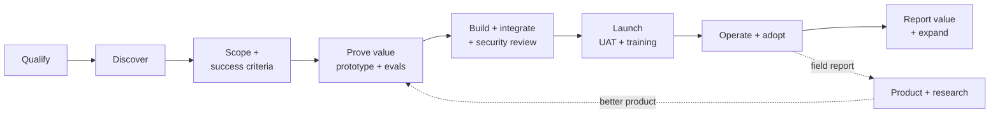
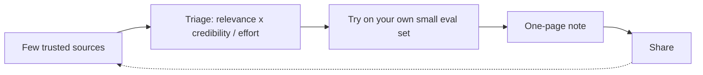
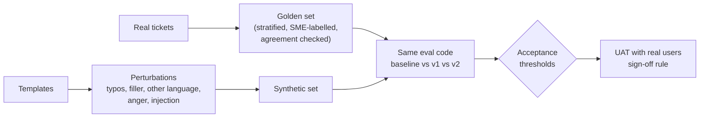
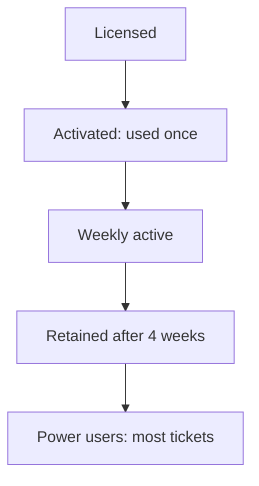
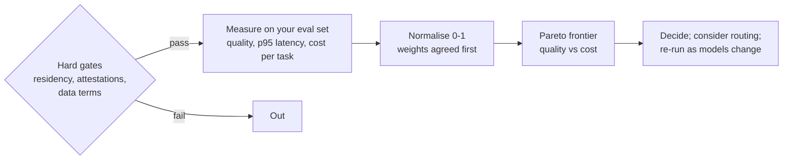

# Applied AI and Forward Deployed Engineering

This is the study guide for the module's three notebooks. It explains the ideas in plain words, with diagrams and tables, so you can revise without running code. The notebooks contain the runnable versions: every matrix, plan, eval, connector, checklist and value case below is built there with pandas and small mocks.

The life of one AI deployment, which the whole module follows:



---

## Part 1 · Roles and how AI work gets done (notebook 01)

### Reading any AI role

A **role** is a bundle of responsibilities; a **job title** is one company's label for it. Read any role with three questions:

1. **Who is the main customer of the work?** An external customer, product users, or internal engineers.
2. **How close to the model is it?** Using models through APIs, adapting them (prompts, fine-tuning, evals), or building and serving them (training, GPUs).
3. **What is the main output?** A deployed solution, a feature, a platform, a model, a decision or an agreement.

### The roles in one table

| Role | One-line description | Main outputs |
|---|---|---|
| Forward deployed engineer (FDE / FDSE) | Engineer embedded with a customer, delivering a production outcome | Deployment, integrations, evals, runbooks, field reports |
| Deployment strategist / delivery lead | Owns the problem, plan, adoption and value with the customer | Use-case shortlist, success plan, training, value reports |
| Applied AI engineer | Turns model capabilities into reliable solutions | Prompt/agent/RAG code, eval suites, reference implementations |
| LLM engineer | Adapts and benchmarks models | Fine-tuned variants, training data, benchmarks |
| ML engineer | Trains and maintains production models | Models, feature pipelines, monitoring |
| MLOps / LLMOps / ML platform engineer | Builds the path to production | Pipelines, LLM gateway, IaC, dashboards |
| AI infrastructure / inference engineer | Makes serving fast, cheap and reliable | Serving stack, benchmarks, capacity plans |
| Evals engineer | Owns how quality is measured | Eval datasets, graders, release gates |
| Solutions architect / applied AI architect | Designs how the solution fits the customer's world | Architectures, security review answers |
| Solutions / sales engineer | Technical partner before the purchase | Demos, POCs, RFP answers, technical win |
| AI deployment / implementation engineer | Installs and configures a standard product | Configured tenant, go-live checklist |
| AI product engineer | Ships AI features inside a product | Features, experiments, product metrics |
| AI product manager | Decides what to build and what "good" means | Specs, quality bar, roadmap, launch plan |
| Technical account manager / customer engineer | Long-term technical partner after go-live | Health reports, escalations, success plans |
| Research engineer / applied scientist | Improves methods and models | Experiments, models, eval methods, write-ups |

**Similar roles, told apart by timing and customisation:** the sales engineer works *before* the purchase on demos and POCs; the solutions architect designs the fit; the FDE builds custom production solutions; the implementation engineer configures a standard product; the TAM keeps value flowing long after go-live.

### RACI

**R**esponsible does the work, **A**ccountable owns the outcome (exactly one per activity), **C**onsulted gives input, **I**nformed is told the result. Every activity needs at least one R. The customer should be **accountable** for prioritisation, success criteria and UAT sign-off. In small teams one person holds many letters. Watch for overload, and for "A/R" cells, where the same person does the work and signs it off, so nobody reviews it.

### Skills maps and a learning plan

Notebook 01 links 40 skills to 84 notebooks in this repo and maps each role to its core skills. The skills shared by most roles are Python for production, LLM evaluation, customer engagement, security for AI apps, statistics and A/B tests, and data storytelling. Learn those first; they are useful in every role.

### Staying current



Source tiers: **primary** (release notes, model and system cards, docs, papers, code), **practitioner** (engineering blogs, newsletters, podcasts by builders), **social** (fast but noisy; use it to find things, then check them in primary sources). Keep a **personal eval set** of 20-50 tasks from your own work and record the quality and cost of every new model or technique on it.

### Portfolio and STAR

A **deployed** project runs somewhere other than your laptop, is used by people other than you, and is measured: baseline, eval results, cost, latency and honest failure analysis.

**STAR** = Situation, Task, Action, Result (+ Learning). A common guide is about S 20%, T 10%, A 60%, R 10%. Use "I" for your own actions, give measured results, and show a decision or trade-off. Keep a story bank tagged by theme: failure, disagreement, customer under pressure, influence without authority, ambiguity, saying no.

---

## Part 2 · Forward deployed engineering in practice (notebook 02)

### The model

**Forward deployed engineering** means engineers work directly with a customer, often inside the customer's environment, to make a product solve that customer's most important problems in production. Palantir made it well known. Its "Deltas" (forward deployed software engineers) work on *one customer, many capabilities*, while "Devs" (product engineers) work on *one capability, many customers*. Deployment strategists ("Echoes") own the problem, the stakeholders and adoption. Work that proves useful at several customers is generalised into the platform.

| | Product engineering | Consulting | Forward deployed engineering |
|---|---|---|---|
| Builds for | All customers | One customer | One customer now, all customers later |
| Output | Features | Custom project | Production outcome + reusable patterns + field feedback |
| Risk | Builds what nobody needs | Unmaintainable custom code | The services trap |

**Pitfalls:** the *services trap* (every deal is custom work and the product never improves), *pilot purgatory* (pilots that never end), *hero deployments* (nothing written down), and building what was asked instead of what is needed.

### Discovery

Interview people at every level (sponsor, managers, front-line users, IT and security). **Shadow** 3-5 users, including a new joiner and an expert. Time each step and note the workarounds. Map the **as-is** and **to-be** workflow. Build a **data inventory**: for each source, record the owner, access path, sensitivity, volume, quality and whether access has been granted. Access requests often take weeks, so start them in week 1.

Write down which definition each baseline uses. In notebook 02 the time study gives about 7.2 minutes of active work, while helpdesk timestamps give 8.6 minutes, because they include waiting and switching.

### Prioritisation and scoping

`priority = w_impact * impact + w_feasibility * feasibility - w_risk * risk`, with the weights agreed before scoring. Check the ranking is **robust**: perturb the weights many times and count how often the top choice stays on top.

A **statement of work (SOW)** has: objective, in scope, **out of scope**, deliverables, milestones, roles, assumptions and dependencies, acceptance criteria, and change control. Compute the **critical path** with a forward pass (earliest start and finish) and a backward pass (latest finish). **Slack** = latest finish - earliest finish, and the critical tasks are the ones with zero slack. In notebook 02 the security review is critical and the model work has slack.

### Success criteria and the path to production

| Type | Example |
|---|---|
| Primary | Handling time on eligible tickets: 8.6 min baseline, target 7.0 min or less |
| Guardrail | Satisfaction no more than 2 points lower; reopen rate no more than 1 point higher |
| Quality | Intent accuracy at least 90%, correct article at least 85% |
| Safety | Must-escalate recall at least 98% |
| Adoption | At least 70% of pilot agents active weekly |

| Stage | Question | Exit criteria |
|---|---|---|
| POC | Can it work technically? | Core technical risk retired |
| POV | Does it create measurable value on real data? | Eval thresholds met |
| Pilot | Does it work in the real workflow? | Metric vs **control group**; guardrails hold; users keep using it |
| Production | Can it run reliably and be owned by the customer? | SLOs, runbooks, monitoring, named owner |

Write every gate, with its decision owner, at the start. A one-page **mutual success plan** (also called a mutual action plan) lists the goals, criteria, dated milestones with owners on both sides, and the decision at the end.

### Prototypes and demo hygiene

Build a **thin slice** through the whole system on real, approved data, with evals from day one. For demos: get permission for any data you show, rehearse on the same network, keep a recorded backup, reset state before each run, keep secrets and notifications off screen, show one failure and how it is handled, say what is mocked, and end with the decision you need.

### Evaluation with the customer



- **Golden set:** sample real data stratified by type, have subject-matter experts label it, and check label agreement with Cohen's kappa. Freeze and version the set, and add every new production failure to it.
- **Synthetic cases:** templates plus perturbations. *Invariance* tests (a typo must not change the answer) and *directional* tests (an angry threat must change the outcome to escalate) come from the CheckList method. Report real and synthetic results separately.
- **Thresholds:** per metric and per slice, agreed in advance.
- **UAT:** scenarios from the workflow map, testers, pass/fail/blocked with severity, and a sign-off rule (for example: all critical scenarios pass, no open sev1/sev2, at least 90% pass).

### Integration patterns

| Pattern | Key habits |
|---|---|
| REST pull | Auth, pagination (follow the cursor to the end), rate limits (429 + Retry-After) |
| Webhooks | HMAC over timestamp + body, constant-time compare, timestamp tolerance against replay, dedupe on event id (delivery is at least once), acknowledge fast and process async |
| Writes with retries | Retry only temporary errors with exponential backoff + **full jitter**; send an **idempotency key** per logical operation |
| CRM / ticketing / ERP | Field mapping, custom objects, service-account permissions, sandbox vs production |
| Healthcare | **FHIR** resources (Patient, Encounter, Observation with LOINC codes, references like `Patient/123`); PHI rules; synthetic data for development |
| Identity | **SSO** with **SAML 2.0** (XML assertions) or **OIDC** (JSON ID tokens on OAuth 2.0; check signature, `iss`, `aud`, `exp`, `nonce`); **SCIM 2.0** to create, update and deactivate users from the IdP |
| Batch files / SFTP | Data file + manifest (row count, SHA-256), wait for the manifest, verify, quarantine bad files, keep a ledger of processed checksums so re-sent files are skipped |

### Deployment options

| Option | Choose when |
|---|---|
| SaaS (multi-tenant) | Fastest start; data may leave the customer's network |
| Single-tenant | Stronger isolation needed |
| Customer VPC / BYOC | Data must stay in the customer's cloud account |
| The customer's cloud AI service | Existing cloud contract, regions and controls |
| On-premises | Strict control, existing hardware, low latency to on-site systems; the customer can operate GPUs |
| Air-gapped | No internet allowed (defence, intelligence, critical infrastructure) |
| Hybrid | Parts of the system need to sit in different places |

Apply the hard constraints first, then pick the simplest option that meets them.

### Security and procurement (general, not legal advice)

- **Questionnaires:** SIG (Core and Lite) from Shared Assessments, and CAIQ from the Cloud Security Alliance (it is part of the Cloud Controls Matrix). A trust centre page with ready answers saves weeks.
- **SOC 2:** an *attestation* against the AICPA Trust Services Criteria. Type I covers design at a point in time; Type II covers operating effectiveness over a period (commonly 3-12 months).
- **ISO/IEC 27001** (information security) and **ISO/IEC 42001** (AI management system) are *certifications*.
- **FedRAMP** (Low / Moderate / High, moving to FedRAMP 20x) and **DoD impact levels** (IL2 public, IL4 CUI, IL5 higher-sensitivity CUI and mission data, IL6 classified) are *authorisations*. US states and cities use StateRAMP / GovRAMP.
- **Data protection:** a DPA (GDPR Article 28) with a subprocessor list, data residency, retention, and whether customer data is used for training. **HIPAA** applies to PHI and needs a **BAA**.
- **Shared responsibility:** no vendor report covers the customer's own controls.

### Training, handover and adoption

- **Workshops:** short concepts, mostly hands-on labs, environments prepared in advance, and train-the-trainer.
- **Runbook:** what the system does, dependencies, dashboards, alerts with first actions, rollback, escalation. Write it while building, then hand over by shadowing and reverse shadowing.
- **ADKAR** (individual change): Awareness, Desire, Knowledge, Ability, Reinforcement. **Kotter's 8 steps** (organisational change): urgency, guiding coalition, vision, volunteer army, remove barriers, short-term wins, sustain acceleration, institute change.
- **Champions, feedback loops, honest framing.** Measure an **adoption funnel** per team: licensed, activated, weekly active, retained, plus depth of use (power users).



### Stakeholders, partners and field reports

- **Stakeholder map:** power x interest gives four quadrants (manage closely, keep satisfied, keep informed, monitor). Note each person's attitude (supporter, neutral, sceptic) and what they care about.
- **Status updates:** status, what changed, metrics vs target, risks with owners, decisions needed, next steps. Send the same shape every week.
- **Systems integrators:** add the SI as a column in the RACI, enable them with playbooks and evals, keep one shared quality bar, and report product gaps instead of building workarounds.
- **Field report:** one issue, evidence and numbers, impact, workaround, the ask and its urgency. Aggregate across customers: a gap seen at three customers is a product priority.

### Value case

```
time value per month   = assisted tickets x minutes saved / 60 x loaded cost per hour
run cost per month     = tokens + platform fee + operations people
net per month          = time value + deflection value - run cost
payback (months)       = one-time cost / net per month
NPV (3 years)          = -one-time cost + sum of discounted monthly net values
```

Use measured pilot numbers (with a control group and a confidence interval). Run a **tornado sensitivity** analysis: move each input by ±20% and see how much the result changes. Say whether saved time becomes capacity or cash.

### On-site work

Plan visits around the moments that need presence: discovery, workshops, go-live and hypercare, executive reviews. Follow the customer's rules on badges, devices and data. Prepare access in advance, send written summaries within a day, and agree a sustainable travel rhythm.

---

## Part 3 · AI product strategy and business skills (notebook 03)

### AI product management

| If the task... | Usually best tool |
|---|---|
| has clear, stable rules | Code or rules |
| is a prediction from structured, labelled data | Classic ML |
| needs language or document understanding with variety | An LLM (+ retrieval) |
| needs several tool-using steps not known in advance | An agent with limits and checks |
| must be correct every time, and mistakes are very costly | AI suggests, a person or rule decides |

- **Defining quality:** read 50-100 real outputs, note the failures, group them into a **failure taxonomy**, count them and rate their severity, then turn the top modes into eval checks.
- **Eval-driven roadmap:** each item names a failure mode, a fix, the effort, and an eval slice with a target. Rank by expected gain per week.
- **Human in the loop:** suggest, approve, auto with a review sample, auto with a confidence gate, or escalate. Choose the lowest confidence threshold whose error rate on automated cases stays within the **error budget**. This needs calibrated confidence.

### Pricing

| Model | Risk |
|---|---|
| Per seat | Heavy users can make the margin negative |
| Usage | Bills are hard for customers to predict |
| Outcome (per resolved task) | Needs a precise, measurable definition of "outcome" |
| Hybrid | More complex to explain |

Track **cost per task** next to quality, and check gross margin across light, typical and heavy customers.

### Build vs buy vs partner

Build differentiators and buy commodities. Score the options with weighted criteria (fit, time to value, cost, control, maintainability, lock-in, security effort). Compare 3-year **TCO**: one-time cost plus monthly run cost (people, usage, infrastructure, reviews, training). Prefer the option with the **least operational responsibility** that meets the requirements. Write down the trigger that would change the decision. In notebook 03 the cheapest option moves from buy, to partner, to build as volume grows.

### Vendor and model evaluation



### Strategy and governance

- **Centre of excellence models:** centralised (consistent but a bottleneck), hub-and-spoke (the hub owns the platform, standards and governance; the spokes build use cases), federated (fast but uneven).
- **Portfolio:** quick wins, core projects and a few big bets, chosen under a budget and a risk limit. Look for **shared platforms** (for example retrieval) needed by several use cases.
- **Governance:** an acceptable-use policy, a model and use-case inventory, **risk tiers** with matching controls, review boards for high-risk uses, and incident handling. References: NIST AI RMF (Govern, Map, Measure, Manage), ISO/IEC 42001, EU AI Act risk categories.

### Pre-sales and go-to-market

- **Technical win:** the customer's technical evaluators agree the product meets their requirements. The commercial decision usually comes after.
- **RFI** (information, shortlist), **RFP** (detailed proposals against requirements), **RFQ** (prices for a defined need). Answer an RFP with a **compliance matrix**: full / partial / roadmap / no, with evidence.
- **POC success plan:** goal, scope, measurable criteria, out of scope, timeline, owners on both sides, and the decision at the end.
- **Roles:** AE (owns the deal), SDR/BDR (first meetings), SE (pre-sales technical), SA (solution design), CSM (adoption and renewal), TAM (technical partner after the sale), partner manager.
- **Sales stages:** prospecting, then discovery and qualification, solution and demo, technical evaluation, proposal and negotiation, procurement / legal / security, closed, and finally onboarding, adoption, renewal and expansion.
- **BANT:** Budget, Authority, Need, Timeline. **MEDDICC:** Metrics, Economic buyer, Decision criteria, Decision process, Identify (implicate) pain, Champion, Competition; **MEDDPICC** adds Paper process. Several letters are technical: the metrics become success criteria, the decision criteria are often technical requirements, and the paper process includes the security review.

### Competitive analysis

Map the alternatives, including in-house builds and doing nothing. Compare on the criteria customers actually use, with dated evidence. Find where you lead and where you trail against the average alternative, and position "for whom". Never disparage competitors or use their confidential information, and say plainly when another option fits a customer better.

### Presenting and writing

- **Pyramid principle:** the answer first, then 2-4 supporting points, each with evidence.
- **SCR:** Situation, Complication, Resolution.
- **Demo structure:** the problem, the before, the after on a real case, one handled failure, the numbers, the decision.
- **Executive one-pager:** the recommendation, 3-5 points compared with targets, honest gaps with confidence intervals, risks, and the decision needed with an owner and a date. Generate it from the data so the numbers always match.

| Document | Purpose |
|---|---|
| Design doc | Agree how to build before building: goals, **non-goals**, design, **alternatives considered**, evaluation, security and cost, rollout, risks |
| RFC / RFD | Propose a change and gather comments from a wider group |
| ADR | Record one decision: status, context, decision, consequences |
| Reference architecture | A reusable approved design for a common need |
| Narrative memo (six-pager) | A decision document read silently at the start of a meeting |

---

## Engagement checklist

- [ ] Sponsor and outcome named; RACI written, with the customer accountable for success criteria
- [ ] Shadowed at least 3 users; time study and as-is / to-be maps
- [ ] Data inventory; access requests sent in week 1
- [ ] Use cases scored with agreed weights; ranking robust
- [ ] SOW with out-of-scope list, dependencies and acceptance criteria; critical path known
- [ ] Success criteria with baselines, guardrails, thresholds, control group and decision owner
- [ ] Path to production with gates written down
- [ ] Golden set (stratified, labels checked) + synthetic perturbations; results reported separately
- [ ] Integrations: signed webhooks, idempotent retries, pagination, SSO + SCIM, file manifests
- [ ] Deployment option chosen from hard constraints
- [ ] Security package sent in week 1; blockers tracked to closure
- [ ] UAT sign-off rule met
- [ ] Runbook, handover, hypercare end date
- [ ] Adoption funnel per team; champions; feedback loop
- [ ] Field report filed; value case updated with measured numbers and sensitivity

---

## Glossary

| Term | Meaning |
|---|---|
| ADKAR | Prosci's model of individual change: Awareness, Desire, Knowledge, Ability, Reinforcement |
| ADR | Architecture decision record: a short note recording one decision and why |
| Air-gapped | Running with no network connection to the internet |
| BAA | Business associate agreement, needed under HIPAA when a vendor handles PHI |
| BYOC / customer VPC | Vendor software running inside the customer's own cloud account and network |
| CAIQ | Cloud Security Alliance's yes/no questionnaire, part of the Cloud Controls Matrix |
| Champion | A respected insider who supports the change and helps colleagues |
| Critical path | The longest chain of dependent tasks; any delay on it delays the end date |
| Deployment strategist | The business-facing partner of an FDE who owns the problem, plan and adoption |
| DPA | Data processing agreement setting how a vendor processes personal data |
| FDE / FDSE | Forward deployed (software) engineer |
| FedRAMP | US federal authorisation programme for cloud services (Low, Moderate, High) |
| FHIR | HL7's standard for exchanging health data as resources |
| Field report | A short, evidence-based write-up of what a deployment learned, for product and research |
| Golden set | A frozen, expert-labelled eval set built from real data |
| Idempotency key | A unique id per logical operation, so a retry does not run it twice |
| Impact level (IL) | DoD cloud authorisation level by data sensitivity (IL2, IL4, IL5, IL6) |
| MEDDICC / MEDDPICC | A deal-qualification checklist (see Part 3) |
| Mutual success plan | A one-page plan agreed by both sides: goals, criteria, milestones, owners, decision |
| OIDC | OpenID Connect: SSO with JSON ID tokens on top of OAuth 2.0 |
| Pilot purgatory | Pilots that never reach production because criteria, owners or the path were not agreed |
| POC / POV | Proof of concept (can it work?) / proof of value (does it create measurable value on real data?) |
| RACI | Responsible, Accountable, Consulted, Informed |
| RFI / RFP / RFQ | Request for information / proposal / quotation |
| Runbook | Step-by-step instructions for operating one system |
| SAML | XML-based SSO standard |
| SCIM | Standard API for provisioning and deprovisioning user accounts |
| Services trap | Every deployment needs custom work and the product never improves |
| SIG | Shared Assessments' standard security questionnaire (Core and Lite) |
| SOC 2 Type I / II | Auditor attestation on controls: design at a point in time / operation over a period |
| SOW | Statement of work: objectives, scope, deliverables, milestones, acceptance |
| Technical win | The customer's technical evaluators agree the product meets their requirements |
| TCO | Total cost of ownership over a period, including hidden costs |
| UAT | User acceptance testing by the customer's own users, ending in sign-off |
